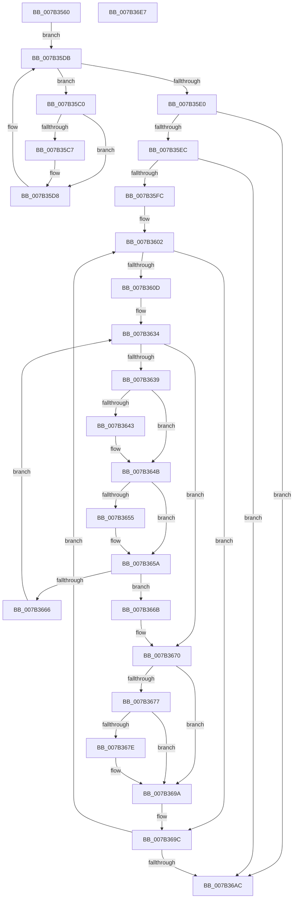

# WmipEnumerateGuids

- RVA: `0x007B3560`–`0x007B36E8` (길이 `392` bytes)
- VA: `0x00000001407B3560`
- 실행 섹션: `PAGE`
- PDB 이름 있음: `예`; PDB Function 태그: `아니요`
- unwind 정보 RVA: `0x00084C9C`
- 디코드: `104`개 명령, `392/392` bytes 표시
- 미해석 바이트: `0` (있으면 어셈블리에 `.byte`로 보존)

> 이 문서는 커널 이미지의 기계어와 PDB 기호를 분석해 생성했습니다. 4번과 5번은 함수 원형과 자료형을 바이너리 사용 방식에서 추정한 C 해석이며 원본 소스 복구 결과는 아닙니다.

## 1. Dependencies

- 직접 호출 지점: **2**; 고유 호출 대상: **2**
- 직접 호출자로 확인된 함수: **1**
- RIP 상대 이미지 참조: **2**

### Outgoing calls
- `0x007B35AF` → [KeWaitForSingleObject](../../text/20/KeWaitForSingleObject_function_0020E6B0.md) (function, `0x0020E6B0`)
- `0x007B36B5` → [KeReleaseMutex](../../text/39/KeReleaseMutex_function_00396810.md) (function, `0x00396810`)

### Direct callers
- [WmipIoControl](../9D/WmipIoControl_function_009DEBD0.md) at `0x009DF10C`

### Static image references
- `0x007B3594` → RVA `0x00EFFA60` (`.data`; read)
- `0x007B35B4` → RVA `0x00EFFB28` (`.data`; read)

## 2. Other-region calls and transfers

- 다른 실행 섹션으로 향하는 call: **2**
  - `0x007B35AF` → [KeWaitForSingleObject](../../text/20/KeWaitForSingleObject_function_0020E6B0.md) (`PAGE` → `.text`)
  - `0x007B36B5` → [KeReleaseMutex](../../text/39/KeReleaseMutex_function_00396810.md) (`PAGE` → `.text`)
- 별도 외부 분기/꼬리 이동을 확인하지 못했습니다.

## 3. Assembly (complete function range)

```asm
007B3560  4C 8B DC                        mov r11, rsp
007B3563  49 89 5B 08                     mov qword ptr [r11 + 8], rbx
007B3567  49 89 6B 10                     mov qword ptr [r11 + 0x10], rbp
007B356B  49 89 73 18                     mov qword ptr [r11 + 0x18], rsi
007B356F  57                              push rdi
007B3570  41 56                           push r14
007B3572  41 57                           push r15
007B3574  48 83 EC 30                     sub rsp, 0x30
007B3578  41 83 C0 F8                     add r8d, -8
007B357C  48 8B FA                        mov rdi, rdx
007B357F  33 DB                           xor ebx, ebx
007B3581  4D 8B F9                        mov r15, r9
007B3584  49 21 5B D8                     and qword ptr [r11 - 0x28], rbx
007B3588  8B E9                           mov ebp, ecx
007B358A  48 B8 8F E3 38 8E E3 38 8E E3   movabs rax, 0xe38e38e38e38e38f
007B3594  48 8D 0D C5 C4 74 00            lea rcx, [rip + 0x74c4c5]
007B359B  49 F7 E0                        mul r8
007B359E  33 F6                           xor esi, esi
007B35A0  45 33 C9                        xor r9d, r9d
007B35A3  4C 8B F2                        mov r14, rdx
007B35A6  45 33 C0                        xor r8d, r8d
007B35A9  49 C1 EE 05                     shr r14, 5
007B35AD  33 D2                           xor edx, edx
007B35AF  E8 FC B0 A5 FF                  call 0x14020e6b0
007B35B4  4C 8B 05 6D C5 74 00            mov r8, qword ptr [rip + 0x74c56d]
007B35BB  4D 8B 08                        mov r9, qword ptr [r8]
007B35BE  EB 1B                           jmp 0x1407b35db
007B35C0  FF C6                           inc esi
007B35C2  41 3B DE                        cmp ebx, r14d
007B35C5  73 11                           jae 0x1407b35d8
007B35C7  41 0F 10 41 48                  movups xmm0, xmmword ptr [r9 + 0x48]
007B35CC  48 8D 0C DB                     lea rcx, [rbx + rbx*8]
007B35D0  FF C3                           inc ebx
007B35D2  F3 0F 7F 44 8F 08               movdqu xmmword ptr [rdi + rcx*4 + 8], xmm0
007B35D8  4D 8B 09                        mov r9, qword ptr [r9]
007B35DB  4D 3B C8                        cmp r9, r8
007B35DE  75 E0                           jne 0x1407b35c0
007B35E0  81 FD 60 41 22 00               cmp ebp, 0x224160
007B35E6  0F 85 C0 00 00 00               jne 0x1407b36ac
007B35EC  49 8B 08                        mov rcx, qword ptr [r8]
007B35EF  33 F6                           xor esi, esi
007B35F1  33 DB                           xor ebx, ebx
007B35F3  49 3B C8                        cmp rcx, r8
007B35F6  0F 84 B0 00 00 00               je 0x1407b36ac
007B35FC  41 BA 00 10 08 00               mov r10d, 0x81000
007B3602  FF C6                           inc esi
007B3604  41 3B DE                        cmp ebx, r14d
007B3607  0F 83 8F 00 00 00               jae 0x1407b369c
007B360D  48 8D 14 DB                     lea rdx, [rbx + rbx*8]
007B3611  83 64 97 1C 00                  and dword ptr [rdi + rdx*4 + 0x1c], 0
007B3616  4C 8D 49 38                     lea r9, [rcx + 0x38]
007B361A  83 64 97 20 00                  and dword ptr [rdi + rdx*4 + 0x20], 0
007B361F  83 64 97 24 00                  and dword ptr [rdi + rdx*4 + 0x24], 0
007B3624  C7 44 97 18 02 00 00 00         mov dword ptr [rdi + rdx*4 + 0x18], 2
007B362C  C6 44 97 28 00                  mov byte ptr [rdi + rdx*4 + 0x28], 0
007B3631  4D 8B 01                        mov r8, qword ptr [r9]
007B3634  4D 3B C1                        cmp r8, r9
007B3637  74 37                           je 0x1407b3670
007B3639  41 F7 40 10 00 80 00 00         test dword ptr [r8 + 0x10], 0x8000
007B3641  74 08                           je 0x1407b364b
007B3643  C7 44 97 18 03 00 00 00         mov dword ptr [rdi + rdx*4 + 0x18], 3
007B364B  41 F7 40 10 00 60 00 00         test dword ptr [r8 + 0x10], 0x6000
007B3653  74 05                           je 0x1407b365a
007B3655  C6 44 97 28 01                  mov byte ptr [rdi + rdx*4 + 0x28], 1
007B365A  41 8B 40 10                     mov eax, dword ptr [r8 + 0x10]
007B365E  41 23 C2                        and eax, r10d
007B3661  41 3B C2                        cmp eax, r10d
007B3664  74 05                           je 0x1407b366b
007B3666  4D 8B 00                        mov r8, qword ptr [r8]
007B3669  EB C9                           jmp 0x1407b3634
007B366B  83 64 97 18 00                  and dword ptr [rdi + rdx*4 + 0x18], 0
007B3670  48 83 79 70 FF                  cmp qword ptr [rcx + 0x70], -1
007B3675  75 23                           jne 0x1407b369a
007B3677  48 83 79 78 00                  cmp qword ptr [rcx + 0x78], 0
007B367C  74 1C                           je 0x1407b369a
007B367E  C6 44 97 28 01                  mov byte ptr [rdi + rdx*4 + 0x28], 1
007B3683  0F B7 41 78                     movzx eax, word ptr [rcx + 0x78]
007B3687  89 44 97 1C                     mov dword ptr [rdi + rdx*4 + 0x1c], eax
007B368B  0F B6 41 7A                     movzx eax, byte ptr [rcx + 0x7a]
007B368F  89 44 97 20                     mov dword ptr [rdi + rdx*4 + 0x20], eax
007B3693  8B 41 7C                        mov eax, dword ptr [rcx + 0x7c]
007B3696  89 44 97 24                     mov dword ptr [rdi + rdx*4 + 0x24], eax
007B369A  FF C3                           inc ebx
007B369C  48 8B 09                        mov rcx, qword ptr [rcx]
007B369F  48 3B 0D 82 C4 74 00            cmp rcx, qword ptr [rip + 0x74c482]
007B36A6  0F 85 56 FF FF FF               jne 0x1407b3602
007B36AC  33 D2                           xor edx, edx
007B36AE  48 8D 0D AB C3 74 00            lea rcx, [rip + 0x74c3ab]
007B36B5  E8 56 31 BE FF                  call 0x140396810
007B36BA  48 8B 6C 24 58                  mov rbp, qword ptr [rsp + 0x58]
007B36BF  8D 04 DB                        lea eax, [rbx + rbx*8]
007B36C2  8D 04 85 08 00 00 00            lea eax, [rax*4 + 8]
007B36C9  89 37                           mov dword ptr [rdi], esi
007B36CB  48 8B 74 24 60                  mov rsi, qword ptr [rsp + 0x60]
007B36D0  41 89 07                        mov dword ptr [r15], eax
007B36D3  33 C0                           xor eax, eax
007B36D5  89 5F 04                        mov dword ptr [rdi + 4], ebx
007B36D8  48 8B 5C 24 50                  mov rbx, qword ptr [rsp + 0x50]
007B36DD  48 83 C4 30                     add rsp, 0x30
007B36E1  41 5F                           pop r15
007B36E3  41 5E                           pop r14
007B36E5  5F                              pop rdi
007B36E6  C3                              ret
007B36E7  CC                              int3
```

## 4. C-style interpretation (structured pseudocode)

```c
__int64 __fastcall WmipEnumerateGuids(int a1, __int64 a2, int a3, __int64 a4)
{
    __int64 result;
    __int64 v_r14;
    __int64 v_rbx;
    __int64 v_rsi;
    __int64 v_rsp;
    unsigned __int64 v_stack_p10;
    unsigned __int64 v_stack_p18;
    unsigned __int64 v_stack_p8;

    *(unsigned __int64 *)(v_rsp + 8) = v_rbx;
    *(unsigned __int64 *)(v_rsp + 16) = v_rbp;
    *(unsigned __int64 *)(v_rsp + 24) = v_rsi;
    v_rsp = (v_rsp) - (48);
    a3 = (unsigned int)((a3) + (-8));
    v_rbx = 0;
    v_rsi = 0;
    a4 = 0;
    a3 = 0;
    v_r14 = (a2) >> (5);
    a2 = 0;
    result = KeWaitForSingleObject(v_rip + 7652549, a2, a3, a4);
    goto loc_007B35DB;
loc_007B35C0:
    v_rsi = (unsigned int)((v_rsi) + 1);
    if (0 < ((unsigned int)(v_r14))) {
        a1 = v_rbx + v_rbx * 8;
        v_rbx = (unsigned int)((v_rbx) + 1);
        *(unsigned __int64 *)(a2 + a1 * 4 + 8) = v_xmm0;
    }
loc_007B35DB:
    if ((*(unsigned __int64 *)(*(unsigned __int64 *)(*(unsigned __int64 *)(v_rip + 7652717)))) != (*(unsigned __int64 *)(v_rip + 7652717))) goto loc_007B35C0;
    if (((unsigned int)((unsigned int)(a1))) != 0x224160ULL) goto loc_007B36AC;
    v_rsi = 0;
    v_rbx = 0;
    if ((*(unsigned __int64 *)(*(unsigned __int64 *)(v_rip + 7652717))) == (*(unsigned __int64 *)(v_rip + 7652717))) goto loc_007B36AC;
loc_007B3602:
    v_rsi = (unsigned int)((v_rsi) + 1);
    if (0 >= ((unsigned int)(v_r14))) goto loc_007B369C;
    *(unsigned int *)(a2 + v_rbx + v_rbx * 8 * 4 + 24) = 2;
    *(unsigned __int8 *)(a2 + v_rbx + v_rbx * 8 * 4 + 40) = 0;
loc_007B3634:
    if ((*(unsigned __int64 *)(*(unsigned __int64 *)(*(unsigned __int64 *)(v_rip + 7652717)) + 56)) == (*(unsigned __int64 *)(*(unsigned __int64 *)(v_rip + 7652717)) + 56)) goto loc_007B3670;
    if (((*(unsigned int *)(*(unsigned __int64 *)(*(unsigned __int64 *)(*(unsigned __int64 *)(v_rip + 7652717)) + 56) + 16)) & (0x8000ULL)) != 0) {
        *(unsigned int *)(a2 + v_rbx + v_rbx * 8 * 4 + 24) = 3;
    }
    if (((*(unsigned int *)(*(unsigned __int64 *)(*(unsigned __int64 *)(*(unsigned __int64 *)(v_rip + 7652717)) + 56) + 16)) & (0x6000ULL)) != 0) {
        *(unsigned __int8 *)(a2 + v_rbx + v_rbx * 8 * 4 + 40) = 1;
    }
    result = (unsigned int)(((unsigned int)(*(unsigned int *)(*(unsigned __int64 *)(*(unsigned __int64 *)(*(unsigned __int64 *)(v_rip + 7652717)) + 56) + 16))) & ((unsigned int)((unsigned int)(0x81000ULL))));
    if (((unsigned int)(result)) == ((unsigned int)((unsigned int)(0x81000ULL)))) goto loc_007B366B;
    goto loc_007B3634;
loc_007B366B:
loc_007B3670:
    if ((*(unsigned __int64 *)(*(unsigned __int64 *)(*(unsigned __int64 *)(v_rip + 7652717)) + 112)) != -1) goto loc_007B369A;
    if ((*(unsigned __int64 *)(*(unsigned __int64 *)(*(unsigned __int64 *)(v_rip + 7652717)) + 120)) != 0) {
        *(unsigned __int8 *)(a2 + v_rbx + v_rbx * 8 * 4 + 40) = 1;
        result = *(unsigned __int16 *)(*(unsigned __int64 *)(*(unsigned __int64 *)(v_rip + 7652717)) + 120);
        *(unsigned int *)(a2 + v_rbx + v_rbx * 8 * 4 + 28) = (unsigned int)(result);
        result = *(unsigned __int8 *)(*(unsigned __int64 *)(*(unsigned __int64 *)(v_rip + 7652717)) + 122);
        *(unsigned int *)(a2 + v_rbx + v_rbx * 8 * 4 + 32) = (unsigned int)(result);
        result = *(unsigned int *)(*(unsigned __int64 *)(*(unsigned __int64 *)(v_rip + 7652717)) + 124);
        *(unsigned int *)(a2 + v_rbx + v_rbx * 8 * 4 + 36) = (unsigned int)(result);
    }
    v_rbx = (unsigned int)((v_rbx) + 1);
loc_007B369C:
    if ((*(unsigned __int64 *)(*(unsigned __int64 *)(*(unsigned __int64 *)(v_rip + 7652717)))) != (*(unsigned __int64 *)(v_rip + 7652482))) goto loc_007B3602;
loc_007B36AC:
    a2 = 0;
    result = KeReleaseMutex(v_rip + 7652267, a2, *(unsigned __int64 *)(*(unsigned __int64 *)(*(unsigned __int64 *)(*(unsigned __int64 *)(v_rip + 7652717)) + 56)), *(unsigned __int64 *)(*(unsigned __int64 *)(v_rip + 7652717)) + 56);
    *(unsigned int *)(a2) = (unsigned int)(v_rsi);
    *(unsigned int *)(a4) = (unsigned int)(v_rbx + v_rbx * 8 * 4 + 8);
    result = 0;
    *(unsigned int *)(a2 + 4) = (unsigned int)(v_rbx);
    v_rsp = (v_rsp) + (48);
    return result;
}
```

## 5. (Beta) C Style

```c
int64_t WmipEnumerateGuids(int32_t Arg1, void *Arg2, int32_t Arg3, void *Arg4)
{
    uint8_t *arg2 = (uint8_t *)Arg2;
    uint8_t *arg4 = (uint8_t *)Arg4;

    int64_t result;
    int64_t local_r14;
    int64_t local_rbx;
    int64_t local_rsi;
    int64_t local_rsp;
    uint64_t v_stack_p10;
    uint64_t v_stack_p18;
    uint64_t v_stack_p8;

    *(uint64_t *)(local_rsp + 0x8) = local_rbx;
    *(uint64_t *)(local_rsp + 0x10) = local_rbp;
    *(uint64_t *)(local_rsp + 0x18) = local_rsi;
    local_rsp = (local_rsp) - (48);
    Arg3 = (uint32_t)((Arg3) + (-8));
    local_rbx = 0;
    local_rsi = 0;
    Arg4 = 0;
    Arg3 = 0;
    local_r14 = (Arg2) >> (5);
    Arg2 = 0;
    result = KeWaitForSingleObject(v_rip + 7652549, Arg2, Arg3, Arg4);
    goto loc_007B35DB;
loc_007B35C0:
    local_rsi = (uint32_t)((local_rsi) + 1);
    if (0 < ((uint32_t)(local_r14))) {
        Arg1 = local_rbx + local_rbx * 8;
        local_rbx = (uint32_t)((local_rbx) + 1);
        *(uint64_t *)(arg2 + Arg1 * 4 + 0x8) = v_xmm0;
    }
loc_007B35DB:
    if ((*(uint64_t *)(*(uint64_t *)(*(uint64_t *)(v_rip + 0x74C56D)))) != (*(uint64_t *)(v_rip + 0x74C56D))) goto loc_007B35C0;
    if (((uint32_t)((uint32_t)(Arg1))) != 0x224160ULL) goto loc_007B36AC;
    local_rsi = 0;
    local_rbx = 0;
    if ((*(uint64_t *)(*(uint64_t *)(v_rip + 0x74C56D))) == (*(uint64_t *)(v_rip + 0x74C56D))) goto loc_007B36AC;
loc_007B3602:
    local_rsi = (uint32_t)((local_rsi) + 1);
    if (0 >= ((uint32_t)(local_r14))) goto loc_007B369C;
    *(uint32_t *)(arg2 + local_rbx + local_rbx * 8 * 4 + 0x18) = 2;
    *(uint8_t *)(arg2 + local_rbx + local_rbx * 8 * 4 + 0x28) = 0;
loc_007B3634:
    if ((*(uint64_t *)(*(uint64_t *)(*(uint64_t *)(v_rip + 0x74C56D)) + 0x38)) == (*(uint64_t *)(*(uint64_t *)(v_rip + 0x74C56D)) + 56)) goto loc_007B3670;
    if (((*(uint32_t *)(*(uint64_t *)(*(uint64_t *)(*(uint64_t *)(v_rip + 0x74C56D)) + 0x38) + 0x10)) & (0x8000ULL)) != 0) {
        *(uint32_t *)(arg2 + local_rbx + local_rbx * 8 * 4 + 0x18) = 3;
    }
    if (((*(uint32_t *)(*(uint64_t *)(*(uint64_t *)(*(uint64_t *)(v_rip + 0x74C56D)) + 0x38) + 0x10)) & (0x6000ULL)) != 0) {
        *(uint8_t *)(arg2 + local_rbx + local_rbx * 8 * 4 + 0x28) = 1;
    }
    result = (uint32_t)(((uint32_t)(*(uint32_t *)(*(uint64_t *)(*(uint64_t *)(*(uint64_t *)(v_rip + 0x74C56D)) + 0x38) + 0x10))) & ((uint32_t)((uint32_t)(0x81000ULL))));
    if (((uint32_t)(result)) == ((uint32_t)((uint32_t)(0x81000ULL)))) goto loc_007B366B;
    goto loc_007B3634;
loc_007B366B:
loc_007B3670:
    if ((*(uint64_t *)(*(uint64_t *)(*(uint64_t *)(v_rip + 0x74C56D)) + 0x70)) != -1) goto loc_007B369A;
    if ((*(uint64_t *)(*(uint64_t *)(*(uint64_t *)(v_rip + 0x74C56D)) + 0x78)) != 0) {
        *(uint8_t *)(arg2 + local_rbx + local_rbx * 8 * 4 + 0x28) = 1;
        result = *(uint16_t *)(*(uint64_t *)(*(uint64_t *)(v_rip + 0x74C56D)) + 0x78);
        *(uint32_t *)(arg2 + local_rbx + local_rbx * 8 * 4 + 0x1C) = (uint32_t)(result);
        result = *(uint8_t *)(*(uint64_t *)(*(uint64_t *)(v_rip + 0x74C56D)) + 0x7A);
        *(uint32_t *)(arg2 + local_rbx + local_rbx * 8 * 4 + 0x20) = (uint32_t)(result);
        result = *(uint32_t *)(*(uint64_t *)(*(uint64_t *)(v_rip + 0x74C56D)) + 0x7C);
        *(uint32_t *)(arg2 + local_rbx + local_rbx * 8 * 4 + 0x24) = (uint32_t)(result);
    }
    local_rbx = (uint32_t)((local_rbx) + 1);
loc_007B369C:
    if ((*(uint64_t *)(*(uint64_t *)(*(uint64_t *)(v_rip + 0x74C56D)))) != (*(uint64_t *)(v_rip + 0x74C482))) goto loc_007B3602;
loc_007B36AC:
    Arg2 = 0;
    result = KeReleaseMutex(v_rip + 7652267, Arg2, *(uint64_t *)(*(uint64_t *)(*(uint64_t *)(*(uint64_t *)(v_rip + 0x74C56D)) + 0x38)), *(uint64_t *)(*(uint64_t *)(v_rip + 0x74C56D)) + 56);
    *(uint32_t *)(arg2) = (uint32_t)(local_rsi);
    *(uint32_t *)(arg4) = (uint32_t)(local_rbx + local_rbx * 8 * 4 + 8);
    result = 0;
    *(uint32_t *)(arg2 + 0x4) = (uint32_t)(local_rbx);
    local_rsp = (local_rsp) + (48);
    return result;
}
```

### 관측된 메모리 오프셋

구조체 형식이 확인되지 않은 접근은 인자 기준의 오프셋으로만 기록했습니다.

| 기준 인자 | 오프셋 표현 | 폭 (bit) | 접근 |
|---|---:|---:|---|
| `Arg2` | `+ 0x0` | `32` | `W` |
| `Arg2` | `+ 0x4` | `32` | `W` |
| `Arg2` | `+ 0x8 + rcx*4` | `128` | `W` |
| `Arg2` | `+ 0x18 + rdx*4` | `32` | `R/W` |
| `Arg2` | `+ 0x18 + rdx*4` | `32` | `W` |
| `Arg2` | `+ 0x1C + rdx*4` | `32` | `R/W` |
| `Arg2` | `+ 0x1C + rdx*4` | `32` | `W` |
| `Arg2` | `+ 0x20 + rdx*4` | `32` | `R/W` |
| `Arg2` | `+ 0x20 + rdx*4` | `32` | `W` |
| `Arg2` | `+ 0x24 + rdx*4` | `32` | `R/W` |
| `Arg2` | `+ 0x24 + rdx*4` | `32` | `W` |
| `Arg2` | `+ 0x28 + rdx*4` | `8` | `W` |
| `Arg4` | `+ 0x0` | `32` | `W` |

## 6. Execution-region graph

[열기: 2D/3D 그래프와 함수 탐색 컨트롤 패널](../../../control-panel.html?section=page&rva=0x007B3560&view=graph)

- 2D 그래프는 위에서 아래로 흐르고, 3D 그래프는 빈 공간을 드래그해 회전합니다. Shift+드래그는 이동, 휠은 확대·축소, 함수 노드 선택은 대상 보고서 이동입니다.

### Static fallback


