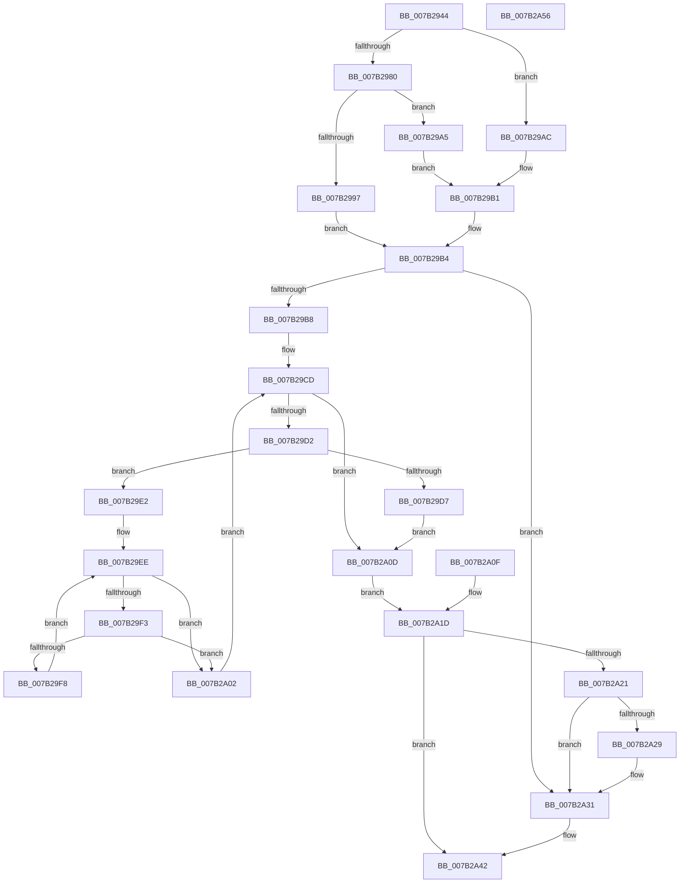

# WmipFindSMBiosStructure

- RVA: `0x007B2944`–`0x007B2A57` (길이 `275` bytes)
- VA: `0x00000001407B2944`
- 실행 섹션: `PAGE`
- PDB 이름 있음: `예`; PDB Function 태그: `아니요`
- unwind 정보 RVA: `0x000D31E8`
- 디코드: `85`개 명령, `275/275` bytes 표시
- 미해석 바이트: `0` (있으면 어셈블리에 `.byte`로 보존)

> 이 문서는 커널 이미지의 기계어와 PDB 기호를 분석해 생성했습니다. 4번과 5번은 함수 원형과 자료형을 바이너리 사용 방식에서 추정한 C 해석이며 원본 소스 복구 결과는 아닙니다.

## 1. Dependencies

- 직접 호출 지점: **5**; 고유 호출 대상: **5**
- 직접 호출자로 확인된 함수: **3**
- RIP 상대 이미지 참조: **3**

### Outgoing calls
- `0x007B296B` → [WmipAcquireSmbiosLockShared](../A4/WmipAcquireSmbiosLockShared_function_00A4F224.md) (function, `0x00A4F224`)
- `0x007B298A` → [MmMapIoSpaceEx](../../text/32/MmMapIoSpaceEx_function_00327830.md) (function, `0x00327830`)
- `0x007B2A2C` → [MmUnmapIoSpace](../../text/3F/MmUnmapIoSpace_function_003F78F0.md) (function, `0x003F78F0`)
- `0x007B2A38` → [ExReleaseResourceLite](../../text/25/ExReleaseResourceLite_function_0025FA10.md) (function, `0x0025FA10`)
- `0x007B2A3D` → [KeLeaveCriticalRegion](../../text/25/KeLeaveCriticalRegion_function_0025D8B0.md) (function, `0x0025D8B0`)

### Direct callers
- [WmipReadSMBiosSysInfo](../../text/64/WmipReadSMBiosSysInfo_function_0064E36C.md) at `0x0064E3AA`
- [WmipGetSMBiosEventlog](WmipGetSMBiosEventlog_function_007B2B58.md) at `0x007B2B92`
- [WmipGetSysIds](WmipGetSysIds_function_007B2DB0.md) at `0x007B2F2C`

### Static image references
- `0x007B2974` → RVA `0x00FD80E8` (`PAGEDATA`; read)
- `0x007B2980` → RVA `0x00FD8038` (`PAGEDATA`; read)
- `0x007B2A31` → RVA `0x00EFFB40` (`.data`; read)

## 2. Other-region calls and transfers

- 다른 실행 섹션으로 향하는 call: **4**
  - `0x007B298A` → [MmMapIoSpaceEx](../../text/32/MmMapIoSpaceEx_function_00327830.md) (`PAGE` → `.text`)
  - `0x007B2A2C` → [MmUnmapIoSpace](../../text/3F/MmUnmapIoSpace_function_003F78F0.md) (`PAGE` → `.text`)
  - `0x007B2A38` → [ExReleaseResourceLite](../../text/25/ExReleaseResourceLite_function_0025FA10.md) (`PAGE` → `.text`)
  - `0x007B2A3D` → [KeLeaveCriticalRegion](../../text/25/KeLeaveCriticalRegion_function_0025D8B0.md) (`PAGE` → `.text`)
- 별도 외부 분기/꼬리 이동을 확인하지 못했습니다.

## 3. Assembly (complete function range)

```asm
007B2944  48 89 5C 24 08                  mov qword ptr [rsp + 8], rbx
007B2949  4C 89 4C 24 20                  mov qword ptr [rsp + 0x20], r9
007B294E  4C 89 44 24 18                  mov qword ptr [rsp + 0x18], r8
007B2953  56                              push rsi
007B2954  57                              push rdi
007B2955  41 54                           push r12
007B2957  41 56                           push r14
007B2959  41 57                           push r15
007B295B  48 83 EC 30                     sub rsp, 0x30
007B295F  4D 8B F1                        mov r14, r9
007B2962  49 8B F0                        mov rsi, r8
007B2965  4C 8B FA                        mov r15, rdx
007B2968  44 8A E1                        mov r12b, cl
007B296B  E8 B4 C8 29 00                  call 0x140a4f224
007B2970  33 DB                           xor ebx, ebx
007B2972  8B FB                           mov edi, ebx
007B2974  48 8B 0D 6D 57 82 00            mov rcx, qword ptr [rip + 0x82576d]
007B297B  48 85 C9                        test rcx, rcx
007B297E  74 2C                           je 0x1407b29ac
007B2980  8B 15 B2 56 82 00               mov edx, dword ptr [rip + 0x8256b2]
007B2986  44 8D 43 04                     lea r8d, [rbx + 4]
007B298A  E8 A1 4E B7 FF                  call 0x140327830
007B298F  48 89 06                        mov qword ptr [rsi], rax
007B2992  48 85 C0                        test rax, rax
007B2995  74 0E                           je 0x1407b29a5
007B2997  8B 05 9B 56 82 00               mov eax, dword ptr [rip + 0x82569b]
007B299D  41 89 06                        mov dword ptr [r14], eax
007B29A0  48 8B 0E                        mov rcx, qword ptr [rsi]
007B29A3  EB 0F                           jmp 0x1407b29b4
007B29A5  BF 9A 00 00 C0                  mov edi, 0xc000009a
007B29AA  EB 05                           jmp 0x1407b29b1
007B29AC  BF 01 00 00 C0                  mov edi, 0xc0000001
007B29B1  48 8B CB                        mov rcx, rbx
007B29B4  85 FF                           test edi, edi
007B29B6  78 79                           js 0x1407b2a31
007B29B8  49 89 1F                        mov qword ptr [r15], rbx
007B29BB  8B 15 77 56 82 00               mov edx, dword ptr [rip + 0x825677]
007B29C1  48 03 D1                        add rdx, rcx
007B29C4  BF 01 00 00 C0                  mov edi, 0xc0000001
007B29C9  89 7C 24 20                     mov dword ptr [rsp + 0x20], edi
007B29CD  48 3B CA                        cmp rcx, rdx
007B29D0  73 3B                           jae 0x1407b2a0d
007B29D2  44 38 21                        cmp byte ptr [rcx], r12b
007B29D5  75 0B                           jne 0x1407b29e2
007B29D7  49 89 0F                        mov qword ptr [r15], rcx
007B29DA  8B FB                           mov edi, ebx
007B29DC  89 5C 24 20                     mov dword ptr [rsp + 0x20], ebx
007B29E0  EB 2B                           jmp 0x1407b2a0d
007B29E2  0F B6 41 01                     movzx eax, byte ptr [rcx + 1]
007B29E6  48 03 C8                        add rcx, rax
007B29E9  48 89 4C 24 28                  mov qword ptr [rsp + 0x28], rcx
007B29EE  66 39 19                        cmp word ptr [rcx], bx
007B29F1  74 0F                           je 0x1407b2a02
007B29F3  48 3B CA                        cmp rcx, rdx
007B29F6  73 0A                           jae 0x1407b2a02
007B29F8  48 FF C1                        inc rcx
007B29FB  48 89 4C 24 28                  mov qword ptr [rsp + 0x28], rcx
007B2A00  EB EC                           jmp 0x1407b29ee
007B2A02  48 83 C1 02                     add rcx, 2
007B2A06  48 89 4C 24 28                  mov qword ptr [rsp + 0x28], rcx
007B2A0B  EB C0                           jmp 0x1407b29cd
007B2A0D  EB 0E                           jmp 0x1407b2a1d
007B2A0F  4C 8B 74 24 78                  mov r14, qword ptr [rsp + 0x78]
007B2A14  48 8B 74 24 70                  mov rsi, qword ptr [rsp + 0x70]
007B2A19  8B 7C 24 20                     mov edi, dword ptr [rsp + 0x20]
007B2A1D  85 FF                           test edi, edi
007B2A1F  79 21                           jns 0x1407b2a42
007B2A21  48 8B 0E                        mov rcx, qword ptr [rsi]
007B2A24  48 85 C9                        test rcx, rcx
007B2A27  74 08                           je 0x1407b2a31
007B2A29  41 8B 16                        mov edx, dword ptr [r14]
007B2A2C  E8 BF 4E C4 FF                  call 0x1403f78f0
007B2A31  48 8D 0D 08 D1 74 00            lea rcx, [rip + 0x74d108]
007B2A38  E8 D3 CF AA FF                  call 0x14025fa10
007B2A3D  E8 6E AE AA FF                  call 0x14025d8b0
007B2A42  8B C7                           mov eax, edi
007B2A44  48 8B 5C 24 60                  mov rbx, qword ptr [rsp + 0x60]
007B2A49  48 83 C4 30                     add rsp, 0x30
007B2A4D  41 5F                           pop r15
007B2A4F  41 5E                           pop r14
007B2A51  41 5C                           pop r12
007B2A53  5F                              pop rdi
007B2A54  5E                              pop rsi
007B2A55  C3                              ret
007B2A56  CC                              int3
```

## 4. C-style interpretation (structured pseudocode)

```c
__int64 __fastcall WmipFindSMBiosStructure(unsigned __int8 a1, __int64 a2, __int64 a3, __int64 a4)
{
    __int64 result;
    __int64 v_rbx;
    __int64 v_rsp;
    unsigned __int64 v_stack_m30;
    unsigned int v_stack_m38;
    unsigned __int64 v_stack_p18;
    unsigned __int64 v_stack_p20;
    unsigned __int64 v_stack_p8;

    v_stack_p8 = v_rbx;
    v_stack_p20 = a4;
    v_stack_p18 = a3;
    v_rsp = (v_rsp) - (48);
    result = WmipAcquireSmbiosLockShared(a1, a2, a3, a4);
    v_rbx = 0;
    if (*(unsigned __int64 *)(v_rip + 8542061) == 0) goto loc_007B29AC;
    result = MmMapIoSpaceEx(*(unsigned __int64 *)(v_rip + 8542061), (unsigned int)(*(unsigned int *)(v_rip + 8541874)), v_rbx + 4, a4);
    *(unsigned __int64 *)(a3) = result;
    if (result == 0) goto loc_007B29A5;
    *(unsigned int *)(a4) = (unsigned int)((unsigned int)(*(unsigned int *)(v_rip + 8541851)));
    goto loc_007B29B4;
loc_007B29A5:
    goto loc_007B29B1;
loc_007B29AC:
loc_007B29B1:
loc_007B29B4:
    if (sign_flag) goto loc_007B2A31;
    *(unsigned __int64 *)(a2) = 0;
    a2 = ((unsigned int)(*(unsigned int *)(v_rip + 8541815))) + (0);
    v_stack_m38 = (unsigned int)((unsigned int)(0xC0000001ULL));
loc_007B29CD:
    if (0 >= a2) goto loc_007B2A0D;
    if ((*(unsigned __int8 *)(0)) != a1) goto loc_007B29E2;
    *(unsigned __int64 *)(a2) = 0;
    v_stack_m38 = 0;
    goto loc_007B2A0D;
loc_007B29E2:
    a1 = (0) + (*(unsigned __int8 *)(0 + 1));
    v_stack_m30 = a1;
loc_007B29EE:
    if ((*(unsigned __int16 *)(a1)) == 0) goto loc_007B2A02;
    if (a1 >= a2) goto loc_007B2A02;
    a1 = (a1) + 1;
    v_stack_m30 = a1;
    goto loc_007B29EE;
loc_007B2A02:
    a1 = (a1) + (2);
    v_stack_m30 = a1;
    goto loc_007B29CD;
loc_007B2A0D:
    goto loc_007B2A1D;
loc_007B2A1D:
    if (!sign_flag) goto loc_007B2A42;
    result = *(unsigned __int8 *)(0 + 1);
    if (*(unsigned __int64 *)(a3) != 0) {
        a2 = *(unsigned int *)(a4);
        result = MmUnmapIoSpace(*(unsigned __int64 *)(a3), a2, v_rbx + 4, a4);
    }
    result = ExReleaseResourceLite(v_rip + 7655688, a2, v_rbx + 4, a4);
    result = KeLeaveCriticalRegion(v_rip + 7655688, a2, v_rbx + 4, a4);
loc_007B2A42:
    v_rsp = (v_rsp) + (48);
    return 0;
}
```

## 5. (Beta) C Style

```c
int64_t WmipFindSMBiosStructure(uint8_t Arg1, void *Arg2, void *Arg3, void *Arg4)
{
    uint8_t *arg2 = (uint8_t *)Arg2;
    uint8_t *arg3 = (uint8_t *)Arg3;
    uint8_t *arg4 = (uint8_t *)Arg4;

    int64_t result;
    int64_t local_rbx;
    int64_t local_rsp;
    uint64_t v_stack_m30;
    uint32_t v_stack_m38;
    uint64_t v_stack_p18;
    uint64_t v_stack_p20;
    uint64_t v_stack_p8;

    v_stack_p8 = local_rbx;
    v_stack_p20 = Arg4;
    v_stack_p18 = Arg3;
    local_rsp = (local_rsp) - (48);
    result = WmipAcquireSmbiosLockShared(Arg1, Arg2, Arg3, Arg4);
    local_rbx = 0;
    if (*(uint64_t *)(v_rip + 0x82576D) == 0) goto loc_007B29AC;
    result = MmMapIoSpaceEx(*(uint64_t *)(v_rip + 0x82576D), (uint32_t)(*(uint32_t *)(v_rip + 0x8256B2)), local_rbx + 4, Arg4);
    *(uint64_t *)(arg3) = result;
    if (result == 0) goto loc_007B29A5;
    *(uint32_t *)(arg4) = (uint32_t)((uint32_t)(*(uint32_t *)(v_rip + 0x82569B)));
    goto loc_007B29B4;
loc_007B29A5:
    goto loc_007B29B1;
loc_007B29AC:
loc_007B29B1:
loc_007B29B4:
    if (sign_flag) goto loc_007B2A31;
    *(uint64_t *)(arg2) = 0;
    Arg2 = ((uint32_t)(*(uint32_t *)(v_rip + 0x825677))) + (0);
    v_stack_m38 = (uint32_t)((uint32_t)(0xC0000001ULL));
loc_007B29CD:
    if (0 >= Arg2) goto loc_007B2A0D;
    if ((*(uint8_t *)(0)) != Arg1) goto loc_007B29E2;
    *(uint64_t *)(arg2) = 0;
    v_stack_m38 = 0;
    goto loc_007B2A0D;
loc_007B29E2:
    Arg1 = (0) + (*(uint8_t *)(0 + 0x1));
    v_stack_m30 = Arg1;
loc_007B29EE:
    if ((*(uint16_t *)(Arg1)) == 0) goto loc_007B2A02;
    if (Arg1 >= Arg2) goto loc_007B2A02;
    Arg1 = (Arg1) + 1;
    v_stack_m30 = Arg1;
    goto loc_007B29EE;
loc_007B2A02:
    Arg1 = (Arg1) + (2);
    v_stack_m30 = Arg1;
    goto loc_007B29CD;
loc_007B2A0D:
    goto loc_007B2A1D;
loc_007B2A1D:
    if (!sign_flag) goto loc_007B2A42;
    result = *(uint8_t *)(0 + 0x1);
    if (*(uint64_t *)(arg3) != 0) {
        Arg2 = *(uint32_t *)(arg4);
        result = MmUnmapIoSpace(*(uint64_t *)(arg3), Arg2, local_rbx + 4, Arg4);
    }
    result = ExReleaseResourceLite(v_rip + 7655688, Arg2, local_rbx + 4, Arg4);
    result = KeLeaveCriticalRegion(v_rip + 7655688, Arg2, local_rbx + 4, Arg4);
loc_007B2A42:
    local_rsp = (local_rsp) + (48);
    return 0;
}
```

### 관측된 메모리 오프셋

구조체 형식이 확인되지 않은 접근은 인자 기준의 오프셋으로만 기록했습니다.

| 기준 인자 | 오프셋 표현 | 폭 (bit) | 접근 |
|---|---:|---:|---|
| `Arg2` | `+ 0x0` | `64` | `W` |
| `Arg3` | `+ 0x0` | `64` | `R` |
| `Arg3` | `+ 0x0` | `64` | `W` |
| `Arg4` | `+ 0x0` | `32` | `R` |
| `Arg4` | `+ 0x0` | `32` | `W` |

## 6. Execution-region graph

[열기: 2D/3D 그래프와 함수 탐색 컨트롤 패널](../../../control-panel.html?section=page&rva=0x007B2944&view=graph)

- 2D 그래프는 위에서 아래로 흐르고, 3D 그래프는 빈 공간을 드래그해 회전합니다. Shift+드래그는 이동, 휠은 확대·축소, 함수 노드 선택은 대상 보고서 이동입니다.

### Static fallback


