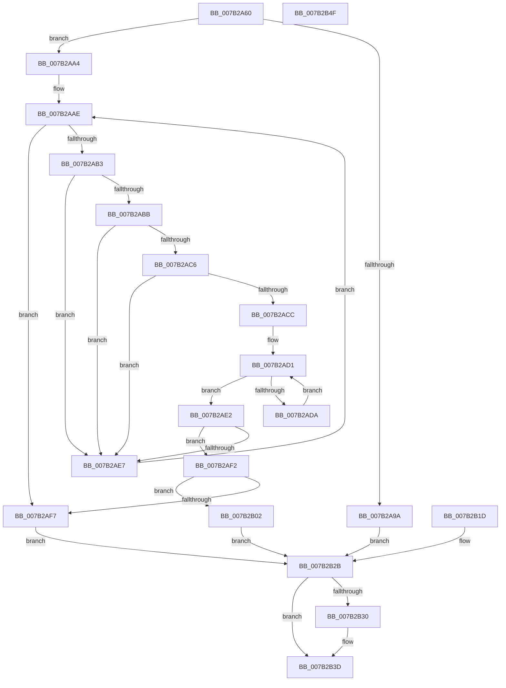

# WmipFindSysIdTable

- RVA: `0x007B2A60`–`0x007B2B50` (길이 `240` bytes)
- VA: `0x00000001407B2A60`
- 실행 섹션: `PAGE`
- PDB 이름 있음: `예`; PDB Function 태그: `아니요`
- unwind 정보 RVA: `0x000D31A4`
- 디코드: `70`개 명령, `240/240` bytes 표시
- 미해석 바이트: `0` (있으면 어셈블리에 `.byte`로 보존)

> 이 문서는 커널 이미지의 기계어와 PDB 기호를 분석해 생성했습니다. 4번과 5번은 함수 원형과 자료형을 바이너리 사용 방식에서 추정한 C 해석이며 원본 소스 복구 결과는 아닙니다.

## 1. Dependencies

- 직접 호출 지점: **2**; 고유 호출 대상: **2**
- 직접 호출자로 확인된 함수: **1**
- RIP 상대 이미지 참조: **0**

### Outgoing calls
- `0x007B2A88` → [MmMapIoSpaceEx](../../text/32/MmMapIoSpaceEx_function_00327830.md) (function, `0x00327830`)
- `0x007B2B38` → [MmUnmapIoSpace](../../text/3F/MmUnmapIoSpace_function_003F78F0.md) (function, `0x003F78F0`)

### Direct callers
- [WmipGetSysIds](WmipGetSysIds_function_007B2DB0.md) at `0x007B2E1A`

### Static image references
- 디코드된 RIP-relative 메모리 참조가 없습니다.

## 2. Other-region calls and transfers

- 다른 실행 섹션으로 향하는 call: **2**
  - `0x007B2A88` → [MmMapIoSpaceEx](../../text/32/MmMapIoSpaceEx_function_00327830.md) (`PAGE` → `.text`)
  - `0x007B2B38` → [MmUnmapIoSpace](../../text/3F/MmUnmapIoSpace_function_003F78F0.md) (`PAGE` → `.text`)
- 별도 외부 분기/꼬리 이동을 확인하지 못했습니다.

## 3. Assembly (complete function range)

```asm
007B2A60  48 89 5C 24 08                  mov qword ptr [rsp + 8], rbx
007B2A65  48 89 74 24 10                  mov qword ptr [rsp + 0x10], rsi
007B2A6A  57                              push rdi
007B2A6B  48 83 EC 30                     sub rsp, 0x30
007B2A6F  49 8B F8                        mov rdi, r8
007B2A72  48 8B F2                        mov rsi, rdx
007B2A75  48 8B D9                        mov rbx, rcx
007B2A78  BA 00 00 02 00                  mov edx, 0x20000
007B2A7D  B9 00 00 0E 00                  mov ecx, 0xe0000
007B2A82  41 B8 04 00 00 00               mov r8d, 4
007B2A88  E8 A3 4D B7 FF                  call 0x140327830
007B2A8D  4C 8B C8                        mov r9, rax
007B2A90  48 89 44 24 58                  mov qword ptr [rsp + 0x58], rax
007B2A95  48 85 C0                        test rax, rax
007B2A98  75 0A                           jne 0x1407b2aa4
007B2A9A  BB 9A 00 00 C0                  mov ebx, 0xc000009a
007B2A9F  E9 87 00 00 00                  jmp 0x1407b2b2b
007B2AA4  48 8B C8                        mov rcx, rax
007B2AA7  4C 8D 90 EF FF 01 00            lea r10, [rax + 0x1ffef]
007B2AAE  49 3B CA                        cmp rcx, r10
007B2AB1  77 44                           ja 0x1407b2af7
007B2AB3  81 39 5F 53 59 53               cmp dword ptr [rcx], 0x5359535f
007B2AB9  75 2C                           jne 0x1407b2ae7
007B2ABB  B8 49 44 00 00                  mov eax, 0x4449
007B2AC0  66 39 41 04                     cmp word ptr [rcx + 4], ax
007B2AC4  75 21                           jne 0x1407b2ae7
007B2AC6  80 79 06 5F                     cmp byte ptr [rcx + 6], 0x5f
007B2ACA  75 1B                           jne 0x1407b2ae7
007B2ACC  45 32 C0                        xor r8b, r8b
007B2ACF  33 D2                           xor edx, edx
007B2AD1  89 54 24 20                     mov dword ptr [rsp + 0x20], edx
007B2AD5  83 FA 11                        cmp edx, 0x11
007B2AD8  73 08                           jae 0x1407b2ae2
007B2ADA  44 02 04 0A                     add r8b, byte ptr [rdx + rcx]
007B2ADE  FF C2                           inc edx
007B2AE0  EB EF                           jmp 0x1407b2ad1
007B2AE2  45 84 C0                        test r8b, r8b
007B2AE5  74 0B                           je 0x1407b2af2
007B2AE7  48 83 C1 10                     add rcx, 0x10
007B2AEB  48 89 4C 24 28                  mov qword ptr [rsp + 0x28], rcx
007B2AF0  EB BC                           jmp 0x1407b2aae
007B2AF2  49 3B CA                        cmp rcx, r10
007B2AF5  76 0B                           jbe 0x1407b2b02
007B2AF7  BB 01 00 00 C0                  mov ebx, 0xc0000001
007B2AFC  89 5C 24 24                     mov dword ptr [rsp + 0x24], ebx
007B2B00  EB 29                           jmp 0x1407b2b2b
007B2B02  C7 43 04 00 00 00 00            mov dword ptr [rbx + 4], 0
007B2B09  8B 41 0A                        mov eax, dword ptr [rcx + 0xa]
007B2B0C  89 03                           mov dword ptr [rbx], eax
007B2B0E  8A 41 10                        mov al, byte ptr [rcx + 0x10]
007B2B11  88 06                           mov byte ptr [rsi], al
007B2B13  0F B7 41 0E                     movzx eax, word ptr [rcx + 0xe]
007B2B17  89 07                           mov dword ptr [rdi], eax
007B2B19  33 DB                           xor ebx, ebx
007B2B1B  EB 0E                           jmp 0x1407b2b2b
007B2B1D  BB 01 00 00 C0                  mov ebx, 0xc0000001
007B2B22  89 5C 24 24                     mov dword ptr [rsp + 0x24], ebx
007B2B26  4C 8B 4C 24 58                  mov r9, qword ptr [rsp + 0x58]
007B2B2B  4D 85 C9                        test r9, r9
007B2B2E  74 0D                           je 0x1407b2b3d
007B2B30  BA 00 00 02 00                  mov edx, 0x20000
007B2B35  49 8B C9                        mov rcx, r9
007B2B38  E8 B3 4D C4 FF                  call 0x1403f78f0
007B2B3D  8B C3                           mov eax, ebx
007B2B3F  48 8B 5C 24 40                  mov rbx, qword ptr [rsp + 0x40]
007B2B44  48 8B 74 24 48                  mov rsi, qword ptr [rsp + 0x48]
007B2B49  48 83 C4 30                     add rsp, 0x30
007B2B4D  5F                              pop rdi
007B2B4E  C3                              ret
007B2B4F  CC                              int3
```

## 4. C-style interpretation (structured pseudocode)

```c
__int64 __fastcall WmipFindSysIdTable(__int64 a1, __int64 a2, __int64 a3)
{
    __int64 result;
    __int64 v_rbx;
    __int64 v_rsp;
    unsigned __int64 v_stack_m10;
    unsigned int v_stack_m14;
    unsigned int v_stack_m18;
    unsigned __int64 v_stack_p10;
    unsigned __int64 v_stack_p20;
    unsigned __int64 v_stack_p8;

    v_stack_p8 = v_rbx;
    v_stack_p10 = v_rsi;
    v_rsp = (v_rsp) - (48);
    result = MmMapIoSpaceEx((unsigned int)(0xE0000ULL), (unsigned int)(0x20000ULL), 4, a4);
    v_stack_p20 = result;
    if (result != 0) goto loc_007B2AA4;
    goto loc_007B2B2B;
loc_007B2AA4:
loc_007B2AAE:
    if (result > (result + 131055)) goto loc_007B2AF7;
    if ((*(unsigned int *)(result)) != 0x5359535FULL) goto loc_007B2AE7;
    if ((*(unsigned __int16 *)(result + 4)) != ((unsigned __int16)((unsigned int)(0x4449ULL)))) goto loc_007B2AE7;
    if ((*(unsigned __int8 *)(result + 6)) != 95) goto loc_007B2AE7;
    a3 = 0;
    a2 = 0;
loc_007B2AD1:
    v_stack_m18 = 0;
    if (0 >= 17) goto loc_007B2AE2;
    a3 = (unsigned __int8)((a3) + (*(unsigned __int8 *)(a2 + result * 1)));
    a2 = (unsigned int)((a2) + 1);
    goto loc_007B2AD1;
loc_007B2AE2:
    if ((unsigned __int8)(a3) == 0) goto loc_007B2AF2;
loc_007B2AE7:
    a1 = (result) + (16);
    v_stack_m10 = a1;
    goto loc_007B2AAE;
loc_007B2AF2:
    if (a1 <= (result + 131055)) goto loc_007B2B02;
loc_007B2AF7:
    v_stack_m14 = (unsigned int)((unsigned int)(0xC0000001ULL));
    goto loc_007B2B2B;
loc_007B2B02:
    *(unsigned int *)((unsigned int)(0xC0000001ULL) + 4) = 0;
    *(unsigned int *)((unsigned int)(0xC0000001ULL)) = (unsigned int)((unsigned int)(*(unsigned int *)(a1 + 10)));
    *(unsigned __int8 *)(a2) = (unsigned __int8)(*(unsigned __int8 *)(a1 + 16));
    *(unsigned int *)(a3) = (unsigned int)(*(unsigned __int16 *)(a1 + 14));
    v_rbx = 0;
    goto loc_007B2B2B;
loc_007B2B2B:
    result = *(unsigned __int16 *)(a1 + 14);
    if (result != 0) {
        a2 = 0x20000ULL;
        a1 = result;
        result = MmUnmapIoSpace(a1, a2, a3, result);
    }
    v_rsp = (v_rsp) + (48);
    return 0;
}
```

## 5. (Beta) C Style

```c
int64_t WmipFindSysIdTable(void *Arg1, void *Arg2, void *Arg3)
{
    uint8_t *arg1 = (uint8_t *)Arg1;
    uint8_t *arg2 = (uint8_t *)Arg2;
    uint8_t *arg3 = (uint8_t *)Arg3;

    int64_t result;
    int64_t local_rbx;
    int64_t local_rsp;
    uint64_t v_stack_m10;
    uint32_t v_stack_m14;
    uint32_t v_stack_m18;
    uint64_t v_stack_p10;
    uint64_t v_stack_p20;
    uint64_t v_stack_p8;

    v_stack_p8 = local_rbx;
    v_stack_p10 = local_rsi;
    local_rsp = (local_rsp) - (48);
    result = MmMapIoSpaceEx((uint32_t)(0xE0000ULL), (uint32_t)(0x20000ULL), 4, a4);
    v_stack_p20 = result;
    if (result != 0) goto loc_007B2AA4;
    goto loc_007B2B2B;
loc_007B2AA4:
loc_007B2AAE:
    if (result > (result + 131055)) goto loc_007B2AF7;
    if ((*(uint32_t *)(result)) != 0x5359535FULL) goto loc_007B2AE7;
    if ((*(uint16_t *)(result + 0x4)) != ((uint16_t)((uint32_t)(0x4449ULL)))) goto loc_007B2AE7;
    if ((*(uint8_t *)(result + 0x6)) != 95) goto loc_007B2AE7;
    Arg3 = 0;
    Arg2 = 0;
loc_007B2AD1:
    v_stack_m18 = 0;
    if (0 >= 17) goto loc_007B2AE2;
    Arg3 = (uint8_t)((Arg3) + (*(uint8_t *)(arg2 + result * 1)));
    Arg2 = (uint32_t)((Arg2) + 1);
    goto loc_007B2AD1;
loc_007B2AE2:
    if ((uint8_t)(Arg3) == 0) goto loc_007B2AF2;
loc_007B2AE7:
    Arg1 = (result) + (16);
    v_stack_m10 = Arg1;
    goto loc_007B2AAE;
loc_007B2AF2:
    if (Arg1 <= (result + 131055)) goto loc_007B2B02;
loc_007B2AF7:
    v_stack_m14 = (uint32_t)((uint32_t)(0xC0000001ULL));
    goto loc_007B2B2B;
loc_007B2B02:
    *(uint32_t *)((uint32_t)(0xC0000001ULL) + 0x4) = 0;
    *(uint32_t *)((uint32_t)(0xC0000001ULL)) = (uint32_t)((uint32_t)(*(uint32_t *)(arg1 + 0xA)));
    *(uint8_t *)(arg2) = (uint8_t)(*(uint8_t *)(arg1 + 0x10));
    *(uint32_t *)(arg3) = (uint32_t)(*(uint16_t *)(arg1 + 0xE));
    local_rbx = 0;
    goto loc_007B2B2B;
loc_007B2B2B:
    result = *(uint16_t *)(arg1 + 0xE);
    if (result != 0) {
        Arg2 = 0x20000ULL;
        Arg1 = result;
        result = MmUnmapIoSpace(Arg1, Arg2, Arg3, result);
    }
    local_rsp = (local_rsp) + (48);
    return 0;
}
```

### 관측된 메모리 오프셋

구조체 형식이 확인되지 않은 접근은 인자 기준의 오프셋으로만 기록했습니다.

| 기준 인자 | 오프셋 표현 | 폭 (bit) | 접근 |
|---|---:|---:|---|
| `Arg1` | `+ 0x0` | `32` | `W` |
| `Arg1` | `+ 0x4` | `32` | `W` |
| `Arg2` | `+ 0x0` | `8` | `W` |
| `Arg3` | `+ 0x0` | `32` | `W` |

## 6. Execution-region graph

[열기: 2D/3D 그래프와 함수 탐색 컨트롤 패널](../../../control-panel.html?section=page&rva=0x007B2A60&view=graph)

- 2D 그래프는 위에서 아래로 흐르고, 3D 그래프는 빈 공간을 드래그해 회전합니다. Shift+드래그는 이동, 휠은 확대·축소, 함수 노드 선택은 대상 보고서 이동입니다.

### Static fallback


