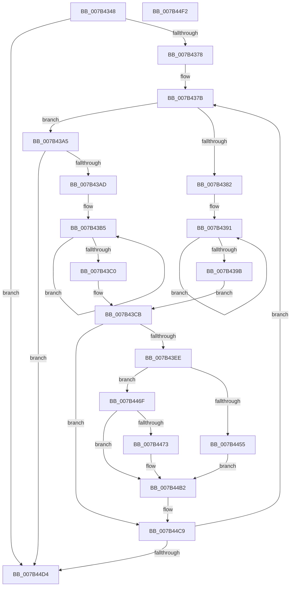

# WmipGenerateBinaryMofNotification

- RVA: `0x007B4348`–`0x007B44F3` (길이 `427` bytes)
- VA: `0x00000001407B4348`
- 실행 섹션: `PAGE`
- PDB 이름 있음: `예`; PDB Function 태그: `아니요`
- unwind 정보 RVA: `0x000AC264`
- 디코드: `113`개 명령, `427/427` bytes 표시
- 미해석 바이트: `0` (있으면 어셈블리에 `.byte`로 보존)

> 이 문서는 커널 이미지의 기계어와 PDB 기호를 분석해 생성했습니다. 4번과 5번은 함수 원형과 자료형을 바이너리 사용 방식에서 추정한 C 해석이며 원본 소스 복구 결과는 아닙니다.

## 1. Dependencies

- 직접 호출 지점: **6**; 고유 호출 대상: **6**
- 직접 호출자로 확인된 함수: **3**
- RIP 상대 이미지 참조: **1**

### Outgoing calls
- `0x007B43DD` → [ExAllocatePool2](../../poolcode/B8/ExAllocatePool2_function_00B820F0.md) (function, `0x00B820F0`)
- `0x007B43F6` → [memset](../../text/6C/memset_function_006C6C40.md) (function, `0x006C6C40`)
- `0x007B4468` → [RtlStringCbCopyW](../../text/43/RtlStringCbCopyW_function_0043B910.md) (function, `0x0043B910`)
- `0x007B44A9` → [RtlStringCbPrintfExW](../../text/46/RtlStringCbPrintfExW_function_00461AD4.md) (function, `0x00461AD4`)
- `0x007B44BA` → [WmipProcessEvent](../9D/WmipProcessEvent_function_009DFA40.md) (function, `0x009DFA40`)
- `0x007B44C4` → [ExFreePoolWithTag](../../poolcode/B8/ExFreePoolWithTag_function_00B82870.md) (function, `0x00B82870`)

### Direct callers
- [WmipUpdateDataSource](../9D/WmipUpdateDataSource_function_009DD474.md) at `0x009DD61E`
- [WmipUpdateDataSource](../9D/WmipUpdateDataSource_function_009DD474.md) at `0x009DD723`
- [WmipUpdateDataSource](../9D/WmipUpdateDataSource_function_009DD474.md) at `0x009DD783`
- [WmipAddDataSource](../9D/WmipAddDataSource_function_009DDC30.md) at `0x009DDEF7`
- [WmipDSCleanup](../9E/WmipDSCleanup_function_009E2400.md) at `0x009E2533`

### Static image references
- `0x007B4495` → RVA `0x00B06FD0` (` ?? ::NNGAKEGL::`string'`; read)

## 2. Other-region calls and transfers

- 다른 실행 섹션으로 향하는 call: **5**
  - `0x007B43DD` → [ExAllocatePool2](../../poolcode/B8/ExAllocatePool2_function_00B820F0.md) (`PAGE` → `POOLCODE`)
  - `0x007B43F6` → [memset](../../text/6C/memset_function_006C6C40.md) (`PAGE` → `.text`)
  - `0x007B4468` → [RtlStringCbCopyW](../../text/43/RtlStringCbCopyW_function_0043B910.md) (`PAGE` → `.text`)
  - `0x007B44A9` → [RtlStringCbPrintfExW](../../text/46/RtlStringCbPrintfExW_function_00461AD4.md) (`PAGE` → `.text`)
  - `0x007B44C4` → [ExFreePoolWithTag](../../poolcode/B8/ExFreePoolWithTag_function_00B82870.md) (`PAGE` → `POOLCODE`)
- 별도 외부 분기/꼬리 이동을 확인하지 못했습니다.

## 3. Assembly (complete function range)

```asm
007B4348  48 89 5C 24 08                  mov qword ptr [rsp + 8], rbx
007B434D  48 89 6C 24 10                  mov qword ptr [rsp + 0x10], rbp
007B4352  48 89 74 24 18                  mov qword ptr [rsp + 0x18], rsi
007B4357  57                              push rdi
007B4358  41 54                           push r12
007B435A  41 55                           push r13
007B435C  41 56                           push r14
007B435E  41 57                           push r15
007B4360  48 83 EC 40                     sub rsp, 0x40
007B4364  8B 41 48                        mov eax, dword ptr [rcx + 0x48]
007B4367  45 33 ED                        xor r13d, r13d
007B436A  4C 8B E2                        mov r12, rdx
007B436D  48 8B D9                        mov rbx, rcx
007B4370  85 C0                           test eax, eax
007B4372  0F 84 5C 01 00 00               je 0x1407b44d4
007B4378  41 8B F5                        mov esi, r13d
007B437B  8B 43 10                        mov eax, dword ptr [rbx + 0x10]
007B437E  A8 02                           test al, 2
007B4380  74 23                           je 0x1407b43a5
007B4382  48 8B 43 58                     mov rax, qword ptr [rbx + 0x58]
007B4386  48 83 CD FF                     or rbp, 0xffffffffffffffff
007B438A  44 8B FE                        mov r15d, esi
007B438D  4A 8B 0C F8                     mov rcx, qword ptr [rax + r15*8]
007B4391  48 FF C5                        inc rbp
007B4394  66 44 39 2C 69                  cmp word ptr [rcx + rbp*2], r13w
007B4399  75 F6                           jne 0x1407b4391
007B439B  48 8D 2C 6D 04 00 00 00         lea rbp, [rbp*2 + 4]
007B43A3  EB 26                           jmp 0x1407b43cb
007B43A5  A8 01                           test al, 1
007B43A7  0F 84 27 01 00 00               je 0x1407b44d4
007B43AD  48 8B 43 58                     mov rax, qword ptr [rbx + 0x58]
007B43B1  48 83 CD FF                     or rbp, 0xffffffffffffffff
007B43B5  48 FF C5                        inc rbp
007B43B8  66 44 39 6C 68 04               cmp word ptr [rax + rbp*2 + 4], r13w
007B43BE  75 F5                           jne 0x1407b43b5
007B43C0  48 8D 2C 6D 0E 00 00 00         lea rbp, [rbp*2 + 0xe]
007B43C8  44 8B FE                        mov r15d, esi
007B43CB  4C 8D 75 4A                     lea r14, [rbp + 0x4a]
007B43CF  41 B8 57 6D 69 70               mov r8d, 0x70696d57
007B43D5  49 8B D6                        mov rdx, r14
007B43D8  B9 00 01 00 00                  mov ecx, 0x100
007B43DD  E8 0E DD 3C 00                  call 0x140b820f0
007B43E2  48 8B F8                        mov rdi, rax
007B43E5  48 85 C0                        test rax, rax
007B43E8  0F 84 DB 00 00 00               je 0x1407b44c9
007B43EE  4D 8B C6                        mov r8, r14
007B43F1  33 D2                           xor edx, edx
007B43F3  48 8B C8                        mov rcx, rax
007B43F6  E8 45 28 F1 FF                  call 0x1406c6c40
007B43FB  44 89 37                        mov dword ptr [rdi], r14d
007B43FE  C7 47 04 03 00 00 00            mov dword ptr [rdi + 4], 3
007B4405  48 C7 47 08 01 00 00 00         mov qword ptr [rdi + 8], 1
007B440D  C7 47 2C 0A 00 00 00            mov dword ptr [rdi + 0x2c], 0xa
007B4414  41 0F 10 04 24                  movups xmm0, xmmword ptr [r12]
007B4419  F3 0F 7F 47 18                  movdqu xmmword ptr [rdi + 0x18], xmm0
007B441E  48 A1 14 00 00 00 80 F7 FF FF   movabs rax, qword ptr [0xfffff78000000014]
007B4428  48 89 47 10                     mov qword ptr [rdi + 0x10], rax
007B442C  8D 45 02                        lea eax, [rbp + 2]
007B442F  89 47 3C                        mov dword ptr [rdi + 0x3c], eax
007B4432  48 83 ED 02                     sub rbp, 2
007B4436  C7 47 30 40 00 00 00            mov dword ptr [rdi + 0x30], 0x40
007B443D  C7 47 38 48 00 00 00            mov dword ptr [rdi + 0x38], 0x48
007B4444  66 44 89 6F 40                  mov word ptr [rdi + 0x40], r13w
007B4449  66 44 89 6F 48                  mov word ptr [rdi + 0x48], r13w
007B444E  8B 43 10                        mov eax, dword ptr [rbx + 0x10]
007B4451  A8 02                           test al, 2
007B4453  74 1A                           je 0x1407b446f
007B4455  66 89 6F 4A                     mov word ptr [rdi + 0x4a], bp
007B4459  48 8D 4F 4C                     lea rcx, [rdi + 0x4c]
007B445D  4C 8B 43 58                     mov r8, qword ptr [rbx + 0x58]
007B4461  48 8B D5                        mov rdx, rbp
007B4464  4F 8B 04 F8                     mov r8, qword ptr [r8 + r15*8]
007B4468  E8 A3 74 C8 FF                  call 0x14043b910
007B446D  EB 43                           jmp 0x1407b44b2
007B446F  A8 01                           test al, 1
007B4471  74 3F                           je 0x1407b44b2
007B4473  48 8B 4B 58                     mov rcx, qword ptr [rbx + 0x58]
007B4477  45 33 C9                        xor r9d, r9d
007B447A  45 33 C0                        xor r8d, r8d
007B447D  8B 11                           mov edx, dword ptr [rcx]
007B447F  48 8D 41 04                     lea rax, [rcx + 4]
007B4483  03 D6                           add edx, esi
007B4485  48 8D 4F 4C                     lea rcx, [rdi + 0x4c]
007B4489  89 54 24 38                     mov dword ptr [rsp + 0x38], edx
007B448D  48 8B D5                        mov rdx, rbp
007B4490  48 89 44 24 30                  mov qword ptr [rsp + 0x30], rax
007B4495  48 8D 05 34 2B 35 00            lea rax, [rip + 0x352b34]
007B449C  48 89 44 24 28                  mov qword ptr [rsp + 0x28], rax
007B44A1  C7 44 24 20 00 02 00 00         mov dword ptr [rsp + 0x20], 0x200
007B44A9  E8 26 D6 CA FF                  call 0x140461ad4
007B44AE  66 89 6F 4A                     mov word ptr [rdi + 0x4a], bp
007B44B2  45 33 C0                        xor r8d, r8d
007B44B5  B2 01                           mov dl, 1
007B44B7  48 8B CF                        mov rcx, rdi
007B44BA  E8 81 B5 22 00                  call 0x1409dfa40
007B44BF  33 D2                           xor edx, edx
007B44C1  48 8B CF                        mov rcx, rdi
007B44C4  E8 A7 E3 3C 00                  call 0x140b82870
007B44C9  FF C6                           inc esi
007B44CB  3B 73 48                        cmp esi, dword ptr [rbx + 0x48]
007B44CE  0F 82 A7 FE FF FF               jb 0x1407b437b
007B44D4  4C 8D 5C 24 40                  lea r11, [rsp + 0x40]
007B44D9  49 8B 5B 30                     mov rbx, qword ptr [r11 + 0x30]
007B44DD  49 8B 6B 38                     mov rbp, qword ptr [r11 + 0x38]
007B44E1  49 8B 73 40                     mov rsi, qword ptr [r11 + 0x40]
007B44E5  49 8B E3                        mov rsp, r11
007B44E8  41 5F                           pop r15
007B44EA  41 5E                           pop r14
007B44EC  41 5D                           pop r13
007B44EE  41 5C                           pop r12
007B44F0  5F                              pop rdi
007B44F1  C3                              ret
007B44F2  CC                              int3
```

## 4. C-style interpretation (structured pseudocode)

```c
__int64 __fastcall WmipGenerateBinaryMofNotification(__int64 a1, __int64 a2, __int64 a3, int a4)
{
    __int64 result;
    __int64 v_r13;
    __int64 v_rbp;
    __int64 v_rsi;
    __int64 v_rsp;
    unsigned __int64 v_stack_m28;
    unsigned int v_stack_m30;
    unsigned __int64 v_stack_m38;
    unsigned __int64 v_stack_m40;
    unsigned int v_stack_m48;
    unsigned __int64 v_stack_p10;
    unsigned __int64 v_stack_p18;
    unsigned __int64 v_stack_p8;

    v_stack_p8 = v_rbx;
    v_stack_p10 = v_rbp;
    v_stack_p18 = v_rsi;
    v_rsp = (v_rsp) - (64);
    v_r13 = 0;
    if ((unsigned int)((unsigned int)(*(unsigned int *)(a1 + 72))) == 0) goto loc_007B44D4;
loc_007B437B:
    if ((((unsigned __int8)((unsigned int)(*(unsigned int *)(a1 + 16)))) & (2)) == 0) goto loc_007B43A5;
    v_rbp = (v_rbp) | (-1);
loc_007B4391:
    v_rbp = (v_rbp) + 1;
    if ((*(unsigned __int16 *)(*(unsigned __int64 *)(*(unsigned __int64 *)(a1 + 88) + 0 * 8) + v_rbp * 2)) != 0) goto loc_007B4391;
    goto loc_007B43CB;
loc_007B43A5:
    if ((((unsigned __int8)(*(unsigned __int64 *)(a1 + 88))) & (1)) == 0) goto loc_007B44D4;
    v_rbp = (v_rbp * 2 + 4) | (-1);
loc_007B43B5:
    v_rbp = (v_rbp) + 1;
    if ((*(unsigned __int16 *)(*(unsigned __int64 *)(a1 + 88) + v_rbp * 2 + 4)) != 0) goto loc_007B43B5;
loc_007B43CB:
    result = ExAllocatePool2(256, v_rbp * 2 + 14 + 74, (unsigned int)(0x70696D57ULL), a4);
    if (result == 0) goto loc_007B44C9;
    a2 = 0;
    result = memset(result, a2, v_rbp * 2 + 14 + 74, a4);
    *(unsigned int *)(result) = (unsigned int)(v_rbp * 2 + 14 + 74);
    *(unsigned int *)(result + 4) = 3;
    *(unsigned __int64 *)(result + 8) = 1;
    *(unsigned int *)(result + 44) = 10;
    *(unsigned __int64 *)(result + 24) = v_xmm0;
    *(unsigned __int64 *)(result + 16) = result;
    *(unsigned int *)(result + 60) = (unsigned int)(v_rbp * 2 + 14 + 2);
    v_rbp = (v_rbp * 2 + 14) - (2);
    *(unsigned int *)(result + 48) = 64;
    *(unsigned int *)(result + 56) = 72;
    *(unsigned __int16 *)(result + 64) = 0;
    *(unsigned __int16 *)(result + 72) = 0;
    if ((((unsigned __int8)((unsigned int)(*(unsigned int *)(a1 + 16)))) & (2)) == 0) goto loc_007B446F;
    *(unsigned __int16 *)(result + 74) = (unsigned __int16)(v_rbp);
    result = RtlStringCbCopyW(result + 76, v_rbp, *(unsigned __int64 *)(*(unsigned __int64 *)(a1 + 88) + 0 * 8), a4);
    goto loc_007B44B2;
loc_007B446F:
    if ((((unsigned __int8)(result)) & (1)) != 0) {
        a1 = *(unsigned __int64 *)(a1 + 88);
        a4 = 0;
        a3 = 0;
        a2 = *(unsigned int *)(a1);
        result = a1 + 4;
        a2 = (unsigned int)((a2) + (0));
        a1 = result + 76;
        v_stack_m30 = (unsigned int)(a2);
        a2 = v_rbp;
        v_stack_m38 = result;
        result = v_rip + 3484468;
        v_stack_m40 = result;
        v_stack_m48 = 512;
        result = RtlStringCbPrintfExW(a1, a2, a3, a4);
        *(unsigned __int16 *)(result + 74) = (unsigned __int16)(v_rbp);
    }
    a3 = 0;
    result = WmipProcessEvent(result, 1, a3, a4);
    a2 = 0;
    result = ExFreePoolWithTag(result, a2, a3, a4);
loc_007B44C9:
    v_rsi = (unsigned int)((0) + 1);
    if (((unsigned int)(v_rsi)) < (*(unsigned int *)(a1 + 72))) goto loc_007B437B;
loc_007B44D4:
    return result;
}
```

## 5. (Beta) C Style

```c
int64_t WmipGenerateBinaryMofNotification(void *Arg1, void *Arg2, int64_t Arg3, int32_t Arg4)
{
    uint8_t *arg1 = (uint8_t *)Arg1;
    uint8_t *arg2 = (uint8_t *)Arg2;

    int64_t result;
    int64_t local_r13;
    int64_t local_rbp;
    int64_t local_rsi;
    int64_t local_rsp;
    uint64_t v_stack_m28;
    uint32_t v_stack_m30;
    uint64_t v_stack_m38;
    uint64_t v_stack_m40;
    uint32_t v_stack_m48;
    uint64_t v_stack_p10;
    uint64_t v_stack_p18;
    uint64_t v_stack_p8;

    v_stack_p8 = local_rbx;
    v_stack_p10 = local_rbp;
    v_stack_p18 = local_rsi;
    local_rsp = (local_rsp) - (64);
    local_r13 = 0;
    if ((uint32_t)((uint32_t)(*(uint32_t *)(arg1 + 0x48))) == 0) goto loc_007B44D4;
loc_007B437B:
    if ((((uint8_t)((uint32_t)(*(uint32_t *)(arg1 + 0x10)))) & (2)) == 0) goto loc_007B43A5;
    local_rbp = (local_rbp) | (-1);
loc_007B4391:
    local_rbp = (local_rbp) + 1;
    if ((*(uint16_t *)(*(uint64_t *)(*(uint64_t *)(arg1 + 0x58) + 0x0 * 8) + local_rbp * 2)) != 0) goto loc_007B4391;
    goto loc_007B43CB;
loc_007B43A5:
    if ((((uint8_t)(*(uint64_t *)(arg1 + 0x58))) & (1)) == 0) goto loc_007B44D4;
    local_rbp = (local_rbp * 2 + 4) | (-1);
loc_007B43B5:
    local_rbp = (local_rbp) + 1;
    if ((*(uint16_t *)(*(uint64_t *)(arg1 + 0x58) + local_rbp * 2 + 0x4)) != 0) goto loc_007B43B5;
loc_007B43CB:
    result = ExAllocatePool2(256, local_rbp * 2 + 14 + 74, (uint32_t)(0x70696D57ULL), Arg4);
    if (result == 0) goto loc_007B44C9;
    Arg2 = 0;
    result = memset(result, Arg2, local_rbp * 2 + 14 + 74, Arg4);
    *(uint32_t *)(result) = (uint32_t)(local_rbp * 2 + 14 + 74);
    *(uint32_t *)(result + 0x4) = 3;
    *(uint64_t *)(result + 0x8) = 1;
    *(uint32_t *)(result + 0x2C) = 10;
    *(uint64_t *)(result + 0x18) = v_xmm0;
    *(uint64_t *)(result + 0x10) = result;
    *(uint32_t *)(result + 0x3C) = (uint32_t)(local_rbp * 2 + 14 + 2);
    local_rbp = (local_rbp * 2 + 14) - (2);
    *(uint32_t *)(result + 0x30) = 64;
    *(uint32_t *)(result + 0x38) = 72;
    *(uint16_t *)(result + 0x40) = 0;
    *(uint16_t *)(result + 0x48) = 0;
    if ((((uint8_t)((uint32_t)(*(uint32_t *)(arg1 + 0x10)))) & (2)) == 0) goto loc_007B446F;
    *(uint16_t *)(result + 0x4A) = (uint16_t)(local_rbp);
    result = RtlStringCbCopyW(result + 76, local_rbp, *(uint64_t *)(*(uint64_t *)(arg1 + 0x58) + 0x0 * 8), Arg4);
    goto loc_007B44B2;
loc_007B446F:
    if ((((uint8_t)(result)) & (1)) != 0) {
        Arg1 = *(uint64_t *)(arg1 + 0x58);
        Arg4 = 0;
        Arg3 = 0;
        Arg2 = *(uint32_t *)(arg1);
        result = Arg1 + 4;
        Arg2 = (uint32_t)((Arg2) + (0));
        Arg1 = result + 76;
        v_stack_m30 = (uint32_t)(Arg2);
        Arg2 = local_rbp;
        v_stack_m38 = result;
        result = v_rip + 3484468;
        v_stack_m40 = result;
        v_stack_m48 = 512;
        result = RtlStringCbPrintfExW(Arg1, Arg2, Arg3, Arg4);
        *(uint16_t *)(result + 0x4A) = (uint16_t)(local_rbp);
    }
    Arg3 = 0;
    result = WmipProcessEvent(result, 1, Arg3, Arg4);
    Arg2 = 0;
    result = ExFreePoolWithTag(result, Arg2, Arg3, Arg4);
loc_007B44C9:
    local_rsi = (uint32_t)((0) + 1);
    if (((uint32_t)(local_rsi)) < (*(uint32_t *)(arg1 + 0x48))) goto loc_007B437B;
loc_007B44D4:
    return result;
}
```

### 관측된 메모리 오프셋

구조체 형식이 확인되지 않은 접근은 인자 기준의 오프셋으로만 기록했습니다.

| 기준 인자 | 오프셋 표현 | 폭 (bit) | 접근 |
|---|---:|---:|---|
| `Arg1` | `+ 0x10` | `32` | `R` |
| `Arg1` | `+ 0x48` | `32` | `R` |
| `Arg1` | `+ 0x58` | `64` | `R` |
| `Arg2` | `+ 0x0` | `128` | `R` |

## 6. Execution-region graph

[열기: 2D/3D 그래프와 함수 탐색 컨트롤 패널](../../../control-panel.html?section=page&rva=0x007B4348&view=graph)

- 2D 그래프는 위에서 아래로 흐르고, 3D 그래프는 빈 공간을 드래그해 회전합니다. Shift+드래그는 이동, 휠은 확대·축소, 함수 노드 선택은 대상 보고서 이동입니다.

### Static fallback


