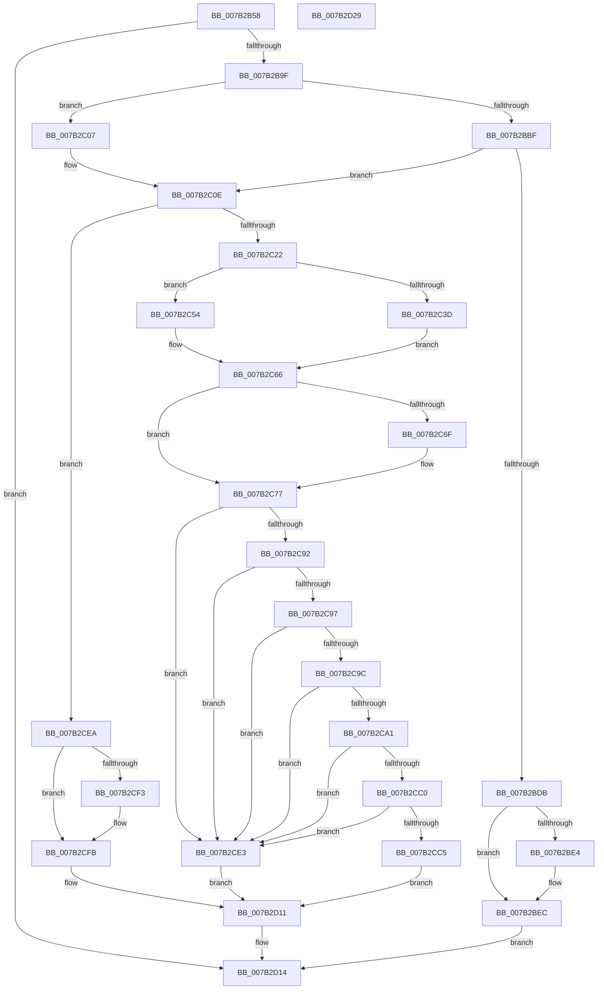

# WmipGetSMBiosEventlog

- RVA: `0x007B2B58`–`0x007B2D2A` (길이 `466` bytes)
- VA: `0x00000001407B2B58`
- 실행 섹션: `PAGE`
- PDB 이름 있음: `예`; PDB Function 태그: `아니요`
- unwind 정보 RVA: `0x000D3158`
- 디코드: `136`개 명령, `466/466` bytes 표시
- 미해석 바이트: `0` (있으면 어셈블리에 `.byte`로 보존)

> 이 문서는 커널 이미지의 기계어와 PDB 기호를 분석해 생성했습니다. 4번과 5번은 함수 원형과 자료형을 바이너리 사용 방식에서 추정한 C 해석이며 원본 소스 복구 결과는 아닙니다.

## 1. Dependencies

- 직접 호출 지점: **14**; 고유 호출 대상: **7**
- 직접 호출자로 확인된 함수: **1**
- RIP 상대 이미지 참조: **1**

### Outgoing calls
- `0x007B2B92` → [WmipFindSMBiosStructure](WmipFindSMBiosStructure_function_007B2944.md) (function, `0x007B2944`)
- `0x007B2BE7` → [MmUnmapIoSpace](../../text/3F/MmUnmapIoSpace_function_003F78F0.md) (function, `0x003F78F0`)
- `0x007B2BF3` → [ExReleaseResourceLite](../../text/25/ExReleaseResourceLite_function_0025FA10.md) (function, `0x0025FA10`)
- `0x007B2BF8` → [KeLeaveCriticalRegion](../../text/25/KeLeaveCriticalRegion_function_0025D8B0.md) (function, `0x0025D8B0`)
- `0x007B2C4D` → [memcpy](../../text/6C/memcpy_function_006C6840.md) (function, `0x006C6840`)
- `0x007B2C72` → [MmUnmapIoSpace](../../text/3F/MmUnmapIoSpace_function_003F78F0.md) (function, `0x003F78F0`)
- `0x007B2C7E` → [ExReleaseResourceLite](../../text/25/ExReleaseResourceLite_function_0025FA10.md) (function, `0x0025FA10`)
- `0x007B2C83` → [KeLeaveCriticalRegion](../../text/25/KeLeaveCriticalRegion_function_0025D8B0.md) (function, `0x0025D8B0`)
- `0x007B2CB3` → [MmMapIoSpaceEx](../../text/32/MmMapIoSpaceEx_function_00327830.md) (function, `0x00327830`)
- `0x007B2CCE` → [RtlCopyDeviceMemory](../../text/52/RtlCopyDeviceMemory_function_00522BFC.md) (function, `0x00522BFC`)
- `0x007B2CD9` → [MmUnmapIoSpace](../../text/3F/MmUnmapIoSpace_function_003F78F0.md) (function, `0x003F78F0`)
- `0x007B2CF6` → [MmUnmapIoSpace](../../text/3F/MmUnmapIoSpace_function_003F78F0.md) (function, `0x003F78F0`)
- `0x007B2D02` → [ExReleaseResourceLite](../../text/25/ExReleaseResourceLite_function_0025FA10.md) (function, `0x0025FA10`)
- `0x007B2D07` → [KeLeaveCriticalRegion](../../text/25/KeLeaveCriticalRegion_function_0025D8B0.md) (function, `0x0025D8B0`)

### Direct callers
- [WmipQueryWmiDataBlock](../A4/WmipQueryWmiDataBlock_function_00A4EDA0.md) at `0x00A4EEB8`

### Static image references
- `0x007B2BEC` → RVA `0x00EFFB40` (`.data`; read)

## 2. Other-region calls and transfers

- 다른 실행 섹션으로 향하는 call: **13**
  - `0x007B2BE7` → [MmUnmapIoSpace](../../text/3F/MmUnmapIoSpace_function_003F78F0.md) (`PAGE` → `.text`)
  - `0x007B2BF3` → [ExReleaseResourceLite](../../text/25/ExReleaseResourceLite_function_0025FA10.md) (`PAGE` → `.text`)
  - `0x007B2BF8` → [KeLeaveCriticalRegion](../../text/25/KeLeaveCriticalRegion_function_0025D8B0.md) (`PAGE` → `.text`)
  - `0x007B2C4D` → [memcpy](../../text/6C/memcpy_function_006C6840.md) (`PAGE` → `.text`)
  - `0x007B2C72` → [MmUnmapIoSpace](../../text/3F/MmUnmapIoSpace_function_003F78F0.md) (`PAGE` → `.text`)
  - `0x007B2C7E` → [ExReleaseResourceLite](../../text/25/ExReleaseResourceLite_function_0025FA10.md) (`PAGE` → `.text`)
  - `0x007B2C83` → [KeLeaveCriticalRegion](../../text/25/KeLeaveCriticalRegion_function_0025D8B0.md) (`PAGE` → `.text`)
  - `0x007B2CB3` → [MmMapIoSpaceEx](../../text/32/MmMapIoSpaceEx_function_00327830.md) (`PAGE` → `.text`)
  - `0x007B2CCE` → [RtlCopyDeviceMemory](../../text/52/RtlCopyDeviceMemory_function_00522BFC.md) (`PAGE` → `.text`)
  - `0x007B2CD9` → [MmUnmapIoSpace](../../text/3F/MmUnmapIoSpace_function_003F78F0.md) (`PAGE` → `.text`)
  - `0x007B2CF6` → [MmUnmapIoSpace](../../text/3F/MmUnmapIoSpace_function_003F78F0.md) (`PAGE` → `.text`)
  - `0x007B2D02` → [ExReleaseResourceLite](../../text/25/ExReleaseResourceLite_function_0025FA10.md) (`PAGE` → `.text`)
  - `0x007B2D07` → [KeLeaveCriticalRegion](../../text/25/KeLeaveCriticalRegion_function_0025D8B0.md) (`PAGE` → `.text`)
- 별도 외부 분기/꼬리 이동을 확인하지 못했습니다.

## 3. Assembly (complete function range)

```asm
007B2B58  48 89 5C 24 08                  mov qword ptr [rsp + 8], rbx
007B2B5D  55                              push rbp
007B2B5E  56                              push rsi
007B2B5F  57                              push rdi
007B2B60  41 54                           push r12
007B2B62  41 55                           push r13
007B2B64  41 56                           push r14
007B2B66  41 57                           push r15
007B2B68  48 8B EC                        mov rbp, rsp
007B2B6B  48 83 EC 30                     sub rsp, 0x30
007B2B6F  45 33 F6                        xor r14d, r14d
007B2B72  4C 8D 4D 50                     lea r9, [rbp + 0x50]
007B2B76  4C 8B FA                        mov r15, rdx
007B2B79  4C 89 75 58                     mov qword ptr [rbp + 0x58], r14
007B2B7D  48 8B F9                        mov rdi, rcx
007B2B80  4C 89 75 F0                     mov qword ptr [rbp - 0x10], r14
007B2B84  48 8D 55 F0                     lea rdx, [rbp - 0x10]
007B2B88  44 89 75 50                     mov dword ptr [rbp + 0x50], r14d
007B2B8C  B1 0F                           mov cl, 0xf
007B2B8E  4C 8D 45 58                     lea r8, [rbp + 0x58]
007B2B92  E8 AD FD FF FF                  call 0x1407b2944
007B2B97  85 C0                           test eax, eax
007B2B99  0F 88 75 01 00 00               js 0x1407b2d14
007B2B9F  4C 8B 45 F0                     mov r8, qword ptr [rbp - 0x10]
007B2BA3  45 0F B6 58 01                  movzx r11d, byte ptr [r8 + 1]
007B2BA8  4D 8D 50 04                     lea r10, [r8 + 4]
007B2BAC  45 0F B7 22                     movzx r12d, word ptr [r10]
007B2BB0  45 0F B6 68 0A                  movzx r13d, byte ptr [r8 + 0xa]
007B2BB5  41 8B 58 10                     mov ebx, dword ptr [r8 + 0x10]
007B2BB9  41 80 FB 17                     cmp r11b, 0x17
007B2BBD  72 48                           jb 0x1407b2c07
007B2BBF  45 0F B6 48 16                  movzx r9d, byte ptr [r8 + 0x16]
007B2BC4  B2 01                           mov dl, 1
007B2BC6  41 0F B6 40 15                  movzx eax, byte ptr [r8 + 0x15]
007B2BCB  44 0F AF C8                     imul r9d, eax
007B2BCF  41 0F B7 C9                     movzx ecx, r9w
007B2BD3  83 C1 17                        add ecx, 0x17
007B2BD6  44 3B D9                        cmp r11d, ecx
007B2BD9  74 33                           je 0x1407b2c0e
007B2BDB  48 8B 4D 58                     mov rcx, qword ptr [rbp + 0x58]
007B2BDF  48 85 C9                        test rcx, rcx
007B2BE2  74 08                           je 0x1407b2bec
007B2BE4  8B 55 50                        mov edx, dword ptr [rbp + 0x50]
007B2BE7  E8 04 4D C4 FF                  call 0x1403f78f0
007B2BEC  48 8D 0D 4D CF 74 00            lea rcx, [rip + 0x74cf4d]
007B2BF3  E8 18 CE AA FF                  call 0x14025fa10
007B2BF8  E8 B3 AC AA FF                  call 0x14025d8b0
007B2BFD  B8 01 00 00 C0                  mov eax, 0xc0000001
007B2C02  E9 0D 01 00 00                  jmp 0x1407b2d14
007B2C07  45 0F B7 CE                     movzx r9d, r14w
007B2C0B  41 8A D6                        mov dl, r14b
007B2C0E  41 0F B7 C9                     movzx ecx, r9w
007B2C12  41 8D 74 24 17                  lea esi, [r12 + 0x17]
007B2C17  03 F1                           add esi, ecx
007B2C19  41 39 37                        cmp dword ptr [r15], esi
007B2C1C  0F 82 C8 00 00 00               jb 0x1407b2cea
007B2C22  44 88 77 03                     mov byte ptr [rdi + 3], r14b
007B2C26  45 0F B7 F1                     movzx r14d, r9w
007B2C2A  49 83 C6 17                     add r14, 0x17
007B2C2E  66 44 89 0F                     mov word ptr [rdi], r9w
007B2C32  4C 03 F7                        add r14, rdi
007B2C35  88 57 02                        mov byte ptr [rdi + 2], dl
007B2C38  80 FA 01                        cmp dl, 1
007B2C3B  75 17                           jne 0x1407b2c54
007B2C3D  45 0F B6 40 01                  movzx r8d, byte ptr [r8 + 1]
007B2C42  48 8D 4F 04                     lea rcx, [rdi + 4]
007B2C46  49 83 E8 04                     sub r8, 4
007B2C4A  49 8B D2                        mov rdx, r10
007B2C4D  E8 EE 3B F1 FF                  call 0x1406c6840
007B2C52  EB 12                           jmp 0x1407b2c66
007B2C54  41 0F 10 02                     movups xmm0, xmmword ptr [r10]
007B2C58  33 C0                           xor eax, eax
007B2C5A  66 89 47 14                     mov word ptr [rdi + 0x14], ax
007B2C5E  F3 0F 7F 47 04                  movdqu xmmword ptr [rdi + 4], xmm0
007B2C63  88 47 16                        mov byte ptr [rdi + 0x16], al
007B2C66  48 8B 4D 58                     mov rcx, qword ptr [rbp + 0x58]
007B2C6A  48 85 C9                        test rcx, rcx
007B2C6D  74 08                           je 0x1407b2c77
007B2C6F  8B 55 50                        mov edx, dword ptr [rbp + 0x50]
007B2C72  E8 79 4C C4 FF                  call 0x1403f78f0
007B2C77  48 8D 0D C2 CE 74 00            lea rcx, [rip + 0x74cec2]
007B2C7E  E8 8D CD AA FF                  call 0x14025fa10
007B2C83  E8 28 AC AA FF                  call 0x14025d8b0
007B2C88  41 8B CD                        mov ecx, r13d
007B2C8B  45 33 ED                        xor r13d, r13d
007B2C8E  85 C9                           test ecx, ecx
007B2C90  74 51                           je 0x1407b2ce3
007B2C92  83 E9 01                        sub ecx, 1
007B2C95  74 4C                           je 0x1407b2ce3
007B2C97  83 E9 01                        sub ecx, 1
007B2C9A  74 47                           je 0x1407b2ce3
007B2C9C  83 E9 01                        sub ecx, 1
007B2C9F  75 42                           jne 0x1407b2ce3
007B2CA1  44 89 6D 54                     mov dword ptr [rbp + 0x54], r13d
007B2CA5  45 8D 45 04                     lea r8d, [r13 + 4]
007B2CA9  89 5D 50                        mov dword ptr [rbp + 0x50], ebx
007B2CAC  49 8B D4                        mov rdx, r12
007B2CAF  48 8B 4D 50                     mov rcx, qword ptr [rbp + 0x50]
007B2CB3  E8 78 4B B7 FF                  call 0x140327830
007B2CB8  48 8B D8                        mov rbx, rax
007B2CBB  4D 85 F6                        test r14, r14
007B2CBE  74 23                           je 0x1407b2ce3
007B2CC0  48 85 C0                        test rax, rax
007B2CC3  74 1E                           je 0x1407b2ce3
007B2CC5  4D 8B C4                        mov r8, r12
007B2CC8  48 8B D0                        mov rdx, rax
007B2CCB  49 8B CE                        mov rcx, r14
007B2CCE  E8 29 FF D6 FF                  call 0x140522bfc
007B2CD3  49 8B D4                        mov rdx, r12
007B2CD6  48 8B CB                        mov rcx, rbx
007B2CD9  E8 12 4C C4 FF                  call 0x1403f78f0
007B2CDE  41 8B C5                        mov eax, r13d
007B2CE1  EB 2E                           jmp 0x1407b2d11
007B2CE3  B8 01 00 00 C0                  mov eax, 0xc0000001
007B2CE8  EB 27                           jmp 0x1407b2d11
007B2CEA  48 8B 4D 58                     mov rcx, qword ptr [rbp + 0x58]
007B2CEE  48 85 C9                        test rcx, rcx
007B2CF1  74 08                           je 0x1407b2cfb
007B2CF3  8B 55 50                        mov edx, dword ptr [rbp + 0x50]
007B2CF6  E8 F5 4B C4 FF                  call 0x1403f78f0
007B2CFB  48 8D 0D 3E CE 74 00            lea rcx, [rip + 0x74ce3e]
007B2D02  E8 09 CD AA FF                  call 0x14025fa10
007B2D07  E8 A4 AB AA FF                  call 0x14025d8b0
007B2D0C  B8 23 00 00 C0                  mov eax, 0xc0000023
007B2D11  41 89 37                        mov dword ptr [r15], esi
007B2D14  48 8B 5C 24 70                  mov rbx, qword ptr [rsp + 0x70]
007B2D19  48 83 C4 30                     add rsp, 0x30
007B2D1D  41 5F                           pop r15
007B2D1F  41 5E                           pop r14
007B2D21  41 5D                           pop r13
007B2D23  41 5C                           pop r12
007B2D25  5F                              pop rdi
007B2D26  5E                              pop rsi
007B2D27  5D                              pop rbp
007B2D28  C3                              ret
007B2D29  CC                              int3
```

## 4. C-style interpretation (structured pseudocode)

```c
__int64 __fastcall WmipGetSMBiosEventlog(__int64 a1, __int64 a2)
{
    __int64 result;
    __int64 v_r13;
    __int64 v_r14;
    __int64 v_rsi;
    __int64 v_rsp;
    unsigned __int64 v_stack_m48;
    unsigned __int64 v_stack_p18;
    unsigned int v_stack_p1C;
    unsigned __int64 v_stack_p20;
    unsigned __int64 v_stack_p8;

    v_stack_p8 = v_rbx;
    v_rsp = (v_rsp) - (48);
    v_r14 = 0;
    v_stack_p20 = 0;
    v_stack_m48 = 0;
    v_stack_p18 = 0;
    result = WmipFindSMBiosStructure(15, v_stack_m48, v_stack_p20, v_stack_p18);
    if (sign_flag) goto loc_007B2D14;
    if (((unsigned __int8)(*(unsigned __int8 *)(v_stack_m48 + 1))) < 23) goto loc_007B2C07;
    a4 = (unsigned int)((*(unsigned __int8 *)(v_stack_m48 + 22)) * ((unsigned int)(*(unsigned __int8 *)(v_stack_m48 + 21))));
    a1 = (unsigned int)(((unsigned __int16)(a4)) + (23));
    if (((unsigned int)(*(unsigned __int8 *)(v_stack_m48 + 1))) == ((unsigned int)(a1))) goto loc_007B2C0E;
    result = *(unsigned __int8 *)(v_stack_m48 + 21);
    if (v_stack_p20 != 0) {
        a2 = v_stack_p18;
        result = MmUnmapIoSpace(v_stack_p20, a2, v_stack_m48, a4);
    }
    result = ExReleaseResourceLite(v_rip + 7655245, a2, v_stack_m48, a4);
    result = KeLeaveCriticalRegion(v_rip + 7655245, a2, v_stack_m48, a4);
    goto loc_007B2D14;
loc_007B2C07:
loc_007B2C0E:
    v_rsi = (unsigned int)((*(unsigned __int16 *)(v_stack_m48 + 4) + 23) + (0));
    if ((*(unsigned int *)(a2)) < ((unsigned int)(v_rsi))) goto loc_007B2CEA;
    *(unsigned __int8 *)(a1 + 3) = 0;
    v_r14 = (0) + (23);
    *(unsigned __int16 *)(a1) = 0;
    v_r14 = (v_r14) + (a1);
    *(unsigned __int8 *)(a1 + 2) = 0;
    if (0 != 1) goto loc_007B2C54;
    a3 = (*(unsigned __int8 *)(v_stack_m48 + 1)) - (4);
    result = memcpy(a1 + 4, v_stack_m48 + 4, a3, 0);
    goto loc_007B2C66;
loc_007B2C54:
    result = 0;
    *(unsigned __int16 *)(a1 + 20) = 0;
    *(unsigned __int64 *)(a1 + 4) = v_xmm0;
    *(unsigned __int8 *)(a1 + 22) = 0;
loc_007B2C66:
    if (v_stack_p20 != 0) {
        a2 = v_stack_p18;
        result = MmUnmapIoSpace(v_stack_p20, a2, a3, 0);
    }
    result = ExReleaseResourceLite(v_rip + 7655106, a2, a3, 0);
    result = KeLeaveCriticalRegion(v_rip + 7655106, a2, a3, 0);
    v_r13 = 0;
    if ((unsigned int)((unsigned int)((unsigned int)(*(unsigned __int8 *)(v_stack_m48 + 10)))) == 0) goto loc_007B2CE3;
    a1 = (unsigned int)(((unsigned int)((unsigned int)(*(unsigned __int8 *)(v_stack_m48 + 10)))) - (1));
    if (condition_is_equal) goto loc_007B2CE3;
    a1 = (unsigned int)((a1) - (1));
    if (condition_is_equal) goto loc_007B2CE3;
    a1 = (unsigned int)((a1) - (1));
    if (condition_is_not_equal) goto loc_007B2CE3;
    v_stack_p1C = 0;
    v_stack_p18 = (unsigned int)((unsigned int)(*(unsigned int *)(v_stack_m48 + 16)));
    result = MmMapIoSpaceEx(v_stack_p18, *(unsigned __int16 *)(v_stack_m48 + 4), v_r13 + 4, 0);
    if (v_r14 == 0) goto loc_007B2CE3;
    if (result == 0) goto loc_007B2CE3;
    result = RtlCopyDeviceMemory(v_r14, result, *(unsigned __int16 *)(v_stack_m48 + 4), 0);
    result = MmUnmapIoSpace(result, *(unsigned __int16 *)(v_stack_m48 + 4), *(unsigned __int16 *)(v_stack_m48 + 4), 0);
    goto loc_007B2D11;
loc_007B2CE3:
    goto loc_007B2D11;
loc_007B2CEA:
    result = (unsigned int)(0xC0000001ULL);
    if (v_stack_p20 != 0) {
        a2 = v_stack_p18;
        result = MmUnmapIoSpace(v_stack_p20, a2, *(unsigned __int16 *)(v_stack_m48 + 4), 0);
    }
    result = ExReleaseResourceLite(v_rip + 7654974, a2, *(unsigned __int16 *)(v_stack_m48 + 4), 0);
    result = KeLeaveCriticalRegion(v_rip + 7654974, a2, *(unsigned __int16 *)(v_stack_m48 + 4), 0);
loc_007B2D11:
    *(unsigned int *)(a2) = (unsigned int)(v_rsi);
loc_007B2D14:
    v_rsp = (v_rsp) + (48);
    return (unsigned int)(0xC0000023ULL);
}
```

## 5. (Beta) C Style

```c
int64_t WmipGetSMBiosEventlog(void *Arg1, void *Arg2)
{
    uint8_t *arg1 = (uint8_t *)Arg1;
    uint8_t *arg2 = (uint8_t *)Arg2;

    int64_t result;
    int64_t local_r13;
    int64_t local_r14;
    int64_t local_rsi;
    int64_t local_rsp;
    uint64_t v_stack_m48;
    uint64_t v_stack_p18;
    uint32_t v_stack_p1C;
    uint64_t v_stack_p20;
    uint64_t v_stack_p8;

    v_stack_p8 = local_rbx;
    local_rsp = (local_rsp) - (48);
    local_r14 = 0;
    v_stack_p20 = 0;
    v_stack_m48 = 0;
    v_stack_p18 = 0;
    result = WmipFindSMBiosStructure(15, v_stack_m48, v_stack_p20, v_stack_p18);
    if (sign_flag) goto loc_007B2D14;
    if (((uint8_t)(*(uint8_t *)(v_stack_m48 + 0x1))) < 23) goto loc_007B2C07;
    a4 = (uint32_t)((*(uint8_t *)(v_stack_m48 + 0x16)) * ((uint32_t)(*(uint8_t *)(v_stack_m48 + 0x15))));
    Arg1 = (uint32_t)(((uint16_t)(a4)) + (23));
    if (((uint32_t)(*(uint8_t *)(v_stack_m48 + 0x1))) == ((uint32_t)(Arg1))) goto loc_007B2C0E;
    result = *(uint8_t *)(v_stack_m48 + 0x15);
    if (v_stack_p20 != 0) {
        Arg2 = v_stack_p18;
        result = MmUnmapIoSpace(v_stack_p20, Arg2, v_stack_m48, a4);
    }
    result = ExReleaseResourceLite(v_rip + 7655245, Arg2, v_stack_m48, a4);
    result = KeLeaveCriticalRegion(v_rip + 7655245, Arg2, v_stack_m48, a4);
    goto loc_007B2D14;
loc_007B2C07:
loc_007B2C0E:
    local_rsi = (uint32_t)((*(uint16_t *)(v_stack_m48 + 0x4) + 23) + (0));
    if ((*(uint32_t *)(arg2)) < ((uint32_t)(local_rsi))) goto loc_007B2CEA;
    *(uint8_t *)(arg1 + 0x3) = 0;
    local_r14 = (0) + (23);
    *(uint16_t *)(arg1) = 0;
    local_r14 = (local_r14) + (Arg1);
    *(uint8_t *)(arg1 + 0x2) = 0;
    if (0 != 1) goto loc_007B2C54;
    a3 = (*(uint8_t *)(v_stack_m48 + 0x1)) - (4);
    result = memcpy(Arg1 + 4, v_stack_m48 + 4, a3, 0);
    goto loc_007B2C66;
loc_007B2C54:
    result = 0;
    *(uint16_t *)(arg1 + 0x14) = 0;
    *(uint64_t *)(arg1 + 0x4) = v_xmm0;
    *(uint8_t *)(arg1 + 0x16) = 0;
loc_007B2C66:
    if (v_stack_p20 != 0) {
        Arg2 = v_stack_p18;
        result = MmUnmapIoSpace(v_stack_p20, Arg2, a3, 0);
    }
    result = ExReleaseResourceLite(v_rip + 7655106, Arg2, a3, 0);
    result = KeLeaveCriticalRegion(v_rip + 7655106, Arg2, a3, 0);
    local_r13 = 0;
    if ((uint32_t)((uint32_t)((uint32_t)(*(uint8_t *)(v_stack_m48 + 0xA)))) == 0) goto loc_007B2CE3;
    Arg1 = (uint32_t)(((uint32_t)((uint32_t)(*(uint8_t *)(v_stack_m48 + 0xA)))) - (1));
    if (condition_is_equal) goto loc_007B2CE3;
    Arg1 = (uint32_t)((Arg1) - (1));
    if (condition_is_equal) goto loc_007B2CE3;
    Arg1 = (uint32_t)((Arg1) - (1));
    if (condition_is_not_equal) goto loc_007B2CE3;
    v_stack_p1C = 0;
    v_stack_p18 = (uint32_t)((uint32_t)(*(uint32_t *)(v_stack_m48 + 0x10)));
    result = MmMapIoSpaceEx(v_stack_p18, *(uint16_t *)(v_stack_m48 + 0x4), local_r13 + 4, 0);
    if (local_r14 == 0) goto loc_007B2CE3;
    if (result == 0) goto loc_007B2CE3;
    result = RtlCopyDeviceMemory(local_r14, result, *(uint16_t *)(v_stack_m48 + 0x4), 0);
    result = MmUnmapIoSpace(result, *(uint16_t *)(v_stack_m48 + 0x4), *(uint16_t *)(v_stack_m48 + 0x4), 0);
    goto loc_007B2D11;
loc_007B2CE3:
    goto loc_007B2D11;
loc_007B2CEA:
    result = (uint32_t)(0xC0000001ULL);
    if (v_stack_p20 != 0) {
        Arg2 = v_stack_p18;
        result = MmUnmapIoSpace(v_stack_p20, Arg2, *(uint16_t *)(v_stack_m48 + 0x4), 0);
    }
    result = ExReleaseResourceLite(v_rip + 7654974, Arg2, *(uint16_t *)(v_stack_m48 + 0x4), 0);
    result = KeLeaveCriticalRegion(v_rip + 7654974, Arg2, *(uint16_t *)(v_stack_m48 + 0x4), 0);
loc_007B2D11:
    *(uint32_t *)(arg2) = (uint32_t)(local_rsi);
loc_007B2D14:
    local_rsp = (local_rsp) + (48);
    return (uint32_t)(0xC0000023ULL);
}
```

### 관측된 메모리 오프셋

구조체 형식이 확인되지 않은 접근은 인자 기준의 오프셋으로만 기록했습니다.

| 기준 인자 | 오프셋 표현 | 폭 (bit) | 접근 |
|---|---:|---:|---|
| `Arg1` | `+ 0x0` | `16` | `W` |
| `Arg1` | `+ 0x2` | `8` | `W` |
| `Arg1` | `+ 0x3` | `8` | `W` |
| `Arg1` | `+ 0x4` | `64` | `R` |
| `Arg1` | `+ 0x4` | `128` | `W` |
| `Arg1` | `+ 0x14` | `16` | `W` |
| `Arg1` | `+ 0x16` | `8` | `W` |
| `Arg2` | `+ 0x0` | `32` | `R` |
| `Arg2` | `+ 0x0` | `32` | `W` |

## 6. Execution-region graph

[열기: 2D/3D 그래프와 함수 탐색 컨트롤 패널](../../../control-panel.html?section=page&rva=0x007B2B58&view=graph)

- 2D 그래프는 위에서 아래로 흐르고, 3D 그래프는 빈 공간을 드래그해 회전합니다. Shift+드래그는 이동, 휠은 확대·축소, 함수 노드 선택은 대상 보고서 이동입니다.

### Static fallback


