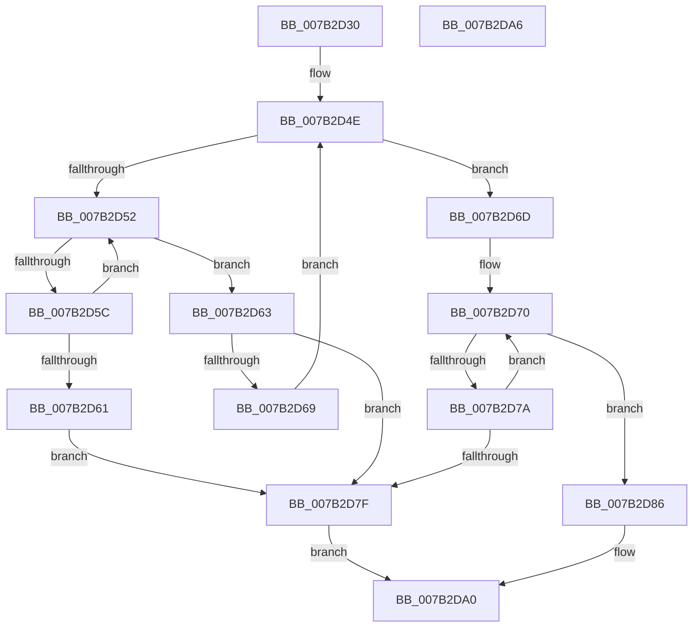

# WmipGetSMBiosString

- RVA: `0x007B2D30`–`0x007B2DA7` (길이 `119` bytes)
- VA: `0x00000001407B2D30`
- 실행 섹션: `PAGE`
- PDB 이름 있음: `예`; PDB Function 태그: `아니요`
- unwind 정보 RVA: `0x00064C80`
- 디코드: `40`개 명령, `119/119` bytes 표시
- 미해석 바이트: `0` (있으면 어셈블리에 `.byte`로 보존)

> 이 문서는 커널 이미지의 기계어와 PDB 기호를 분석해 생성했습니다. 4번과 5번은 함수 원형과 자료형을 바이너리 사용 방식에서 추정한 C 해석이며 원본 소스 복구 결과는 아닙니다.

## 1. Dependencies

- 직접 호출 지점: **2**; 고유 호출 대상: **2**
- 직접 호출자로 확인된 함수: **1**
- RIP 상대 이미지 참조: **0**

### Outgoing calls
- `0x007B2D8B` → [RtlInitAnsiString](../../text/47/RtlInitAnsiString_function_00470F40.md) (function, `0x00470F40`)
- `0x007B2D9B` → [RtlAnsiStringToUnicodeString](../90/RtlAnsiStringToUnicodeString_function_0090BEA0.md) (function, `0x0090BEA0`)

### Direct callers
- [WmipReadSMBiosSysInfo](../../text/64/WmipReadSMBiosSysInfo_function_0064E36C.md) at `0x0064E3E5`
- [WmipReadSMBiosSysInfo](../../text/64/WmipReadSMBiosSysInfo_function_0064E36C.md) at `0x0064E401`

### Static image references
- 디코드된 RIP-relative 메모리 참조가 없습니다.

## 2. Other-region calls and transfers

- 다른 실행 섹션으로 향하는 call: **1**
  - `0x007B2D8B` → [RtlInitAnsiString](../../text/47/RtlInitAnsiString_function_00470F40.md) (`PAGE` → `.text`)
- 별도 외부 분기/꼬리 이동을 확인하지 못했습니다.

## 3. Assembly (complete function range)

```asm
007B2D30  40 53                           push rbx
007B2D32  48 83 EC 30                     sub rsp, 0x30
007B2D36  44 0F B6 51 01                  movzx r10d, byte ptr [rcx + 1]
007B2D3B  0F 57 C0                        xorps xmm0, xmm0
007B2D3E  4C 03 D1                        add r10, rcx
007B2D41  49 8B D9                        mov rbx, r9
007B2D44  B9 01 00 00 00                  mov ecx, 1
007B2D49  0F 11 44 24 20                  movups xmmword ptr [rsp + 0x20], xmm0
007B2D4E  3B CA                           cmp ecx, edx
007B2D50  73 1B                           jae 0x1407b2d6d
007B2D52  41 8A 02                        mov al, byte ptr [r10]
007B2D55  49 FF C2                        inc r10
007B2D58  84 C0                           test al, al
007B2D5A  74 07                           je 0x1407b2d63
007B2D5C  4D 3B D0                        cmp r10, r8
007B2D5F  75 F1                           jne 0x1407b2d52
007B2D61  EB 1C                           jmp 0x1407b2d7f
007B2D63  41 80 3A 00                     cmp byte ptr [r10], 0
007B2D67  74 16                           je 0x1407b2d7f
007B2D69  FF C1                           inc ecx
007B2D6B  EB E1                           jmp 0x1407b2d4e
007B2D6D  49 8B D2                        mov rdx, r10
007B2D70  41 8A 02                        mov al, byte ptr [r10]
007B2D73  49 FF C2                        inc r10
007B2D76  84 C0                           test al, al
007B2D78  74 0C                           je 0x1407b2d86
007B2D7A  4D 3B D0                        cmp r10, r8
007B2D7D  75 F1                           jne 0x1407b2d70
007B2D7F  B8 25 02 00 C0                  mov eax, 0xc0000225
007B2D84  EB 1A                           jmp 0x1407b2da0
007B2D86  48 8D 4C 24 20                  lea rcx, [rsp + 0x20]
007B2D8B  E8 B0 E1 CB FF                  call 0x140470f40
007B2D90  41 B0 01                        mov r8b, 1
007B2D93  48 8D 54 24 20                  lea rdx, [rsp + 0x20]
007B2D98  48 8B CB                        mov rcx, rbx
007B2D9B  E8 00 91 15 00                  call 0x14090bea0
007B2DA0  48 83 C4 30                     add rsp, 0x30
007B2DA4  5B                              pop rbx
007B2DA5  C3                              ret
007B2DA6  CC                              int3
```

## 4. C-style interpretation (structured pseudocode)

```c
__int64 __fastcall WmipGetSMBiosString(__int64 a1, int a2, __int64 a3, __int64 a4)
{
    __int64 result;
    __int64 v_r10;
    __int64 v_rsp;
    unsigned __int64 v_stack_m18;

    v_rsp = (v_rsp) - (48);
    v_r10 = (*(unsigned __int8 *)(a1 + 1)) + (a1);
    v_stack_m18 = v_xmm0;
loc_007B2D4E:
    if (1 >= a2) goto loc_007B2D6D;
loc_007B2D52:
    v_r10 = (v_r10) + 1;
    if ((unsigned __int8)(*(unsigned __int8 *)(v_r10)) == 0) goto loc_007B2D63;
    if (v_r10 != a3) goto loc_007B2D52;
    goto loc_007B2D7F;
loc_007B2D63:
    if ((*(unsigned __int8 *)(v_r10)) == 0) goto loc_007B2D7F;
    a1 = (unsigned int)((1) + 1);
    goto loc_007B2D4E;
loc_007B2D6D:
loc_007B2D70:
    v_r10 = (v_r10) + 1;
    if ((unsigned __int8)(*(unsigned __int8 *)(v_r10)) == 0) goto loc_007B2D86;
    if (v_r10 != a3) goto loc_007B2D70;
loc_007B2D7F:
    goto loc_007B2DA0;
loc_007B2D86:
    result = RtlInitAnsiString(v_stack_m18, v_r10, a3, a4);
    result = RtlAnsiStringToUnicodeString(a4, v_stack_m18, 1, a4);
loc_007B2DA0:
    v_rsp = (v_rsp) + (48);
    return result;
}
```

## 5. (Beta) C Style

```c
int64_t WmipGetSMBiosString(void *Arg1, int32_t Arg2, int64_t Arg3, int64_t Arg4)
{
    uint8_t *arg1 = (uint8_t *)Arg1;

    int64_t result;
    int64_t local_r10;
    int64_t local_rsp;
    uint64_t v_stack_m18;

    local_rsp = (local_rsp) - (48);
    local_r10 = (*(uint8_t *)(arg1 + 0x1)) + (Arg1);
    v_stack_m18 = v_xmm0;
loc_007B2D4E:
    if (1 >= Arg2) goto loc_007B2D6D;
loc_007B2D52:
    local_r10 = (local_r10) + 1;
    if ((uint8_t)(*(uint8_t *)(local_r10)) == 0) goto loc_007B2D63;
    if (local_r10 != Arg3) goto loc_007B2D52;
    goto loc_007B2D7F;
loc_007B2D63:
    if ((*(uint8_t *)(local_r10)) == 0) goto loc_007B2D7F;
    Arg1 = (uint32_t)((1) + 1);
    goto loc_007B2D4E;
loc_007B2D6D:
loc_007B2D70:
    local_r10 = (local_r10) + 1;
    if ((uint8_t)(*(uint8_t *)(local_r10)) == 0) goto loc_007B2D86;
    if (local_r10 != Arg3) goto loc_007B2D70;
loc_007B2D7F:
    goto loc_007B2DA0;
loc_007B2D86:
    result = RtlInitAnsiString(v_stack_m18, local_r10, Arg3, Arg4);
    result = RtlAnsiStringToUnicodeString(Arg4, v_stack_m18, 1, Arg4);
loc_007B2DA0:
    local_rsp = (local_rsp) + (48);
    return result;
}
```

### 관측된 메모리 오프셋

구조체 형식이 확인되지 않은 접근은 인자 기준의 오프셋으로만 기록했습니다.

| 기준 인자 | 오프셋 표현 | 폭 (bit) | 접근 |
|---|---:|---:|---|
| `Arg1` | `+ 0x1` | `8` | `R` |

## 6. Execution-region graph

[열기: 2D/3D 그래프와 함수 탐색 컨트롤 패널](../../../control-panel.html?section=page&rva=0x007B2D30&view=graph)

- 2D 그래프는 위에서 아래로 흐르고, 3D 그래프는 빈 공간을 드래그해 회전합니다. Shift+드래그는 이동, 휠은 확대·축소, 함수 노드 선택은 대상 보고서 이동입니다.

### Static fallback


