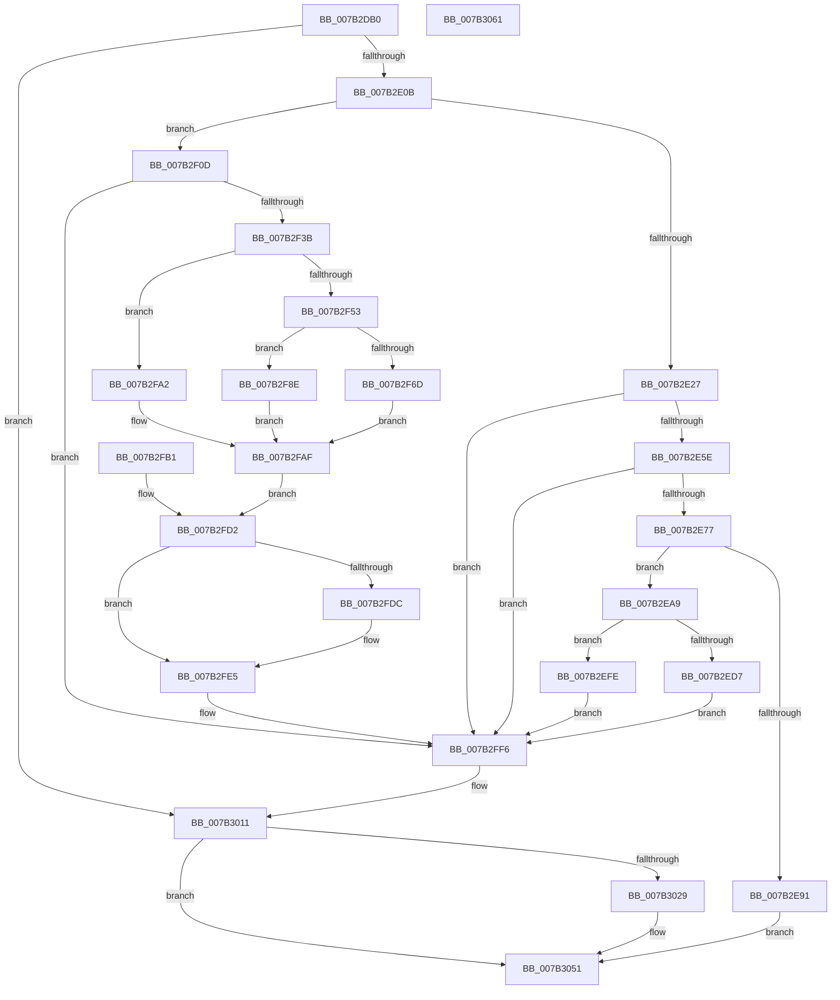

# WmipGetSysIds

- RVA: `0x007B2DB0`–`0x007B3062` (길이 `690` bytes)
- VA: `0x00000001407B2DB0`
- 실행 섹션: `PAGE`
- PDB 이름 있음: `예`; PDB Function 태그: `아니요`
- unwind 정보 RVA: `0x000D3174`
- 디코드: `167`개 명령, `690/690` bytes 표시
- 미해석 바이트: `0` (있으면 어셈블리에 `.byte`로 보존)

> 이 문서는 커널 이미지의 기계어와 PDB 기호를 분석해 생성했습니다. 4번과 5번은 함수 원형과 자료형을 바이너리 사용 방식에서 추정한 C 해석이며 원본 소스 복구 결과는 아닙니다.

## 1. Dependencies

- 직접 호출 지점: **14**; 고유 호출 대상: **10**
- 직접 호출자로 확인된 함수: **1**
- RIP 상대 이미지 참조: **14**

### Outgoing calls
- `0x007B2DFA` → [KeWaitForSingleObject](../../text/20/KeWaitForSingleObject_function_0020E6B0.md) (function, `0x0020E6B0`)
- `0x007B2E1A` → [WmipFindSysIdTable](WmipFindSysIdTable_function_007B2A60.md) (function, `0x007B2A60`)
- `0x007B2E4F` → [WmipParseSysIdTable](WmipParseSysIdTable_function_007B3068.md) (function, `0x007B3068`)
- `0x007B2E84` → [ExAllocatePool2](../../poolcode/B8/ExAllocatePool2_function_00B820F0.md) (function, `0x00B820F0`)
- `0x007B2E9A` → [KeReleaseMutex](../../text/39/KeReleaseMutex_function_00396810.md) (function, `0x00396810`)
- `0x007B2ECC` → [WmipParseSysIdTable](WmipParseSysIdTable_function_007B3068.md) (function, `0x007B3068`)
- `0x007B2F03` → [ExFreePoolWithTag](../../poolcode/B8/ExFreePoolWithTag_function_00B82870.md) (function, `0x00B82870`)
- `0x007B2F2C` → [WmipFindSMBiosStructure](WmipFindSMBiosStructure_function_007B2944.md) (function, `0x007B2944`)
- `0x007B2F63` → [ExAllocatePool2](../../poolcode/B8/ExAllocatePool2_function_00B820F0.md) (function, `0x00B820F0`)
- `0x007B2F92` → [ExFreePoolWithTag](../../poolcode/B8/ExFreePoolWithTag_function_00B82870.md) (function, `0x00B82870`)
- `0x007B2FE0` → [MmUnmapIoSpace](../../text/3F/MmUnmapIoSpace_function_003F78F0.md) (function, `0x003F78F0`)
- `0x007B2FEC` → [ExReleaseResourceLite](../../text/25/ExReleaseResourceLite_function_0025FA10.md) (function, `0x0025FA10`)
- `0x007B2FF1` → [KeLeaveCriticalRegion](../../text/25/KeLeaveCriticalRegion_function_0025D8B0.md) (function, `0x0025D8B0`)
- `0x007B301A` → [KeReleaseMutex](../../text/39/KeReleaseMutex_function_00396810.md) (function, `0x00396810`)

### Direct callers
- [WmipQueryWmiDataBlock](../A4/WmipQueryWmiDataBlock_function_00A4EDA0.md) at `0x00A4EEF7`

### Static image references
- `0x007B2DF3` → RVA `0x00EFFA60` (`.data`; read)
- `0x007B2DFF` → RVA `0x00EFFBAC` (`.data`; read)
- `0x007B2ED7` → RVA `0x00EFFB30` (`.data`; write)
- `0x007B2EE2` → RVA `0x00EFFBB0` (`.data`; write)
- `0x007B2EE8` → RVA `0x00EFFBE0` (`.data`; write)
- `0x007B2EF3` → RVA `0x00EFFBA8` (`.data`; write)
- `0x007B2FE5` → RVA `0x00EFFB40` (`.data`; read)
- `0x007B2FFC` → RVA `0x00EFFBAC` (`.data`; write)
- `0x007B3003` → RVA `0x00EFFBB4` (`.data`; write)
- `0x007B301F` → RVA `0x00EFFBB4` (`.data`; read)
- `0x007B3029` → RVA `0x00EFFB30` (`.data`; read)
- `0x007B3033` → RVA `0x00EFFBB0` (`.data`; read)
- `0x007B303D` → RVA `0x00EFFBE0` (`.data`; read)
- `0x007B3048` → RVA `0x00EFFBA8` (`.data`; read)

## 2. Other-region calls and transfers

- 다른 실행 섹션으로 향하는 call: **10**
  - `0x007B2DFA` → [KeWaitForSingleObject](../../text/20/KeWaitForSingleObject_function_0020E6B0.md) (`PAGE` → `.text`)
  - `0x007B2E84` → [ExAllocatePool2](../../poolcode/B8/ExAllocatePool2_function_00B820F0.md) (`PAGE` → `POOLCODE`)
  - `0x007B2E9A` → [KeReleaseMutex](../../text/39/KeReleaseMutex_function_00396810.md) (`PAGE` → `.text`)
  - `0x007B2F03` → [ExFreePoolWithTag](../../poolcode/B8/ExFreePoolWithTag_function_00B82870.md) (`PAGE` → `POOLCODE`)
  - `0x007B2F63` → [ExAllocatePool2](../../poolcode/B8/ExAllocatePool2_function_00B820F0.md) (`PAGE` → `POOLCODE`)
  - `0x007B2F92` → [ExFreePoolWithTag](../../poolcode/B8/ExFreePoolWithTag_function_00B82870.md) (`PAGE` → `POOLCODE`)
  - `0x007B2FE0` → [MmUnmapIoSpace](../../text/3F/MmUnmapIoSpace_function_003F78F0.md) (`PAGE` → `.text`)
  - `0x007B2FEC` → [ExReleaseResourceLite](../../text/25/ExReleaseResourceLite_function_0025FA10.md) (`PAGE` → `.text`)
  - `0x007B2FF1` → [KeLeaveCriticalRegion](../../text/25/KeLeaveCriticalRegion_function_0025D8B0.md) (`PAGE` → `.text`)
  - `0x007B301A` → [KeReleaseMutex](../../text/39/KeReleaseMutex_function_00396810.md) (`PAGE` → `.text`)
- 별도 외부 분기/꼬리 이동을 확인하지 못했습니다.

## 3. Assembly (complete function range)

```asm
007B2DB0  48 8B C4                        mov rax, rsp
007B2DB3  4C 89 48 20                     mov qword ptr [rax + 0x20], r9
007B2DB7  4C 89 40 18                     mov qword ptr [rax + 0x18], r8
007B2DBB  48 89 50 10                     mov qword ptr [rax + 0x10], rdx
007B2DBF  48 89 48 08                     mov qword ptr [rax + 8], rcx
007B2DC3  53                              push rbx
007B2DC4  56                              push rsi
007B2DC5  57                              push rdi
007B2DC6  41 54                           push r12
007B2DC8  41 55                           push r13
007B2DCA  41 56                           push r14
007B2DCC  41 57                           push r15
007B2DCE  48 83 EC 50                     sub rsp, 0x50
007B2DD2  4D 8B F9                        mov r15, r9
007B2DD5  4D 8B E0                        mov r12, r8
007B2DD8  4C 8B EA                        mov r13, rdx
007B2DDB  48 8B F9                        mov rdi, rcx
007B2DDE  33 DB                           xor ebx, ebx
007B2DE0  48 89 58 C0                     mov qword ptr [rax - 0x40], rbx
007B2DE4  89 58 B8                        mov dword ptr [rax - 0x48], ebx
007B2DE7  48 89 58 98                     mov qword ptr [rax - 0x68], rbx
007B2DEB  45 33 C9                        xor r9d, r9d
007B2DEE  45 33 C0                        xor r8d, r8d
007B2DF1  33 D2                           xor edx, edx
007B2DF3  48 8D 0D 66 CC 74 00            lea rcx, [rip + 0x74cc66]
007B2DFA  E8 B1 B8 A5 FF                  call 0x14020e6b0
007B2DFF  38 1D A7 CD 74 00               cmp byte ptr [rip + 0x74cda7], bl
007B2E05  0F 85 06 02 00 00               jne 0x1407b3011
007B2E0B  4C 8D 44 24 40                  lea r8, [rsp + 0x40]
007B2E10  48 8D 54 24 30                  lea rdx, [rsp + 0x30]
007B2E15  48 8D 4C 24 48                  lea rcx, [rsp + 0x48]
007B2E1A  E8 41 FC FF FF                  call 0x1407b2a60
007B2E1F  85 C0                           test eax, eax
007B2E21  0F 88 E6 00 00 00               js 0x1407b2f0d
007B2E27  89 5C 24 34                     mov dword ptr [rsp + 0x34], ebx
007B2E2B  89 5C 24 38                     mov dword ptr [rsp + 0x38], ebx
007B2E2F  48 8D 44 24 38                  lea rax, [rsp + 0x38]
007B2E34  48 89 44 24 28                  mov qword ptr [rsp + 0x28], rax
007B2E39  48 89 5C 24 20                  mov qword ptr [rsp + 0x20], rbx
007B2E3E  4C 8D 4C 24 34                  lea r9, [rsp + 0x34]
007B2E43  45 33 C0                        xor r8d, r8d
007B2E46  8B 54 24 40                     mov edx, dword ptr [rsp + 0x40]
007B2E4A  48 8B 4C 24 48                  mov rcx, qword ptr [rsp + 0x48]
007B2E4F  E8 14 02 00 00                  call 0x1407b3068
007B2E54  8B F8                           mov edi, eax
007B2E56  85 C0                           test eax, eax
007B2E58  0F 88 98 01 00 00               js 0x1407b2ff6
007B2E5E  44 8B 74 24 34                  mov r14d, dword ptr [rsp + 0x34]
007B2E63  41 C1 E6 04                     shl r14d, 4
007B2E67  8B 4C 24 38                     mov ecx, dword ptr [rsp + 0x38]
007B2E6B  41 8D 04 CE                     lea eax, [r14 + rcx*8]
007B2E6F  85 C0                           test eax, eax
007B2E71  0F 84 7F 01 00 00               je 0x1407b2ff6
007B2E77  8B D0                           mov edx, eax
007B2E79  B9 00 01 00 00                  mov ecx, 0x100
007B2E7E  41 B8 57 6D 69 73               mov r8d, 0x73696d57
007B2E84  E8 67 F2 3C 00                  call 0x140b820f0
007B2E89  48 8B F0                        mov rsi, rax
007B2E8C  48 85 C0                        test rax, rax
007B2E8F  75 18                           jne 0x1407b2ea9
007B2E91  33 D2                           xor edx, edx
007B2E93  48 8D 0D C6 CB 74 00            lea rcx, [rip + 0x74cbc6]
007B2E9A  E8 71 39 BE FF                  call 0x140396810
007B2E9F  B8 9A 00 00 C0                  mov eax, 0xc000009a
007B2EA4  E9 A8 01 00 00                  jmp 0x1407b3051
007B2EA9  4C 03 F6                        add r14, rsi
007B2EAC  48 8D 44 24 38                  lea rax, [rsp + 0x38]
007B2EB1  48 89 44 24 28                  mov qword ptr [rsp + 0x28], rax
007B2EB6  4C 89 74 24 20                  mov qword ptr [rsp + 0x20], r14
007B2EBB  4C 8D 4C 24 34                  lea r9, [rsp + 0x34]
007B2EC0  4C 8B C6                        mov r8, rsi
007B2EC3  8B 54 24 40                     mov edx, dword ptr [rsp + 0x40]
007B2EC7  48 8B 4C 24 48                  mov rcx, qword ptr [rsp + 0x48]
007B2ECC  E8 97 01 00 00                  call 0x1407b3068
007B2ED1  8B F8                           mov edi, eax
007B2ED3  85 C0                           test eax, eax
007B2ED5  78 27                           js 0x1407b2efe
007B2ED7  48 89 35 52 CC 74 00            mov qword ptr [rip + 0x74cc52], rsi
007B2EDE  8B 44 24 34                     mov eax, dword ptr [rsp + 0x34]
007B2EE2  89 05 C8 CC 74 00               mov dword ptr [rip + 0x74ccc8], eax
007B2EE8  4C 89 35 F1 CC 74 00            mov qword ptr [rip + 0x74ccf1], r14
007B2EEF  8B 44 24 38                     mov eax, dword ptr [rsp + 0x38]
007B2EF3  89 05 AF CC 74 00               mov dword ptr [rip + 0x74ccaf], eax
007B2EF9  E9 F8 00 00 00                  jmp 0x1407b2ff6
007B2EFE  33 D2                           xor edx, edx
007B2F00  48 8B CE                        mov rcx, rsi
007B2F03  E8 68 F9 3C 00                  call 0x140b82870
007B2F08  E9 E9 00 00 00                  jmp 0x1407b2ff6
007B2F0D  48 89 5C 24 38                  mov qword ptr [rsp + 0x38], rbx
007B2F12  48 89 5C 24 48                  mov qword ptr [rsp + 0x48], rbx
007B2F17  89 5C 24 40                     mov dword ptr [rsp + 0x40], ebx
007B2F1B  4C 8D 4C 24 40                  lea r9, [rsp + 0x40]
007B2F20  4C 8D 44 24 38                  lea r8, [rsp + 0x38]
007B2F25  48 8D 54 24 48                  lea rdx, [rsp + 0x48]
007B2F2A  B1 01                           mov cl, 1
007B2F2C  E8 13 FA FF FF                  call 0x1407b2944
007B2F31  8B F8                           mov edi, eax
007B2F33  85 C0                           test eax, eax
007B2F35  0F 88 BB 00 00 00               js 0x1407b2ff6
007B2F3B  48 89 1D 9E CC 74 00            mov qword ptr [rip + 0x74cc9e], rbx
007B2F42  89 1D 60 CC 74 00               mov dword ptr [rip + 0x74cc60], ebx
007B2F48  48 8B 74 24 48                  mov rsi, qword ptr [rsp + 0x48]
007B2F4D  80 7E 01 08                     cmp byte ptr [rsi + 1], 8
007B2F51  76 4F                           jbe 0x1407b2fa2
007B2F53  BA 10 00 00 00                  mov edx, 0x10
007B2F58  B9 00 01 00 00                  mov ecx, 0x100
007B2F5D  41 B8 57 6D 69 73               mov r8d, 0x73696d57
007B2F63  E8 88 F1 3C 00                  call 0x140b820f0
007B2F68  48 85 C0                        test rax, rax
007B2F6B  74 21                           je 0x1407b2f8e
007B2F6D  0F 10 46 08                     movups xmm0, xmmword ptr [rsi + 8]
007B2F71  F3 0F 7F 00                     movdqu xmmword ptr [rax], xmm0
007B2F75  C7 05 31 CC 74 00 01 00 00 00   mov dword ptr [rip + 0x74cc31], 1
007B2F7F  48 89 05 AA CB 74 00            mov qword ptr [rip + 0x74cbaa], rax
007B2F86  8B FB                           mov edi, ebx
007B2F88  89 5C 24 44                     mov dword ptr [rsp + 0x44], ebx
007B2F8C  EB 21                           jmp 0x1407b2faf
007B2F8E  33 D2                           xor edx, edx
007B2F90  33 C9                           xor ecx, ecx
007B2F92  E8 D9 F8 3C 00                  call 0x140b82870
007B2F97  BF 01 00 00 C0                  mov edi, 0xc0000001
007B2F9C  89 7C 24 44                     mov dword ptr [rsp + 0x44], edi
007B2FA0  EB 0D                           jmp 0x1407b2faf
007B2FA2  48 89 1D 87 CB 74 00            mov qword ptr [rip + 0x74cb87], rbx
007B2FA9  89 1D 01 CC 74 00               mov dword ptr [rip + 0x74cc01], ebx
007B2FAF  EB 21                           jmp 0x1407b2fd2
007B2FB1  BF 01 00 00 C0                  mov edi, 0xc0000001
007B2FB6  89 7C 24 44                     mov dword ptr [rsp + 0x44], edi
007B2FBA  4C 8B BC 24 A8 00 00 00         mov r15, qword ptr [rsp + 0xa8]
007B2FC2  4C 8B A4 24 A0 00 00 00         mov r12, qword ptr [rsp + 0xa0]
007B2FCA  4C 8B AC 24 98 00 00 00         mov r13, qword ptr [rsp + 0x98]
007B2FD2  48 8B 4C 24 38                  mov rcx, qword ptr [rsp + 0x38]
007B2FD7  48 85 C9                        test rcx, rcx
007B2FDA  74 09                           je 0x1407b2fe5
007B2FDC  8B 54 24 40                     mov edx, dword ptr [rsp + 0x40]
007B2FE0  E8 0B 49 C4 FF                  call 0x1403f78f0
007B2FE5  48 8D 0D 54 CB 74 00            lea rcx, [rip + 0x74cb54]
007B2FEC  E8 1F CA AA FF                  call 0x14025fa10
007B2FF1  E8 BA A8 AA FF                  call 0x14025d8b0
007B2FF6  81 FF 9A 00 00 C0               cmp edi, 0xc000009a
007B2FFC  0F 95 05 A9 CB 74 00            setne byte ptr [rip + 0x74cba9]
007B3003  89 3D AB CB 74 00               mov dword ptr [rip + 0x74cbab], edi
007B3009  48 8B BC 24 90 00 00 00         mov rdi, qword ptr [rsp + 0x90]
007B3011  33 D2                           xor edx, edx
007B3013  48 8D 0D 46 CA 74 00            lea rcx, [rip + 0x74ca46]
007B301A  E8 F1 37 BE FF                  call 0x140396810
007B301F  8B 05 8F CB 74 00               mov eax, dword ptr [rip + 0x74cb8f]
007B3025  85 C0                           test eax, eax
007B3027  78 28                           js 0x1407b3051
007B3029  48 8B 0D 00 CB 74 00            mov rcx, qword ptr [rip + 0x74cb00]
007B3030  48 89 0F                        mov qword ptr [rdi], rcx
007B3033  8B 0D 77 CB 74 00               mov ecx, dword ptr [rip + 0x74cb77]
007B3039  41 89 4D 00                     mov dword ptr [r13], ecx
007B303D  48 8B 0D 9C CB 74 00            mov rcx, qword ptr [rip + 0x74cb9c]
007B3044  49 89 0C 24                     mov qword ptr [r12], rcx
007B3048  8B 0D 5A CB 74 00               mov ecx, dword ptr [rip + 0x74cb5a]
007B304E  41 89 0F                        mov dword ptr [r15], ecx
007B3051  48 83 C4 50                     add rsp, 0x50
007B3055  41 5F                           pop r15
007B3057  41 5E                           pop r14
007B3059  41 5D                           pop r13
007B305B  41 5C                           pop r12
007B305D  5F                              pop rdi
007B305E  5E                              pop rsi
007B305F  5B                              pop rbx
007B3060  C3                              ret
007B3061  CC                              int3
```

## 4. C-style interpretation (structured pseudocode)

```c
__int64 __fastcall WmipGetSysIds(__int64 a1, __int64 a2, __int64 a3, __int64 a4)
{
    __int64 result;
    __int64 v_r14;
    __int64 v_rbx;
    __int64 v_rsp;
    unsigned __int64 v_stack_m40;
    unsigned int v_stack_m44;
    unsigned __int64 v_stack_m48;
    unsigned int v_stack_m50;
    unsigned int v_stack_m54;
    unsigned __int64 v_stack_m58;
    unsigned __int64 v_stack_m60;
    unsigned __int64 v_stack_m68;
    unsigned __int64 v_stack_p10;
    unsigned __int64 v_stack_p18;
    unsigned __int64 v_stack_p20;
    unsigned __int64 v_stack_p8;

    *(unsigned __int64 *)(v_rsp + 32) = a4;
    *(unsigned __int64 *)(v_rsp + 24) = a3;
    *(unsigned __int64 *)(v_rsp + 16) = a2;
    *(unsigned __int64 *)(v_rsp + 8) = a1;
    v_rsp = (v_rsp) - (80);
    v_rbx = 0;
    *(unsigned __int64 *)(v_rsp - 64) = 0;
    *(unsigned int *)(v_rsp - 72) = 0;
    *(unsigned __int64 *)(v_rsp - 104) = 0;
    a4 = 0;
    a3 = 0;
    a2 = 0;
    result = KeWaitForSingleObject(v_rip + 7654502, a2, a3, a4);
    if ((*(unsigned __int8 *)(v_rip + 7654823)) != 0) goto loc_007B3011;
    result = WmipFindSysIdTable(v_stack_m40, v_stack_m58, v_stack_m48, a4);
    if (sign_flag) goto loc_007B2F0D;
    v_stack_m54 = 0;
    v_stack_m50 = 0;
    v_stack_m60 = v_stack_m50;
    v_stack_m68 = 0;
    a3 = 0;
    result = WmipParseSysIdTable(v_stack_m40, (unsigned int)(v_stack_m48), a3, v_stack_m54);
    if (sign_flag) goto loc_007B2FF6;
    v_r14 = (unsigned int)(((unsigned int)(v_stack_m54)) << (4));
    if ((unsigned int)(v_r14 + (unsigned int)(v_stack_m50) * 8) == 0) goto loc_007B2FF6;
    result = ExAllocatePool2(256, (unsigned int)((unsigned int)(v_r14 + (unsigned int)(v_stack_m50) * 8)), (unsigned int)(0x73696D57ULL), v_stack_m54);
    if (result != 0) goto loc_007B2EA9;
    a2 = 0;
    result = KeReleaseMutex(v_rip + 7654342, a2, (unsigned int)(0x73696D57ULL), v_stack_m54);
    goto loc_007B3051;
loc_007B2EA9:
    v_r14 = (v_r14) + (result);
    v_stack_m60 = v_stack_m50;
    v_stack_m68 = v_r14;
    result = WmipParseSysIdTable(v_stack_m40, (unsigned int)(v_stack_m48), result, v_stack_m54);
    if (sign_flag) goto loc_007B2EFE;
    *(unsigned __int64 *)(v_rip + 7654482) = result;
    *(unsigned int *)(v_rip + 7654600) = (unsigned int)((unsigned int)(v_stack_m54));
    *(unsigned __int64 *)(v_rip + 7654641) = v_r14;
    *(unsigned int *)(v_rip + 7654575) = (unsigned int)((unsigned int)(v_stack_m50));
    goto loc_007B2FF6;
loc_007B2EFE:
    a2 = 0;
    result = ExFreePoolWithTag(result, a2, result, v_stack_m54);
    goto loc_007B2FF6;
loc_007B2F0D:
    v_stack_m50 = 0;
    v_stack_m40 = 0;
    v_stack_m48 = 0;
    result = WmipFindSMBiosStructure(1, v_stack_m40, v_stack_m50, v_stack_m48);
    if (sign_flag) goto loc_007B2FF6;
    *(unsigned __int64 *)(v_rip + 7654558) = 0;
    *(unsigned int *)(v_rip + 7654496) = 0;
    if ((*(unsigned __int8 *)(v_stack_m40 + 1)) <= 8) goto loc_007B2FA2;
    result = ExAllocatePool2(256, 16, (unsigned int)(0x73696D57ULL), v_stack_m48);
    if (result == 0) goto loc_007B2F8E;
    *(unsigned __int64 *)(result) = v_xmm0;
    *(unsigned int *)(v_rip + 7654449) = 1;
    *(unsigned __int64 *)(v_rip + 7654314) = result;
    v_stack_m44 = 0;
    goto loc_007B2FAF;
loc_007B2F8E:
    a2 = 0;
    a1 = 0;
    result = ExFreePoolWithTag(a1, a2, (unsigned int)(0x73696D57ULL), v_stack_m48);
    v_stack_m44 = (unsigned int)((unsigned int)(0xC0000001ULL));
    goto loc_007B2FAF;
loc_007B2FA2:
    *(unsigned __int64 *)(v_rip + 7654279) = 0;
    *(unsigned int *)(v_rip + 7654401) = 0;
loc_007B2FAF:
    goto loc_007B2FD2;
loc_007B2FD2:
    if (v_stack_m50 != 0) {
        a2 = v_stack_m48;
        result = MmUnmapIoSpace(v_stack_m50, a2, (unsigned int)(0x73696D57ULL), v_stack_m48);
    }
    result = ExReleaseResourceLite(v_rip + 7654228, a2, (unsigned int)(0x73696D57ULL), v_stack_m48);
    result = KeLeaveCriticalRegion(v_rip + 7654228, a2, (unsigned int)(0x73696D57ULL), v_stack_m48);
loc_007B2FF6:
    *(unsigned int *)(v_rip + 7654315) = (unsigned int)((unsigned int)(0xC0000001ULL));
loc_007B3011:
    a2 = 0;
    result = KeReleaseMutex(v_rip + 7653958, a2, (unsigned int)(0x73696D57ULL), v_stack_m48);
    if (!(sign_flag)) {
        a1 = *(unsigned __int64 *)(v_rip + 7654144);
        *(unsigned __int64 *)(v_stack_p8) = a1;
        a1 = *(unsigned int *)(v_rip + 7654263);
        *(unsigned int *)(a2) = (unsigned int)(a1);
        a1 = *(unsigned __int64 *)(v_rip + 7654300);
        *(unsigned __int64 *)(a3) = a1;
        a1 = *(unsigned int *)(v_rip + 7654234);
        *(unsigned int *)(a4) = (unsigned int)(a1);
    }
    v_rsp = (v_rsp) + (80);
    return (unsigned int)(*(unsigned int *)(v_rip + 7654287));
}
```

## 5. (Beta) C Style

```c
int64_t WmipGetSysIds(int64_t Arg1, void *Arg2, void *Arg3, void *Arg4)
{
    uint8_t *arg2 = (uint8_t *)Arg2;
    uint8_t *arg3 = (uint8_t *)Arg3;
    uint8_t *arg4 = (uint8_t *)Arg4;

    int64_t result;
    int64_t local_r14;
    int64_t local_rbx;
    int64_t local_rsp;
    uint64_t v_stack_m40;
    uint32_t v_stack_m44;
    uint64_t v_stack_m48;
    uint32_t v_stack_m50;
    uint32_t v_stack_m54;
    uint64_t v_stack_m58;
    uint64_t v_stack_m60;
    uint64_t v_stack_m68;
    uint64_t v_stack_p10;
    uint64_t v_stack_p18;
    uint64_t v_stack_p20;
    uint64_t v_stack_p8;

    *(void **)(local_rsp + 0x20) = Arg4;
    *(void **)(local_rsp + 0x18) = Arg3;
    *(void **)(local_rsp + 0x10) = Arg2;
    *(uint64_t *)(local_rsp + 0x8) = Arg1;
    local_rsp = (local_rsp) - (80);
    local_rbx = 0;
    *(uint64_t *)(local_rsp - 0x40) = 0;
    *(uint32_t *)(local_rsp - 0x48) = 0;
    *(uint64_t *)(local_rsp - 0x68) = 0;
    Arg4 = 0;
    Arg3 = 0;
    Arg2 = 0;
    result = KeWaitForSingleObject(v_rip + 7654502, Arg2, Arg3, Arg4);
    if ((*(uint8_t *)(v_rip + 0x74CDA7)) != 0) goto loc_007B3011;
    result = WmipFindSysIdTable(v_stack_m40, v_stack_m58, v_stack_m48, Arg4);
    if (sign_flag) goto loc_007B2F0D;
    v_stack_m54 = 0;
    v_stack_m50 = 0;
    v_stack_m60 = v_stack_m50;
    v_stack_m68 = 0;
    Arg3 = 0;
    result = WmipParseSysIdTable(v_stack_m40, (uint32_t)(v_stack_m48), Arg3, v_stack_m54);
    if (sign_flag) goto loc_007B2FF6;
    local_r14 = (uint32_t)(((uint32_t)(v_stack_m54)) << (4));
    if ((uint32_t)(local_r14 + (uint32_t)(v_stack_m50) * 8) == 0) goto loc_007B2FF6;
    result = ExAllocatePool2(256, (uint32_t)((uint32_t)(local_r14 + (uint32_t)(v_stack_m50) * 8)), (uint32_t)(0x73696D57ULL), v_stack_m54);
    if (result != 0) goto loc_007B2EA9;
    Arg2 = 0;
    result = KeReleaseMutex(v_rip + 7654342, Arg2, (uint32_t)(0x73696D57ULL), v_stack_m54);
    goto loc_007B3051;
loc_007B2EA9:
    local_r14 = (local_r14) + (result);
    v_stack_m60 = v_stack_m50;
    v_stack_m68 = local_r14;
    result = WmipParseSysIdTable(v_stack_m40, (uint32_t)(v_stack_m48), result, v_stack_m54);
    if (sign_flag) goto loc_007B2EFE;
    *(uint64_t *)(v_rip + 0x74CC52) = result;
    *(uint32_t *)(v_rip + 0x74CCC8) = (uint32_t)((uint32_t)(v_stack_m54));
    *(uint64_t *)(v_rip + 0x74CCF1) = local_r14;
    *(uint32_t *)(v_rip + 0x74CCAF) = (uint32_t)((uint32_t)(v_stack_m50));
    goto loc_007B2FF6;
loc_007B2EFE:
    Arg2 = 0;
    result = ExFreePoolWithTag(result, Arg2, result, v_stack_m54);
    goto loc_007B2FF6;
loc_007B2F0D:
    v_stack_m50 = 0;
    v_stack_m40 = 0;
    v_stack_m48 = 0;
    result = WmipFindSMBiosStructure(1, v_stack_m40, v_stack_m50, v_stack_m48);
    if (sign_flag) goto loc_007B2FF6;
    *(uint64_t *)(v_rip + 0x74CC9E) = 0;
    *(uint32_t *)(v_rip + 0x74CC60) = 0;
    if ((*(uint8_t *)(v_stack_m40 + 0x1)) <= 8) goto loc_007B2FA2;
    result = ExAllocatePool2(256, 16, (uint32_t)(0x73696D57ULL), v_stack_m48);
    if (result == 0) goto loc_007B2F8E;
    *(uint64_t *)(result) = v_xmm0;
    *(uint32_t *)(v_rip + 0x74CC31) = 1;
    *(uint64_t *)(v_rip + 0x74CBAA) = result;
    v_stack_m44 = 0;
    goto loc_007B2FAF;
loc_007B2F8E:
    Arg2 = 0;
    Arg1 = 0;
    result = ExFreePoolWithTag(Arg1, Arg2, (uint32_t)(0x73696D57ULL), v_stack_m48);
    v_stack_m44 = (uint32_t)((uint32_t)(0xC0000001ULL));
    goto loc_007B2FAF;
loc_007B2FA2:
    *(uint64_t *)(v_rip + 0x74CB87) = 0;
    *(uint32_t *)(v_rip + 0x74CC01) = 0;
loc_007B2FAF:
    goto loc_007B2FD2;
loc_007B2FD2:
    if (v_stack_m50 != 0) {
        Arg2 = v_stack_m48;
        result = MmUnmapIoSpace(v_stack_m50, Arg2, (uint32_t)(0x73696D57ULL), v_stack_m48);
    }
    result = ExReleaseResourceLite(v_rip + 7654228, Arg2, (uint32_t)(0x73696D57ULL), v_stack_m48);
    result = KeLeaveCriticalRegion(v_rip + 7654228, Arg2, (uint32_t)(0x73696D57ULL), v_stack_m48);
loc_007B2FF6:
    *(uint32_t *)(v_rip + 0x74CBAB) = (uint32_t)((uint32_t)(0xC0000001ULL));
loc_007B3011:
    Arg2 = 0;
    result = KeReleaseMutex(v_rip + 7653958, Arg2, (uint32_t)(0x73696D57ULL), v_stack_m48);
    if (!(sign_flag)) {
        Arg1 = *(uint64_t *)(v_rip + 0x74CB00);
        *(uint64_t *)(v_stack_p8) = Arg1;
        Arg1 = *(uint32_t *)(v_rip + 0x74CB77);
        *(uint32_t *)(arg2) = (uint32_t)(Arg1);
        Arg1 = *(uint64_t *)(v_rip + 0x74CB9C);
        *(uint64_t *)(arg3) = Arg1;
        Arg1 = *(uint32_t *)(v_rip + 0x74CB5A);
        *(uint32_t *)(arg4) = (uint32_t)(Arg1);
    }
    local_rsp = (local_rsp) + (80);
    return (uint32_t)(*(uint32_t *)(v_rip + 0x74CB8F));
}
```

### 관측된 메모리 오프셋

구조체 형식이 확인되지 않은 접근은 인자 기준의 오프셋으로만 기록했습니다.

| 기준 인자 | 오프셋 표현 | 폭 (bit) | 접근 |
|---|---:|---:|---|
| `Arg2` | `+ 0x0` | `32` | `W` |
| `Arg3` | `+ 0x0` | `64` | `W` |
| `Arg4` | `+ 0x0` | `32` | `W` |

## 6. Execution-region graph

[열기: 2D/3D 그래프와 함수 탐색 컨트롤 패널](../../../control-panel.html?section=page&rva=0x007B2DB0&view=graph)

- 2D 그래프는 위에서 아래로 흐르고, 3D 그래프는 빈 공간을 드래그해 회전합니다. Shift+드래그는 이동, 휠은 확대·축소, 함수 노드 선택은 대상 보고서 이동입니다.

### Static fallback


