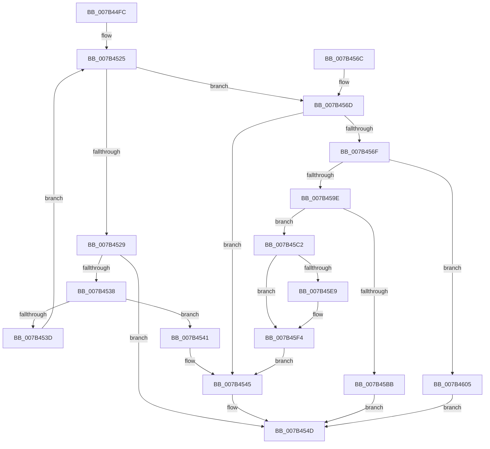

# WmipInsertMofResource

- RVA: `0x007B44FC`–`0x007B460F` (길이 `275` bytes)
- VA: `0x00000001407B44FC`
- 실행 섹션: `PAGE`
- PDB 이름 있음: `예`; PDB Function 태그: `아니요`
- unwind 정보 RVA: `0x000D32D4`
- 디코드: `84`개 명령, `275/275` bytes 표시
- 미해석 바이트: `0` (있으면 어셈블리에 `.byte`로 보존)

> 이 문서는 커널 이미지의 기계어와 PDB 기호를 분석해 생성했습니다. 4번과 5번은 함수 원형과 자료형을 바이너리 사용 방식에서 추정한 C 해석이며 원본 소스 복구 결과는 아닙니다.

## 1. Dependencies

- 직접 호출 지점: **5**; 고유 호출 대상: **5**
- 직접 호출자로 확인된 함수: **1**
- RIP 상대 이미지 참조: **0**

### Outgoing calls
- `0x007B4548` → [WmipReferenceEntry](../9E/WmipReferenceEntry_function_009E1BF8.md) (function, `0x009E1BF8`)
- `0x007B45AE` → [ExAllocatePool2](../../poolcode/B8/ExAllocatePool2_function_00B820F0.md) (function, `0x00B820F0`)
- `0x007B45CA` → [memset](../../text/6C/memset_function_006C6C40.md) (function, `0x006C6C40`)
- `0x007B45D9` → [memcpy](../../text/6C/memcpy_function_006C6840.md) (function, `0x006C6840`)
- `0x007B45EF` → [ExFreePoolWithTag](../../poolcode/B8/ExFreePoolWithTag_function_00B82870.md) (function, `0x00B82870`)

### Direct callers
- [WmipAddMofResource](WmipAddMofResource_function_007B4188.md) at `0x007B42FC`

### Static image references
- 디코드된 RIP-relative 메모리 참조가 없습니다.

## 2. Other-region calls and transfers

- 다른 실행 섹션으로 향하는 call: **4**
  - `0x007B45AE` → [ExAllocatePool2](../../poolcode/B8/ExAllocatePool2_function_00B820F0.md) (`PAGE` → `POOLCODE`)
  - `0x007B45CA` → [memset](../../text/6C/memset_function_006C6C40.md) (`PAGE` → `.text`)
  - `0x007B45D9` → [memcpy](../../text/6C/memcpy_function_006C6840.md) (`PAGE` → `.text`)
  - `0x007B45EF` → [ExFreePoolWithTag](../../poolcode/B8/ExFreePoolWithTag_function_00B82870.md) (`PAGE` → `POOLCODE`)
- 별도 외부 분기/꼬리 이동을 확인하지 못했습니다.

## 3. Assembly (complete function range)

```asm
007B44FC  48 89 5C 24 10                  mov qword ptr [rsp + 0x10], rbx
007B4501  48 89 6C 24 18                  mov qword ptr [rsp + 0x18], rbp
007B4506  48 89 74 24 20                  mov qword ptr [rsp + 0x20], rsi
007B450B  57                              push rdi
007B450C  41 54                           push r12
007B450E  41 55                           push r13
007B4510  41 56                           push r14
007B4512  41 57                           push r15
007B4514  48 83 EC 20                     sub rsp, 0x20
007B4518  33 DB                           xor ebx, ebx
007B451A  48 8B F9                        mov rdi, rcx
007B451D  8B 49 40                        mov ecx, dword ptr [rcx + 0x40]
007B4520  8B C3                           mov eax, ebx
007B4522  48 8B F2                        mov rsi, rdx
007B4525  3B C1                           cmp eax, ecx
007B4527  73 44                           jae 0x1407b456d
007B4529  4C 8B 47 48                     mov r8, qword ptr [rdi + 0x48]
007B452D  8B D0                           mov edx, eax
007B452F  4D 8B 0C D0                     mov r9, qword ptr [r8 + rdx*8]
007B4533  4C 3B CE                        cmp r9, rsi
007B4536  74 15                           je 0x1407b454d
007B4538  4D 85 C9                        test r9, r9
007B453B  74 04                           je 0x1407b4541
007B453D  FF C0                           inc eax
007B453F  EB E4                           jmp 0x1407b4525
007B4541  49 89 34 D0                     mov qword ptr [r8 + rdx*8], rsi
007B4545  48 8B CE                        mov rcx, rsi
007B4548  E8 AB D6 22 00                  call 0x1409e1bf8
007B454D  48 8B 6C 24 60                  mov rbp, qword ptr [rsp + 0x60]
007B4552  8B C3                           mov eax, ebx
007B4554  48 8B 5C 24 58                  mov rbx, qword ptr [rsp + 0x58]
007B4559  48 8B 74 24 68                  mov rsi, qword ptr [rsp + 0x68]
007B455E  48 83 C4 20                     add rsp, 0x20
007B4562  41 5F                           pop r15
007B4564  41 5E                           pop r14
007B4566  41 5D                           pop r13
007B4568  41 5C                           pop r12
007B456A  5F                              pop rdi
007B456B  C3                              ret
007B456C  CC                              int3
007B456D  75 D6                           jne 0x1407b4545
007B456F  48 8B 47 48                     mov rax, qword ptr [rdi + 0x48]
007B4573  44 8D 61 04                     lea r12d, [rcx + 4]
007B4577  4C 8B F1                        mov r14, rcx
007B457A  48 89 44 24 50                  mov qword ptr [rsp + 0x50], rax
007B457F  49 C1 E6 03                     shl r14, 3
007B4583  B9 FF FF FF FF                  mov ecx, 0xffffffff
007B4588  4C 3B F1                        cmp r14, rcx
007B458B  41 8B C4                        mov eax, r12d
007B458E  44 8B E9                        mov r13d, ecx
007B4591  45 0F 46 EE                     cmovbe r13d, r14d
007B4595  48 C1 E0 03                     shl rax, 3
007B4599  48 3B C1                        cmp rax, rcx
007B459C  77 67                           ja 0x1407b4605
007B459E  41 B8 57 6D 69 70               mov r8d, 0x70696d57
007B45A4  8B D0                           mov edx, eax
007B45A6  B9 00 01 00 00                  mov ecx, 0x100
007B45AB  44 8B F8                        mov r15d, eax
007B45AE  E8 3D DB 3C 00                  call 0x140b820f0
007B45B3  48 8B E8                        mov rbp, rax
007B45B6  48 85 C0                        test rax, rax
007B45B9  75 07                           jne 0x1407b45c2
007B45BB  BB 9A 00 00 C0                  mov ebx, 0xc000009a
007B45C0  EB 8B                           jmp 0x1407b454d
007B45C2  4D 8B C7                        mov r8, r15
007B45C5  33 D2                           xor edx, edx
007B45C7  48 8B CD                        mov rcx, rbp
007B45CA  E8 71 26 F1 FF                  call 0x1406c6c40
007B45CF  48 8B 57 48                     mov rdx, qword ptr [rdi + 0x48]
007B45D3  48 8B CD                        mov rcx, rbp
007B45D6  45 8B C5                        mov r8d, r13d
007B45D9  E8 62 22 F1 FF                  call 0x1406c6840
007B45DE  48 8D 47 50                     lea rax, [rdi + 0x50]
007B45E2  48 39 44 24 50                  cmp qword ptr [rsp + 0x50], rax
007B45E7  74 0B                           je 0x1407b45f4
007B45E9  48 8B 4F 48                     mov rcx, qword ptr [rdi + 0x48]
007B45ED  33 D2                           xor edx, edx
007B45EF  E8 7C E2 3C 00                  call 0x140b82870
007B45F4  48 89 6F 48                     mov qword ptr [rdi + 0x48], rbp
007B45F8  49 89 34 2E                     mov qword ptr [r14 + rbp], rsi
007B45FC  44 89 67 40                     mov dword ptr [rdi + 0x40], r12d
007B4600  E9 40 FF FF FF                  jmp 0x1407b4545
007B4605  BB 95 00 00 C0                  mov ebx, 0xc0000095
007B460A  E9 3E FF FF FF                  jmp 0x1407b454d
```

## 4. C-style interpretation (structured pseudocode)

```c
__int64 __fastcall WmipInsertMofResource(__int64 a1, __int64 a2)
{
    __int64 result;
    __int64 v_r13;
    __int64 v_r14;
    __int64 v_rbx;
    __int64 v_rsp;
    unsigned __int64 v_stack_p10;
    unsigned __int64 v_stack_p18;
    unsigned __int64 v_stack_p20;
    unsigned __int64 v_stack_p50;

    v_stack_p10 = v_rbx;
    v_stack_p18 = v_rbp;
    v_stack_p20 = v_rsi;
    v_rsp = (v_rsp) - (32);
    v_rbx = 0;
loc_007B4525:
    if (0 >= ((unsigned int)((unsigned int)(*(unsigned int *)(a1 + 64))))) goto loc_007B456D;
    if ((*(unsigned __int64 *)(*(unsigned __int64 *)(a1 + 72) + 0 * 8)) == a2) goto loc_007B454D;
    if (*(unsigned __int64 *)(*(unsigned __int64 *)(a1 + 72) + 0 * 8) == 0) goto loc_007B4541;
    result = (unsigned int)((0) + 1);
    goto loc_007B4525;
loc_007B4541:
    *(unsigned __int64 *)(*(unsigned __int64 *)(a1 + 72) + 0 * 8) = a2;
loc_007B4545:
    result = WmipReferenceEntry(a2, 0, *(unsigned __int64 *)(a1 + 72), *(unsigned __int64 *)(*(unsigned __int64 *)(a1 + 72) + 0 * 8));
loc_007B454D:
    v_rsp = (v_rsp) + (32);
    return 0;
loc_007B456D:
    if (condition_is_not_equal) goto loc_007B4545;
    v_stack_p50 = *(unsigned __int64 *)(a1 + 72);
    v_r14 = (a2) << (3);
    v_r13 = (unsigned int)((unsigned int)((unsigned int)(0xFFFFFFFFULL)));
    if (v_r14 <= ((unsigned int)(0xFFFFFFFFULL))) { v_r13 = (unsigned int)(v_r14); }
    result = ((unsigned int)((unsigned int)(a2 + 4))) << (3);
    if (result > ((unsigned int)(0xFFFFFFFFULL))) goto loc_007B4605;
    result = ExAllocatePool2(256, (unsigned int)((unsigned int)(result)), (unsigned int)(0x70696D57ULL), *(unsigned __int64 *)(*(unsigned __int64 *)(a1 + 72) + 0 * 8));
    if (result != 0) goto loc_007B45C2;
    goto loc_007B454D;
loc_007B45C2:
    a2 = 0;
    result = memset(result, a2, (unsigned int)((unsigned int)(result)), *(unsigned __int64 *)(*(unsigned __int64 *)(a1 + 72) + 0 * 8));
    result = memcpy(result, *(unsigned __int64 *)(a1 + 72), (unsigned int)((unsigned int)(v_r13)), *(unsigned __int64 *)(*(unsigned __int64 *)(a1 + 72) + 0 * 8));
    result = a1 + 80;
    if (v_stack_p50 != (a1 + 80)) {
        a1 = *(unsigned __int64 *)(a1 + 72);
        a2 = 0;
        result = ExFreePoolWithTag(a1, a2, (unsigned int)((unsigned int)(v_r13)), *(unsigned __int64 *)(*(unsigned __int64 *)(a1 + 72) + 0 * 8));
    }
    *(unsigned __int64 *)(a1 + 72) = result;
    *(unsigned __int64 *)(v_r14 + result * 1) = v_stack_p20;
    *(unsigned int *)(a1 + 64) = (unsigned int)(a2 + 4);
    goto loc_007B4545;
loc_007B4605:
    goto loc_007B454D;
}
```

## 5. (Beta) C Style

```c
int64_t WmipInsertMofResource(void *Arg1, int64_t Arg2)
{
    uint8_t *arg1 = (uint8_t *)Arg1;

    int64_t result;
    int64_t local_r13;
    int64_t local_r14;
    int64_t local_rbx;
    int64_t local_rsp;
    uint64_t v_stack_p10;
    uint64_t v_stack_p18;
    uint64_t v_stack_p20;
    uint64_t v_stack_p50;

    v_stack_p10 = local_rbx;
    v_stack_p18 = local_rbp;
    v_stack_p20 = local_rsi;
    local_rsp = (local_rsp) - (32);
    local_rbx = 0;
loc_007B4525:
    if (0 >= ((uint32_t)((uint32_t)(*(uint32_t *)(arg1 + 0x40))))) goto loc_007B456D;
    if ((*(uint64_t *)(*(uint64_t *)(arg1 + 0x48) + 0x0 * 8)) == Arg2) goto loc_007B454D;
    if (*(uint64_t *)(*(uint64_t *)(arg1 + 0x48) + 0x0 * 8) == 0) goto loc_007B4541;
    result = (uint32_t)((0) + 1);
    goto loc_007B4525;
loc_007B4541:
    *(uint64_t *)(*(uint64_t *)(arg1 + 0x48) + 0x0 * 8) = Arg2;
loc_007B4545:
    result = WmipReferenceEntry(Arg2, 0, *(uint64_t *)(arg1 + 0x48), *(uint64_t *)(*(uint64_t *)(arg1 + 0x48) + 0x0 * 8));
loc_007B454D:
    local_rsp = (local_rsp) + (32);
    return 0;
loc_007B456D:
    if (condition_is_not_equal) goto loc_007B4545;
    v_stack_p50 = *(uint64_t *)(arg1 + 0x48);
    local_r14 = (Arg2) << (3);
    local_r13 = (uint32_t)((uint32_t)((uint32_t)(0xFFFFFFFFULL)));
    if (local_r14 <= ((uint32_t)(0xFFFFFFFFULL))) { local_r13 = (uint32_t)(local_r14); }
    result = ((uint32_t)((uint32_t)(Arg2 + 4))) << (3);
    if (result > ((uint32_t)(0xFFFFFFFFULL))) goto loc_007B4605;
    result = ExAllocatePool2(256, (uint32_t)((uint32_t)(result)), (uint32_t)(0x70696D57ULL), *(uint64_t *)(*(uint64_t *)(arg1 + 0x48) + 0x0 * 8));
    if (result != 0) goto loc_007B45C2;
    goto loc_007B454D;
loc_007B45C2:
    Arg2 = 0;
    result = memset(result, Arg2, (uint32_t)((uint32_t)(result)), *(uint64_t *)(*(uint64_t *)(arg1 + 0x48) + 0x0 * 8));
    result = memcpy(result, *(uint64_t *)(arg1 + 0x48), (uint32_t)((uint32_t)(local_r13)), *(uint64_t *)(*(uint64_t *)(arg1 + 0x48) + 0x0 * 8));
    result = Arg1 + 80;
    if (v_stack_p50 != (Arg1 + 80)) {
        Arg1 = *(uint64_t *)(arg1 + 0x48);
        Arg2 = 0;
        result = ExFreePoolWithTag(Arg1, Arg2, (uint32_t)((uint32_t)(local_r13)), *(uint64_t *)(*(uint64_t *)(arg1 + 0x48) + 0x0 * 8));
    }
    *(uint64_t *)(arg1 + 0x48) = result;
    *(uint64_t *)(local_r14 + result * 1) = v_stack_p20;
    *(uint32_t *)(arg1 + 0x40) = (uint32_t)(Arg2 + 4);
    goto loc_007B4545;
loc_007B4605:
    goto loc_007B454D;
}
```

### 관측된 메모리 오프셋

구조체 형식이 확인되지 않은 접근은 인자 기준의 오프셋으로만 기록했습니다.

| 기준 인자 | 오프셋 표현 | 폭 (bit) | 접근 |
|---|---:|---:|---|
| `Arg1` | `+ 0x40` | `32` | `R` |
| `Arg1` | `+ 0x40` | `32` | `W` |
| `Arg1` | `+ 0x48` | `64` | `R` |
| `Arg1` | `+ 0x48` | `64` | `W` |
| `Arg1` | `+ 0x50` | `64` | `R` |

## 6. Execution-region graph

[열기: 2D/3D 그래프와 함수 탐색 컨트롤 패널](../../../control-panel.html?section=page&rva=0x007B44FC&view=graph)

- 2D 그래프는 위에서 아래로 흐르고, 3D 그래프는 빈 공간을 드래그해 회전합니다. Shift+드래그는 이동, 휠은 확대·축소, 함수 노드 선택은 대상 보고서 이동입니다.

### Static fallback


