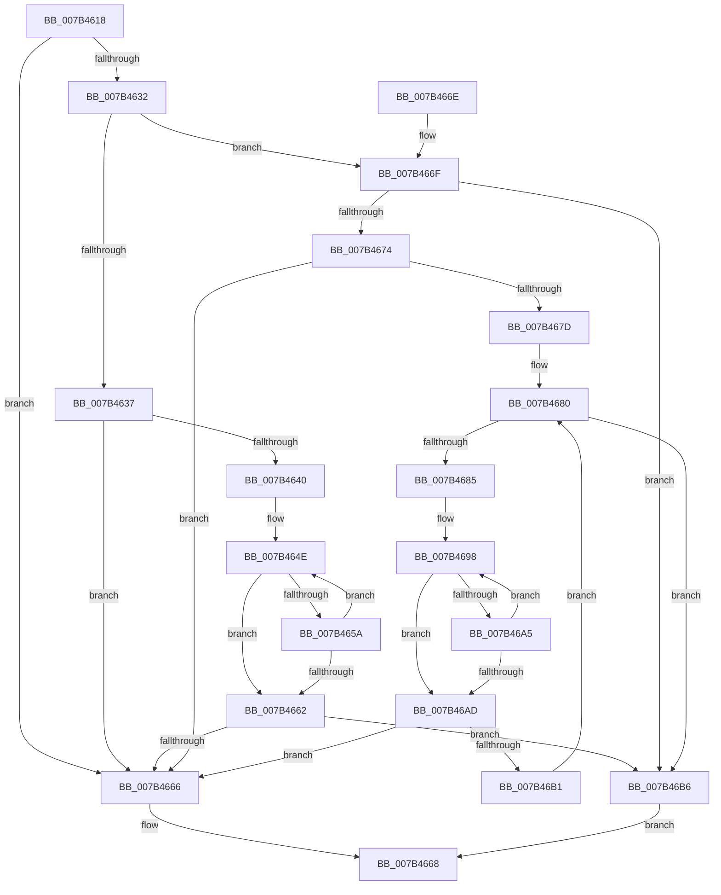

# WmipIsEqualInstanceSets

- RVA: `0x007B4618`–`0x007B46BA` (길이 `162` bytes)
- VA: `0x00000001407B4618`
- 실행 섹션: `PAGE`
- PDB 이름 있음: `예`; PDB Function 태그: `아니요`
- unwind 정보 RVA: `0x000D32C8`
- 디코드: `56`개 명령, `162/162` bytes 표시
- 미해석 바이트: `0` (있으면 어셈블리에 `.byte`로 보존)

> 이 문서는 커널 이미지의 기계어와 PDB 기호를 분석해 생성했습니다. 4번과 5번은 함수 원형과 자료형을 바이너리 사용 방식에서 추정한 C 해석이며 원본 소스 복구 결과는 아닙니다.

## 1. Dependencies

- 직접 호출 지점: **0**; 고유 호출 대상: **0**
- 직접 호출자로 확인된 함수: **1**
- RIP 상대 이미지 참조: **0**

### Outgoing calls
- 직접 디코드된 call 명령이 없습니다.

### Direct callers
- [WmipUpdateModifyGuid](WmipUpdateModifyGuid_function_007B4798.md) at `0x007B4851`

### Static image references
- 디코드된 RIP-relative 메모리 참조가 없습니다.

## 2. Other-region calls and transfers

- 다른 실행 섹션으로 향하는 call: **0**
- 별도 외부 분기/꼬리 이동을 확인하지 못했습니다.

## 3. Assembly (complete function range)

```asm
007B4618  48 89 5C 24 08                  mov qword ptr [rsp + 8], rbx
007B461D  4C 8B C1                        mov r8, rcx
007B4620  4C 8B CA                        mov r9, rdx
007B4623  8B 49 10                        mov ecx, dword ptr [rcx + 0x10]
007B4626  8B C1                           mov eax, ecx
007B4628  33 42 10                        xor eax, dword ptr [rdx + 0x10]
007B462B  A9 FF 9F FF FF                  test eax, 0xffff9fff
007B4630  75 34                           jne 0x1407b4666
007B4632  F6 C1 01                        test cl, 1
007B4635  74 38                           je 0x1407b466f
007B4637  8B 42 48                        mov eax, dword ptr [rdx + 0x48]
007B463A  41 39 40 48                     cmp dword ptr [r8 + 0x48], eax
007B463E  75 26                           jne 0x1407b4666
007B4640  49 8B 40 58                     mov rax, qword ptr [r8 + 0x58]
007B4644  48 83 C0 04                     add rax, 4
007B4648  4C 8B C0                        mov r8, rax
007B464B  4C 2B C0                        sub r8, rax
007B464E  0F B7 08                        movzx ecx, word ptr [rax]
007B4651  42 0F B7 14 00                  movzx edx, word ptr [rax + r8]
007B4656  2B CA                           sub ecx, edx
007B4658  75 08                           jne 0x1407b4662
007B465A  48 83 C0 02                     add rax, 2
007B465E  85 D2                           test edx, edx
007B4660  75 EC                           jne 0x1407b464e
007B4662  85 C9                           test ecx, ecx
007B4664  74 50                           je 0x1407b46b6
007B4666  32 C0                           xor al, al
007B4668  48 8B 5C 24 08                  mov rbx, qword ptr [rsp + 8]
007B466D  C3                              ret
007B466E  CC                              int3
007B466F  F6 C1 02                        test cl, 2
007B4672  74 42                           je 0x1407b46b6
007B4674  41 8B 58 48                     mov ebx, dword ptr [r8 + 0x48]
007B4678  3B 5A 48                        cmp ebx, dword ptr [rdx + 0x48]
007B467B  75 E9                           jne 0x1407b4666
007B467D  45 33 D2                        xor r10d, r10d
007B4680  44 3B D3                        cmp r10d, ebx
007B4683  73 31                           jae 0x1407b46b6
007B4685  49 8B 49 58                     mov rcx, qword ptr [r9 + 0x58]
007B4689  49 8B 40 58                     mov rax, qword ptr [r8 + 0x58]
007B468D  4A 8B 14 D1                     mov rdx, qword ptr [rcx + r10*8]
007B4691  4E 8B 1C D0                     mov r11, qword ptr [rax + r10*8]
007B4695  49 2B D3                        sub rdx, r11
007B4698  41 0F B7 03                     movzx eax, word ptr [r11]
007B469C  41 0F B7 0C 13                  movzx ecx, word ptr [r11 + rdx]
007B46A1  2B C1                           sub eax, ecx
007B46A3  75 08                           jne 0x1407b46ad
007B46A5  49 83 C3 02                     add r11, 2
007B46A9  85 C9                           test ecx, ecx
007B46AB  75 EB                           jne 0x1407b4698
007B46AD  85 C0                           test eax, eax
007B46AF  75 B5                           jne 0x1407b4666
007B46B1  41 FF C2                        inc r10d
007B46B4  EB CA                           jmp 0x1407b4680
007B46B6  B0 01                           mov al, 1
007B46B8  EB AE                           jmp 0x1407b4668
```

## 4. C-style interpretation (structured pseudocode)

```c
__int64 __fastcall WmipIsEqualInstanceSets(__int64 a1, __int64 a2)
{
    __int64 result;
    __int64 v_r10;
    __int64 v_r11;
    unsigned __int64 v_stack_p8;

    v_stack_p8 = v_rbx;
    result = (unsigned int)(((unsigned int)((unsigned int)((unsigned int)(*(unsigned int *)(a1 + 16))))) ^ (*(unsigned int *)(a2 + 16)));
    if ((((unsigned int)(result)) & (0xFFFF9FFFULL)) != 0) goto loc_007B4666;
    if ((((unsigned __int8)((unsigned int)(*(unsigned int *)(a1 + 16)))) & (1)) == 0) goto loc_007B466F;
    if ((*(unsigned int *)(a1 + 72)) != ((unsigned int)((unsigned int)(*(unsigned int *)(a2 + 72))))) goto loc_007B4666;
    result = (*(unsigned __int64 *)(a1 + 88)) + (4);
    a3 = (result) - (result);
loc_007B464E:
    a1 = (unsigned int)((*(unsigned __int16 *)(result)) - ((unsigned int)(*(unsigned __int16 *)(result + a3 * 1))));
    if (condition_is_not_equal) goto loc_007B4662;
    result = (result) + (2);
    if ((unsigned int)(*(unsigned __int16 *)(result + a3 * 1)) != 0) goto loc_007B464E;
loc_007B4662:
    if ((unsigned int)(a1) == 0) goto loc_007B46B6;
loc_007B4666:
    result = 0;
loc_007B4668:
    return result;
loc_007B466F:
    if ((((unsigned __int8)(a1)) & (2)) == 0) goto loc_007B46B6;
    if (((unsigned int)((unsigned int)(*(unsigned int *)(a3 + 72)))) != (*(unsigned int *)(*(unsigned __int16 *)(result + a3 * 1) + 72))) goto loc_007B4666;
    v_r10 = 0;
loc_007B4680:
    if (0 >= ((unsigned int)((unsigned int)(*(unsigned int *)(a3 + 72))))) goto loc_007B46B6;
    a2 = (*(unsigned __int64 *)(*(unsigned __int64 *)(a2 + 88) + v_r10 * 8)) - (*(unsigned __int64 *)(*(unsigned __int64 *)(a3 + 88) + v_r10 * 8));
loc_007B4698:
    result = (unsigned int)((*(unsigned __int16 *)(*(unsigned __int64 *)(*(unsigned __int64 *)(a3 + 88) + v_r10 * 8))) - ((unsigned int)(*(unsigned __int16 *)(*(unsigned __int64 *)(*(unsigned __int64 *)(a3 + 88) + v_r10 * 8) + a2 * 1))));
    if (condition_is_not_equal) goto loc_007B46AD;
    v_r11 = (*(unsigned __int64 *)(*(unsigned __int64 *)(a3 + 88) + v_r10 * 8)) + (2);
    if ((unsigned int)(*(unsigned __int16 *)(*(unsigned __int64 *)(*(unsigned __int64 *)(a3 + 88) + v_r10 * 8) + a2 * 1)) != 0) goto loc_007B4698;
loc_007B46AD:
    if ((unsigned int)(result) != 0) goto loc_007B4666;
    v_r10 = (unsigned int)((v_r10) + 1);
    goto loc_007B4680;
loc_007B46B6:
    goto loc_007B4668;
}
```

## 5. (Beta) C Style

```c
int64_t WmipIsEqualInstanceSets(void *Arg1, void *Arg2)
{
    uint8_t *arg1 = (uint8_t *)Arg1;
    uint8_t *arg2 = (uint8_t *)Arg2;

    int64_t result;
    int64_t local_r10;
    int64_t local_r11;
    uint64_t v_stack_p8;

    v_stack_p8 = local_rbx;
    result = (uint32_t)(((uint32_t)((uint32_t)((uint32_t)(*(uint32_t *)(arg1 + 0x10))))) ^ (*(uint32_t *)(arg2 + 0x10)));
    if ((((uint32_t)(result)) & (0xFFFF9FFFULL)) != 0) goto loc_007B4666;
    if ((((uint8_t)((uint32_t)(*(uint32_t *)(arg1 + 0x10)))) & (1)) == 0) goto loc_007B466F;
    if ((*(uint32_t *)(arg1 + 0x48)) != ((uint32_t)((uint32_t)(*(uint32_t *)(arg2 + 0x48))))) goto loc_007B4666;
    result = (*(uint64_t *)(arg1 + 0x58)) + (4);
    a3 = (result) - (result);
loc_007B464E:
    Arg1 = (uint32_t)((*(uint16_t *)(result)) - ((uint32_t)(*(uint16_t *)(result + a3 * 1))));
    if (condition_is_not_equal) goto loc_007B4662;
    result = (result) + (2);
    if ((uint32_t)(*(uint16_t *)(result + a3 * 1)) != 0) goto loc_007B464E;
loc_007B4662:
    if ((uint32_t)(Arg1) == 0) goto loc_007B46B6;
loc_007B4666:
    result = 0;
loc_007B4668:
    return result;
loc_007B466F:
    if ((((uint8_t)(Arg1)) & (2)) == 0) goto loc_007B46B6;
    if (((uint32_t)((uint32_t)(*(uint32_t *)(a3 + 0x48)))) != (*(uint32_t *)(*(uint16_t *)(result + a3 * 1) + 0x48))) goto loc_007B4666;
    local_r10 = 0;
loc_007B4680:
    if (0 >= ((uint32_t)((uint32_t)(*(uint32_t *)(a3 + 0x48))))) goto loc_007B46B6;
    Arg2 = (*(uint64_t *)(*(uint64_t *)(arg2 + 0x58) + local_r10 * 8)) - (*(uint64_t *)(*(uint64_t *)(a3 + 0x58) + local_r10 * 8));
loc_007B4698:
    result = (uint32_t)((*(uint16_t *)(*(uint64_t *)(*(uint64_t *)(a3 + 0x58) + local_r10 * 8))) - ((uint32_t)(*(uint16_t *)(*(uint64_t *)(*(uint64_t *)(a3 + 0x58) + local_r10 * 8) + arg2 * 1))));
    if (condition_is_not_equal) goto loc_007B46AD;
    local_r11 = (*(uint64_t *)(*(uint64_t *)(a3 + 0x58) + local_r10 * 8)) + (2);
    if ((uint32_t)(*(uint16_t *)(*(uint64_t *)(*(uint64_t *)(a3 + 0x58) + local_r10 * 8) + arg2 * 1)) != 0) goto loc_007B4698;
loc_007B46AD:
    if ((uint32_t)(result) != 0) goto loc_007B4666;
    local_r10 = (uint32_t)((local_r10) + 1);
    goto loc_007B4680;
loc_007B46B6:
    goto loc_007B4668;
}
```

### 관측된 메모리 오프셋

구조체 형식이 확인되지 않은 접근은 인자 기준의 오프셋으로만 기록했습니다.

| 기준 인자 | 오프셋 표현 | 폭 (bit) | 접근 |
|---|---:|---:|---|
| `Arg1` | `+ 0x10` | `32` | `R` |
| `Arg1` | `+ 0x48` | `32` | `R` |
| `Arg1` | `+ 0x58` | `64` | `R` |
| `Arg2` | `+ 0x10` | `32` | `R` |
| `Arg2` | `+ 0x48` | `32` | `R` |
| `Arg2` | `+ 0x58` | `64` | `R` |

## 6. Execution-region graph

[열기: 2D/3D 그래프와 함수 탐색 컨트롤 패널](../../../control-panel.html?section=page&rva=0x007B4618&view=graph)

- 2D 그래프는 위에서 아래로 흐르고, 3D 그래프는 빈 공간을 드래그해 회전합니다. Shift+드래그는 이동, 휠은 확대·축소, 함수 노드 선택은 대상 보고서 이동입니다.

### Static fallback


