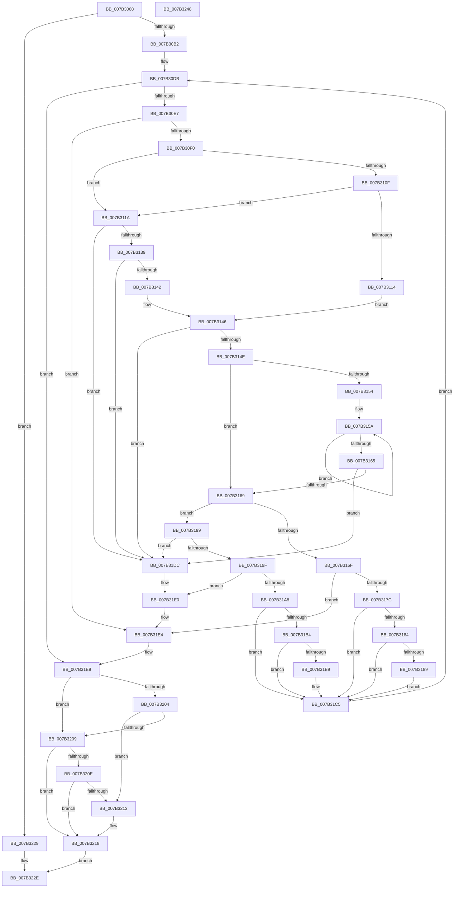

# WmipParseSysIdTable

- RVA: `0x007B3068`–`0x007B3249` (길이 `481` bytes)
- VA: `0x00000001407B3068`
- 실행 섹션: `PAGE`
- PDB 이름 있음: `예`; PDB Function 태그: `아니요`
- unwind 정보 RVA: `0x00093A28`
- 디코드: `140`개 명령, `481/481` bytes 표시
- 미해석 바이트: `0` (있으면 어셈블리에 `.byte`로 보존)

> 이 문서는 커널 이미지의 기계어와 PDB 기호를 분석해 생성했습니다. 4번과 5번은 함수 원형과 자료형을 바이너리 사용 방식에서 추정한 C 해석이며 원본 소스 복구 결과는 아닙니다.

## 1. Dependencies

- 직접 호출 지점: **4**; 고유 호출 대상: **3**
- 직접 호출자로 확인된 함수: **1**
- RIP 상대 이미지 참조: **2**

### Outgoing calls
- `0x007B309F` → [MmMapIoSpaceEx](../../text/32/MmMapIoSpaceEx_function_00327830.md) (function, `0x00327830`)
- `0x007B3104` → [RtlCompareMemory](../../text/6B/RtlCompareMemory_function_006BA670.md) (function, `0x006BA670`)
- `0x007B312A` → [RtlCompareMemory](../../text/6B/RtlCompareMemory_function_006BA670.md) (function, `0x006BA670`)
- `0x007B3222` → [MmUnmapIoSpace](../../text/3F/MmUnmapIoSpace_function_003F78F0.md) (function, `0x003F78F0`)

### Direct callers
- [WmipGetSysIds](WmipGetSysIds_function_007B2DB0.md) at `0x007B2E4F`
- [WmipGetSysIds](WmipGetSysIds_function_007B2DB0.md) at `0x007B2ECC`

### Static image references
- `0x007B30F4` → RVA `0x00B06FA0` (` ?? ::NNGAKEGL::`string'`; read)
- `0x007B3120` → RVA `0x00B06F90` (` ?? ::NNGAKEGL::`string'`; read)

## 2. Other-region calls and transfers

- 다른 실행 섹션으로 향하는 call: **4**
  - `0x007B309F` → [MmMapIoSpaceEx](../../text/32/MmMapIoSpaceEx_function_00327830.md) (`PAGE` → `.text`)
  - `0x007B3104` → [RtlCompareMemory](../../text/6B/RtlCompareMemory_function_006BA670.md) (`PAGE` → `.text`)
  - `0x007B312A` → [RtlCompareMemory](../../text/6B/RtlCompareMemory_function_006BA670.md) (`PAGE` → `.text`)
  - `0x007B3222` → [MmUnmapIoSpace](../../text/3F/MmUnmapIoSpace_function_003F78F0.md) (`PAGE` → `.text`)
- 별도 외부 분기/꼬리 이동을 확인하지 못했습니다.

## 3. Assembly (complete function range)

```asm
007B3068  48 89 5C 24 08                  mov qword ptr [rsp + 8], rbx
007B306D  4C 89 4C 24 20                  mov qword ptr [rsp + 0x20], r9
007B3072  89 54 24 10                     mov dword ptr [rsp + 0x10], edx
007B3076  55                              push rbp
007B3077  56                              push rsi
007B3078  57                              push rdi
007B3079  41 54                           push r12
007B307B  41 55                           push r13
007B307D  41 56                           push r14
007B307F  41 57                           push r15
007B3081  48 83 EC 40                     sub rsp, 0x40
007B3085  6B FA 19                        imul edi, edx, 0x19
007B3088  4D 8B E0                        mov r12, r8
007B308B  8B F2                           mov esi, edx
007B308D  41 B8 04 00 00 00               mov r8d, 4
007B3093  49 8B D9                        mov rbx, r9
007B3096  8B C7                           mov eax, edi
007B3098  8B D7                           mov edx, edi
007B309A  48 89 44 24 30                  mov qword ptr [rsp + 0x30], rax
007B309F  E8 8C 47 B7 FF                  call 0x140327830
007B30A4  48 89 44 24 38                  mov qword ptr [rsp + 0x38], rax
007B30A9  48 85 C0                        test rax, rax
007B30AC  0F 84 77 01 00 00               je 0x1407b3229
007B30B2  8B 13                           mov edx, dword ptr [rbx]
007B30B4  45 33 FF                        xor r15d, r15d
007B30B7  48 8B 8C 24 A8 00 00 00         mov rcx, qword ptr [rsp + 0xa8]
007B30BF  45 33 F6                        xor r14d, r14d
007B30C2  4C 8B AC 24 A0 00 00 00         mov r13, qword ptr [rsp + 0xa0]
007B30CA  33 DB                           xor ebx, ebx
007B30CC  48 8B E8                        mov rbp, rax
007B30CF  89 54 24 24                     mov dword ptr [rsp + 0x24], edx
007B30D3  33 C0                           xor eax, eax
007B30D5  8B 09                           mov ecx, dword ptr [rcx]
007B30D7  89 4C 24 20                     mov dword ptr [rsp + 0x20], ecx
007B30DB  89 44 24 28                     mov dword ptr [rsp + 0x28], eax
007B30DF  3B C6                           cmp eax, esi
007B30E1  0F 83 02 01 00 00               jae 0x1407b31e9
007B30E7  83 FF 0A                        cmp edi, 0xa
007B30EA  0F 82 F4 00 00 00               jb 0x1407b31e4
007B30F0  0F B7 75 07                     movzx esi, word ptr [rbp + 7]
007B30F4  48 8D 15 A5 3E 35 00            lea rdx, [rip + 0x353ea5]
007B30FB  41 B8 06 00 00 00               mov r8d, 6
007B3101  48 8B CD                        mov rcx, rbp
007B3104  E8 67 75 F0 FF                  call 0x1406ba670
007B3109  48 83 F8 06                     cmp rax, 6
007B310D  75 0B                           jne 0x1407b311a
007B310F  83 FE 19                        cmp esi, 0x19
007B3112  75 06                           jne 0x1407b311a
007B3114  44 8D 40 FB                     lea r8d, [rax - 5]
007B3118  EB 2C                           jmp 0x1407b3146
007B311A  41 B8 06 00 00 00               mov r8d, 6
007B3120  48 8D 15 69 3E 35 00            lea rdx, [rip + 0x353e69]
007B3127  48 8B CD                        mov rcx, rbp
007B312A  E8 41 75 F0 FF                  call 0x1406ba670
007B312F  48 83 F8 06                     cmp rax, 6
007B3133  0F 85 A3 00 00 00               jne 0x1407b31dc
007B3139  83 FE 11                        cmp esi, 0x11
007B313C  0F 85 9A 00 00 00               jne 0x1407b31dc
007B3142  44 8D 40 FC                     lea r8d, [rax - 4]
007B3146  3B FE                           cmp edi, esi
007B3148  0F 82 8E 00 00 00               jb 0x1407b31dc
007B314E  32 C9                           xor cl, cl
007B3150  85 F6                           test esi, esi
007B3152  74 15                           je 0x1407b3169
007B3154  48 8B C5                        mov rax, rbp
007B3157  48 8B D6                        mov rdx, rsi
007B315A  02 08                           add cl, byte ptr [rax]
007B315C  48 FF C0                        inc rax
007B315F  48 83 EA 01                     sub rdx, 1
007B3163  75 F5                           jne 0x1407b315a
007B3165  84 C9                           test cl, cl
007B3167  75 73                           jne 0x1407b31dc
007B3169  41 83 F8 01                     cmp r8d, 1
007B316D  75 2A                           jne 0x1407b3199
007B316F  8B 54 24 24                     mov edx, dword ptr [rsp + 0x24]
007B3173  8B 4C 24 20                     mov ecx, dword ptr [rsp + 0x20]
007B3177  83 FF 19                        cmp edi, 0x19
007B317A  72 68                           jb 0x1407b31e4
007B317C  41 FF C7                        inc r15d
007B317F  4D 85 E4                        test r12, r12
007B3182  74 41                           je 0x1407b31c5
007B3184  41 3B D7                        cmp edx, r15d
007B3187  72 3C                           jb 0x1407b31c5
007B3189  0F 10 45 09                     movups xmm0, xmmword ptr [rbp + 9]
007B318D  F3 41 0F 7F 04 24               movdqu xmmword ptr [r12], xmm0
007B3193  49 83 C4 10                     add r12, 0x10
007B3197  EB 2C                           jmp 0x1407b31c5
007B3199  41 83 F8 02                     cmp r8d, 2
007B319D  75 3D                           jne 0x1407b31dc
007B319F  8B 4C 24 20                     mov ecx, dword ptr [rsp + 0x20]
007B31A3  83 FF 11                        cmp edi, 0x11
007B31A6  72 38                           jb 0x1407b31e0
007B31A8  8B 54 24 24                     mov edx, dword ptr [rsp + 0x24]
007B31AC  41 FF C6                        inc r14d
007B31AF  4D 85 ED                        test r13, r13
007B31B2  74 11                           je 0x1407b31c5
007B31B4  41 3B CE                        cmp ecx, r14d
007B31B7  72 0C                           jb 0x1407b31c5
007B31B9  48 8B 45 09                     mov rax, qword ptr [rbp + 9]
007B31BD  49 89 45 00                     mov qword ptr [r13], rax
007B31C1  49 83 C5 08                     add r13, 8
007B31C5  8B 44 24 28                     mov eax, dword ptr [rsp + 0x28]
007B31C9  48 03 EE                        add rbp, rsi
007B31CC  2B FE                           sub edi, esi
007B31CE  8B B4 24 88 00 00 00            mov esi, dword ptr [rsp + 0x88]
007B31D5  FF C0                           inc eax
007B31D7  E9 FF FE FF FF                  jmp 0x1407b30db
007B31DC  8B 4C 24 20                     mov ecx, dword ptr [rsp + 0x20]
007B31E0  8B 54 24 24                     mov edx, dword ptr [rsp + 0x24]
007B31E4  BB 01 00 00 C0                  mov ebx, 0xc0000001
007B31E9  48 8B 84 24 98 00 00 00         mov rax, qword ptr [rsp + 0x98]
007B31F1  44 89 38                        mov dword ptr [rax], r15d
007B31F4  48 8B 84 24 A8 00 00 00         mov rax, qword ptr [rsp + 0xa8]
007B31FC  44 89 30                        mov dword ptr [rax], r14d
007B31FF  4D 85 E4                        test r12, r12
007B3202  74 05                           je 0x1407b3209
007B3204  41 3B D7                        cmp edx, r15d
007B3207  72 0A                           jb 0x1407b3213
007B3209  4D 85 ED                        test r13, r13
007B320C  74 0A                           je 0x1407b3218
007B320E  41 3B CE                        cmp ecx, r14d
007B3211  73 05                           jae 0x1407b3218
007B3213  BB 23 00 00 C0                  mov ebx, 0xc0000023
007B3218  48 8B 54 24 30                  mov rdx, qword ptr [rsp + 0x30]
007B321D  48 8B 4C 24 38                  mov rcx, qword ptr [rsp + 0x38]
007B3222  E8 C9 46 C4 FF                  call 0x1403f78f0
007B3227  EB 05                           jmp 0x1407b322e
007B3229  BB 9A 00 00 C0                  mov ebx, 0xc000009a
007B322E  8B C3                           mov eax, ebx
007B3230  48 8B 9C 24 80 00 00 00         mov rbx, qword ptr [rsp + 0x80]
007B3238  48 83 C4 40                     add rsp, 0x40
007B323C  41 5F                           pop r15
007B323E  41 5E                           pop r14
007B3240  41 5D                           pop r13
007B3242  41 5C                           pop r12
007B3244  5F                              pop rdi
007B3245  5E                              pop rsi
007B3246  5D                              pop rbp
007B3247  C3                              ret
007B3248  CC                              int3
```

## 4. C-style interpretation (structured pseudocode)

```c
__int64 __fastcall WmipParseSysIdTable(__int64 a1, int a2, __int64 a3, __int64 a4, __int64 a5, __int64 a6)
{
    __int64 result;
    __int64 v_r12;
    __int64 v_r13;
    __int64 v_r14;
    __int64 v_r15;
    __int64 v_rbp;
    __int64 v_rbx;
    __int64 v_rdi;
    __int64 v_rsp;
    unsigned __int64 v_stack_m40;
    unsigned __int64 v_stack_m48;
    unsigned int v_stack_m50;
    unsigned int v_stack_m54;
    unsigned int v_stack_m58;
    unsigned int v_stack_p10;
    unsigned __int64 v_stack_p20;
    unsigned __int64 v_stack_p8;

    v_stack_p8 = v_rbx;
    v_stack_p20 = a4;
    v_stack_p10 = a2;
    v_rsp = (v_rsp) - (64);
    v_rdi = (unsigned int)((v_rdi) * (a2));
    v_stack_m48 = (unsigned int)((unsigned int)(v_rdi));
    result = MmMapIoSpaceEx(a1, (unsigned int)((unsigned int)(v_rdi)), 4, a4);
    v_stack_m40 = result;
    if (result == 0) goto loc_007B3229;
    v_r15 = 0;
    v_r14 = 0;
    v_rbx = 0;
    v_stack_m54 = (unsigned int)((unsigned int)(*(unsigned int *)(a4)));
    result = 0;
    v_stack_m58 = (unsigned int)((unsigned int)(*(unsigned int *)(a6)));
loc_007B30DB:
    v_stack_m50 = 0;
    if (0 >= ((unsigned int)((unsigned int)(a2)))) goto loc_007B31E9;
    if (((unsigned int)(v_rdi)) < 10) goto loc_007B31E4;
    result = RtlCompareMemory(0, v_rip + 3489445, 6, a4);
    if (result != 6) goto loc_007B311A;
    if (((unsigned int)(*(unsigned __int16 *)(result + 7))) != 25) goto loc_007B311A;
    goto loc_007B3146;
loc_007B311A:
    result = RtlCompareMemory(result, v_rip + 3489385, 6, a4);
    if (result != 6) goto loc_007B31DC;
    if (((unsigned int)(*(unsigned __int16 *)(result + 7))) != 17) goto loc_007B31DC;
loc_007B3146:
    if (((unsigned int)(v_rdi)) < ((unsigned int)(*(unsigned __int16 *)(result + 7)))) goto loc_007B31DC;
    a1 = 0;
    if ((unsigned int)(*(unsigned __int16 *)(result + 7)) == 0) goto loc_007B3169;
loc_007B315A:
    a1 = (unsigned __int8)((a1) + (*(unsigned __int8 *)(result)));
    result = (result) + 1;
    a2 = (*(unsigned __int16 *)(result + 7)) - (1);
    if (condition_is_not_equal) goto loc_007B315A;
    if ((unsigned __int8)(a1) != 0) goto loc_007B31DC;
loc_007B3169:
    if (((unsigned int)(result - 4)) != 1) goto loc_007B3199;
    if (((unsigned int)(v_rdi)) < 25) goto loc_007B31E4;
    v_r15 = (unsigned int)((v_r15) + 1);
    if (a3 == 0) goto loc_007B31C5;
    if (((unsigned int)((unsigned int)(v_stack_m54))) < ((unsigned int)(v_r15))) goto loc_007B31C5;
    *(unsigned __int64 *)(a3) = v_xmm0;
    v_r12 = (a3) + (16);
    goto loc_007B31C5;
loc_007B3199:
    if (((unsigned int)(result - 4)) != 2) goto loc_007B31DC;
    if (((unsigned int)(v_rdi)) < 17) goto loc_007B31E0;
    v_r14 = (unsigned int)((v_r14) + 1);
    if (a5 == 0) goto loc_007B31C5;
    v_r13 = a5;
    if (((unsigned int)((unsigned int)(v_stack_m58))) >= ((unsigned int)(v_r14))) {
        result = *(unsigned __int64 *)(result + 9);
        *(unsigned __int64 *)(a5) = result;
        v_r13 = (a5) + (8);
    }
    v_rbp = (result) + (*(unsigned __int16 *)(result + 7));
    v_rdi = (unsigned int)((v_rdi) - ((unsigned int)(*(unsigned __int16 *)(result + 7))));
    result = (unsigned int)(((unsigned int)(v_stack_m50)) + 1);
    goto loc_007B30DB;
loc_007B31DC:
loc_007B31E0:
loc_007B31E4:
loc_007B31E9:
    *(unsigned int *)(v_stack_p20) = (unsigned int)(v_r15);
    *(unsigned int *)(a6) = (unsigned int)(v_r14);
    if (v_r12 == 0) goto loc_007B3209;
    if (((unsigned int)((unsigned int)(v_stack_m54))) < ((unsigned int)(v_r15))) goto loc_007B3213;
loc_007B3209:
    if (v_r13 == 0) goto loc_007B3218;
    v_rbx = (unsigned int)(0xC0000001ULL);
    if (((unsigned int)((unsigned int)(v_stack_m58))) < ((unsigned int)(v_r14))) {
        v_rbx = 0xC0000023ULL;
    }
    result = MmUnmapIoSpace(v_stack_m40, v_stack_m48, result - 4, a4);
    goto loc_007B322E;
loc_007B3229:
loc_007B322E:
    v_rsp = (v_rsp) + (64);
    return (unsigned int)((unsigned int)((unsigned int)(0xC000009AULL)));
}
```

## 5. (Beta) C Style

```c
int64_t WmipParseSysIdTable(int64_t Arg1, int32_t Arg2, int64_t Arg3, void *Arg4, int64_t Arg5, void *Arg6)
{
    uint8_t *arg4 = (uint8_t *)Arg4;
    uint8_t *arg6 = (uint8_t *)Arg6;

    int64_t result;
    int64_t local_r12;
    int64_t local_r13;
    int64_t local_r14;
    int64_t local_r15;
    int64_t local_rbp;
    int64_t local_rbx;
    int64_t local_rdi;
    int64_t local_rsp;
    uint64_t v_stack_m40;
    uint64_t v_stack_m48;
    uint32_t v_stack_m50;
    uint32_t v_stack_m54;
    uint32_t v_stack_m58;
    uint32_t v_stack_p10;
    uint64_t v_stack_p20;
    uint64_t v_stack_p8;

    v_stack_p8 = local_rbx;
    v_stack_p20 = Arg4;
    v_stack_p10 = Arg2;
    local_rsp = (local_rsp) - (64);
    local_rdi = (uint32_t)((local_rdi) * (Arg2));
    v_stack_m48 = (uint32_t)((uint32_t)(local_rdi));
    result = MmMapIoSpaceEx(Arg1, (uint32_t)((uint32_t)(local_rdi)), 4, Arg4);
    v_stack_m40 = result;
    if (result == 0) goto loc_007B3229;
    local_r15 = 0;
    local_r14 = 0;
    local_rbx = 0;
    v_stack_m54 = (uint32_t)((uint32_t)(*(uint32_t *)(arg4)));
    result = 0;
    v_stack_m58 = (uint32_t)((uint32_t)(*(uint32_t *)(arg6)));
loc_007B30DB:
    v_stack_m50 = 0;
    if (0 >= ((uint32_t)((uint32_t)(Arg2)))) goto loc_007B31E9;
    if (((uint32_t)(local_rdi)) < 10) goto loc_007B31E4;
    result = RtlCompareMemory(0, v_rip + 3489445, 6, Arg4);
    if (result != 6) goto loc_007B311A;
    if (((uint32_t)(*(uint16_t *)(result + 0x7))) != 25) goto loc_007B311A;
    goto loc_007B3146;
loc_007B311A:
    result = RtlCompareMemory(result, v_rip + 3489385, 6, Arg4);
    if (result != 6) goto loc_007B31DC;
    if (((uint32_t)(*(uint16_t *)(result + 0x7))) != 17) goto loc_007B31DC;
loc_007B3146:
    if (((uint32_t)(local_rdi)) < ((uint32_t)(*(uint16_t *)(result + 0x7)))) goto loc_007B31DC;
    Arg1 = 0;
    if ((uint32_t)(*(uint16_t *)(result + 0x7)) == 0) goto loc_007B3169;
loc_007B315A:
    Arg1 = (uint8_t)((Arg1) + (*(uint8_t *)(result)));
    result = (result) + 1;
    Arg2 = (*(uint16_t *)(result + 0x7)) - (1);
    if (condition_is_not_equal) goto loc_007B315A;
    if ((uint8_t)(Arg1) != 0) goto loc_007B31DC;
loc_007B3169:
    if (((uint32_t)(result - 4)) != 1) goto loc_007B3199;
    if (((uint32_t)(local_rdi)) < 25) goto loc_007B31E4;
    local_r15 = (uint32_t)((local_r15) + 1);
    if (Arg3 == 0) goto loc_007B31C5;
    if (((uint32_t)((uint32_t)(v_stack_m54))) < ((uint32_t)(local_r15))) goto loc_007B31C5;
    *(uint64_t *)(Arg3) = v_xmm0;
    local_r12 = (Arg3) + (16);
    goto loc_007B31C5;
loc_007B3199:
    if (((uint32_t)(result - 4)) != 2) goto loc_007B31DC;
    if (((uint32_t)(local_rdi)) < 17) goto loc_007B31E0;
    local_r14 = (uint32_t)((local_r14) + 1);
    if (Arg5 == 0) goto loc_007B31C5;
    local_r13 = Arg5;
    if (((uint32_t)((uint32_t)(v_stack_m58))) >= ((uint32_t)(local_r14))) {
        result = *(uint64_t *)(result + 0x9);
        *(uint64_t *)(Arg5) = result;
        local_r13 = (Arg5) + (8);
    }
    local_rbp = (result) + (*(uint16_t *)(result + 0x7));
    local_rdi = (uint32_t)((local_rdi) - ((uint32_t)(*(uint16_t *)(result + 0x7))));
    result = (uint32_t)(((uint32_t)(v_stack_m50)) + 1);
    goto loc_007B30DB;
loc_007B31DC:
loc_007B31E0:
loc_007B31E4:
loc_007B31E9:
    *(uint32_t *)(v_stack_p20) = (uint32_t)(local_r15);
    *(uint32_t *)(arg6) = (uint32_t)(local_r14);
    if (local_r12 == 0) goto loc_007B3209;
    if (((uint32_t)((uint32_t)(v_stack_m54))) < ((uint32_t)(local_r15))) goto loc_007B3213;
loc_007B3209:
    if (local_r13 == 0) goto loc_007B3218;
    local_rbx = (uint32_t)(0xC0000001ULL);
    if (((uint32_t)((uint32_t)(v_stack_m58))) < ((uint32_t)(local_r14))) {
        local_rbx = 0xC0000023ULL;
    }
    result = MmUnmapIoSpace(v_stack_m40, v_stack_m48, result - 4, Arg4);
    goto loc_007B322E;
loc_007B3229:
loc_007B322E:
    local_rsp = (local_rsp) + (64);
    return (uint32_t)((uint32_t)((uint32_t)(0xC000009AULL)));
}
```

### 관측된 메모리 오프셋

구조체 형식이 확인되지 않은 접근은 인자 기준의 오프셋으로만 기록했습니다.

| 기준 인자 | 오프셋 표현 | 폭 (bit) | 접근 |
|---|---:|---:|---|
| `Arg4` | `+ 0x0` | `32` | `R` |
| `Arg6` | `+ 0x0` | `32` | `R` |
| `Arg6` | `+ 0x0` | `32` | `W` |

## 6. Execution-region graph

[열기: 2D/3D 그래프와 함수 탐색 컨트롤 패널](../../../control-panel.html?section=page&rva=0x007B3068&view=graph)

- 2D 그래프는 위에서 아래로 흐르고, 3D 그래프는 빈 공간을 드래그해 회전합니다. Shift+드래그는 이동, 휠은 확대·축소, 함수 노드 선택은 대상 보고서 이동입니다.

### Static fallback


