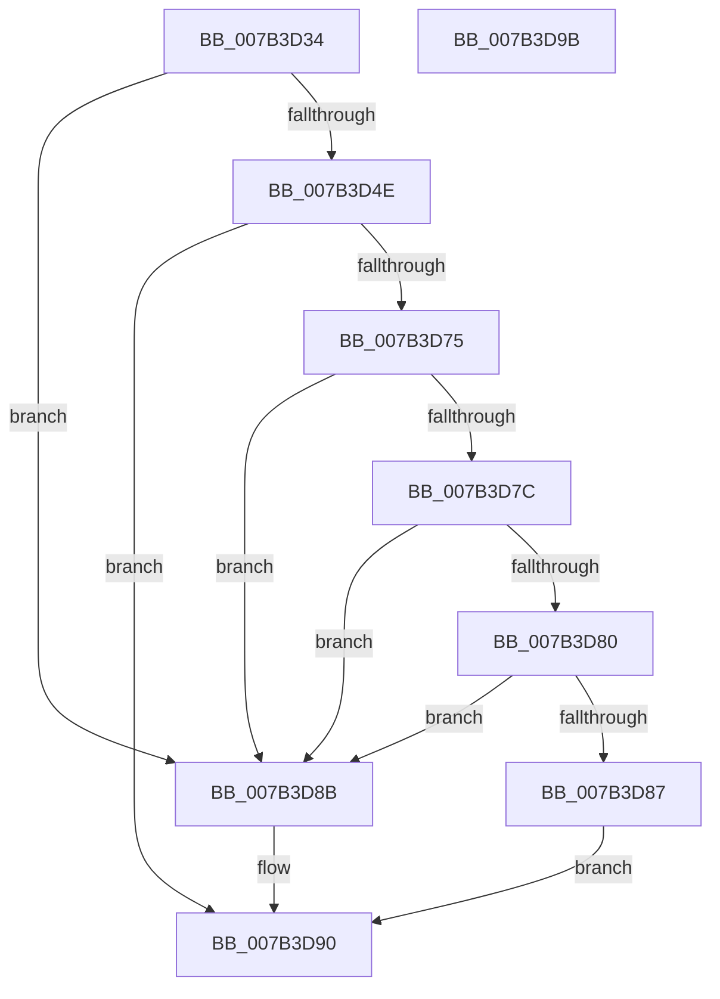

# WmipProbeWnodeSingleItem

- RVA: `0x007B3D34`–`0x007B3D9C` (길이 `104` bytes)
- VA: `0x00000001407B3D34`
- 실행 섹션: `PAGE`
- PDB 이름 있음: `예`; PDB Function 태그: `아니요`
- unwind 정보 RVA: `0x00089EA4`
- 디코드: `35`개 명령, `104/104` bytes 표시
- 미해석 바이트: `0` (있으면 어셈블리에 `.byte`로 보존)

> 이 문서는 커널 이미지의 기계어와 PDB 기호를 분석해 생성했습니다. 4번과 5번은 함수 원형과 자료형을 바이너리 사용 방식에서 추정한 C 해석이며 원본 소스 복구 결과는 아닙니다.

## 1. Dependencies

- 직접 호출 지점: **1**; 고유 호출 대상: **1**
- 직접 호출자로 확인된 함수: **1**
- RIP 상대 이미지 참조: **0**

### Outgoing calls
- `0x007B3D6C` → [WmipProbeWnodeWorker](../9D/WmipProbeWnodeWorker_function_009DE7BC.md) (function, `0x009DE7BC`)

### Direct callers
- [WmipIoControl](../9D/WmipIoControl_function_009DEBD0.md) at `0x009DF0BE`

### Static image references
- 디코드된 RIP-relative 메모리 참조가 없습니다.

## 2. Other-region calls and transfers

- 다른 실행 섹션으로 향하는 call: **0**
- 별도 외부 분기/꼬리 이동을 확인하지 못했습니다.

## 3. Assembly (complete function range)

```asm
007B3D34  48 8B C4                        mov rax, rsp
007B3D37  48 89 58 08                     mov qword ptr [rax + 8], rbx
007B3D3B  57                              push rdi
007B3D3C  48 83 EC 50                     sub rsp, 0x50
007B3D40  8B FA                           mov edi, edx
007B3D42  48 8B D9                        mov rbx, rcx
007B3D45  BA 44 00 00 00                  mov edx, 0x44
007B3D4A  3B FA                           cmp edi, edx
007B3D4C  72 3D                           jb 0x1407b3d8b
007B3D4E  44 8B 49 3C                     mov r9d, dword ptr [rcx + 0x3c]
007B3D52  44 8B 41 30                     mov r8d, dword ptr [rcx + 0x30]
007B3D56  C6 40 E8 01                     mov byte ptr [rax - 0x18], 1
007B3D5A  C6 40 E0 00                     mov byte ptr [rax - 0x20], 0
007B3D5E  83 60 D8 00                     and dword ptr [rax - 0x28], 0
007B3D62  89 78 D0                        mov dword ptr [rax - 0x30], edi
007B3D65  8B 41 40                        mov eax, dword ptr [rcx + 0x40]
007B3D68  89 44 24 20                     mov dword ptr [rsp + 0x20], eax
007B3D6C  E8 4B AA 22 00                  call 0x1409de7bc
007B3D71  85 C0                           test eax, eax
007B3D73  78 1B                           js 0x1407b3d90
007B3D75  8B 43 2C                        mov eax, dword ptr [rbx + 0x2c]
007B3D78  A8 04                           test al, 4
007B3D7A  74 0F                           je 0x1407b3d8b
007B3D7C  3B 3B                           cmp edi, dword ptr [rbx]
007B3D7E  75 0B                           jne 0x1407b3d8b
007B3D80  A9 7B FF FF FF                  test eax, 0xffffff7b
007B3D85  75 04                           jne 0x1407b3d8b
007B3D87  33 C0                           xor eax, eax
007B3D89  EB 05                           jmp 0x1407b3d90
007B3D8B  B8 01 00 00 C0                  mov eax, 0xc0000001
007B3D90  48 8B 5C 24 60                  mov rbx, qword ptr [rsp + 0x60]
007B3D95  48 83 C4 50                     add rsp, 0x50
007B3D99  5F                              pop rdi
007B3D9A  C3                              ret
007B3D9B  CC                              int3
```

## 4. C-style interpretation (structured pseudocode)

```c
__int64 __fastcall WmipProbeWnodeSingleItem(__int64 a1, int a2)
{
    __int64 result;
    __int64 v_rsp;
    unsigned int v_stack_m38;
    unsigned __int64 v_stack_p8;

    *(unsigned __int64 *)(v_rsp + 8) = v_rbx;
    v_rsp = (v_rsp) - (80);
    if (((unsigned int)((unsigned int)(a2))) < 68) goto loc_007B3D8B;
    *(unsigned __int8 *)(v_rsp - 24) = 1;
    *(unsigned __int8 *)(v_rsp - 32) = 0;
    *(unsigned int *)(v_rsp - 48) = (unsigned int)((unsigned int)(a2));
    v_stack_m38 = (unsigned int)((unsigned int)(*(unsigned int *)(a1 + 64)));
    result = WmipProbeWnodeWorker(a1, 68, (unsigned int)(*(unsigned int *)(a1 + 48)), (unsigned int)(*(unsigned int *)(a1 + 60)));
    if (sign_flag) goto loc_007B3D90;
    if ((((unsigned __int8)((unsigned int)(*(unsigned int *)(a1 + 44)))) & (4)) == 0) goto loc_007B3D8B;
    if (((unsigned int)((unsigned int)(a2))) != (*(unsigned int *)(a1))) goto loc_007B3D8B;
    if ((((unsigned int)((unsigned int)(*(unsigned int *)(a1 + 44)))) & (0xFFFFFF7BULL)) != 0) goto loc_007B3D8B;
    result = 0;
    goto loc_007B3D90;
loc_007B3D8B:
loc_007B3D90:
    v_rsp = (v_rsp) + (80);
    return (unsigned int)(0xC0000001ULL);
}
```

## 5. (Beta) C Style

```c
int64_t WmipProbeWnodeSingleItem(void *Arg1, int32_t Arg2)
{
    uint8_t *arg1 = (uint8_t *)Arg1;

    int64_t result;
    int64_t local_rsp;
    uint32_t v_stack_m38;
    uint64_t v_stack_p8;

    *(uint64_t *)(local_rsp + 0x8) = local_rbx;
    local_rsp = (local_rsp) - (80);
    if (((uint32_t)((uint32_t)(Arg2))) < 68) goto loc_007B3D8B;
    *(uint8_t *)(local_rsp - 0x18) = 1;
    *(uint8_t *)(local_rsp - 0x20) = 0;
    *(uint32_t *)(local_rsp - 0x30) = (uint32_t)((uint32_t)(Arg2));
    v_stack_m38 = (uint32_t)((uint32_t)(*(uint32_t *)(arg1 + 0x40)));
    result = WmipProbeWnodeWorker(Arg1, 68, (uint32_t)(*(uint32_t *)(arg1 + 0x30)), (uint32_t)(*(uint32_t *)(arg1 + 0x3C)));
    if (sign_flag) goto loc_007B3D90;
    if ((((uint8_t)((uint32_t)(*(uint32_t *)(arg1 + 0x2C)))) & (4)) == 0) goto loc_007B3D8B;
    if (((uint32_t)((uint32_t)(Arg2))) != (*(uint32_t *)(arg1))) goto loc_007B3D8B;
    if ((((uint32_t)((uint32_t)(*(uint32_t *)(arg1 + 0x2C)))) & (0xFFFFFF7BULL)) != 0) goto loc_007B3D8B;
    result = 0;
    goto loc_007B3D90;
loc_007B3D8B:
loc_007B3D90:
    local_rsp = (local_rsp) + (80);
    return (uint32_t)(0xC0000001ULL);
}
```

### 관측된 메모리 오프셋

구조체 형식이 확인되지 않은 접근은 인자 기준의 오프셋으로만 기록했습니다.

| 기준 인자 | 오프셋 표현 | 폭 (bit) | 접근 |
|---|---:|---:|---|
| `Arg1` | `+ 0x0` | `32` | `R` |
| `Arg1` | `+ 0x2C` | `32` | `R` |
| `Arg1` | `+ 0x30` | `32` | `R` |
| `Arg1` | `+ 0x3C` | `32` | `R` |
| `Arg1` | `+ 0x40` | `32` | `R` |

## 6. Execution-region graph

[열기: 2D/3D 그래프와 함수 탐색 컨트롤 패널](../../../control-panel.html?section=page&rva=0x007B3D34&view=graph)

- 2D 그래프는 위에서 아래로 흐르고, 3D 그래프는 빈 공간을 드래그해 회전합니다. Shift+드래그는 이동, 휠은 확대·축소, 함수 노드 선택은 대상 보고서 이동입니다.

### Static fallback


