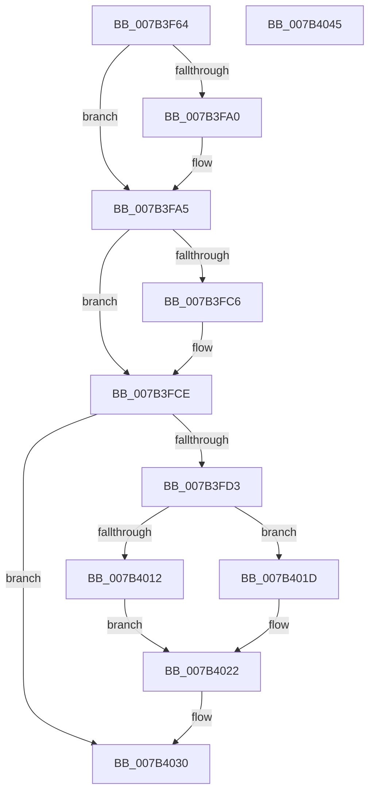

# WmipProcessLegacyEtwRegister

- RVA: `0x007B3F64`–`0x007B4046` (길이 `226` bytes)
- VA: `0x00000001407B3F64`
- 실행 섹션: `PAGE`
- PDB 이름 있음: `예`; PDB Function 태그: `아니요`
- unwind 정보 RVA: `0x000A118C`
- 디코드: `60`개 명령, `226/226` bytes 표시
- 미해석 바이트: `0` (있으면 어셈블리에 `.byte`로 보존)

> 이 문서는 커널 이미지의 기계어와 PDB 기호를 분석해 생성했습니다. 4번과 5번은 함수 원형과 자료형을 바이너리 사용 방식에서 추정한 C 해석이며 원본 소스 복구 결과는 아닙니다.

## 1. Dependencies

- 직접 호출 지점: **6**; 고유 호출 대상: **4**
- 직접 호출자로 확인된 함수: **1**
- RIP 상대 이미지 참조: **2**

### Outgoing calls
- `0x007B3F92` → [KeWaitForSingleObject](../../text/20/KeWaitForSingleObject_function_0020E6B0.md) (function, `0x0020E6B0`)
- `0x007B3FBC` → [KeReleaseMutex](../../text/39/KeReleaseMutex_function_00396810.md) (function, `0x00396810`)
- `0x007B3FC9` → [EtwUnregister](../A7/EtwUnregister_function_00A723D0.md) (function, `0x00A723D0`)
- `0x007B3FED` → [EtwRegisterClassicProvider](../AA/EtwRegisterClassicProvider_function_00AA5B40.md) (function, `0x00AA5B40`)
- `0x007B4009` → [KeWaitForSingleObject](../../text/20/KeWaitForSingleObject_function_0020E6B0.md) (function, `0x0020E6B0`)
- `0x007B402B` → [KeReleaseMutex](../../text/39/KeReleaseMutex_function_00396810.md) (function, `0x00396810`)

### Direct callers
- [WmipLegacyEtwWorker](../9E/WmipLegacyEtwWorker_function_009E3290.md) at `0x009E33CA`

### Static image references
- `0x007B3F85` → RVA `0x00EFFA60` (`.data`; read)
- `0x007B3FE4` → RVA `0x009E3480` (`WmipLegacyEtwCallback`; read)

## 2. Other-region calls and transfers

- 다른 실행 섹션으로 향하는 call: **4**
  - `0x007B3F92` → [KeWaitForSingleObject](../../text/20/KeWaitForSingleObject_function_0020E6B0.md) (`PAGE` → `.text`)
  - `0x007B3FBC` → [KeReleaseMutex](../../text/39/KeReleaseMutex_function_00396810.md) (`PAGE` → `.text`)
  - `0x007B4009` → [KeWaitForSingleObject](../../text/20/KeWaitForSingleObject_function_0020E6B0.md) (`PAGE` → `.text`)
  - `0x007B402B` → [KeReleaseMutex](../../text/39/KeReleaseMutex_function_00396810.md) (`PAGE` → `.text`)
- 별도 외부 분기/꼬리 이동을 확인하지 못했습니다.

## 3. Assembly (complete function range)

```asm
007B3F64  48 8B C4                        mov rax, rsp
007B3F67  48 89 58 10                     mov qword ptr [rax + 0x10], rbx
007B3F6B  48 89 68 18                     mov qword ptr [rax + 0x18], rbp
007B3F6F  48 89 70 20                     mov qword ptr [rax + 0x20], rsi
007B3F73  57                              push rdi
007B3F74  48 83 EC 30                     sub rsp, 0x30
007B3F78  48 83 60 E8 00                  and qword ptr [rax - 0x18], 0
007B3F7D  48 8B F2                        mov rsi, rdx
007B3F80  48 8B F9                        mov rdi, rcx
007B3F83  33 D2                           xor edx, edx
007B3F85  48 8D 0D D4 BA 74 00            lea rcx, [rip + 0x74bad4]
007B3F8C  45 33 C9                        xor r9d, r9d
007B3F8F  45 33 C0                        xor r8d, r8d
007B3F92  E8 19 A7 A5 FF                  call 0x14020e6b0
007B3F97  48 8B 6F 70                     mov rbp, qword ptr [rdi + 0x70]
007B3F9B  48 3B EE                        cmp rbp, rsi
007B3F9E  75 05                           jne 0x1407b3fa5
007B3FA0  48 83 4F 70 FF                  or qword ptr [rdi + 0x70], 0xffffffffffffffff
007B3FA5  48 8B 5F 68                     mov rbx, qword ptr [rdi + 0x68]
007B3FA9  48 8D 0D B0 BA 74 00            lea rcx, [rip + 0x74bab0]
007B3FB0  48 83 67 68 00                  and qword ptr [rdi + 0x68], 0
007B3FB5  33 D2                           xor edx, edx
007B3FB7  48 89 5C 24 40                  mov qword ptr [rsp + 0x40], rbx
007B3FBC  E8 4F 28 BE FF                  call 0x140396810
007B3FC1  48 85 DB                        test rbx, rbx
007B3FC4  74 08                           je 0x1407b3fce
007B3FC6  48 8B CB                        mov rcx, rbx
007B3FC9  E8 02 E4 2B 00                  call 0x140a723d0
007B3FCE  48 3B EE                        cmp rbp, rsi
007B3FD1  75 5D                           jne 0x1407b4030
007B3FD3  48 8D 44 24 40                  lea rax, [rsp + 0x40]
007B3FD8  4C 8B CF                        mov r9, rdi
007B3FDB  48 8D 4F 48                     lea rcx, [rdi + 0x48]
007B3FDF  48 89 44 24 20                  mov qword ptr [rsp + 0x20], rax
007B3FE4  4C 8D 05 95 F4 22 00            lea r8, [rip + 0x22f495]
007B3FEB  33 D2                           xor edx, edx
007B3FED  E8 4E 1B 2F 00                  call 0x140aa5b40
007B3FF2  48 83 64 24 20 00               and qword ptr [rsp + 0x20], 0
007B3FF8  48 8D 0D 61 BA 74 00            lea rcx, [rip + 0x74ba61]
007B3FFF  45 33 C9                        xor r9d, r9d
007B4002  45 33 C0                        xor r8d, r8d
007B4005  33 D2                           xor edx, edx
007B4007  8B D8                           mov ebx, eax
007B4009  E8 A2 A6 A5 FF                  call 0x14020e6b0
007B400E  85 DB                           test ebx, ebx
007B4010  78 0B                           js 0x1407b401d
007B4012  48 8B 44 24 40                  mov rax, qword ptr [rsp + 0x40]
007B4017  48 89 47 68                     mov qword ptr [rdi + 0x68], rax
007B401B  EB 05                           jmp 0x1407b4022
007B401D  48 83 67 70 00                  and qword ptr [rdi + 0x70], 0
007B4022  33 D2                           xor edx, edx
007B4024  48 8D 0D 35 BA 74 00            lea rcx, [rip + 0x74ba35]
007B402B  E8 E0 27 BE FF                  call 0x140396810
007B4030  48 8B 5C 24 48                  mov rbx, qword ptr [rsp + 0x48]
007B4035  48 8B 6C 24 50                  mov rbp, qword ptr [rsp + 0x50]
007B403A  48 8B 74 24 58                  mov rsi, qword ptr [rsp + 0x58]
007B403F  48 83 C4 30                     add rsp, 0x30
007B4043  5F                              pop rdi
007B4044  C3                              ret
007B4045  CC                              int3
```

## 4. C-style interpretation (structured pseudocode)

```c
__int64 __fastcall WmipProcessLegacyEtwRegister(__int64 a1, __int64 a2, int a3, int a4)
{
    __int64 result;
    __int64 v_rsp;
    unsigned __int64 v_stack_m18;
    unsigned __int64 v_stack_p10;
    unsigned __int64 v_stack_p18;
    unsigned __int64 v_stack_p20;
    unsigned __int64 v_stack_p8;

    *(unsigned __int64 *)(v_rsp + 16) = v_rbx;
    *(unsigned __int64 *)(v_rsp + 24) = v_rbp;
    *(unsigned __int64 *)(v_rsp + 32) = v_rsi;
    v_rsp = (v_rsp) - (48);
    a2 = 0;
    a4 = 0;
    a3 = 0;
    result = KeWaitForSingleObject(v_rip + 7650004, a2, a3, a4);
    if ((*(unsigned __int64 *)(a1 + 112)) == 0) {
    }
    a2 = 0;
    v_stack_p8 = *(unsigned __int64 *)(a1 + 104);
    result = KeReleaseMutex(v_rip + 7649968, a2, a3, a4);
    if (*(unsigned __int64 *)(a1 + 104) != 0) {
        a1 = *(unsigned __int64 *)(a1 + 104);
        result = EtwUnregister(a1, a2, a3, a4);
    }
    if ((*(unsigned __int64 *)(a1 + 112)) != 0) goto loc_007B4030;
    v_stack_m18 = v_stack_p8;
    a2 = 0;
    result = EtwRegisterClassicProvider(a1 + 72, a2, v_rip + 2290837, a1);
    a4 = 0;
    a3 = 0;
    a2 = 0;
    result = KeWaitForSingleObject(v_rip + 7649889, a2, a3, a4);
    if (sign_flag) goto loc_007B401D;
    *(unsigned __int64 *)(a1 + 104) = v_stack_p8;
    goto loc_007B4022;
loc_007B401D:
loc_007B4022:
    a2 = 0;
    result = KeReleaseMutex(v_rip + 7649845, a2, a3, a4);
loc_007B4030:
    v_rsp = (v_rsp) + (48);
    return result;
}
```

## 5. (Beta) C Style

```c
int64_t WmipProcessLegacyEtwRegister(void *Arg1, int64_t Arg2, int32_t Arg3, int32_t Arg4)
{
    uint8_t *arg1 = (uint8_t *)Arg1;

    int64_t result;
    int64_t local_rsp;
    uint64_t v_stack_m18;
    uint64_t v_stack_p10;
    uint64_t v_stack_p18;
    uint64_t v_stack_p20;
    uint64_t v_stack_p8;

    *(uint64_t *)(local_rsp + 0x10) = local_rbx;
    *(uint64_t *)(local_rsp + 0x18) = local_rbp;
    *(uint64_t *)(local_rsp + 0x20) = local_rsi;
    local_rsp = (local_rsp) - (48);
    Arg2 = 0;
    Arg4 = 0;
    Arg3 = 0;
    result = KeWaitForSingleObject(v_rip + 7650004, Arg2, Arg3, Arg4);
    if ((*(uint64_t *)(arg1 + 0x70)) == 0) {
    }
    Arg2 = 0;
    v_stack_p8 = *(uint64_t *)(arg1 + 0x68);
    result = KeReleaseMutex(v_rip + 7649968, Arg2, Arg3, Arg4);
    if (*(uint64_t *)(arg1 + 0x68) != 0) {
        Arg1 = *(uint64_t *)(arg1 + 0x68);
        result = EtwUnregister(Arg1, Arg2, Arg3, Arg4);
    }
    if ((*(uint64_t *)(arg1 + 0x70)) != 0) goto loc_007B4030;
    v_stack_m18 = v_stack_p8;
    Arg2 = 0;
    result = EtwRegisterClassicProvider(Arg1 + 72, Arg2, v_rip + 2290837, Arg1);
    Arg4 = 0;
    Arg3 = 0;
    Arg2 = 0;
    result = KeWaitForSingleObject(v_rip + 7649889, Arg2, Arg3, Arg4);
    if (sign_flag) goto loc_007B401D;
    *(uint64_t *)(arg1 + 0x68) = v_stack_p8;
    goto loc_007B4022;
loc_007B401D:
loc_007B4022:
    Arg2 = 0;
    result = KeReleaseMutex(v_rip + 7649845, Arg2, Arg3, Arg4);
loc_007B4030:
    local_rsp = (local_rsp) + (48);
    return result;
}
```

### 관측된 메모리 오프셋

구조체 형식이 확인되지 않은 접근은 인자 기준의 오프셋으로만 기록했습니다.

| 기준 인자 | 오프셋 표현 | 폭 (bit) | 접근 |
|---|---:|---:|---|
| `Arg1` | `+ 0x48` | `64` | `R` |
| `Arg1` | `+ 0x68` | `64` | `R` |
| `Arg1` | `+ 0x68` | `64` | `R/W` |
| `Arg1` | `+ 0x68` | `64` | `W` |
| `Arg1` | `+ 0x70` | `64` | `R` |
| `Arg1` | `+ 0x70` | `64` | `R/W` |

## 6. Execution-region graph

[열기: 2D/3D 그래프와 함수 탐색 컨트롤 패널](../../../control-panel.html?section=page&rva=0x007B3F64&view=graph)

- 2D 그래프는 위에서 아래로 흐르고, 3D 그래프는 빈 공간을 드래그해 회전합니다. Shift+드래그는 이동, 휠은 확대·축소, 함수 노드 선택은 대상 보고서 이동입니다.

### Static fallback


