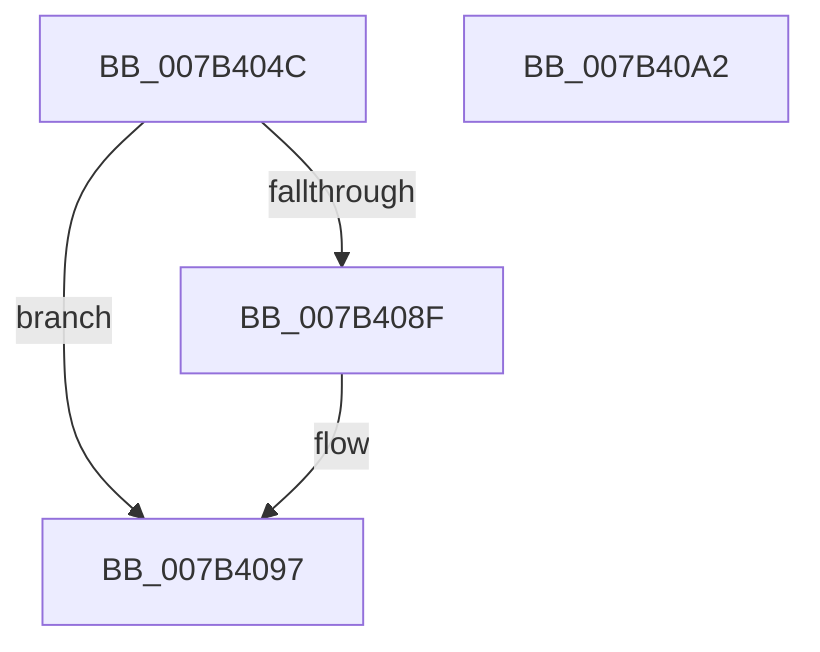

# WmipProcessLegacyEtwUnregister

- RVA: `0x007B404C`–`0x007B40A3` (길이 `87` bytes)
- VA: `0x00000001407B404C`
- 실행 섹션: `PAGE`
- PDB 이름 있음: `예`; PDB Function 태그: `아니요`
- unwind 정보 RVA: `0x0006E5F8`
- 디코드: `24`개 명령, `87/87` bytes 표시
- 미해석 바이트: `0` (있으면 어셈블리에 `.byte`로 보존)

> 이 문서는 커널 이미지의 기계어와 PDB 기호를 분석해 생성했습니다. 4번과 5번은 함수 원형과 자료형을 바이너리 사용 방식에서 추정한 C 해석이며 원본 소스 복구 결과는 아닙니다.

## 1. Dependencies

- 직접 호출 지점: **3**; 고유 호출 대상: **3**
- 직접 호출자로 확인된 함수: **1**
- RIP 상대 이미지 참조: **1**

### Outgoing calls
- `0x007B406E` → [KeWaitForSingleObject](../../text/20/KeWaitForSingleObject_function_0020E6B0.md) (function, `0x0020E6B0`)
- `0x007B4085` → [KeReleaseMutex](../../text/39/KeReleaseMutex_function_00396810.md) (function, `0x00396810`)
- `0x007B4092` → [EtwUnregister](../A7/EtwUnregister_function_00A723D0.md) (function, `0x00A723D0`)

### Direct callers
- [WmipLegacyEtwWorker](../9E/WmipLegacyEtwWorker_function_009E3290.md) at `0x009E33BA`

### Static image references
- `0x007B405F` → RVA `0x00EFFA60` (`.data`; read)

## 2. Other-region calls and transfers

- 다른 실행 섹션으로 향하는 call: **2**
  - `0x007B406E` → [KeWaitForSingleObject](../../text/20/KeWaitForSingleObject_function_0020E6B0.md) (`PAGE` → `.text`)
  - `0x007B4085` → [KeReleaseMutex](../../text/39/KeReleaseMutex_function_00396810.md) (`PAGE` → `.text`)
- 별도 외부 분기/꼬리 이동을 확인하지 못했습니다.

## 3. Assembly (complete function range)

```asm
007B404C  48 89 5C 24 08                  mov qword ptr [rsp + 8], rbx
007B4051  57                              push rdi
007B4052  48 83 EC 30                     sub rsp, 0x30
007B4056  48 83 64 24 20 00               and qword ptr [rsp + 0x20], 0
007B405C  48 8B D9                        mov rbx, rcx
007B405F  48 8D 0D FA B9 74 00            lea rcx, [rip + 0x74b9fa]
007B4066  45 33 C9                        xor r9d, r9d
007B4069  45 33 C0                        xor r8d, r8d
007B406C  33 D2                           xor edx, edx
007B406E  E8 3D A6 A5 FF                  call 0x14020e6b0
007B4073  48 8B 7B 68                     mov rdi, qword ptr [rbx + 0x68]
007B4077  48 8D 0D E2 B9 74 00            lea rcx, [rip + 0x74b9e2]
007B407E  48 83 63 68 00                  and qword ptr [rbx + 0x68], 0
007B4083  33 D2                           xor edx, edx
007B4085  E8 86 27 BE FF                  call 0x140396810
007B408A  48 85 FF                        test rdi, rdi
007B408D  74 08                           je 0x1407b4097
007B408F  48 8B CF                        mov rcx, rdi
007B4092  E8 39 E3 2B 00                  call 0x140a723d0
007B4097  48 8B 5C 24 40                  mov rbx, qword ptr [rsp + 0x40]
007B409C  48 83 C4 30                     add rsp, 0x30
007B40A0  5F                              pop rdi
007B40A1  C3                              ret
007B40A2  CC                              int3
```

## 4. C-style interpretation (structured pseudocode)

```c
__int64 __fastcall WmipProcessLegacyEtwUnregister(__int64 a1, int a2, int a3, int a4)
{
    __int64 result;
    __int64 v_rsp;
    unsigned __int64 v_stack_m18;
    unsigned __int64 v_stack_p8;

    v_stack_p8 = v_rbx;
    v_rsp = (v_rsp) - (48);
    a4 = 0;
    a3 = 0;
    a2 = 0;
    result = KeWaitForSingleObject(v_rip + 7649786, a2, a3, a4);
    a2 = 0;
    result = KeReleaseMutex(v_rip + 7649762, a2, a3, a4);
    if (*(unsigned __int64 *)(a1 + 104) != 0) {
        a1 = *(unsigned __int64 *)(a1 + 104);
        result = EtwUnregister(a1, a2, a3, a4);
    }
    v_rsp = (v_rsp) + (48);
    return result;
}
```

## 5. (Beta) C Style

```c
int64_t WmipProcessLegacyEtwUnregister(void *Arg1, int32_t Arg2, int32_t Arg3, int32_t Arg4)
{
    uint8_t *arg1 = (uint8_t *)Arg1;

    int64_t result;
    int64_t local_rsp;
    uint64_t v_stack_m18;
    uint64_t v_stack_p8;

    v_stack_p8 = local_rbx;
    local_rsp = (local_rsp) - (48);
    Arg4 = 0;
    Arg3 = 0;
    Arg2 = 0;
    result = KeWaitForSingleObject(v_rip + 7649786, Arg2, Arg3, Arg4);
    Arg2 = 0;
    result = KeReleaseMutex(v_rip + 7649762, Arg2, Arg3, Arg4);
    if (*(uint64_t *)(arg1 + 0x68) != 0) {
        Arg1 = *(uint64_t *)(arg1 + 0x68);
        result = EtwUnregister(Arg1, Arg2, Arg3, Arg4);
    }
    local_rsp = (local_rsp) + (48);
    return result;
}
```

### 관측된 메모리 오프셋

구조체 형식이 확인되지 않은 접근은 인자 기준의 오프셋으로만 기록했습니다.

| 기준 인자 | 오프셋 표현 | 폭 (bit) | 접근 |
|---|---:|---:|---|
| `Arg1` | `+ 0x68` | `64` | `R` |
| `Arg1` | `+ 0x68` | `64` | `R/W` |

## 6. Execution-region graph

[열기: 2D/3D 그래프와 함수 탐색 컨트롤 패널](../../../control-panel.html?section=page&rva=0x007B404C&view=graph)

- 2D 그래프는 위에서 아래로 흐르고, 3D 그래프는 빈 공간을 드래그해 회전합니다. Shift+드래그는 이동, 휠은 확대·축소, 함수 노드 선택은 대상 보고서 이동입니다.

### Static fallback


