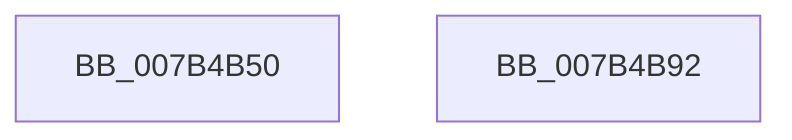

# WmipQueryWmiRegInfo

- RVA: `0x007B4B50`–`0x007B4B93` (길이 `67` bytes)
- VA: `0x00000001407B4B50`
- 실행 섹션: `PAGE`
- PDB 이름 있음: `예`; PDB Function 태그: `아니요`
- unwind 정보 RVA: `0x00064C80`
- 디코드: `18`개 명령, `67/67` bytes 표시
- 미해석 바이트: `0` (있으면 어셈블리에 `.byte`로 보존)

> 이 문서는 커널 이미지의 기계어와 PDB 기호를 분석해 생성했습니다. 4번과 5번은 함수 원형과 자료형을 바이너리 사용 방식에서 추정한 C 해석이며 원본 소스 복구 결과는 아닙니다.

## 1. Dependencies

- 직접 호출 지점: **2**; 고유 호출 대상: **2**
- 직접 호출자로 확인된 함수: **1**
- RIP 상대 이미지 참조: **2**

### Outgoing calls
- `0x007B4B77` → [RtlInitAnsiString](../../text/47/RtlInitAnsiString_function_00470F40.md) (function, `0x00470F40`)
- `0x007B4B87` → [RtlAnsiStringToUnicodeString](../90/RtlAnsiStringToUnicodeString_function_0090BEA0.md) (function, `0x0090BEA0`)

### Direct callers
- [sub_00B3C02C](../B3/Unknown_function_00B3C02C.md) at `0x00B3C0BC`

### Static image references
- `0x007B4B59` → RVA `0x00EFFA40` (`.data`; read)
- `0x007B4B60` → RVA `0x00B07070` (` ?? ::NNGAKEGL::`string'`; read)

## 2. Other-region calls and transfers

- 다른 실행 섹션으로 향하는 call: **1**
  - `0x007B4B77` → [RtlInitAnsiString](../../text/47/RtlInitAnsiString_function_00470F40.md) (`PAGE` → `.text`)
- 별도 외부 분기/꼬리 이동을 확인하지 못했습니다.

## 3. Assembly (complete function range)

```asm
007B4B50  40 53                           push rbx
007B4B52  48 83 EC 30                     sub rsp, 0x30
007B4B56  0F 57 C0                        xorps xmm0, xmm0
007B4B59  48 8D 05 E0 AE 74 00            lea rax, [rip + 0x74aee0]
007B4B60  48 8D 15 09 25 35 00            lea rdx, [rip + 0x352509]
007B4B67  49 89 01                        mov qword ptr [r9], rax
007B4B6A  48 8D 4C 24 20                  lea rcx, [rsp + 0x20]
007B4B6F  49 8B D8                        mov rbx, r8
007B4B72  0F 11 44 24 20                  movups xmmword ptr [rsp + 0x20], xmm0
007B4B77  E8 C4 C3 CB FF                  call 0x140470f40
007B4B7C  41 B0 01                        mov r8b, 1
007B4B7F  48 8D 54 24 20                  lea rdx, [rsp + 0x20]
007B4B84  48 8B CB                        mov rcx, rbx
007B4B87  E8 14 73 15 00                  call 0x14090bea0
007B4B8C  48 83 C4 30                     add rsp, 0x30
007B4B90  5B                              pop rbx
007B4B91  C3                              ret
007B4B92  CC                              int3
```

## 4. C-style interpretation (structured pseudocode)

```c
__int64 __fastcall WmipQueryWmiRegInfo(__int64 a1, __int64 a2, __int64 a3, __int64 a4)
{
    __int64 result;
    __int64 v_rsp;
    unsigned __int64 v_stack_m18;

    v_rsp = (v_rsp) - (48);
    *(unsigned __int64 *)(a4) = v_rip + 7646944;
    v_stack_m18 = v_xmm0;
    result = RtlInitAnsiString(v_stack_m18, v_rip + 3482889, a3, a4);
    result = RtlAnsiStringToUnicodeString(a3, v_stack_m18, 1, a4);
    v_rsp = (v_rsp) + (48);
    return result;
}
```

## 5. (Beta) C Style

```c
int64_t WmipQueryWmiRegInfo(int64_t Arg1, int64_t Arg2, int64_t Arg3, void *Arg4)
{
    uint8_t *arg4 = (uint8_t *)Arg4;

    int64_t result;
    int64_t local_rsp;
    uint64_t v_stack_m18;

    local_rsp = (local_rsp) - (48);
    *(uint64_t *)(arg4) = v_rip + 7646944;
    v_stack_m18 = v_xmm0;
    result = RtlInitAnsiString(v_stack_m18, v_rip + 3482889, Arg3, Arg4);
    result = RtlAnsiStringToUnicodeString(Arg3, v_stack_m18, 1, Arg4);
    local_rsp = (local_rsp) + (48);
    return result;
}
```

### 관측된 메모리 오프셋

구조체 형식이 확인되지 않은 접근은 인자 기준의 오프셋으로만 기록했습니다.

| 기준 인자 | 오프셋 표현 | 폭 (bit) | 접근 |
|---|---:|---:|---|
| `Arg4` | `+ 0x0` | `64` | `W` |

## 6. Execution-region graph

[열기: 2D/3D 그래프와 함수 탐색 컨트롤 패널](../../../control-panel.html?section=page&rva=0x007B4B50&view=graph)

- 2D 그래프는 위에서 아래로 흐르고, 3D 그래프는 빈 공간을 드래그해 회전합니다. Shift+드래그는 이동, 휠은 확대·축소, 함수 노드 선택은 대상 보고서 이동입니다.

### Static fallback


