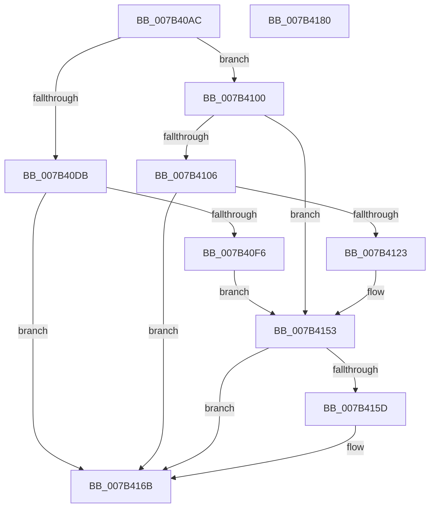

# WmipRegisterEtwProvider

- RVA: `0x007B40AC`–`0x007B4181` (길이 `213` bytes)
- VA: `0x00000001407B40AC`
- 실행 섹션: `PAGE`
- PDB 이름 있음: `예`; PDB Function 태그: `아니요`
- unwind 정보 RVA: `0x0005C954`
- 디코드: `55`개 명령, `213/213` bytes 표시
- 미해석 바이트: `0` (있으면 어셈블리에 `.byte`로 보존)

> 이 문서는 커널 이미지의 기계어와 PDB 기호를 분석해 생성했습니다. 4번과 5번은 함수 원형과 자료형을 바이너리 사용 방식에서 추정한 C 해석이며 원본 소스 복구 결과는 아닙니다.

## 1. Dependencies

- 직접 호출 지점: **4**; 고유 호출 대상: **3**
- 직접 호출자로 확인된 함수: **1**
- RIP 상대 이미지 참조: **0**

### Outgoing calls
- `0x007B40E9` → [ExAllocatePool2](../../poolcode/B8/ExAllocatePool2_function_00B820F0.md) (function, `0x00B820F0`)
- `0x007B4116` → [ExAllocatePool2](../../poolcode/B8/ExAllocatePool2_function_00B820F0.md) (function, `0x00B820F0`)
- `0x007B412C` → [WmipReferenceEntry](../9E/WmipReferenceEntry_function_009E1BF8.md) (function, `0x009E1BF8`)
- `0x007B4166` → [WmipQueueLegacyEtwWork](../9E/WmipQueueLegacyEtwWork_function_009E33DC.md) (function, `0x009E33DC`)

### Direct callers
- [WmipLinkDataSourceToList](../9D/WmipLinkDataSourceToList_function_009DF4D4.md) at `0x009DF5FC`

### Static image references
- 디코드된 RIP-relative 메모리 참조가 없습니다.

## 2. Other-region calls and transfers

- 다른 실행 섹션으로 향하는 call: **2**
  - `0x007B40E9` → [ExAllocatePool2](../../poolcode/B8/ExAllocatePool2_function_00B820F0.md) (`PAGE` → `POOLCODE`)
  - `0x007B4116` → [ExAllocatePool2](../../poolcode/B8/ExAllocatePool2_function_00B820F0.md) (`PAGE` → `POOLCODE`)
- 별도 외부 분기/꼬리 이동을 확인하지 못했습니다.

## 3. Assembly (complete function range)

```asm
007B40AC  48 89 5C 24 08                  mov qword ptr [rsp + 8], rbx
007B40B1  48 89 6C 24 10                  mov qword ptr [rsp + 0x10], rbp
007B40B6  48 89 74 24 18                  mov qword ptr [rsp + 0x18], rsi
007B40BB  57                              push rdi
007B40BC  48 83 EC 20                     sub rsp, 0x20
007B40C0  48 8B 79 38                     mov rdi, qword ptr [rcx + 0x38]
007B40C4  33 DB                           xor ebx, ebx
007B40C6  48 8B EA                        mov rbp, rdx
007B40C9  48 8B F1                        mov rsi, rcx
007B40CC  FF 87 98 00 00 00               inc dword ptr [rdi + 0x98]
007B40D2  83 BF 98 00 00 00 01            cmp dword ptr [rdi + 0x98], 1
007B40D9  75 25                           jne 0x1407b4100
007B40DB  8D 53 18                        lea edx, [rbx + 0x18]
007B40DE  B9 00 01 00 00                  mov ecx, 0x100
007B40E3  41 B8 57 6D 69 70               mov r8d, 0x70696d57
007B40E9  E8 02 E0 3C 00                  call 0x140b820f0
007B40EE  48 8B D8                        mov rbx, rax
007B40F1  48 85 C0                        test rax, rax
007B40F4  74 75                           je 0x1407b416b
007B40F6  48 89 47 70                     mov qword ptr [rdi + 0x70], rax
007B40FA  83 60 10 00                     and dword ptr [rax + 0x10], 0
007B40FE  EB 53                           jmp 0x1407b4153
007B4100  48 39 5F 78                     cmp qword ptr [rdi + 0x78], rbx
007B4104  74 4D                           je 0x1407b4153
007B4106  BA 30 00 00 00                  mov edx, 0x30
007B410B  B9 00 01 00 00                  mov ecx, 0x100
007B4110  41 B8 57 6D 69 70               mov r8d, 0x70696d57
007B4116  E8 D5 DF 3C 00                  call 0x140b820f0
007B411B  48 8B D8                        mov rbx, rax
007B411E  48 85 C0                        test rax, rax
007B4121  74 48                           je 0x1407b416b
007B4123  0F BA 6E 10 15                  bts dword ptr [rsi + 0x10], 0x15
007B4128  48 8B 4E 40                     mov rcx, qword ptr [rsi + 0x40]
007B412C  E8 C7 DA 22 00                  call 0x1409e1bf8
007B4131  C7 43 10 02 00 00 00            mov dword ptr [rbx + 0x10], 2
007B4138  C7 43 20 01 00 00 00            mov dword ptr [rbx + 0x20], 1
007B413F  48 8B 46 40                     mov rax, qword ptr [rsi + 0x40]
007B4143  48 89 43 28                     mov qword ptr [rbx + 0x28], rax
007B4147  48 8B 47 78                     mov rax, qword ptr [rdi + 0x78]
007B414B  48 89 43 18                     mov qword ptr [rbx + 0x18], rax
007B414F  C6 43 24 01                     mov byte ptr [rbx + 0x24], 1
007B4153  0F BA 6E 10 14                  bts dword ptr [rsi + 0x10], 0x14
007B4158  48 85 DB                        test rbx, rbx
007B415B  74 0E                           je 0x1407b416b
007B415D  4C 8B C5                        mov r8, rbp
007B4160  48 8B D7                        mov rdx, rdi
007B4163  48 8B CB                        mov rcx, rbx
007B4166  E8 71 F2 22 00                  call 0x1409e33dc
007B416B  48 8B 5C 24 30                  mov rbx, qword ptr [rsp + 0x30]
007B4170  48 8B 6C 24 38                  mov rbp, qword ptr [rsp + 0x38]
007B4175  48 8B 74 24 40                  mov rsi, qword ptr [rsp + 0x40]
007B417A  48 83 C4 20                     add rsp, 0x20
007B417E  5F                              pop rdi
007B417F  C3                              ret
007B4180  CC                              int3
```

## 4. C-style interpretation (structured pseudocode)

```c
__int64 __fastcall WmipRegisterEtwProvider(__int64 a1, __int64 a2)
{
    __int64 result;
    __int64 v_rbx;
    __int64 v_rsp;
    unsigned __int64 v_stack_p10;
    unsigned __int64 v_stack_p18;
    unsigned __int64 v_stack_p8;

    v_stack_p8 = v_rbx;
    v_stack_p10 = v_rbp;
    v_stack_p18 = v_rsi;
    v_rsp = (v_rsp) - (32);
    v_rbx = 0;
    if ((*(unsigned int *)(*(unsigned __int64 *)(a1 + 56) + 152)) != 1) goto loc_007B4100;
    result = ExAllocatePool2(256, v_rbx + 24, (unsigned int)(0x70696D57ULL), a4);
    if (result == 0) goto loc_007B416B;
    *(unsigned __int64 *)(*(unsigned __int64 *)(a1 + 56) + 112) = result;
    goto loc_007B4153;
loc_007B4100:
    if ((*(unsigned __int64 *)(*(unsigned __int64 *)(a1 + 56) + 120)) == result) goto loc_007B4153;
    result = ExAllocatePool2(256, 48, (unsigned int)(0x70696D57ULL), a4);
    if (result == 0) goto loc_007B416B;
    result = WmipReferenceEntry(*(unsigned __int64 *)(a1 + 64), 48, (unsigned int)(0x70696D57ULL), a4);
    *(unsigned int *)(result + 16) = 2;
    *(unsigned int *)(result + 32) = 1;
    *(unsigned __int64 *)(result + 40) = *(unsigned __int64 *)(a1 + 64);
    *(unsigned __int64 *)(result + 24) = *(unsigned __int64 *)(*(unsigned __int64 *)(a1 + 56) + 120);
    *(unsigned __int8 *)(result + 36) = 1;
loc_007B4153:
    result = *(unsigned __int64 *)(*(unsigned __int64 *)(a1 + 56) + 120);
    if (result != 0) {
        a3 = a2;
        a2 = *(unsigned __int64 *)(a1 + 56);
        a1 = result;
        result = WmipQueueLegacyEtwWork(a1, a2, a3, a4);
    }
    v_rsp = (v_rsp) + (32);
    return result;
}
```

## 5. (Beta) C Style

```c
int64_t WmipRegisterEtwProvider(void *Arg1, int64_t Arg2)
{
    uint8_t *arg1 = (uint8_t *)Arg1;

    int64_t result;
    int64_t local_rbx;
    int64_t local_rsp;
    uint64_t v_stack_p10;
    uint64_t v_stack_p18;
    uint64_t v_stack_p8;

    v_stack_p8 = local_rbx;
    v_stack_p10 = local_rbp;
    v_stack_p18 = local_rsi;
    local_rsp = (local_rsp) - (32);
    local_rbx = 0;
    if ((*(uint32_t *)(*(uint64_t *)(arg1 + 0x38) + 0x98)) != 1) goto loc_007B4100;
    result = ExAllocatePool2(256, local_rbx + 24, (uint32_t)(0x70696D57ULL), a4);
    if (result == 0) goto loc_007B416B;
    *(uint64_t *)(*(uint64_t *)(arg1 + 0x38) + 0x70) = result;
    goto loc_007B4153;
loc_007B4100:
    if ((*(uint64_t *)(*(uint64_t *)(arg1 + 0x38) + 0x78)) == result) goto loc_007B4153;
    result = ExAllocatePool2(256, 48, (uint32_t)(0x70696D57ULL), a4);
    if (result == 0) goto loc_007B416B;
    result = WmipReferenceEntry(*(uint64_t *)(arg1 + 0x40), 48, (uint32_t)(0x70696D57ULL), a4);
    *(uint32_t *)(result + 0x10) = 2;
    *(uint32_t *)(result + 0x20) = 1;
    *(uint64_t *)(result + 0x28) = *(uint64_t *)(arg1 + 0x40);
    *(uint64_t *)(result + 0x18) = *(uint64_t *)(*(uint64_t *)(arg1 + 0x38) + 0x78);
    *(uint8_t *)(result + 0x24) = 1;
loc_007B4153:
    result = *(uint64_t *)(*(uint64_t *)(arg1 + 0x38) + 0x78);
    if (result != 0) {
        a3 = Arg2;
        Arg2 = *(uint64_t *)(arg1 + 0x38);
        Arg1 = result;
        result = WmipQueueLegacyEtwWork(Arg1, Arg2, a3, a4);
    }
    local_rsp = (local_rsp) + (32);
    return result;
}
```

### 관측된 메모리 오프셋

구조체 형식이 확인되지 않은 접근은 인자 기준의 오프셋으로만 기록했습니다.

| 기준 인자 | 오프셋 표현 | 폭 (bit) | 접근 |
|---|---:|---:|---|
| `Arg1` | `+ 0x10` | `32` | `R/W` |
| `Arg1` | `+ 0x38` | `64` | `R` |
| `Arg1` | `+ 0x40` | `64` | `R` |

## 6. Execution-region graph

[열기: 2D/3D 그래프와 함수 탐색 컨트롤 패널](../../../control-panel.html?section=page&rva=0x007B40AC&view=graph)

- 2D 그래프는 위에서 아래로 흐르고, 3D 그래프는 빈 공간을 드래그해 회전합니다. Shift+드래그는 이동, 휠은 확대·축소, 함수 노드 선택은 대상 보고서 이동입니다.

### Static fallback


