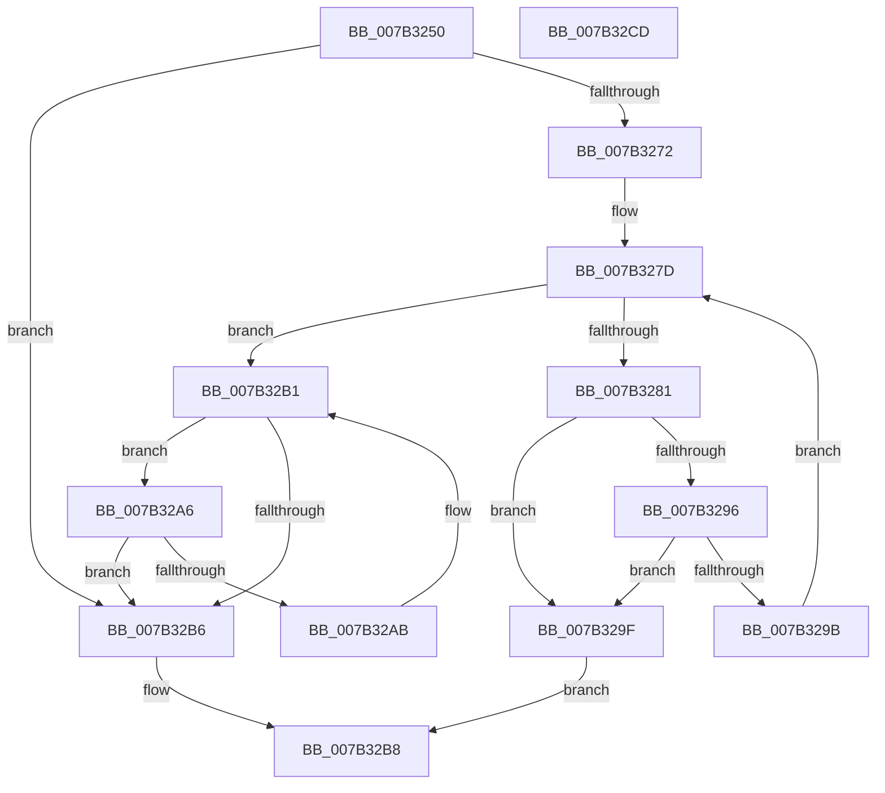

# WmipSMBiosFindStringAndZero

- RVA: `0x007B3250`–`0x007B32CE` (길이 `126` bytes)
- VA: `0x00000001407B3250`
- 실행 섹션: `PAGE`
- PDB 이름 있음: `예`; PDB Function 태그: `아니요`
- unwind 정보 RVA: `0x0005C954`
- 디코드: `44`개 명령, `126/126` bytes 표시
- 미해석 바이트: `0` (있으면 어셈블리에 `.byte`로 보존)

> 이 문서는 커널 이미지의 기계어와 PDB 기호를 분석해 생성했습니다. 4번과 5번은 함수 원형과 자료형을 바이너리 사용 방식에서 추정한 C 해석이며 원본 소스 복구 결과는 아닙니다.

## 1. Dependencies

- 직접 호출 지점: **1**; 고유 호출 대상: **1**
- 직접 호출자로 확인된 함수: **1**
- RIP 상대 이미지 참조: **0**

### Outgoing calls
- `0x007B3286` → [strchr](../../text/50/strchr_function_005014F0.md) (function, `0x005014F0`)

### Direct callers
- [WmipSMBiosHideMachine](WmipSMBiosHideMachine_function_007B335C.md) at `0x007B33E3`
- [WmipSMBiosHideMachine](WmipSMBiosHideMachine_function_007B335C.md) at `0x007B33F9`
- [WmipSMBiosHideMachine](WmipSMBiosHideMachine_function_007B335C.md) at `0x007B3445`
- [WmipSMBiosHideMachine](WmipSMBiosHideMachine_function_007B335C.md) at `0x007B345B`
- [WmipSMBiosHideMachine](WmipSMBiosHideMachine_function_007B335C.md) at `0x007B3471`
- [WmipSMBiosHideMachine](WmipSMBiosHideMachine_function_007B335C.md) at `0x007B3489`
- [WmipSMBiosHideMachine](WmipSMBiosHideMachine_function_007B335C.md) at `0x007B34CF`
- [WmipSMBiosHideMachine](WmipSMBiosHideMachine_function_007B335C.md) at `0x007B34E5`
- [WmipSMBiosHideMachine](WmipSMBiosHideMachine_function_007B335C.md) at `0x007B3528`
- [WmipSMBiosHideMachine](WmipSMBiosHideMachine_function_007B335C.md) at `0x007B353E`

### Static image references
- 디코드된 RIP-relative 메모리 참조가 없습니다.

## 2. Other-region calls and transfers

- 다른 실행 섹션으로 향하는 call: **1**
  - `0x007B3286` → [strchr](../../text/50/strchr_function_005014F0.md) (`PAGE` → `.text`)
- 별도 외부 분기/꼬리 이동을 확인하지 못했습니다.

## 3. Assembly (complete function range)

```asm
007B3250  48 89 5C 24 08                  mov qword ptr [rsp + 8], rbx
007B3255  48 89 6C 24 10                  mov qword ptr [rsp + 0x10], rbp
007B325A  48 89 74 24 18                  mov qword ptr [rsp + 0x18], rsi
007B325F  57                              push rdi
007B3260  48 83 EC 20                     sub rsp, 0x20
007B3264  41 8B D8                        mov ebx, r8d
007B3267  33 ED                           xor ebp, ebp
007B3269  48 03 D9                        add rbx, rcx
007B326C  8B FA                           mov edi, edx
007B326E  85 D2                           test edx, edx
007B3270  74 44                           je 0x1407b32b6
007B3272  0F B6 41 01                     movzx eax, byte ptr [rcx + 1]
007B3276  FF CF                           dec edi
007B3278  48 03 C1                        add rax, rcx
007B327B  8B F5                           mov esi, ebp
007B327D  3B F7                           cmp esi, edi
007B327F  73 30                           jae 0x1407b32b1
007B3281  33 D2                           xor edx, edx
007B3283  48 8B C8                        mov rcx, rax
007B3286  E8 65 E2 D4 FF                  call 0x1405014f0
007B328B  48 8B C8                        mov rcx, rax
007B328E  48 FF C0                        inc rax
007B3291  48 3B C3                        cmp rax, rbx
007B3294  73 09                           jae 0x1407b329f
007B3296  66 39 29                        cmp word ptr [rcx], bp
007B3299  74 04                           je 0x1407b329f
007B329B  FF C6                           inc esi
007B329D  EB DE                           jmp 0x1407b327d
007B329F  B8 34 00 00 C0                  mov eax, 0xc0000034
007B32A4  EB 12                           jmp 0x1407b32b8
007B32A6  40 38 28                        cmp byte ptr [rax], bpl
007B32A9  74 0B                           je 0x1407b32b6
007B32AB  C6 00 5F                        mov byte ptr [rax], 0x5f
007B32AE  48 FF C0                        inc rax
007B32B1  48 3B C3                        cmp rax, rbx
007B32B4  72 F0                           jb 0x1407b32a6
007B32B6  33 C0                           xor eax, eax
007B32B8  48 8B 5C 24 30                  mov rbx, qword ptr [rsp + 0x30]
007B32BD  48 8B 6C 24 38                  mov rbp, qword ptr [rsp + 0x38]
007B32C2  48 8B 74 24 40                  mov rsi, qword ptr [rsp + 0x40]
007B32C7  48 83 C4 20                     add rsp, 0x20
007B32CB  5F                              pop rdi
007B32CC  C3                              ret
007B32CD  CC                              int3
```

## 4. C-style interpretation (structured pseudocode)

```c
__int64 __fastcall WmipSMBiosFindStringAndZero(__int64 a1, int a2, int a3)
{
    __int64 result;
    __int64 v_rbp;
    __int64 v_rbx;
    __int64 v_rdi;
    __int64 v_rsi;
    __int64 v_rsp;
    unsigned __int64 v_stack_p10;
    unsigned __int64 v_stack_p18;
    unsigned __int64 v_stack_p8;

    v_stack_p8 = v_rbx;
    v_stack_p10 = v_rbp;
    v_stack_p18 = v_rsi;
    v_rsp = (v_rsp) - (32);
    v_rbp = 0;
    v_rbx = ((unsigned int)(a3)) + (a1);
    if (a2 == 0) goto loc_007B32B6;
    v_rdi = (unsigned int)(((unsigned int)(a2)) - 1);
    result = (*(unsigned __int8 *)(a1 + 1)) + (a1);
loc_007B327D:
    if (0 >= ((unsigned int)(v_rdi))) goto loc_007B32B1;
    a2 = 0;
    result = strchr(result, a2, a3, a4);
    result = (result) + 1;
    if (result >= v_rbx) goto loc_007B329F;
    if ((*(unsigned __int16 *)(result)) == 0) goto loc_007B329F;
    v_rsi = (unsigned int)((0) + 1);
    goto loc_007B327D;
loc_007B329F:
    goto loc_007B32B8;
loc_007B32A6:
    if ((*(unsigned __int8 *)((unsigned int)(0xC0000034ULL))) == 0) goto loc_007B32B6;
    *(unsigned __int8 *)((unsigned int)(0xC0000034ULL)) = 95;
    result = ((unsigned int)(0xC0000034ULL)) + 1;
loc_007B32B1:
    if (result < v_rbx) goto loc_007B32A6;
loc_007B32B6:
    result = 0;
loc_007B32B8:
    v_rsp = (v_rsp) + (32);
    return result;
}
```

## 5. (Beta) C Style

```c
int64_t WmipSMBiosFindStringAndZero(void *Arg1, int32_t Arg2, int32_t Arg3)
{
    uint8_t *arg1 = (uint8_t *)Arg1;

    int64_t result;
    int64_t local_rbp;
    int64_t local_rbx;
    int64_t local_rdi;
    int64_t local_rsi;
    int64_t local_rsp;
    uint64_t v_stack_p10;
    uint64_t v_stack_p18;
    uint64_t v_stack_p8;

    v_stack_p8 = local_rbx;
    v_stack_p10 = local_rbp;
    v_stack_p18 = local_rsi;
    local_rsp = (local_rsp) - (32);
    local_rbp = 0;
    local_rbx = ((uint32_t)(Arg3)) + (Arg1);
    if (Arg2 == 0) goto loc_007B32B6;
    local_rdi = (uint32_t)(((uint32_t)(Arg2)) - 1);
    result = (*(uint8_t *)(arg1 + 0x1)) + (Arg1);
loc_007B327D:
    if (0 >= ((uint32_t)(local_rdi))) goto loc_007B32B1;
    Arg2 = 0;
    result = strchr(result, Arg2, Arg3, a4);
    result = (result) + 1;
    if (result >= local_rbx) goto loc_007B329F;
    if ((*(uint16_t *)(result)) == 0) goto loc_007B329F;
    local_rsi = (uint32_t)((0) + 1);
    goto loc_007B327D;
loc_007B329F:
    goto loc_007B32B8;
loc_007B32A6:
    if ((*(uint8_t *)((uint32_t)(0xC0000034ULL))) == 0) goto loc_007B32B6;
    *(uint8_t *)((uint32_t)(0xC0000034ULL)) = 95;
    result = ((uint32_t)(0xC0000034ULL)) + 1;
loc_007B32B1:
    if (result < local_rbx) goto loc_007B32A6;
loc_007B32B6:
    result = 0;
loc_007B32B8:
    local_rsp = (local_rsp) + (32);
    return result;
}
```

### 관측된 메모리 오프셋

구조체 형식이 확인되지 않은 접근은 인자 기준의 오프셋으로만 기록했습니다.

| 기준 인자 | 오프셋 표현 | 폭 (bit) | 접근 |
|---|---:|---:|---|
| `Arg1` | `+ 0x1` | `8` | `R` |

## 6. Execution-region graph

[열기: 2D/3D 그래프와 함수 탐색 컨트롤 패널](../../../control-panel.html?section=page&rva=0x007B3250&view=graph)

- 2D 그래프는 위에서 아래로 흐르고, 3D 그래프는 빈 공간을 드래그해 회전합니다. Shift+드래그는 이동, 휠은 확대·축소, 함수 노드 선택은 대상 보고서 이동입니다.

### Static fallback


