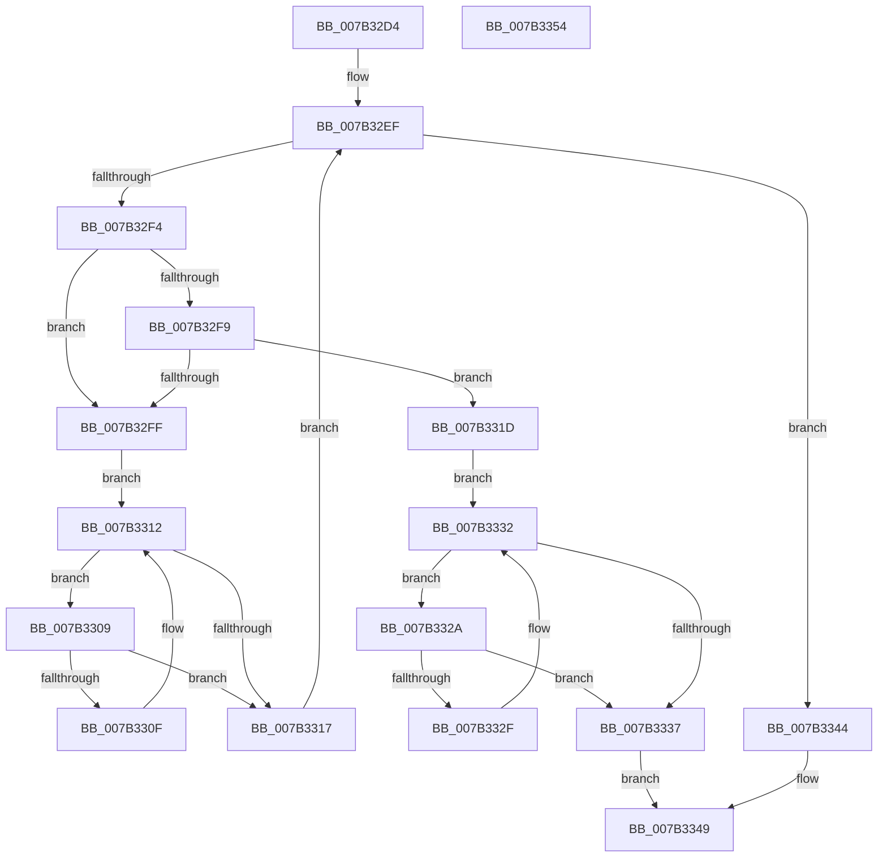

# WmipSMBiosFindStructure

- RVA: `0x007B32D4`–`0x007B3355` (길이 `129` bytes)
- VA: `0x00000001407B32D4`
- 실행 섹션: `PAGE`
- PDB 이름 있음: `예`; PDB Function 태그: `아니요`
- unwind 정보 RVA: `0x000950EC`
- 디코드: `43`개 명령, `129/129` bytes 표시
- 미해석 바이트: `0` (있으면 어셈블리에 `.byte`로 보존)

> 이 문서는 커널 이미지의 기계어와 PDB 기호를 분석해 생성했습니다. 4번과 5번은 함수 원형과 자료형을 바이너리 사용 방식에서 추정한 C 해석이며 원본 소스 복구 결과는 아닙니다.

## 1. Dependencies

- 직접 호출 지점: **0**; 고유 호출 대상: **0**
- 직접 호출자로 확인된 함수: **1**
- RIP 상대 이미지 참조: **0**

### Outgoing calls
- 직접 디코드된 call 명령이 없습니다.

### Direct callers
- [WmipSMBiosHideMachine](WmipSMBiosHideMachine_function_007B335C.md) at `0x007B33B6`
- [WmipSMBiosHideMachine](WmipSMBiosHideMachine_function_007B335C.md) at `0x007B3418`
- [WmipSMBiosHideMachine](WmipSMBiosHideMachine_function_007B335C.md) at `0x007B34AB`
- [WmipSMBiosHideMachine](WmipSMBiosHideMachine_function_007B335C.md) at `0x007B3504`

### Static image references
- 디코드된 RIP-relative 메모리 참조가 없습니다.

## 2. Other-region calls and transfers

- 다른 실행 섹션으로 향하는 call: **0**
- 별도 외부 분기/꼬리 이동을 확인하지 못했습니다.

## 3. Assembly (complete function range)

```asm
007B32D4  48 89 5C 24 08                  mov qword ptr [rsp + 8], rbx
007B32D9  48 89 7C 24 10                  mov qword ptr [rsp + 0x10], rdi
007B32DE  44 8B 5C 24 30                  mov r11d, dword ptr [rsp + 0x30]
007B32E3  4C 8B 54 24 28                  mov r10, qword ptr [rsp + 0x28]
007B32E8  4D 03 DA                        add r11, r10
007B32EB  33 FF                           xor edi, edi
007B32ED  8B DF                           mov ebx, edi
007B32EF  4D 3B D3                        cmp r10, r11
007B32F2  73 50                           jae 0x1407b3344
007B32F4  41 38 0A                        cmp byte ptr [r10], cl
007B32F7  75 06                           jne 0x1407b32ff
007B32F9  FF C3                           inc ebx
007B32FB  3B DA                           cmp ebx, edx
007B32FD  77 1E                           ja 0x1407b331d
007B32FF  41 0F B6 42 01                  movzx eax, byte ptr [r10 + 1]
007B3304  4C 03 D0                        add r10, rax
007B3307  EB 09                           jmp 0x1407b3312
007B3309  66 41 39 3A                     cmp word ptr [r10], di
007B330D  74 08                           je 0x1407b3317
007B330F  49 FF C2                        inc r10
007B3312  4D 3B D3                        cmp r10, r11
007B3315  72 F2                           jb 0x1407b3309
007B3317  49 83 C2 02                     add r10, 2
007B331B  EB D2                           jmp 0x1407b32ef
007B331D  41 0F B6 4A 01                  movzx ecx, byte ptr [r10 + 1]
007B3322  49 03 CA                        add rcx, r10
007B3325  4D 89 10                        mov qword ptr [r8], r10
007B3328  EB 08                           jmp 0x1407b3332
007B332A  66 39 39                        cmp word ptr [rcx], di
007B332D  74 08                           je 0x1407b3337
007B332F  48 FF C1                        inc rcx
007B3332  49 3B CB                        cmp rcx, r11
007B3335  72 F3                           jb 0x1407b332a
007B3337  41 2B CA                        sub ecx, r10d
007B333A  83 C1 02                        add ecx, 2
007B333D  41 89 09                        mov dword ptr [r9], ecx
007B3340  33 C0                           xor eax, eax
007B3342  EB 05                           jmp 0x1407b3349
007B3344  B8 34 00 00 C0                  mov eax, 0xc0000034
007B3349  48 8B 5C 24 08                  mov rbx, qword ptr [rsp + 8]
007B334E  48 8B 7C 24 10                  mov rdi, qword ptr [rsp + 0x10]
007B3353  C3                              ret
007B3354  CC                              int3
```

## 4. C-style interpretation (structured pseudocode)

```c
__int64 __fastcall WmipSMBiosFindStructure(unsigned __int8 a1, int a2, __int64 a3, __int64 a4, __int64 a5, unsigned int a6)
{
    __int64 result;
    __int64 v_r10;
    __int64 v_r11;
    __int64 v_rbx;
    __int64 v_rdi;
    unsigned __int64 v_stack_p10;
    unsigned __int64 v_stack_p8;

    v_stack_p8 = v_rbx;
    v_stack_p10 = v_rdi;
    v_r11 = ((unsigned int)(a6)) + (a5);
    v_rdi = 0;
loc_007B32EF:
    if (a5 >= v_r11) goto loc_007B3344;
    if ((*(unsigned __int8 *)(a5)) != a1) goto loc_007B32FF;
    v_rbx = (unsigned int)((0) + 1);
    if (((unsigned int)(v_rbx)) > a2) goto loc_007B331D;
loc_007B32FF:
    v_r10 = (a5) + (*(unsigned __int8 *)(a5 + 1));
    goto loc_007B3312;
loc_007B3309:
    if ((*(unsigned __int16 *)(v_r10)) == 0) goto loc_007B3317;
    v_r10 = (v_r10) + 1;
loc_007B3312:
    if (v_r10 < v_r11) goto loc_007B3309;
loc_007B3317:
    v_r10 = (v_r10) + (2);
    goto loc_007B32EF;
loc_007B331D:
    a1 = (*(unsigned __int8 *)(v_r10 + 1)) + (v_r10);
    *(unsigned __int64 *)(a3) = v_r10;
    goto loc_007B3332;
loc_007B332A:
    if ((*(unsigned __int16 *)(a1)) == 0) goto loc_007B3337;
    a1 = (a1) + 1;
loc_007B3332:
    if (a1 < v_r11) goto loc_007B332A;
loc_007B3337:
    a1 = (unsigned int)((a1) - ((unsigned int)(v_r10)));
    a1 = (unsigned int)((a1) + (2));
    *(unsigned int *)(a4) = a1;
    result = 0;
    goto loc_007B3349;
loc_007B3344:
loc_007B3349:
    return (unsigned int)(0xC0000034ULL);
}
```

## 5. (Beta) C Style

```c
int64_t WmipSMBiosFindStructure(uint8_t Arg1, int32_t Arg2, void *Arg3, void *Arg4, int64_t Arg5, uint32_t Arg6)
{
    uint8_t *arg3 = (uint8_t *)Arg3;
    uint8_t *arg4 = (uint8_t *)Arg4;

    int64_t result;
    int64_t local_r10;
    int64_t local_r11;
    int64_t local_rbx;
    int64_t local_rdi;
    uint64_t v_stack_p10;
    uint64_t v_stack_p8;

    v_stack_p8 = local_rbx;
    v_stack_p10 = local_rdi;
    local_r11 = ((uint32_t)(Arg6)) + (Arg5);
    local_rdi = 0;
loc_007B32EF:
    if (Arg5 >= local_r11) goto loc_007B3344;
    if ((*(uint8_t *)(Arg5)) != Arg1) goto loc_007B32FF;
    local_rbx = (uint32_t)((0) + 1);
    if (((uint32_t)(local_rbx)) > Arg2) goto loc_007B331D;
loc_007B32FF:
    local_r10 = (Arg5) + (*(uint8_t *)(Arg5 + 0x1));
    goto loc_007B3312;
loc_007B3309:
    if ((*(uint16_t *)(local_r10)) == 0) goto loc_007B3317;
    local_r10 = (local_r10) + 1;
loc_007B3312:
    if (local_r10 < local_r11) goto loc_007B3309;
loc_007B3317:
    local_r10 = (local_r10) + (2);
    goto loc_007B32EF;
loc_007B331D:
    Arg1 = (*(uint8_t *)(local_r10 + 0x1)) + (local_r10);
    *(uint64_t *)(arg3) = local_r10;
    goto loc_007B3332;
loc_007B332A:
    if ((*(uint16_t *)(Arg1)) == 0) goto loc_007B3337;
    Arg1 = (Arg1) + 1;
loc_007B3332:
    if (Arg1 < local_r11) goto loc_007B332A;
loc_007B3337:
    Arg1 = (uint32_t)((Arg1) - ((uint32_t)(local_r10)));
    Arg1 = (uint32_t)((Arg1) + (2));
    *(uint32_t *)(arg4) = Arg1;
    result = 0;
    goto loc_007B3349;
loc_007B3344:
loc_007B3349:
    return (uint32_t)(0xC0000034ULL);
}
```

### 관측된 메모리 오프셋

구조체 형식이 확인되지 않은 접근은 인자 기준의 오프셋으로만 기록했습니다.

| 기준 인자 | 오프셋 표현 | 폭 (bit) | 접근 |
|---|---:|---:|---|
| `Arg3` | `+ 0x0` | `64` | `W` |
| `Arg4` | `+ 0x0` | `32` | `W` |

## 6. Execution-region graph

[열기: 2D/3D 그래프와 함수 탐색 컨트롤 패널](../../../control-panel.html?section=page&rva=0x007B32D4&view=graph)

- 2D 그래프는 위에서 아래로 흐르고, 3D 그래프는 빈 공간을 드래그해 회전합니다. Shift+드래그는 이동, 휠은 확대·축소, 함수 노드 선택은 대상 보고서 이동입니다.

### Static fallback


