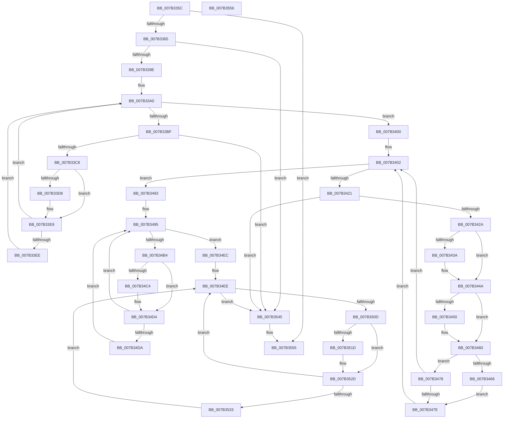

# WmipSMBiosHideMachine

- RVA: `0x007B335C`–`0x007B3557` (길이 `507` bytes)
- VA: `0x00000001407B335C`
- 실행 섹션: `PAGE`
- PDB 이름 있음: `예`; PDB Function 태그: `아니요`
- unwind 정보 RVA: `0x000D31D0`
- 디코드: `149`개 명령, `507/507` bytes 표시
- 미해석 바이트: `0` (있으면 어셈블리에 `.byte`로 보존)

> 이 문서는 커널 이미지의 기계어와 PDB 기호를 분석해 생성했습니다. 4번과 5번은 함수 원형과 자료형을 바이너리 사용 방식에서 추정한 C 해석이며 원본 소스 복구 결과는 아닙니다.

## 1. Dependencies

- 직접 호출 지점: **14**; 고유 호출 대상: **2**
- 직접 호출자로 확인된 함수: **1**
- RIP 상대 이미지 참조: **0**

### Outgoing calls
- `0x007B33B6` → [WmipSMBiosFindStructure](WmipSMBiosFindStructure_function_007B32D4.md) (function, `0x007B32D4`)
- `0x007B33E3` → [WmipSMBiosFindStringAndZero](WmipSMBiosFindStringAndZero_function_007B3250.md) (function, `0x007B3250`)
- `0x007B33F9` → [WmipSMBiosFindStringAndZero](WmipSMBiosFindStringAndZero_function_007B3250.md) (function, `0x007B3250`)
- `0x007B3418` → [WmipSMBiosFindStructure](WmipSMBiosFindStructure_function_007B32D4.md) (function, `0x007B32D4`)
- `0x007B3445` → [WmipSMBiosFindStringAndZero](WmipSMBiosFindStringAndZero_function_007B3250.md) (function, `0x007B3250`)
- `0x007B345B` → [WmipSMBiosFindStringAndZero](WmipSMBiosFindStringAndZero_function_007B3250.md) (function, `0x007B3250`)
- `0x007B3471` → [WmipSMBiosFindStringAndZero](WmipSMBiosFindStringAndZero_function_007B3250.md) (function, `0x007B3250`)
- `0x007B3489` → [WmipSMBiosFindStringAndZero](WmipSMBiosFindStringAndZero_function_007B3250.md) (function, `0x007B3250`)
- `0x007B34AB` → [WmipSMBiosFindStructure](WmipSMBiosFindStructure_function_007B32D4.md) (function, `0x007B32D4`)
- `0x007B34CF` → [WmipSMBiosFindStringAndZero](WmipSMBiosFindStringAndZero_function_007B3250.md) (function, `0x007B3250`)
- `0x007B34E5` → [WmipSMBiosFindStringAndZero](WmipSMBiosFindStringAndZero_function_007B3250.md) (function, `0x007B3250`)
- `0x007B3504` → [WmipSMBiosFindStructure](WmipSMBiosFindStructure_function_007B32D4.md) (function, `0x007B32D4`)
- `0x007B3528` → [WmipSMBiosFindStringAndZero](WmipSMBiosFindStringAndZero_function_007B3250.md) (function, `0x007B3250`)
- `0x007B353E` → [WmipSMBiosFindStringAndZero](WmipSMBiosFindStringAndZero_function_007B3250.md) (function, `0x007B3250`)

### Direct callers
- [WmipGetSMBiosTableData](../A4/WmipGetSMBiosTableData_function_00A4F078.md) at `0x00A4F161`

### Static image references
- 디코드된 RIP-relative 메모리 참조가 없습니다.

## 2. Other-region calls and transfers

- 다른 실행 섹션으로 향하는 call: **0**
- 별도 외부 분기/꼬리 이동을 확인하지 못했습니다.

## 3. Assembly (complete function range)

```asm
007B335C  48 85 C9                        test rcx, rcx
007B335F  0F 84 F0 01 00 00               je 0x1407b3555
007B3365  48 89 5C 24 10                  mov qword ptr [rsp + 0x10], rbx
007B336A  55                              push rbp
007B336B  56                              push rsi
007B336C  57                              push rdi
007B336D  41 54                           push r12
007B336F  41 57                           push r15
007B3371  48 8B EC                        mov rbp, rsp
007B3374  48 83 EC 40                     sub rsp, 0x40
007B3378  48 83 65 F0 00                  and qword ptr [rbp - 0x10], 0
007B337D  44 8B FA                        mov r15d, edx
007B3380  48 83 65 40 00                  and qword ptr [rbp + 0x40], 0
007B3385  4C 8B E1                        mov r12, rcx
007B3388  48 83 65 F8 00                  and qword ptr [rbp - 8], 0
007B338D  48 83 65 48 00                  and qword ptr [rbp + 0x48], 0
007B3392  83 65 30 00                     and dword ptr [rbp + 0x30], 0
007B3396  85 D2                           test edx, edx
007B3398  0F 84 A7 01 00 00               je 0x1407b3545
007B339E  33 DB                           xor ebx, ebx
007B33A0  44 89 7C 24 28                  mov dword ptr [rsp + 0x28], r15d
007B33A5  4C 8D 4D 30                     lea r9, [rbp + 0x30]
007B33A9  4C 8D 45 40                     lea r8, [rbp + 0x40]
007B33AD  4C 89 64 24 20                  mov qword ptr [rsp + 0x20], r12
007B33B2  8B D3                           mov edx, ebx
007B33B4  33 C9                           xor ecx, ecx
007B33B6  E8 19 FF FF FF                  call 0x1407b32d4
007B33BB  85 C0                           test eax, eax
007B33BD  78 41                           js 0x1407b3400
007B33BF  83 FB 01                        cmp ebx, 1
007B33C2  0F 83 7D 01 00 00               jae 0x1407b3545
007B33C8  48 8B 7D 40                     mov rdi, qword ptr [rbp + 0x40]
007B33CC  FF C3                           inc ebx
007B33CE  40 8A 77 01                     mov sil, byte ptr [rdi + 1]
007B33D2  40 80 FE 04                     cmp sil, 4
007B33D6  76 10                           jbe 0x1407b33e8
007B33D8  0F B6 57 04                     movzx edx, byte ptr [rdi + 4]
007B33DC  48 8B CF                        mov rcx, rdi
007B33DF  44 8B 45 30                     mov r8d, dword ptr [rbp + 0x30]
007B33E3  E8 68 FE FF FF                  call 0x1407b3250
007B33E8  40 80 FE 05                     cmp sil, 5
007B33EC  76 B2                           jbe 0x1407b33a0
007B33EE  0F B6 57 05                     movzx edx, byte ptr [rdi + 5]
007B33F2  48 8B CF                        mov rcx, rdi
007B33F5  44 8B 45 30                     mov r8d, dword ptr [rbp + 0x30]
007B33F9  E8 52 FE FF FF                  call 0x1407b3250
007B33FE  EB A0                           jmp 0x1407b33a0
007B3400  33 F6                           xor esi, esi
007B3402  44 89 7C 24 28                  mov dword ptr [rsp + 0x28], r15d
007B3407  4C 8D 4D 30                     lea r9, [rbp + 0x30]
007B340B  4C 8D 45 48                     lea r8, [rbp + 0x48]
007B340F  4C 89 64 24 20                  mov qword ptr [rsp + 0x20], r12
007B3414  8B D6                           mov edx, esi
007B3416  B1 01                           mov cl, 1
007B3418  E8 B7 FE FF FF                  call 0x1407b32d4
007B341D  85 C0                           test eax, eax
007B341F  78 72                           js 0x1407b3493
007B3421  83 FE 01                        cmp esi, 1
007B3424  0F 83 1B 01 00 00               jae 0x1407b3545
007B342A  48 8B 5D 48                     mov rbx, qword ptr [rbp + 0x48]
007B342E  FF C6                           inc esi
007B3430  40 8A 7B 01                     mov dil, byte ptr [rbx + 1]
007B3434  40 80 FF 04                     cmp dil, 4
007B3438  76 10                           jbe 0x1407b344a
007B343A  0F B6 53 04                     movzx edx, byte ptr [rbx + 4]
007B343E  48 8B CB                        mov rcx, rbx
007B3441  44 8B 45 30                     mov r8d, dword ptr [rbp + 0x30]
007B3445  E8 06 FE FF FF                  call 0x1407b3250
007B344A  40 80 FF 05                     cmp dil, 5
007B344E  76 10                           jbe 0x1407b3460
007B3450  0F B6 53 05                     movzx edx, byte ptr [rbx + 5]
007B3454  48 8B CB                        mov rcx, rbx
007B3457  44 8B 45 30                     mov r8d, dword ptr [rbp + 0x30]
007B345B  E8 F0 FD FF FF                  call 0x1407b3250
007B3460  40 80 FF 1A                     cmp dil, 0x1a
007B3464  76 12                           jbe 0x1407b3478
007B3466  0F B6 53 1A                     movzx edx, byte ptr [rbx + 0x1a]
007B346A  48 8B CB                        mov rcx, rbx
007B346D  44 8B 45 30                     mov r8d, dword ptr [rbp + 0x30]
007B3471  E8 DA FD FF FF                  call 0x1407b3250
007B3476  EB 06                           jmp 0x1407b347e
007B3478  40 80 FF 19                     cmp dil, 0x19
007B347C  76 84                           jbe 0x1407b3402
007B347E  0F B6 53 19                     movzx edx, byte ptr [rbx + 0x19]
007B3482  48 8B CB                        mov rcx, rbx
007B3485  44 8B 45 30                     mov r8d, dword ptr [rbp + 0x30]
007B3489  E8 C2 FD FF FF                  call 0x1407b3250
007B348E  E9 6F FF FF FF                  jmp 0x1407b3402
007B3493  33 FF                           xor edi, edi
007B3495  44 89 7C 24 28                  mov dword ptr [rsp + 0x28], r15d
007B349A  4C 8D 4D 30                     lea r9, [rbp + 0x30]
007B349E  4C 8D 45 F0                     lea r8, [rbp - 0x10]
007B34A2  4C 89 64 24 20                  mov qword ptr [rsp + 0x20], r12
007B34A7  8B D7                           mov edx, edi
007B34A9  B1 02                           mov cl, 2
007B34AB  E8 24 FE FF FF                  call 0x1407b32d4
007B34B0  85 C0                           test eax, eax
007B34B2  78 38                           js 0x1407b34ec
007B34B4  48 8B 5D F0                     mov rbx, qword ptr [rbp - 0x10]
007B34B8  FF C7                           inc edi
007B34BA  40 8A 73 01                     mov sil, byte ptr [rbx + 1]
007B34BE  40 80 FE 04                     cmp sil, 4
007B34C2  76 10                           jbe 0x1407b34d4
007B34C4  0F B6 53 04                     movzx edx, byte ptr [rbx + 4]
007B34C8  48 8B CB                        mov rcx, rbx
007B34CB  44 8B 45 30                     mov r8d, dword ptr [rbp + 0x30]
007B34CF  E8 7C FD FF FF                  call 0x1407b3250
007B34D4  40 80 FE 05                     cmp sil, 5
007B34D8  76 BB                           jbe 0x1407b3495
007B34DA  0F B6 53 05                     movzx edx, byte ptr [rbx + 5]
007B34DE  48 8B CB                        mov rcx, rbx
007B34E1  44 8B 45 30                     mov r8d, dword ptr [rbp + 0x30]
007B34E5  E8 66 FD FF FF                  call 0x1407b3250
007B34EA  EB A9                           jmp 0x1407b3495
007B34EC  33 FF                           xor edi, edi
007B34EE  44 89 7C 24 28                  mov dword ptr [rsp + 0x28], r15d
007B34F3  4C 8D 4D 30                     lea r9, [rbp + 0x30]
007B34F7  4C 8D 45 F8                     lea r8, [rbp - 8]
007B34FB  4C 89 64 24 20                  mov qword ptr [rsp + 0x20], r12
007B3500  8B D7                           mov edx, edi
007B3502  B1 04                           mov cl, 4
007B3504  E8 CB FD FF FF                  call 0x1407b32d4
007B3509  85 C0                           test eax, eax
007B350B  78 38                           js 0x1407b3545
007B350D  48 8B 5D F8                     mov rbx, qword ptr [rbp - 8]
007B3511  FF C7                           inc edi
007B3513  40 8A 73 01                     mov sil, byte ptr [rbx + 1]
007B3517  40 80 FE 07                     cmp sil, 7
007B351B  76 10                           jbe 0x1407b352d
007B351D  0F B6 53 07                     movzx edx, byte ptr [rbx + 7]
007B3521  48 8B CB                        mov rcx, rbx
007B3524  44 8B 45 30                     mov r8d, dword ptr [rbp + 0x30]
007B3528  E8 23 FD FF FF                  call 0x1407b3250
007B352D  40 80 FE 10                     cmp sil, 0x10
007B3531  76 BB                           jbe 0x1407b34ee
007B3533  0F B6 53 10                     movzx edx, byte ptr [rbx + 0x10]
007B3537  48 8B CB                        mov rcx, rbx
007B353A  44 8B 45 30                     mov r8d, dword ptr [rbp + 0x30]
007B353E  E8 0D FD FF FF                  call 0x1407b3250
007B3543  EB A9                           jmp 0x1407b34ee
007B3545  48 8B 5C 24 78                  mov rbx, qword ptr [rsp + 0x78]
007B354A  48 83 C4 40                     add rsp, 0x40
007B354E  41 5F                           pop r15
007B3550  41 5C                           pop r12
007B3552  5F                              pop rdi
007B3553  5E                              pop rsi
007B3554  5D                              pop rbp
007B3555  C3                              ret
007B3556  CC                              int3
```

## 4. C-style interpretation (structured pseudocode)

```c
__int64 __fastcall WmipSMBiosHideMachine(__int64 a1, int a2)
{
    __int64 result;
    __int64 v_rbx;
    __int64 v_rdi;
    __int64 v_rsi;
    __int64 v_rsp;
    unsigned __int64 v_stack_m30;
    unsigned __int64 v_stack_m38;
    unsigned int v_stack_m40;
    unsigned __int64 v_stack_m48;
    unsigned __int64 v_stack_p10;
    unsigned __int64 v_stack_p18;
    unsigned __int64 v_stack_p20;
    unsigned int v_stack_p8;

    if (a1 == 0) goto loc_007B3555;
    v_stack_p10 = v_rbx;
    v_rsp = (v_rsp) - (64);
    if (a2 == 0) goto loc_007B3545;
    v_rbx = 0;
loc_007B33A0:
    v_stack_m40 = (unsigned int)((unsigned int)(a2));
    v_stack_m48 = a1;
    a1 = 0;
    result = WmipSMBiosFindStructure(a1, 0, v_stack_p18, v_stack_p8);
    if (sign_flag) goto loc_007B3400;
    if (0 >= 1) goto loc_007B3545;
    v_rbx = (unsigned int)((v_rbx) + 1);
    if (((unsigned __int8)(*(unsigned __int8 *)(v_stack_p18 + 1))) >= = 4) {
        a2 = *(unsigned __int8 *)(v_stack_p18 + 4);
        a1 = v_stack_p18;
        a3 = v_stack_p8;
        result = WmipSMBiosFindStringAndZero(a1, a2, a3, v_stack_p8);
    }
    if (((unsigned __int8)(*(unsigned __int8 *)(v_stack_p18 + 1))) <= 5) goto loc_007B33A0;
    result = WmipSMBiosFindStringAndZero(v_stack_p18, *(unsigned __int8 *)(v_stack_p18 + 5), (unsigned int)(v_stack_p8), v_stack_p8);
    goto loc_007B33A0;
loc_007B3400:
    v_rsi = 0;
loc_007B3402:
    v_stack_m40 = (unsigned int)((unsigned int)(a2));
    v_stack_m48 = a1;
    result = WmipSMBiosFindStructure(1, 0, v_stack_p20, v_stack_p8);
    if (sign_flag) goto loc_007B3493;
    if (0 >= 1) goto loc_007B3545;
    v_rsi = (unsigned int)((v_rsi) + 1);
    if (((unsigned __int8)(*(unsigned __int8 *)(v_stack_p20 + 1))) >= = 4) {
        a2 = *(unsigned __int8 *)(v_stack_p20 + 4);
        a1 = v_stack_p20;
        a3 = v_stack_p8;
        result = WmipSMBiosFindStringAndZero(a1, a2, a3, v_stack_p8);
    }
    if (((unsigned __int8)(*(unsigned __int8 *)(v_stack_p20 + 1))) >= = 5) {
        a2 = *(unsigned __int8 *)(v_stack_p20 + 5);
        a1 = v_stack_p20;
        a3 = v_stack_p8;
        result = WmipSMBiosFindStringAndZero(a1, a2, a3, v_stack_p8);
    }
    if (((unsigned __int8)(*(unsigned __int8 *)(v_stack_p20 + 1))) <= 26) goto loc_007B3478;
    result = WmipSMBiosFindStringAndZero(v_stack_p20, *(unsigned __int8 *)(v_stack_p20 + 26), (unsigned int)(v_stack_p8), v_stack_p8);
    goto loc_007B347E;
loc_007B3478:
    if (((unsigned __int8)(*(unsigned __int8 *)(v_stack_p20 + 1))) <= 25) goto loc_007B3402;
loc_007B347E:
    result = WmipSMBiosFindStringAndZero(v_stack_p20, *(unsigned __int8 *)(v_stack_p20 + 25), (unsigned int)(v_stack_p8), v_stack_p8);
    goto loc_007B3402;
loc_007B3493:
    v_rdi = 0;
loc_007B3495:
    v_stack_m40 = (unsigned int)((unsigned int)(a2));
    v_stack_m48 = a1;
    result = WmipSMBiosFindStructure(2, 0, v_stack_m38, v_stack_p8);
    if (sign_flag) goto loc_007B34EC;
    v_rdi = (unsigned int)((v_rdi) + 1);
    if (((unsigned __int8)(*(unsigned __int8 *)(v_stack_m38 + 1))) >= = 4) {
        a2 = *(unsigned __int8 *)(v_stack_m38 + 4);
        a1 = v_stack_m38;
        a3 = v_stack_p8;
        result = WmipSMBiosFindStringAndZero(a1, a2, a3, v_stack_p8);
    }
    if (((unsigned __int8)(*(unsigned __int8 *)(v_stack_m38 + 1))) <= 5) goto loc_007B3495;
    result = WmipSMBiosFindStringAndZero(v_stack_m38, *(unsigned __int8 *)(v_stack_m38 + 5), (unsigned int)(v_stack_p8), v_stack_p8);
    goto loc_007B3495;
loc_007B34EC:
    v_rdi = 0;
loc_007B34EE:
    v_stack_m40 = (unsigned int)((unsigned int)(a2));
    v_stack_m48 = a1;
    result = WmipSMBiosFindStructure(4, 0, v_stack_m30, v_stack_p8);
    if (sign_flag) goto loc_007B3545;
    v_rdi = (unsigned int)((v_rdi) + 1);
    if (((unsigned __int8)(*(unsigned __int8 *)(v_stack_m30 + 1))) >= = 7) {
        a2 = *(unsigned __int8 *)(v_stack_m30 + 7);
        a1 = v_stack_m30;
        a3 = v_stack_p8;
        result = WmipSMBiosFindStringAndZero(a1, a2, a3, v_stack_p8);
    }
    if (((unsigned __int8)(*(unsigned __int8 *)(v_stack_m30 + 1))) <= 16) goto loc_007B34EE;
    result = WmipSMBiosFindStringAndZero(v_stack_m30, *(unsigned __int8 *)(v_stack_m30 + 16), (unsigned int)(v_stack_p8), v_stack_p8);
    goto loc_007B34EE;
loc_007B3545:
    v_rsp = (v_rsp) + (64);
loc_007B3555:
    return result;
}
```

## 5. (Beta) C Style

```c
int64_t WmipSMBiosHideMachine(int64_t Arg1, int32_t Arg2)
{
    int64_t result;
    int64_t local_rbx;
    int64_t local_rdi;
    int64_t local_rsi;
    int64_t local_rsp;
    uint64_t v_stack_m30;
    uint64_t v_stack_m38;
    uint32_t v_stack_m40;
    uint64_t v_stack_m48;
    uint64_t v_stack_p10;
    uint64_t v_stack_p18;
    uint64_t v_stack_p20;
    uint32_t v_stack_p8;

    if (Arg1 == 0) goto loc_007B3555;
    v_stack_p10 = local_rbx;
    local_rsp = (local_rsp) - (64);
    if (Arg2 == 0) goto loc_007B3545;
    local_rbx = 0;
loc_007B33A0:
    v_stack_m40 = (uint32_t)((uint32_t)(Arg2));
    v_stack_m48 = Arg1;
    Arg1 = 0;
    result = WmipSMBiosFindStructure(Arg1, 0, v_stack_p18, v_stack_p8);
    if (sign_flag) goto loc_007B3400;
    if (0 >= 1) goto loc_007B3545;
    local_rbx = (uint32_t)((local_rbx) + 1);
    if (((uint8_t)(*(uint8_t *)(v_stack_p18 + 0x1))) >= = 4) {
        Arg2 = *(uint8_t *)(v_stack_p18 + 0x4);
        Arg1 = v_stack_p18;
        a3 = v_stack_p8;
        result = WmipSMBiosFindStringAndZero(Arg1, Arg2, a3, v_stack_p8);
    }
    if (((uint8_t)(*(uint8_t *)(v_stack_p18 + 0x1))) <= 5) goto loc_007B33A0;
    result = WmipSMBiosFindStringAndZero(v_stack_p18, *(uint8_t *)(v_stack_p18 + 0x5), (uint32_t)(v_stack_p8), v_stack_p8);
    goto loc_007B33A0;
loc_007B3400:
    local_rsi = 0;
loc_007B3402:
    v_stack_m40 = (uint32_t)((uint32_t)(Arg2));
    v_stack_m48 = Arg1;
    result = WmipSMBiosFindStructure(1, 0, v_stack_p20, v_stack_p8);
    if (sign_flag) goto loc_007B3493;
    if (0 >= 1) goto loc_007B3545;
    local_rsi = (uint32_t)((local_rsi) + 1);
    if (((uint8_t)(*(uint8_t *)(v_stack_p20 + 0x1))) >= = 4) {
        Arg2 = *(uint8_t *)(v_stack_p20 + 0x4);
        Arg1 = v_stack_p20;
        a3 = v_stack_p8;
        result = WmipSMBiosFindStringAndZero(Arg1, Arg2, a3, v_stack_p8);
    }
    if (((uint8_t)(*(uint8_t *)(v_stack_p20 + 0x1))) >= = 5) {
        Arg2 = *(uint8_t *)(v_stack_p20 + 0x5);
        Arg1 = v_stack_p20;
        a3 = v_stack_p8;
        result = WmipSMBiosFindStringAndZero(Arg1, Arg2, a3, v_stack_p8);
    }
    if (((uint8_t)(*(uint8_t *)(v_stack_p20 + 0x1))) <= 26) goto loc_007B3478;
    result = WmipSMBiosFindStringAndZero(v_stack_p20, *(uint8_t *)(v_stack_p20 + 0x1A), (uint32_t)(v_stack_p8), v_stack_p8);
    goto loc_007B347E;
loc_007B3478:
    if (((uint8_t)(*(uint8_t *)(v_stack_p20 + 0x1))) <= 25) goto loc_007B3402;
loc_007B347E:
    result = WmipSMBiosFindStringAndZero(v_stack_p20, *(uint8_t *)(v_stack_p20 + 0x19), (uint32_t)(v_stack_p8), v_stack_p8);
    goto loc_007B3402;
loc_007B3493:
    local_rdi = 0;
loc_007B3495:
    v_stack_m40 = (uint32_t)((uint32_t)(Arg2));
    v_stack_m48 = Arg1;
    result = WmipSMBiosFindStructure(2, 0, v_stack_m38, v_stack_p8);
    if (sign_flag) goto loc_007B34EC;
    local_rdi = (uint32_t)((local_rdi) + 1);
    if (((uint8_t)(*(uint8_t *)(v_stack_m38 + 0x1))) >= = 4) {
        Arg2 = *(uint8_t *)(v_stack_m38 + 0x4);
        Arg1 = v_stack_m38;
        a3 = v_stack_p8;
        result = WmipSMBiosFindStringAndZero(Arg1, Arg2, a3, v_stack_p8);
    }
    if (((uint8_t)(*(uint8_t *)(v_stack_m38 + 0x1))) <= 5) goto loc_007B3495;
    result = WmipSMBiosFindStringAndZero(v_stack_m38, *(uint8_t *)(v_stack_m38 + 0x5), (uint32_t)(v_stack_p8), v_stack_p8);
    goto loc_007B3495;
loc_007B34EC:
    local_rdi = 0;
loc_007B34EE:
    v_stack_m40 = (uint32_t)((uint32_t)(Arg2));
    v_stack_m48 = Arg1;
    result = WmipSMBiosFindStructure(4, 0, v_stack_m30, v_stack_p8);
    if (sign_flag) goto loc_007B3545;
    local_rdi = (uint32_t)((local_rdi) + 1);
    if (((uint8_t)(*(uint8_t *)(v_stack_m30 + 0x1))) >= = 7) {
        Arg2 = *(uint8_t *)(v_stack_m30 + 0x7);
        Arg1 = v_stack_m30;
        a3 = v_stack_p8;
        result = WmipSMBiosFindStringAndZero(Arg1, Arg2, a3, v_stack_p8);
    }
    if (((uint8_t)(*(uint8_t *)(v_stack_m30 + 0x1))) <= 16) goto loc_007B34EE;
    result = WmipSMBiosFindStringAndZero(v_stack_m30, *(uint8_t *)(v_stack_m30 + 0x10), (uint32_t)(v_stack_p8), v_stack_p8);
    goto loc_007B34EE;
loc_007B3545:
    local_rsp = (local_rsp) + (64);
loc_007B3555:
    return result;
}
```

## 6. Execution-region graph

[열기: 2D/3D 그래프와 함수 탐색 컨트롤 패널](../../../control-panel.html?section=page&rva=0x007B335C&view=graph)

- 2D 그래프는 위에서 아래로 흐르고, 3D 그래프는 빈 공간을 드래그해 회전합니다. Shift+드래그는 이동, 휠은 확대·축소, 함수 노드 선택은 대상 보고서 이동입니다.

### Static fallback


