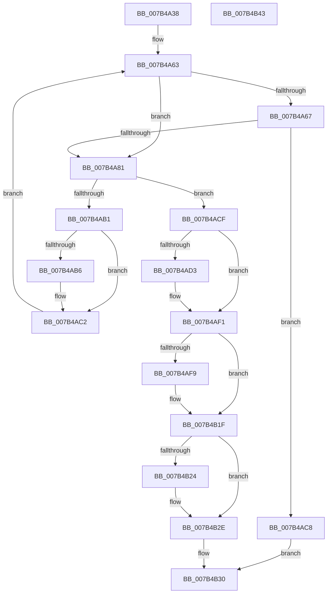

# WmipSaveGuidSecurityDescriptor

- RVA: `0x007B4A38`–`0x007B4B44` (길이 `268` bytes)
- VA: `0x00000001407B4A38`
- 실행 섹션: `PAGE`
- PDB 이름 있음: `예`; PDB Function 태그: `아니요`
- unwind 정보 RVA: `0x000CCE24`
- 디코드: `79`개 명령, `268/268` bytes 표시
- 미해석 바이트: `0` (있으면 어셈블리에 `.byte`로 보존)

> 이 문서는 커널 이미지의 기계어와 PDB 기호를 분석해 생성했습니다. 4번과 5번은 함수 원형과 자료형을 바이너리 사용 방식에서 추정한 C 해석이며 원본 소스 복구 결과는 아닙니다.

## 1. Dependencies

- 직접 호출 지점: **7**; 고유 호출 대상: **5**
- 직접 호출자로 확인된 함수: **1**
- RIP 상대 이미지 참조: **2**

### Outgoing calls
- `0x007B4A53` → [RtlLengthSecurityDescriptor](../8B/RtlLengthSecurityDescriptor_function_008BC870.md) (function, `0x008BC870`)
- `0x007B4A74` → [ExAllocatePool2](../../poolcode/B8/ExAllocatePool2_function_00B820F0.md) (function, `0x00B820F0`)
- `0x007B4AA3` → [RtlGetPersistedStateLocation](../8C/RtlGetPersistedStateLocation_function_008C8DE0.md) (function, `0x008C8DE0`)
- `0x007B4ABB` → [ExFreePoolWithTag](../../poolcode/B8/ExFreePoolWithTag_function_00B82870.md) (function, `0x00B82870`)
- `0x007B4AEA` → [RtlWriteRegistryValue](../A6/RtlWriteRegistryValue_function_00A6C620.md) (function, `0x00A6C620`)
- `0x007B4B18` → [RtlWriteRegistryValue](../A6/RtlWriteRegistryValue_function_00A6C620.md) (function, `0x00A6C620`)
- `0x007B4B29` → [ExFreePoolWithTag](../../poolcode/B8/ExFreePoolWithTag_function_00B82870.md) (function, `0x00B82870`)

### Direct callers
- [sub_00B2D638](../B2/Unknown_function_00B2D638.md) at `0x00B2D71E`

### Static image references
- `0x007B4A8E` → RVA `0x00B06FE0` (` ?? ::NNGAKEGL::`string'`; read)
- `0x007B4AFD` → RVA `0x00B07050` (` ?? ::NNGAKEGL::`string'`; read)

## 2. Other-region calls and transfers

- 다른 실행 섹션으로 향하는 call: **3**
  - `0x007B4A74` → [ExAllocatePool2](../../poolcode/B8/ExAllocatePool2_function_00B820F0.md) (`PAGE` → `POOLCODE`)
  - `0x007B4ABB` → [ExFreePoolWithTag](../../poolcode/B8/ExFreePoolWithTag_function_00B82870.md) (`PAGE` → `POOLCODE`)
  - `0x007B4B29` → [ExFreePoolWithTag](../../poolcode/B8/ExFreePoolWithTag_function_00B82870.md) (`PAGE` → `POOLCODE`)
- 별도 외부 분기/꼬리 이동을 확인하지 못했습니다.

## 3. Assembly (complete function range)

```asm
007B4A38  48 89 5C 24 08                  mov qword ptr [rsp + 8], rbx
007B4A3D  48 89 6C 24 10                  mov qword ptr [rsp + 0x10], rbp
007B4A42  56                              push rsi
007B4A43  57                              push rdi
007B4A44  41 56                           push r14
007B4A46  48 83 EC 40                     sub rsp, 0x40
007B4A4A  48 8B E9                        mov rbp, rcx
007B4A4D  48 8B F2                        mov rsi, rdx
007B4A50  48 8B CA                        mov rcx, rdx
007B4A53  E8 18 7E 10 00                  call 0x1408bc870
007B4A58  33 DB                           xor ebx, ebx
007B4A5A  44 8B F0                        mov r14d, eax
007B4A5D  33 FF                           xor edi, edi
007B4A5F  89 7C 24 70                     mov dword ptr [rsp + 0x70], edi
007B4A63  85 FF                           test edi, edi
007B4A65  74 1A                           je 0x1407b4a81
007B4A67  8B D7                           mov edx, edi
007B4A69  B9 00 01 00 00                  mov ecx, 0x100
007B4A6E  41 B8 57 6D 69 70               mov r8d, 0x70696d57
007B4A74  E8 77 D6 3C 00                  call 0x140b820f0
007B4A79  48 8B D8                        mov rbx, rax
007B4A7C  48 85 C0                        test rax, rax
007B4A7F  74 47                           je 0x1407b4ac8
007B4A81  48 8D 44 24 70                  lea rax, [rsp + 0x70]
007B4A86  45 33 C9                        xor r9d, r9d
007B4A89  48 89 44 24 30                  mov qword ptr [rsp + 0x30], rax
007B4A8E  48 8D 0D 4B 25 35 00            lea rcx, [rip + 0x35254b]
007B4A95  89 7C 24 28                     mov dword ptr [rsp + 0x28], edi
007B4A99  45 33 C0                        xor r8d, r8d
007B4A9C  33 D2                           xor edx, edx
007B4A9E  48 89 5C 24 20                  mov qword ptr [rsp + 0x20], rbx
007B4AA3  E8 38 43 11 00                  call 0x1408c8de0
007B4AA8  8B F8                           mov edi, eax
007B4AAA  3D 05 00 00 80                  cmp eax, 0x80000005
007B4AAF  75 1E                           jne 0x1407b4acf
007B4AB1  48 85 DB                        test rbx, rbx
007B4AB4  74 0C                           je 0x1407b4ac2
007B4AB6  33 D2                           xor edx, edx
007B4AB8  48 8B CB                        mov rcx, rbx
007B4ABB  E8 B0 DD 3C 00                  call 0x140b82870
007B4AC0  33 DB                           xor ebx, ebx
007B4AC2  8B 7C 24 70                     mov edi, dword ptr [rsp + 0x70]
007B4AC6  EB 9B                           jmp 0x1407b4a63
007B4AC8  B8 9A 00 00 C0                  mov eax, 0xc000009a
007B4ACD  EB 61                           jmp 0x1407b4b30
007B4ACF  85 C0                           test eax, eax
007B4AD1  75 1E                           jne 0x1407b4af1
007B4AD3  4C 8B 45 08                     mov r8, qword ptr [rbp + 8]
007B4AD7  44 8D 48 03                     lea r9d, [rax + 3]
007B4ADB  44 89 74 24 28                  mov dword ptr [rsp + 0x28], r14d
007B4AE0  48 8B D3                        mov rdx, rbx
007B4AE3  33 C9                           xor ecx, ecx
007B4AE5  48 89 74 24 20                  mov qword ptr [rsp + 0x20], rsi
007B4AEA  E8 31 7B 2B 00                  call 0x140a6c620
007B4AEF  8B F8                           mov edi, eax
007B4AF1  81 FF 34 00 00 C0               cmp edi, 0xc0000034
007B4AF7  75 26                           jne 0x1407b4b1f
007B4AF9  4C 8B 45 08                     mov r8, qword ptr [rbp + 8]
007B4AFD  48 8D 15 4C 25 35 00            lea rdx, [rip + 0x35254c]
007B4B04  41 B9 03 00 00 00               mov r9d, 3
007B4B0A  44 89 74 24 28                  mov dword ptr [rsp + 0x28], r14d
007B4B0F  48 89 74 24 20                  mov qword ptr [rsp + 0x20], rsi
007B4B14  41 8D 49 FF                     lea ecx, [r9 - 1]
007B4B18  E8 03 7B 2B 00                  call 0x140a6c620
007B4B1D  8B F8                           mov edi, eax
007B4B1F  48 85 DB                        test rbx, rbx
007B4B22  74 0A                           je 0x1407b4b2e
007B4B24  33 D2                           xor edx, edx
007B4B26  48 8B CB                        mov rcx, rbx
007B4B29  E8 42 DD 3C 00                  call 0x140b82870
007B4B2E  8B C7                           mov eax, edi
007B4B30  48 8B 5C 24 60                  mov rbx, qword ptr [rsp + 0x60]
007B4B35  48 8B 6C 24 68                  mov rbp, qword ptr [rsp + 0x68]
007B4B3A  48 83 C4 40                     add rsp, 0x40
007B4B3E  41 5E                           pop r14
007B4B40  5F                              pop rdi
007B4B41  5E                              pop rsi
007B4B42  C3                              ret
007B4B43  CC                              int3
```

## 4. C-style interpretation (structured pseudocode)

```c
__int64 __fastcall WmipSaveGuidSecurityDescriptor(__int64 a1, __int64 a2, __int64 a3, int a4)
{
    __int64 result;
    __int64 v_rbx;
    __int64 v_rdi;
    __int64 v_rsp;
    unsigned __int64 v_stack_m28;
    unsigned int v_stack_m30;
    unsigned __int64 v_stack_m38;
    unsigned __int64 v_stack_p10;
    unsigned int v_stack_p18;
    unsigned __int64 v_stack_p8;

    v_stack_p8 = v_rbx;
    v_stack_p10 = v_rbp;
    v_rsp = (v_rsp) - (64);
    result = RtlLengthSecurityDescriptor(a2, a2, a3, a4);
    v_rbx = 0;
    v_rdi = 0;
    v_stack_p18 = 0;
loc_007B4A63:
    if (0 == 0) goto loc_007B4A81;
    result = ExAllocatePool2(256, 0, (unsigned int)(0x70696D57ULL), a4);
    if (result == 0) goto loc_007B4AC8;
loc_007B4A81:
    a4 = 0;
    v_stack_m28 = v_stack_p18;
    v_stack_m30 = 0;
    a3 = 0;
    a2 = 0;
    v_stack_m38 = result;
    result = RtlGetPersistedStateLocation(v_rip + 3482955, a2, a3, a4);
    if (((unsigned int)(result)) != 0x80000005ULL) goto loc_007B4ACF;
    v_rbx = result;
    if (result != 0) {
        a2 = 0;
        a1 = result;
        result = ExFreePoolWithTag(a1, a2, a3, a4);
        v_rbx = 0;
    }
    goto loc_007B4A63;
loc_007B4AC8:
    goto loc_007B4B30;
loc_007B4ACF:
    result = (unsigned int)(0xC000009AULL);
    v_rdi = (unsigned int)(v_stack_p18);
    if ((unsigned int)((unsigned int)(0xC000009AULL)) == 0) {
        a3 = *(unsigned __int64 *)(a1 + 8);
        a4 = (unsigned int)(0xC000009AULL) + 3;
        v_stack_m30 = (unsigned int)((unsigned int)((unsigned int)(result)));
        a2 = 0;
        a1 = 0;
        v_stack_m38 = a2;
        result = RtlWriteRegistryValue(a1, a2, a3, a4);
        v_rdi = (unsigned int)(result);
    }
    if (((unsigned int)(v_rdi)) == 0xC0000034ULL) {
        a3 = *(unsigned __int64 *)(a1 + 8);
        a2 = v_rip + 3482956;
        a4 = 3;
        v_stack_m30 = (unsigned int)((unsigned int)((unsigned int)(result)));
        v_stack_m38 = a2;
        a1 = a4 - 1;
        result = RtlWriteRegistryValue(a1, a2, a3, a4);
        v_rdi = (unsigned int)(result);
    }
    if (0 != 0) {
        a2 = 0;
        a1 = 0;
        result = ExFreePoolWithTag(a1, a2, a3, a4);
    }
loc_007B4B30:
    v_rsp = (v_rsp) + (64);
    return (unsigned int)((unsigned int)(v_rdi));
}
```

## 5. (Beta) C Style

```c
int64_t WmipSaveGuidSecurityDescriptor(void *Arg1, int64_t Arg2, int64_t Arg3, int32_t Arg4)
{
    uint8_t *arg1 = (uint8_t *)Arg1;

    int64_t result;
    int64_t local_rbx;
    int64_t local_rdi;
    int64_t local_rsp;
    uint64_t v_stack_m28;
    uint32_t v_stack_m30;
    uint64_t v_stack_m38;
    uint64_t v_stack_p10;
    uint32_t v_stack_p18;
    uint64_t v_stack_p8;

    v_stack_p8 = local_rbx;
    v_stack_p10 = local_rbp;
    local_rsp = (local_rsp) - (64);
    result = RtlLengthSecurityDescriptor(Arg2, Arg2, Arg3, Arg4);
    local_rbx = 0;
    local_rdi = 0;
    v_stack_p18 = 0;
loc_007B4A63:
    if (0 == 0) goto loc_007B4A81;
    result = ExAllocatePool2(256, 0, (uint32_t)(0x70696D57ULL), Arg4);
    if (result == 0) goto loc_007B4AC8;
loc_007B4A81:
    Arg4 = 0;
    v_stack_m28 = v_stack_p18;
    v_stack_m30 = 0;
    Arg3 = 0;
    Arg2 = 0;
    v_stack_m38 = result;
    result = RtlGetPersistedStateLocation(v_rip + 3482955, Arg2, Arg3, Arg4);
    if (((uint32_t)(result)) != 0x80000005ULL) goto loc_007B4ACF;
    local_rbx = result;
    if (result != 0) {
        Arg2 = 0;
        Arg1 = result;
        result = ExFreePoolWithTag(Arg1, Arg2, Arg3, Arg4);
        local_rbx = 0;
    }
    goto loc_007B4A63;
loc_007B4AC8:
    goto loc_007B4B30;
loc_007B4ACF:
    result = (uint32_t)(0xC000009AULL);
    local_rdi = (uint32_t)(v_stack_p18);
    if ((uint32_t)((uint32_t)(0xC000009AULL)) == 0) {
        Arg3 = *(uint64_t *)(arg1 + 0x8);
        Arg4 = (uint32_t)(0xC000009AULL) + 3;
        v_stack_m30 = (uint32_t)((uint32_t)((uint32_t)(result)));
        Arg2 = 0;
        Arg1 = 0;
        v_stack_m38 = Arg2;
        result = RtlWriteRegistryValue(Arg1, Arg2, Arg3, Arg4);
        local_rdi = (uint32_t)(result);
    }
    if (((uint32_t)(local_rdi)) == 0xC0000034ULL) {
        Arg3 = *(uint64_t *)(arg1 + 0x8);
        Arg2 = v_rip + 3482956;
        Arg4 = 3;
        v_stack_m30 = (uint32_t)((uint32_t)((uint32_t)(result)));
        v_stack_m38 = Arg2;
        Arg1 = Arg4 - 1;
        result = RtlWriteRegistryValue(Arg1, Arg2, Arg3, Arg4);
        local_rdi = (uint32_t)(result);
    }
    if (0 != 0) {
        Arg2 = 0;
        Arg1 = 0;
        result = ExFreePoolWithTag(Arg1, Arg2, Arg3, Arg4);
    }
loc_007B4B30:
    local_rsp = (local_rsp) + (64);
    return (uint32_t)((uint32_t)(local_rdi));
}
```

### 관측된 메모리 오프셋

구조체 형식이 확인되지 않은 접근은 인자 기준의 오프셋으로만 기록했습니다.

| 기준 인자 | 오프셋 표현 | 폭 (bit) | 접근 |
|---|---:|---:|---|
| `Arg1` | `+ 0x8` | `64` | `R` |

## 6. Execution-region graph

[열기: 2D/3D 그래프와 함수 탐색 컨트롤 패널](../../../control-panel.html?section=page&rva=0x007B4A38&view=graph)

- 2D 그래프는 위에서 아래로 흐르고, 3D 그래프는 빈 공간을 드래그해 회전합니다. Shift+드래그는 이동, 휠은 확대·축소, 함수 노드 선택은 대상 보고서 이동입니다.

### Static fallback


