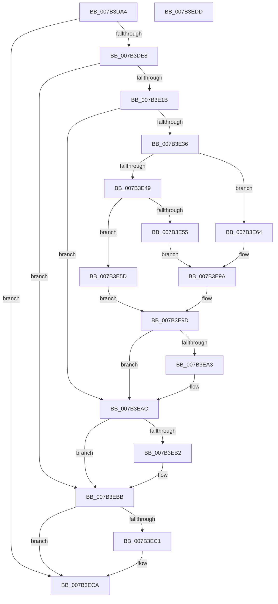

# WmipTranslateFileHandle

- RVA: `0x007B3DA4`–`0x007B3EDE` (길이 `314` bytes)
- VA: `0x00000001407B3DA4`
- 실행 섹션: `PAGE`
- PDB 이름 있음: `예`; PDB Function 태그: `아니요`
- unwind 정보 RVA: `0x000D328C`
- 디코드: `94`개 명령, `314/314` bytes 표시
- 미해석 바이트: `0` (있으면 어셈블리에 `.byte`로 보존)

> 이 문서는 커널 이미지의 기계어와 PDB 기호를 분석해 생성했습니다. 4번과 5번은 함수 원형과 자료형을 바이너리 사용 방식에서 추정한 C 해석이며 원본 소스 복구 결과는 아닙니다.

## 1. Dependencies

- 직접 호출 지점: **7**; 고유 호출 대상: **6**
- 직접 호출자로 확인된 함수: **1**
- RIP 상대 이미지 참조: **1**

### Outgoing calls
- `0x007B3DD9` → [WmipGetFilePDO](../AA/WmipGetFilePDO_function_00AAF454.md) (function, `0x00AAF454`)
- `0x007B3E0C` → [ObReferenceObjectByHandle](../86/ObReferenceObjectByHandle_function_00868DB0.md) (function, `0x00868DB0`)
- `0x007B3E2B` → [WmipGetGuidObjectInstanceInfo](../A8/WmipGetGuidObjectInstanceInfo_function_00A87470.md) (function, `0x00A87470`)
- `0x007B3E82` → [memcpy](../../text/6C/memcpy_function_006C6840.md) (function, `0x006C6840`)
- `0x007B3EA7` → [RtlFreeAnsiString](../9C/RtlFreeAnsiString_function_009C0800.md) (function, `0x009C0800`)
- `0x007B3EB6` → [ObfDereferenceObject](../../text/2F/ObfDereferenceObject_function_002F9350.md) (function, `0x002F9350`)
- `0x007B3EC5` → [ObfDereferenceObject](../../text/2F/ObfDereferenceObject_function_002F9350.md) (function, `0x002F9350`)

### Direct callers
- [WmipIoControl](../9D/WmipIoControl_function_009DEBD0.md) at `0x009DF021`

### Static image references
- `0x007B3DE8` → RVA `0x00FC6D70` (`ALMOSTRO`; read)

## 2. Other-region calls and transfers

- 다른 실행 섹션으로 향하는 call: **3**
  - `0x007B3E82` → [memcpy](../../text/6C/memcpy_function_006C6840.md) (`PAGE` → `.text`)
  - `0x007B3EB6` → [ObfDereferenceObject](../../text/2F/ObfDereferenceObject_function_002F9350.md) (`PAGE` → `.text`)
  - `0x007B3EC5` → [ObfDereferenceObject](../../text/2F/ObfDereferenceObject_function_002F9350.md) (`PAGE` → `.text`)
- 별도 외부 분기/꼬리 이동을 확인하지 못했습니다.

## 3. Assembly (complete function range)

```asm
007B3DA4  48 89 5C 24 10                  mov qword ptr [rsp + 0x10], rbx
007B3DA9  55                              push rbp
007B3DAA  56                              push rsi
007B3DAB  57                              push rdi
007B3DAC  41 54                           push r12
007B3DAE  41 55                           push r13
007B3DB0  48 8B EC                        mov rbp, rsp
007B3DB3  48 83 EC 40                     sub rsp, 0x40
007B3DB7  45 33 ED                        xor r13d, r13d
007B3DBA  4C 8D 45 48                     lea r8, [rbp + 0x48]
007B3DBE  4C 8B E2                        mov r12, rdx
007B3DC1  44 89 6D 30                     mov dword ptr [rbp + 0x30], r13d
007B3DC5  48 8B F1                        mov rsi, rcx
007B3DC8  4C 89 6D F0                     mov qword ptr [rbp - 0x10], r13
007B3DCC  48 8B 09                        mov rcx, qword ptr [rcx]
007B3DCF  B2 01                           mov dl, 1
007B3DD1  4C 89 6D 48                     mov qword ptr [rbp + 0x48], r13
007B3DD5  4C 89 6D F8                     mov qword ptr [rbp - 8], r13
007B3DD9  E8 76 B6 2F 00                  call 0x140aaf454
007B3DDE  8B D8                           mov ebx, eax
007B3DE0  85 C0                           test eax, eax
007B3DE2  0F 88 E2 00 00 00               js 0x1407b3eca
007B3DE8  4C 8B 05 81 2F 81 00            mov r8, qword ptr [rip + 0x812f81]
007B3DEF  48 8D 45 40                     lea rax, [rbp + 0x40]
007B3DF3  48 8B 4E 08                     mov rcx, qword ptr [rsi + 8]
007B3DF7  41 8D 55 01                     lea edx, [r13 + 1]
007B3DFB  4C 89 6C 24 28                  mov qword ptr [rsp + 0x28], r13
007B3E00  41 B1 01                        mov r9b, 1
007B3E03  48 89 44 24 20                  mov qword ptr [rsp + 0x20], rax
007B3E08  4C 89 6D 40                     mov qword ptr [rbp + 0x40], r13
007B3E0C  E8 9F 4F 0B 00                  call 0x140868db0
007B3E11  8B D8                           mov ebx, eax
007B3E13  85 C0                           test eax, eax
007B3E15  0F 88 A0 00 00 00               js 0x1407b3ebb
007B3E1B  48 8B 55 48                     mov rdx, qword ptr [rbp + 0x48]
007B3E1F  4C 8D 4D 30                     lea r9, [rbp + 0x30]
007B3E23  48 8B 4D 40                     mov rcx, qword ptr [rbp + 0x40]
007B3E27  4C 8D 45 F0                     lea r8, [rbp - 0x10]
007B3E2B  E8 40 36 2D 00                  call 0x140a87470
007B3E30  8B D8                           mov ebx, eax
007B3E32  85 C0                           test eax, eax
007B3E34  78 76                           js 0x1407b3eac
007B3E36  4C 8B 6D F0                     mov r13, qword ptr [rbp - 0x10]
007B3E3A  41 8B 04 24                     mov eax, dword ptr [r12]
007B3E3E  41 0F B7 FD                     movzx edi, r13w
007B3E42  83 C7 1A                        add edi, 0x1a
007B3E45  3B C7                           cmp eax, edi
007B3E47  73 1B                           jae 0x1407b3e64
007B3E49  B9 04 00 00 00                  mov ecx, 4
007B3E4E  45 33 ED                        xor r13d, r13d
007B3E51  3B C1                           cmp eax, ecx
007B3E53  72 08                           jb 0x1407b3e5d
007B3E55  89 3E                           mov dword ptr [rsi], edi
007B3E57  41 89 0C 24                     mov dword ptr [r12], ecx
007B3E5B  EB 3D                           jmp 0x1407b3e9a
007B3E5D  BB 01 00 00 C0                  mov ebx, 0xc0000001
007B3E62  EB 39                           jmp 0x1407b3e9d
007B3E64  8B 45 30                        mov eax, dword ptr [rbp + 0x30]
007B3E67  48 8D 4E 16                     lea rcx, [rsi + 0x16]
007B3E6B  48 8B 55 F8                     mov rdx, qword ptr [rbp - 8]
007B3E6F  89 46 10                        mov dword ptr [rsi + 0x10], eax
007B3E72  B8 04 00 00 00                  mov eax, 4
007B3E77  41 03 C5                        add eax, r13d
007B3E7A  45 0F B7 C5                     movzx r8d, r13w
007B3E7E  66 89 46 14                     mov word ptr [rsi + 0x14], ax
007B3E82  E8 B9 29 F1 FF                  call 0x1406c6840
007B3E87  41 0F B7 C5                     movzx eax, r13w
007B3E8B  48 D1 E8                        shr rax, 1
007B3E8E  45 33 ED                        xor r13d, r13d
007B3E91  41 89 3C 24                     mov dword ptr [r12], edi
007B3E95  44 89 6C 46 16                  mov dword ptr [rsi + rax*2 + 0x16], r13d
007B3E9A  41 8B DD                        mov ebx, r13d
007B3E9D  4C 39 6D F8                     cmp qword ptr [rbp - 8], r13
007B3EA1  74 09                           je 0x1407b3eac
007B3EA3  48 8D 4D F0                     lea rcx, [rbp - 0x10]
007B3EA7  E8 54 C9 20 00                  call 0x1409c0800
007B3EAC  4C 39 6D 40                     cmp qword ptr [rbp + 0x40], r13
007B3EB0  74 09                           je 0x1407b3ebb
007B3EB2  48 8B 4D 40                     mov rcx, qword ptr [rbp + 0x40]
007B3EB6  E8 95 54 B4 FF                  call 0x1402f9350
007B3EBB  4C 39 6D 48                     cmp qword ptr [rbp + 0x48], r13
007B3EBF  74 09                           je 0x1407b3eca
007B3EC1  48 8B 4D 48                     mov rcx, qword ptr [rbp + 0x48]
007B3EC5  E8 86 54 B4 FF                  call 0x1402f9350
007B3ECA  8B C3                           mov eax, ebx
007B3ECC  48 8B 5C 24 78                  mov rbx, qword ptr [rsp + 0x78]
007B3ED1  48 83 C4 40                     add rsp, 0x40
007B3ED5  41 5D                           pop r13
007B3ED7  41 5C                           pop r12
007B3ED9  5F                              pop rdi
007B3EDA  5E                              pop rsi
007B3EDB  5D                              pop rbp
007B3EDC  C3                              ret
007B3EDD  CC                              int3
```

## 4. C-style interpretation (structured pseudocode)

```c
__int64 __fastcall WmipTranslateFileHandle(__int64 a1, __int64 a2)
{
    __int64 result;
    __int64 v_r13;
    __int64 v_rdi;
    __int64 v_rsp;
    unsigned __int64 v_stack_m30;
    unsigned __int64 v_stack_m38;
    unsigned __int64 v_stack_m40;
    unsigned __int64 v_stack_m48;
    unsigned __int64 v_stack_p10;
    unsigned __int64 v_stack_p18;
    unsigned __int64 v_stack_p20;
    unsigned int v_stack_p8;

    v_stack_p10 = v_rbx;
    v_rsp = (v_rsp) - (64);
    v_r13 = 0;
    v_stack_p8 = 0;
    v_stack_m38 = 0;
    v_stack_p20 = 0;
    v_stack_m30 = 0;
    result = WmipGetFilePDO(*(unsigned __int64 *)(a1), 1, v_stack_p20, a4);
    if (sign_flag) goto loc_007B3ECA;
    v_stack_m40 = 0;
    v_stack_m48 = v_stack_p18;
    v_stack_p18 = 0;
    result = ObReferenceObjectByHandle(*(unsigned __int64 *)(a1 + 8), v_r13 + 1, *(unsigned __int64 *)(v_rip + 8466305), 1);
    if (sign_flag) goto loc_007B3EBB;
    result = WmipGetGuidObjectInstanceInfo(v_stack_p18, v_stack_p20, v_stack_m38, v_stack_p8);
    if (sign_flag) goto loc_007B3EAC;
    v_rdi = (unsigned int)(((unsigned __int16)(v_stack_m38)) + (26));
    if (((unsigned int)((unsigned int)(*(unsigned int *)(a2)))) >= ((unsigned int)(v_rdi))) goto loc_007B3E64;
    v_r13 = 0;
    if (((unsigned int)((unsigned int)(*(unsigned int *)(a2)))) < 4) goto loc_007B3E5D;
    *(unsigned int *)(a1) = (unsigned int)(v_rdi);
    *(unsigned int *)(a2) = 4;
    goto loc_007B3E9A;
loc_007B3E5D:
    goto loc_007B3E9D;
loc_007B3E64:
    *(unsigned int *)(a1 + 16) = (unsigned int)((unsigned int)(v_stack_p8));
    result = (unsigned int)((4) + (0));
    *(unsigned __int16 *)(a1 + 20) = (unsigned __int16)(result);
    result = memcpy(a1 + 22, v_stack_m30, 0, v_stack_p8);
    result = (0) >> (1);
    v_r13 = 0;
    *(unsigned int *)(a2) = (unsigned int)(v_rdi);
    *(unsigned int *)(a1 + result * 2 + 22) = 0;
loc_007B3E9A:
loc_007B3E9D:
    if (v_stack_m30 != 0) {
        a1 = v_stack_m38;
        result = RtlFreeAnsiString(a1, v_stack_m30, 0, v_stack_p8);
    }
    if (v_stack_p18 != 0) {
        a1 = v_stack_p18;
        result = ObfDereferenceObject(a1, v_stack_m30, 0, v_stack_p8);
    }
    if (v_stack_p20 != 0) {
        a1 = v_stack_p20;
        result = ObfDereferenceObject(a1, v_stack_m30, 0, v_stack_p8);
    }
    v_rsp = (v_rsp) + (64);
    return 0;
}
```

## 5. (Beta) C Style

```c
int64_t WmipTranslateFileHandle(void *Arg1, void *Arg2)
{
    uint8_t *arg1 = (uint8_t *)Arg1;
    uint8_t *arg2 = (uint8_t *)Arg2;

    int64_t result;
    int64_t local_r13;
    int64_t local_rdi;
    int64_t local_rsp;
    uint64_t v_stack_m30;
    uint64_t v_stack_m38;
    uint64_t v_stack_m40;
    uint64_t v_stack_m48;
    uint64_t v_stack_p10;
    uint64_t v_stack_p18;
    uint64_t v_stack_p20;
    uint32_t v_stack_p8;

    v_stack_p10 = local_rbx;
    local_rsp = (local_rsp) - (64);
    local_r13 = 0;
    v_stack_p8 = 0;
    v_stack_m38 = 0;
    v_stack_p20 = 0;
    v_stack_m30 = 0;
    result = WmipGetFilePDO(*(uint64_t *)(arg1), 1, v_stack_p20, a4);
    if (sign_flag) goto loc_007B3ECA;
    v_stack_m40 = 0;
    v_stack_m48 = v_stack_p18;
    v_stack_p18 = 0;
    result = ObReferenceObjectByHandle(*(uint64_t *)(arg1 + 0x8), local_r13 + 1, *(uint64_t *)(v_rip + 0x812F81), 1);
    if (sign_flag) goto loc_007B3EBB;
    result = WmipGetGuidObjectInstanceInfo(v_stack_p18, v_stack_p20, v_stack_m38, v_stack_p8);
    if (sign_flag) goto loc_007B3EAC;
    local_rdi = (uint32_t)(((uint16_t)(v_stack_m38)) + (26));
    if (((uint32_t)((uint32_t)(*(uint32_t *)(arg2)))) >= ((uint32_t)(local_rdi))) goto loc_007B3E64;
    local_r13 = 0;
    if (((uint32_t)((uint32_t)(*(uint32_t *)(arg2)))) < 4) goto loc_007B3E5D;
    *(uint32_t *)(arg1) = (uint32_t)(local_rdi);
    *(uint32_t *)(arg2) = 4;
    goto loc_007B3E9A;
loc_007B3E5D:
    goto loc_007B3E9D;
loc_007B3E64:
    *(uint32_t *)(arg1 + 0x10) = (uint32_t)((uint32_t)(v_stack_p8));
    result = (uint32_t)((4) + (0));
    *(uint16_t *)(arg1 + 0x14) = (uint16_t)(result);
    result = memcpy(Arg1 + 22, v_stack_m30, 0, v_stack_p8);
    result = (0) >> (1);
    local_r13 = 0;
    *(uint32_t *)(arg2) = (uint32_t)(local_rdi);
    *(uint32_t *)(arg1 + result * 2 + 0x16) = 0;
loc_007B3E9A:
loc_007B3E9D:
    if (v_stack_m30 != 0) {
        Arg1 = v_stack_m38;
        result = RtlFreeAnsiString(Arg1, v_stack_m30, 0, v_stack_p8);
    }
    if (v_stack_p18 != 0) {
        Arg1 = v_stack_p18;
        result = ObfDereferenceObject(Arg1, v_stack_m30, 0, v_stack_p8);
    }
    if (v_stack_p20 != 0) {
        Arg1 = v_stack_p20;
        result = ObfDereferenceObject(Arg1, v_stack_m30, 0, v_stack_p8);
    }
    local_rsp = (local_rsp) + (64);
    return 0;
}
```

### 관측된 메모리 오프셋

구조체 형식이 확인되지 않은 접근은 인자 기준의 오프셋으로만 기록했습니다.

| 기준 인자 | 오프셋 표현 | 폭 (bit) | 접근 |
|---|---:|---:|---|
| `Arg1` | `+ 0x0` | `32` | `W` |
| `Arg1` | `+ 0x0` | `64` | `R` |
| `Arg1` | `+ 0x8` | `64` | `R` |
| `Arg1` | `+ 0x10` | `32` | `W` |
| `Arg1` | `+ 0x14` | `16` | `W` |
| `Arg1` | `+ 0x16` | `64` | `R` |
| `Arg1` | `+ 0x16 + rax*2` | `32` | `W` |
| `Arg2` | `+ 0x0` | `32` | `R` |
| `Arg2` | `+ 0x0` | `32` | `W` |

## 6. Execution-region graph

[열기: 2D/3D 그래프와 함수 탐색 컨트롤 패널](../../../control-panel.html?section=page&rva=0x007B3DA4&view=graph)

- 2D 그래프는 위에서 아래로 흐르고, 3D 그래프는 빈 공간을 드래그해 회전합니다. Shift+드래그는 이동, 휠은 확대·축소, 함수 노드 선택은 대상 보고서 이동입니다.

### Static fallback


