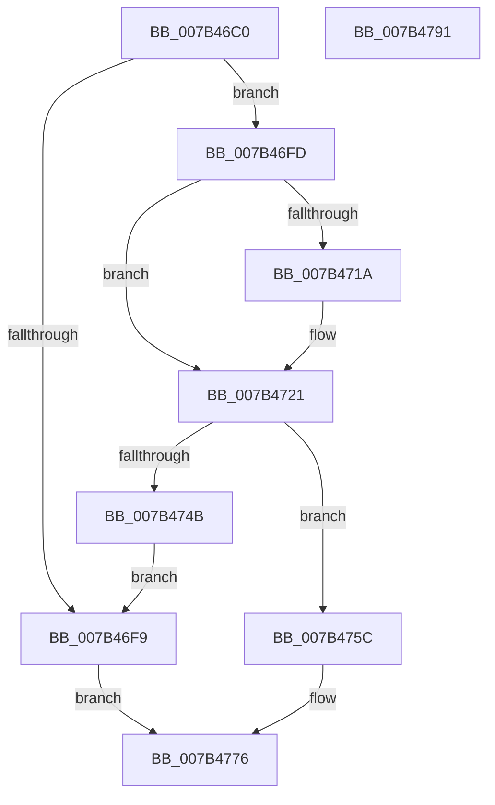

# WmipUpdateAddGuid

- RVA: `0x007B46C0`–`0x007B4792` (길이 `210` bytes)
- VA: `0x00000001407B46C0`
- 실행 섹션: `PAGE`
- PDB 이름 있음: `예`; PDB Function 태그: `아니요`
- unwind 정보 RVA: `0x0005D7BC`
- 디코드: `61`개 명령, `210/210` bytes 표시
- 미해석 바이트: `0` (있으면 어셈블리에 `.byte`로 보존)

> 이 문서는 커널 이미지의 기계어와 PDB 기호를 분석해 생성했습니다. 4번과 5번은 함수 원형과 자료형을 바이너리 사용 방식에서 추정한 C 해석이며 원본 소스 복구 결과는 아닙니다.

## 1. Dependencies

- 직접 호출 지점: **4**; 고유 호출 대상: **4**
- 직접 호출자로 확인된 함수: **1**
- RIP 상대 이미지 참조: **1**

### Outgoing calls
- `0x007B46EC` → [WmipAllocEntry](../9D/WmipAllocEntry_function_009DDF70.md) (function, `0x009DDF70`)
- `0x007B4742` → [WmipBuildInstanceSet](../9D/WmipBuildInstanceSet_function_009DDFC4.md) (function, `0x009DDFC4`)
- `0x007B4755` → [WmipUnreferenceEntry](../9E/WmipUnreferenceEntry_function_009E0CC8.md) (function, `0x009E0CC8`)
- `0x007B4764` → [WmipLinkDataSourceToList](../9D/WmipLinkDataSourceToList_function_009DF4D4.md) (function, `0x009DF4D4`)

### Direct callers
- [WmipUpdateModifyGuid](WmipUpdateModifyGuid_function_007B4798.md) at `0x007B4806`

### Static image references
- `0x007B46DF` → RVA `0x00E03608` (`.data`; read)

## 2. Other-region calls and transfers

- 다른 실행 섹션으로 향하는 call: **0**
- 별도 외부 분기/꼬리 이동을 확인하지 못했습니다.

## 3. Assembly (complete function range)

```asm
007B46C0  48 8B C4                        mov rax, rsp
007B46C3  48 89 58 08                     mov qword ptr [rax + 8], rbx
007B46C7  48 89 68 10                     mov qword ptr [rax + 0x10], rbp
007B46CB  48 89 70 18                     mov qword ptr [rax + 0x18], rsi
007B46CF  48 89 78 20                     mov qword ptr [rax + 0x20], rdi
007B46D3  41 56                           push r14
007B46D5  48 83 EC 30                     sub rsp, 0x30
007B46D9  48 8B F9                        mov rdi, rcx
007B46DC  41 8B E9                        mov ebp, r9d
007B46DF  48 8D 0D 22 EF 64 00            lea rcx, [rip + 0x64ef22]
007B46E6  4D 8B F0                        mov r14, r8
007B46E9  48 8B F2                        mov rsi, rdx
007B46EC  E8 7F 98 22 00                  call 0x1409ddf70
007B46F1  48 8B D8                        mov rbx, rax
007B46F4  48 85 C0                        test rax, rax
007B46F7  75 04                           jne 0x1407b46fd
007B46F9  33 C0                           xor eax, eax
007B46FB  EB 79                           jmp 0x1407b4776
007B46FD  83 48 10 08                     or dword ptr [rax + 0x10], 8
007B4701  48 8D 50 28                     lea rdx, [rax + 0x28]
007B4705  48 89 70 38                     mov qword ptr [rax + 0x38], rsi
007B4709  48 89 78 40                     mov qword ptr [rax + 0x40], rdi
007B470D  48 8D 47 28                     lea rax, [rdi + 0x28]
007B4711  48 8B 08                        mov rcx, qword ptr [rax]
007B4714  48 39 41 08                     cmp qword ptr [rcx + 8], rax
007B4718  74 07                           je 0x1407b4721
007B471A  B9 03 00 00 00                  mov ecx, 3
007B471F  CD 29                           int 0x29
007B4721  48 89 0A                        mov qword ptr [rdx], rcx
007B4724  4C 8B CB                        mov r9, rbx
007B4727  48 89 42 08                     mov qword ptr [rdx + 8], rax
007B472B  44 8B C5                        mov r8d, ebp
007B472E  48 89 51 08                     mov qword ptr [rcx + 8], rdx
007B4732  48 8B CE                        mov rcx, rsi
007B4735  48 89 10                        mov qword ptr [rax], rdx
007B4738  49 8B D6                        mov rdx, r14
007B473B  8B 47 38                        mov eax, dword ptr [rdi + 0x38]
007B473E  89 44 24 20                     mov dword ptr [rsp + 0x20], eax
007B4742  E8 7D 98 22 00                  call 0x1409ddfc4
007B4747  85 C0                           test eax, eax
007B4749  79 11                           jns 0x1407b475c
007B474B  48 8B D3                        mov rdx, rbx
007B474E  48 8D 0D B3 EE 64 00            lea rcx, [rip + 0x64eeb3]
007B4755  E8 6E C5 22 00                  call 0x1409e0cc8
007B475A  EB 9D                           jmp 0x1407b46f9
007B475C  45 33 C0                        xor r8d, r8d
007B475F  33 D2                           xor edx, edx
007B4761  48 8B CF                        mov rcx, rdi
007B4764  E8 6B AD 22 00                  call 0x1409df4d4
007B4769  48 8B 4C 24 60                  mov rcx, qword ptr [rsp + 0x60]
007B476E  F7 D0                           not eax
007B4770  C1 E8 1F                        shr eax, 0x1f
007B4773  48 89 19                        mov qword ptr [rcx], rbx
007B4776  48 8B 5C 24 40                  mov rbx, qword ptr [rsp + 0x40]
007B477B  48 8B 6C 24 48                  mov rbp, qword ptr [rsp + 0x48]
007B4780  48 8B 74 24 50                  mov rsi, qword ptr [rsp + 0x50]
007B4785  48 8B 7C 24 58                  mov rdi, qword ptr [rsp + 0x58]
007B478A  48 83 C4 30                     add rsp, 0x30
007B478E  41 5E                           pop r14
007B4790  C3                              ret
007B4791  CC                              int3
```

## 4. C-style interpretation (structured pseudocode)

```c
__int64 __fastcall WmipUpdateAddGuid(__int64 a1, __int64 a2, __int64 a3, int a4, __int64 a5)
{
    __int64 result;
    __int64 v_rsp;
    unsigned int v_stack_m18;
    unsigned __int64 v_stack_p10;
    unsigned __int64 v_stack_p18;
    unsigned __int64 v_stack_p20;
    unsigned __int64 v_stack_p8;

    *(unsigned __int64 *)(v_rsp + 8) = v_rbx;
    *(unsigned __int64 *)(v_rsp + 16) = v_rbp;
    *(unsigned __int64 *)(v_rsp + 24) = v_rsi;
    *(unsigned __int64 *)(v_rsp + 32) = v_rdi;
    v_rsp = (v_rsp) - (48);
    result = WmipAllocEntry(v_rip + 6614818, a2, a3, a4);
    if (result != 0) goto loc_007B46FD;
loc_007B46F9:
    result = 0;
    goto loc_007B4776;
loc_007B46FD:
    *(unsigned __int64 *)(result + 56) = a2;
    *(unsigned __int64 *)(result + 64) = a1;
    if ((*(unsigned __int64 *)(*(unsigned __int64 *)(a1 + 40) + 8)) != (a1 + 40)) {
        a1 = 3;
    }
    *(unsigned __int64 *)(result + 40) = a1;
    *(unsigned __int64 *)(result + 40 + 8) = a1 + 40;
    *(unsigned __int64 *)(a1 + 8) = result + 40;
    *(unsigned __int64 *)(a1 + 40) = result + 40;
    v_stack_m18 = (unsigned int)((unsigned int)(*(unsigned int *)(a1 + 56)));
    result = WmipBuildInstanceSet(a2, a3, (unsigned int)((unsigned int)((unsigned int)(a4))), 0);
    if (!sign_flag) goto loc_007B475C;
    result = WmipUnreferenceEntry(v_rip + 6614707, result, (unsigned int)((unsigned int)((unsigned int)(a4))), 0);
    goto loc_007B46F9;
loc_007B475C:
    a3 = 0;
    a2 = 0;
    result = WmipLinkDataSourceToList(a1, a2, a3, 0);
    result = (unsigned int)(~(result));
    result = (unsigned int)((result) >> (31));
    *(unsigned __int64 *)(a5) = result;
loc_007B4776:
    v_rsp = (v_rsp) + (48);
    return result;
}
```

## 5. (Beta) C Style

```c
int64_t WmipUpdateAddGuid(void *Arg1, int64_t Arg2, int64_t Arg3, int32_t Arg4, void *Arg5)
{
    uint8_t *arg1 = (uint8_t *)Arg1;
    uint8_t *arg5 = (uint8_t *)Arg5;

    int64_t result;
    int64_t local_rsp;
    uint32_t v_stack_m18;
    uint64_t v_stack_p10;
    uint64_t v_stack_p18;
    uint64_t v_stack_p20;
    uint64_t v_stack_p8;

    *(uint64_t *)(local_rsp + 0x8) = local_rbx;
    *(uint64_t *)(local_rsp + 0x10) = local_rbp;
    *(uint64_t *)(local_rsp + 0x18) = local_rsi;
    *(uint64_t *)(local_rsp + 0x20) = local_rdi;
    local_rsp = (local_rsp) - (48);
    result = WmipAllocEntry(v_rip + 6614818, Arg2, Arg3, Arg4);
    if (result != 0) goto loc_007B46FD;
loc_007B46F9:
    result = 0;
    goto loc_007B4776;
loc_007B46FD:
    *(uint64_t *)(result + 0x38) = Arg2;
    *(void **)(result + 0x40) = Arg1;
    if ((*(uint64_t *)(*(uint64_t *)(arg1 + 0x28) + 0x8)) != (Arg1 + 40)) {
        Arg1 = 3;
    }
    *(void **)(result + 0x28) = Arg1;
    *(void **)(result + 0x28 + 0x8) = Arg1 + 40;
    *(uint64_t *)(arg1 + 0x8) = result + 40;
    *(uint64_t *)(arg1 + 0x28) = result + 40;
    v_stack_m18 = (uint32_t)((uint32_t)(*(uint32_t *)(arg1 + 0x38)));
    result = WmipBuildInstanceSet(Arg2, Arg3, (uint32_t)((uint32_t)((uint32_t)(Arg4))), 0);
    if (!sign_flag) goto loc_007B475C;
    result = WmipUnreferenceEntry(v_rip + 6614707, result, (uint32_t)((uint32_t)((uint32_t)(Arg4))), 0);
    goto loc_007B46F9;
loc_007B475C:
    Arg3 = 0;
    Arg2 = 0;
    result = WmipLinkDataSourceToList(Arg1, Arg2, Arg3, 0);
    result = (uint32_t)(~(result));
    result = (uint32_t)((result) >> (31));
    *(uint64_t *)(arg5) = result;
loc_007B4776:
    local_rsp = (local_rsp) + (48);
    return result;
}
```

### 관측된 메모리 오프셋

구조체 형식이 확인되지 않은 접근은 인자 기준의 오프셋으로만 기록했습니다.

| 기준 인자 | 오프셋 표현 | 폭 (bit) | 접근 |
|---|---:|---:|---|
| `Arg1` | `+ 0x0` | `64` | `R` |
| `Arg1` | `+ 0x0` | `64` | `W` |
| `Arg1` | `+ 0x28` | `64` | `R` |
| `Arg1` | `+ 0x38` | `32` | `R` |
| `Arg5` | `+ 0x0` | `64` | `W` |

## 6. Execution-region graph

[열기: 2D/3D 그래프와 함수 탐색 컨트롤 패널](../../../control-panel.html?section=page&rva=0x007B46C0&view=graph)

- 2D 그래프는 위에서 아래로 흐르고, 3D 그래프는 빈 공간을 드래그해 회전합니다. Shift+드래그는 이동, 휠은 확대·축소, 함수 노드 선택은 대상 보고서 이동입니다.

### Static fallback


