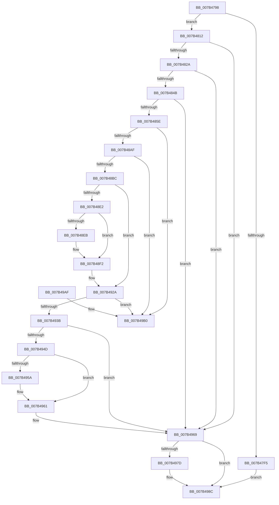

# WmipUpdateModifyGuid

- RVA: `0x007B4798`–`0x007B49B7` (길이 `543` bytes)
- VA: `0x00000001407B4798`
- 실행 섹션: `PAGE`
- PDB 이름 있음: `예`; PDB Function 태그: `아니요`
- unwind 정보 RVA: `0x000D32A4`
- 디코드: `144`개 명령, `543/543` bytes 표시
- 미해석 바이트: `0` (있으면 어셈블리에 `.byte`로 보존)

> 이 문서는 커널 이미지의 기계어와 PDB 기호를 분석해 생성했습니다. 4번과 5번은 함수 원형과 자료형을 바이너리 사용 방식에서 추정한 C 해석이며 원본 소스 복구 결과는 아닙니다.

## 1. Dependencies

- 직접 호출 지점: **11**; 고유 호출 대상: **8**
- 직접 호출자로 확인된 함수: **1**
- RIP 상대 이미지 참조: **1**

### Outgoing calls
- `0x007B47D0` → [memset](../../text/6C/memset_function_006C6C40.md) (function, `0x006C6C40`)
- `0x007B47E8` → [WmipFindISInDSByGuid](../AC/WmipFindISInDSByGuid_function_00AC1A20.md) (function, `0x00AC1A20`)
- `0x007B4806` → [WmipUpdateAddGuid](WmipUpdateAddGuid_function_007B46C0.md) (function, `0x007B46C0`)
- `0x007B4819` → [WmipAllocEntry](../9D/WmipAllocEntry_function_009DDF70.md) (function, `0x009DDF70`)
- `0x007B483E` → [WmipBuildInstanceSet](../9D/WmipBuildInstanceSet_function_009DDFC4.md) (function, `0x009DDFC4`)
- `0x007B4851` → [WmipIsEqualInstanceSets](WmipIsEqualInstanceSets_function_007B4618.md) (function, `0x007B4618`)
- `0x007B48D7` → [WmipBuildInstanceSet](../9D/WmipBuildInstanceSet_function_009DDFC4.md) (function, `0x009DDFC4`)
- `0x007B48ED` → [ExFreePoolWithTag](../../poolcode/B8/ExFreePoolWithTag_function_00B82870.md) (function, `0x00B82870`)
- `0x007B495C` → [ExFreePoolWithTag](../../poolcode/B8/ExFreePoolWithTag_function_00B82870.md) (function, `0x00B82870`)
- `0x007B4973` → [WmipUnreferenceEntry](../9E/WmipUnreferenceEntry_function_009E0CC8.md) (function, `0x009E0CC8`)
- `0x007B4987` → [WmipUnreferenceEntry](../9E/WmipUnreferenceEntry_function_009E0CC8.md) (function, `0x009E0CC8`)

### Direct callers
- [WmipUpdateDataSource](../9D/WmipUpdateDataSource_function_009DD474.md) at `0x009DD561`

### Static image references
- `0x007B4812` → RVA `0x00E03608` (`.data`; read)

## 2. Other-region calls and transfers

- 다른 실행 섹션으로 향하는 call: **3**
  - `0x007B47D0` → [memset](../../text/6C/memset_function_006C6C40.md) (`PAGE` → `.text`)
  - `0x007B48ED` → [ExFreePoolWithTag](../../poolcode/B8/ExFreePoolWithTag_function_00B82870.md) (`PAGE` → `POOLCODE`)
  - `0x007B495C` → [ExFreePoolWithTag](../../poolcode/B8/ExFreePoolWithTag_function_00B82870.md) (`PAGE` → `POOLCODE`)
- 별도 외부 분기/꼬리 이동을 확인하지 못했습니다.

## 3. Assembly (complete function range)

```asm
007B4798  48 8B C4                        mov rax, rsp
007B479B  48 89 58 08                     mov qword ptr [rax + 8], rbx
007B479F  48 89 68 10                     mov qword ptr [rax + 0x10], rbp
007B47A3  48 89 70 18                     mov qword ptr [rax + 0x18], rsi
007B47A7  57                              push rdi
007B47A8  41 54                           push r12
007B47AA  41 55                           push r13
007B47AC  41 56                           push r14
007B47AE  41 57                           push r15
007B47B0  48 81 EC F0 00 00 00            sub rsp, 0xf0
007B47B7  48 8B EA                        mov rbp, rdx
007B47BA  4D 8B E8                        mov r13, r8
007B47BD  33 D2                           xor edx, edx
007B47BF  4C 8B F1                        mov r14, rcx
007B47C2  48 8D 88 78 FF FF FF            lea rcx, [rax - 0x88]
007B47C9  45 8B E1                        mov r12d, r9d
007B47CC  44 8D 42 60                     lea r8d, [rdx + 0x60]
007B47D0  E8 6B 24 F1 FF                  call 0x1406c6c40
007B47D5  4C 8B BC 24 40 01 00 00         mov r15, qword ptr [rsp + 0x140]
007B47DD  33 F6                           xor esi, esi
007B47DF  48 8B D5                        mov rdx, rbp
007B47E2  49 8B CE                        mov rcx, r14
007B47E5  49 21 37                        and qword ptr [r15], rsi
007B47E8  E8 33 D2 30 00                  call 0x140ac1a20
007B47ED  48 8B D8                        mov rbx, rax
007B47F0  48 85 C0                        test rax, rax
007B47F3  75 1D                           jne 0x1407b4812
007B47F5  45 8B CC                        mov r9d, r12d
007B47F8  4C 89 7C 24 20                  mov qword ptr [rsp + 0x20], r15
007B47FD  4D 8B C5                        mov r8, r13
007B4800  48 8B D5                        mov rdx, rbp
007B4803  49 8B CE                        mov rcx, r14
007B4806  E8 B5 FE FF FF                  call 0x1407b46c0
007B480B  8B F0                           mov esi, eax
007B480D  E9 7A 01 00 00                  jmp 0x1407b498c
007B4812  48 8D 0D EF ED 64 00            lea rcx, [rip + 0x64edef]
007B4819  E8 52 97 22 00                  call 0x1409ddf70
007B481E  48 8B F8                        mov rdi, rax
007B4821  48 85 C0                        test rax, rax
007B4824  0F 84 3F 01 00 00               je 0x1407b4969
007B482A  41 8B 4E 38                     mov ecx, dword ptr [r14 + 0x38]
007B482E  4C 8B C8                        mov r9, rax
007B4831  89 4C 24 20                     mov dword ptr [rsp + 0x20], ecx
007B4835  45 8B C4                        mov r8d, r12d
007B4838  48 8B CD                        mov rcx, rbp
007B483B  49 8B D5                        mov rdx, r13
007B483E  E8 81 97 22 00                  call 0x1409ddfc4
007B4843  85 C0                           test eax, eax
007B4845  0F 88 1E 01 00 00               js 0x1407b4969
007B484B  48 8B D7                        mov rdx, rdi
007B484E  48 8B CB                        mov rcx, rbx
007B4851  E8 C2 FD FF FF                  call 0x1407b4618
007B4856  84 C0                           test al, al
007B4858  0F 85 0B 01 00 00               jne 0x1407b4969
007B485E  0F 10 03                        movups xmm0, xmmword ptr [rbx]
007B4861  0F 11 44 24 30                  movups xmmword ptr [rsp + 0x30], xmm0
007B4866  0F 10 43 10                     movups xmm0, xmmword ptr [rbx + 0x10]
007B486A  0F 11 44 24 40                  movups xmmword ptr [rsp + 0x40], xmm0
007B486F  0F 10 43 20                     movups xmm0, xmmword ptr [rbx + 0x20]
007B4873  0F 11 44 24 50                  movups xmmword ptr [rsp + 0x50], xmm0
007B4878  0F 10 43 30                     movups xmm0, xmmword ptr [rbx + 0x30]
007B487C  0F 11 44 24 60                  movups xmmword ptr [rsp + 0x60], xmm0
007B4881  0F 10 43 40                     movups xmm0, xmmword ptr [rbx + 0x40]
007B4885  0F 11 44 24 70                  movups xmmword ptr [rsp + 0x70], xmm0
007B488A  0F 10 43 50                     movups xmm0, xmmword ptr [rbx + 0x50]
007B488E  48 21 73 58                     and qword ptr [rbx + 0x58], rsi
007B4892  48 8B 0B                        mov rcx, qword ptr [rbx]
007B4895  0F 11 84 24 80 00 00 00         movups xmmword ptr [rsp + 0x80], xmm0
007B489D  0F 29 84 24 E0 00 00 00         movaps xmmword ptr [rsp + 0xe0], xmm0
007B48A5  48 39 59 08                     cmp qword ptr [rcx + 8], rbx
007B48A9  0F 85 01 01 00 00               jne 0x1407b49b0
007B48AF  48 8B 43 08                     mov rax, qword ptr [rbx + 8]
007B48B3  48 39 18                        cmp qword ptr [rax], rbx
007B48B6  0F 85 F4 00 00 00               jne 0x1407b49b0
007B48BC  48 89 08                        mov qword ptr [rax], rcx
007B48BF  4C 8B CB                        mov r9, rbx
007B48C2  48 89 41 08                     mov qword ptr [rcx + 8], rax
007B48C6  45 8B C4                        mov r8d, r12d
007B48C9  41 8B 46 38                     mov eax, dword ptr [r14 + 0x38]
007B48CD  48 8B CD                        mov rcx, rbp
007B48D0  49 8B D5                        mov rdx, r13
007B48D3  89 44 24 20                     mov dword ptr [rsp + 0x20], eax
007B48D7  E8 E8 96 22 00                  call 0x1409ddfc4
007B48DC  8B E8                           mov ebp, eax
007B48DE  85 C0                           test eax, eax
007B48E0  79 48                           jns 0x1407b492a
007B48E2  48 8B 4B 58                     mov rcx, qword ptr [rbx + 0x58]
007B48E6  48 85 C9                        test rcx, rcx
007B48E9  74 07                           je 0x1407b48f2
007B48EB  33 D2                           xor edx, edx
007B48ED  E8 7E DF 3C 00                  call 0x140b82870
007B48F2  0F 10 44 24 30                  movups xmm0, xmmword ptr [rsp + 0x30]
007B48F7  0F 10 4C 24 40                  movups xmm1, xmmword ptr [rsp + 0x40]
007B48FC  0F 11 03                        movups xmmword ptr [rbx], xmm0
007B48FF  0F 10 44 24 50                  movups xmm0, xmmword ptr [rsp + 0x50]
007B4904  0F 11 4B 10                     movups xmmword ptr [rbx + 0x10], xmm1
007B4908  0F 10 4C 24 60                  movups xmm1, xmmword ptr [rsp + 0x60]
007B490D  0F 11 43 20                     movups xmmword ptr [rbx + 0x20], xmm0
007B4911  0F 10 44 24 70                  movups xmm0, xmmword ptr [rsp + 0x70]
007B4916  0F 11 4B 30                     movups xmmword ptr [rbx + 0x30], xmm1
007B491A  0F 11 43 40                     movups xmmword ptr [rbx + 0x40], xmm0
007B491E  0F 10 84 24 80 00 00 00         movups xmm0, xmmword ptr [rsp + 0x80]
007B4926  0F 11 43 50                     movups xmmword ptr [rbx + 0x50], xmm0
007B492A  48 8B 43 38                     mov rax, qword ptr [rbx + 0x38]
007B492E  48 83 C0 38                     add rax, 0x38
007B4932  48 8B 08                        mov rcx, qword ptr [rax]
007B4935  48 39 41 08                     cmp qword ptr [rcx + 8], rax
007B4939  75 75                           jne 0x1407b49b0
007B493B  48 89 0B                        mov qword ptr [rbx], rcx
007B493E  48 89 43 08                     mov qword ptr [rbx + 8], rax
007B4942  48 89 59 08                     mov qword ptr [rcx + 8], rbx
007B4946  48 89 18                        mov qword ptr [rax], rbx
007B4949  85 ED                           test ebp, ebp
007B494B  78 1C                           js 0x1407b4969
007B494D  48 8B 8C 24 E8 00 00 00         mov rcx, qword ptr [rsp + 0xe8]
007B4955  48 85 C9                        test rcx, rcx
007B4958  74 07                           je 0x1407b4961
007B495A  33 D2                           xor edx, edx
007B495C  E8 0F DF 3C 00                  call 0x140b82870
007B4961  49 89 1F                        mov qword ptr [r15], rbx
007B4964  BE 02 00 00 00                  mov esi, 2
007B4969  48 8B D3                        mov rdx, rbx
007B496C  48 8D 0D 95 EC 64 00            lea rcx, [rip + 0x64ec95]
007B4973  E8 50 C3 22 00                  call 0x1409e0cc8
007B4978  48 85 FF                        test rdi, rdi
007B497B  74 0F                           je 0x1407b498c
007B497D  48 8B D7                        mov rdx, rdi
007B4980  48 8D 0D 81 EC 64 00            lea rcx, [rip + 0x64ec81]
007B4987  E8 3C C3 22 00                  call 0x1409e0cc8
007B498C  4C 8D 9C 24 F0 00 00 00         lea r11, [rsp + 0xf0]
007B4994  8B C6                           mov eax, esi
007B4996  49 8B 5B 30                     mov rbx, qword ptr [r11 + 0x30]
007B499A  49 8B 6B 38                     mov rbp, qword ptr [r11 + 0x38]
007B499E  49 8B 73 40                     mov rsi, qword ptr [r11 + 0x40]
007B49A2  49 8B E3                        mov rsp, r11
007B49A5  41 5F                           pop r15
007B49A7  41 5E                           pop r14
007B49A9  41 5D                           pop r13
007B49AB  41 5C                           pop r12
007B49AD  5F                              pop rdi
007B49AE  C3                              ret
007B49AF  CC                              int3
007B49B0  B9 03 00 00 00                  mov ecx, 3
007B49B5  CD 29                           int 0x29
```

## 4. C-style interpretation (structured pseudocode)

```c
__int64 __fastcall WmipUpdateModifyGuid(__int64 a1, __int64 a2, __int64 a3, int a4, __int64 a5)
{
    __int64 result;
    __int64 v_rsi;
    __int64 v_rsp;
    unsigned __int64 v_stack_m28;
    unsigned __int64 v_stack_m30;
    unsigned __int64 v_stack_m38;
    unsigned __int64 v_stack_m98;
    unsigned __int64 v_stack_mA8;
    unsigned __int64 v_stack_mB8;
    unsigned __int64 v_stack_mC8;
    unsigned __int64 v_stack_mD8;
    unsigned __int64 v_stack_mE8;
    unsigned __int64 v_stack_mF8;

    *(unsigned __int64 *)(v_rsp + 8) = v_rbx;
    *(unsigned __int64 *)(v_rsp + 16) = v_rbp;
    *(unsigned __int64 *)(v_rsp + 24) = v_rsi;
    v_rsp = (v_rsp) - (240);
    a2 = 0;
    result = memset(v_rsp - 136, a2, a2 + 96, a4);
    v_rsi = 0;
    result = WmipFindISInDSByGuid(a1, 0, a2 + 96, a4);
    if (result != 0) goto loc_007B4812;
    v_stack_mF8 = a5;
    result = WmipUpdateAddGuid(a1, 0, a3, (unsigned int)((unsigned int)((unsigned int)(a4))));
    goto loc_007B498C;
loc_007B4812:
    result = WmipAllocEntry(v_rip + 6614511, 0, a3, (unsigned int)((unsigned int)((unsigned int)(a4))));
    if (result == 0) goto loc_007B4969;
    v_stack_mF8 = (unsigned int)((unsigned int)(*(unsigned int *)(a1 + 56)));
    result = WmipBuildInstanceSet(0, a3, (unsigned int)((unsigned int)((unsigned int)(a4))), result);
    if (sign_flag) goto loc_007B4969;
    result = WmipIsEqualInstanceSets(result, result, (unsigned int)((unsigned int)((unsigned int)(a4))), result);
    if ((unsigned __int8)(result) != 0) goto loc_007B4969;
    v_stack_mE8 = v_xmm0;
    v_stack_mD8 = v_xmm0;
    v_stack_mC8 = v_xmm0;
    v_stack_mB8 = v_xmm0;
    v_stack_mA8 = v_xmm0;
    v_stack_m98 = v_xmm0;
    v_stack_m38 = v_xmm0;
    if ((*(unsigned __int64 *)(*(unsigned __int64 *)(result) + 8)) != result) goto loc_007B49B0;
    if ((*(unsigned __int64 *)(*(unsigned __int64 *)(result + 8))) != result) goto loc_007B49B0;
    *(unsigned __int64 *)(*(unsigned __int64 *)(result + 8)) = *(unsigned __int64 *)(result);
    *(unsigned __int64 *)(*(unsigned __int64 *)(result) + 8) = *(unsigned __int64 *)(result + 8);
    v_stack_mF8 = (unsigned int)((unsigned int)(*(unsigned int *)(a1 + 56)));
    result = WmipBuildInstanceSet(0, a3, (unsigned int)((unsigned int)((unsigned int)(a4))), result);
    if (!sign_flag) goto loc_007B492A;
    if (*(unsigned __int64 *)(result + 88) != 0) {
        a2 = 0;
        result = ExFreePoolWithTag(*(unsigned __int64 *)(result + 88), a2, (unsigned int)((unsigned int)((unsigned int)(a4))), result);
    }
    *(unsigned __int64 *)(result) = v_xmm0;
    *(unsigned __int64 *)(result + 16) = v_xmm1;
    *(unsigned __int64 *)(result + 32) = v_xmm0;
    *(unsigned __int64 *)(result + 48) = v_xmm1;
    *(unsigned __int64 *)(result + 64) = v_xmm0;
    *(unsigned __int64 *)(result + 80) = v_xmm0;
loc_007B492A:
    result = (*(unsigned __int64 *)(result + 56)) + (56);
    if ((*(unsigned __int64 *)(*(unsigned __int64 *)(result) + 8)) != result) goto loc_007B49B0;
    *(unsigned __int64 *)(result) = *(unsigned __int64 *)(result);
    *(unsigned __int64 *)(result + 8) = result;
    *(unsigned __int64 *)(*(unsigned __int64 *)(result) + 8) = result;
    *(unsigned __int64 *)(result) = result;
    if (sign_flag) goto loc_007B4969;
    if (v_stack_m30 != 0) {
        a2 = 0;
        result = ExFreePoolWithTag(v_stack_m30, a2, (unsigned int)((unsigned int)((unsigned int)(a4))), result);
    }
    *(unsigned __int64 *)(a5) = result;
loc_007B4969:
    result = WmipUnreferenceEntry(v_rip + 6614165, result, (unsigned int)((unsigned int)((unsigned int)(a4))), result);
    if (result != 0) {
        a2 = result;
        a1 = v_rip + 6614145;
        result = WmipUnreferenceEntry(a1, a2, (unsigned int)((unsigned int)((unsigned int)(a4))), result);
    }
    return 2;
loc_007B49B0:
    return 2;
}
```

## 5. (Beta) C Style

```c
int64_t WmipUpdateModifyGuid(void *Arg1, int64_t Arg2, int64_t Arg3, int32_t Arg4, void *Arg5)
{
    uint8_t *arg1 = (uint8_t *)Arg1;
    uint8_t *arg5 = (uint8_t *)Arg5;

    int64_t result;
    int64_t local_rsi;
    int64_t local_rsp;
    uint64_t v_stack_m28;
    uint64_t v_stack_m30;
    uint64_t v_stack_m38;
    uint64_t v_stack_m98;
    uint64_t v_stack_mA8;
    uint64_t v_stack_mB8;
    uint64_t v_stack_mC8;
    uint64_t v_stack_mD8;
    uint64_t v_stack_mE8;
    uint64_t v_stack_mF8;

    *(uint64_t *)(local_rsp + 0x8) = local_rbx;
    *(uint64_t *)(local_rsp + 0x10) = local_rbp;
    *(uint64_t *)(local_rsp + 0x18) = local_rsi;
    local_rsp = (local_rsp) - (240);
    Arg2 = 0;
    result = memset(local_rsp - 136, Arg2, Arg2 + 96, Arg4);
    local_rsi = 0;
    result = WmipFindISInDSByGuid(Arg1, 0, Arg2 + 96, Arg4);
    if (result != 0) goto loc_007B4812;
    v_stack_mF8 = Arg5;
    result = WmipUpdateAddGuid(Arg1, 0, Arg3, (uint32_t)((uint32_t)((uint32_t)(Arg4))));
    goto loc_007B498C;
loc_007B4812:
    result = WmipAllocEntry(v_rip + 6614511, 0, Arg3, (uint32_t)((uint32_t)((uint32_t)(Arg4))));
    if (result == 0) goto loc_007B4969;
    v_stack_mF8 = (uint32_t)((uint32_t)(*(uint32_t *)(arg1 + 0x38)));
    result = WmipBuildInstanceSet(0, Arg3, (uint32_t)((uint32_t)((uint32_t)(Arg4))), result);
    if (sign_flag) goto loc_007B4969;
    result = WmipIsEqualInstanceSets(result, result, (uint32_t)((uint32_t)((uint32_t)(Arg4))), result);
    if ((uint8_t)(result) != 0) goto loc_007B4969;
    v_stack_mE8 = v_xmm0;
    v_stack_mD8 = v_xmm0;
    v_stack_mC8 = v_xmm0;
    v_stack_mB8 = v_xmm0;
    v_stack_mA8 = v_xmm0;
    v_stack_m98 = v_xmm0;
    v_stack_m38 = v_xmm0;
    if ((*(uint64_t *)(*(uint64_t *)(result) + 0x8)) != result) goto loc_007B49B0;
    if ((*(uint64_t *)(*(uint64_t *)(result + 0x8))) != result) goto loc_007B49B0;
    *(uint64_t *)(*(uint64_t *)(result + 0x8)) = *(uint64_t *)(result);
    *(uint64_t *)(*(uint64_t *)(result) + 0x8) = *(uint64_t *)(result + 0x8);
    v_stack_mF8 = (uint32_t)((uint32_t)(*(uint32_t *)(arg1 + 0x38)));
    result = WmipBuildInstanceSet(0, Arg3, (uint32_t)((uint32_t)((uint32_t)(Arg4))), result);
    if (!sign_flag) goto loc_007B492A;
    if (*(uint64_t *)(result + 0x58) != 0) {
        Arg2 = 0;
        result = ExFreePoolWithTag(*(uint64_t *)(result + 0x58), Arg2, (uint32_t)((uint32_t)((uint32_t)(Arg4))), result);
    }
    *(uint64_t *)(result) = v_xmm0;
    *(uint64_t *)(result + 0x10) = v_xmm1;
    *(uint64_t *)(result + 0x20) = v_xmm0;
    *(uint64_t *)(result + 0x30) = v_xmm1;
    *(uint64_t *)(result + 0x40) = v_xmm0;
    *(uint64_t *)(result + 0x50) = v_xmm0;
loc_007B492A:
    result = (*(uint64_t *)(result + 0x38)) + (56);
    if ((*(uint64_t *)(*(uint64_t *)(result) + 0x8)) != result) goto loc_007B49B0;
    *(uint64_t *)(result) = *(uint64_t *)(result);
    *(uint64_t *)(result + 0x8) = result;
    *(uint64_t *)(*(uint64_t *)(result) + 0x8) = result;
    *(uint64_t *)(result) = result;
    if (sign_flag) goto loc_007B4969;
    if (v_stack_m30 != 0) {
        Arg2 = 0;
        result = ExFreePoolWithTag(v_stack_m30, Arg2, (uint32_t)((uint32_t)((uint32_t)(Arg4))), result);
    }
    *(uint64_t *)(arg5) = result;
loc_007B4969:
    result = WmipUnreferenceEntry(v_rip + 6614165, result, (uint32_t)((uint32_t)((uint32_t)(Arg4))), result);
    if (result != 0) {
        Arg2 = result;
        Arg1 = v_rip + 6614145;
        result = WmipUnreferenceEntry(Arg1, Arg2, (uint32_t)((uint32_t)((uint32_t)(Arg4))), result);
    }
    return 2;
loc_007B49B0:
    return 2;
}
```

### 관측된 메모리 오프셋

구조체 형식이 확인되지 않은 접근은 인자 기준의 오프셋으로만 기록했습니다.

| 기준 인자 | 오프셋 표현 | 폭 (bit) | 접근 |
|---|---:|---:|---|
| `Arg1` | `+ 0x38` | `32` | `R` |
| `Arg5` | `+ 0x0` | `64` | `R/W` |
| `Arg5` | `+ 0x0` | `64` | `W` |

## 6. Execution-region graph

[열기: 2D/3D 그래프와 함수 탐색 컨트롤 패널](../../../control-panel.html?section=page&rva=0x007B4798&view=graph)

- 2D 그래프는 위에서 아래로 흐르고, 3D 그래프는 빈 공간을 드래그해 회전합니다. Shift+드래그는 이동, 휠은 확대·축소, 함수 노드 선택은 대상 보고서 이동입니다.

### Static fallback


