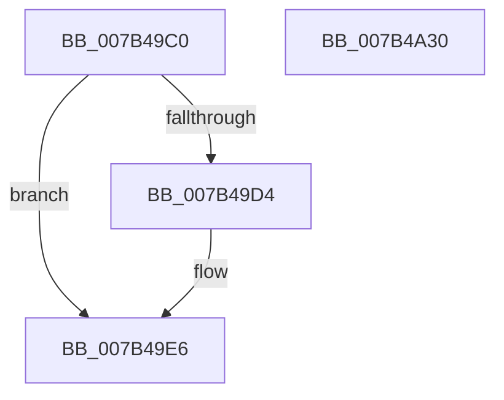

# WmipWaitForCollectionEnabled

- RVA: `0x007B49C0`–`0x007B4A31` (길이 `113` bytes)
- VA: `0x00000001407B49C0`
- 실행 섹션: `PAGE`
- PDB 이름 있음: `예`; PDB Function 태그: `아니요`
- unwind 정보 RVA: `0x0006E5F8`
- 디코드: `32`개 명령, `113/113` bytes 표시
- 미해석 바이트: `0` (있으면 어셈블리에 `.byte`로 보존)

> 이 문서는 커널 이미지의 기계어와 PDB 기호를 분석해 생성했습니다. 4번과 5번은 함수 원형과 자료형을 바이너리 사용 방식에서 추정한 C 해석이며 원본 소스 복구 결과는 아닙니다.

## 1. Dependencies

- 직접 호출 지점: **4**; 고유 호출 대상: **3**
- 직접 호출자로 확인된 함수: **1**
- RIP 상대 이미지 참조: **1**

### Outgoing calls
- `0x007B49DD` → [KeInitializeEvent](../../text/40/KeInitializeEvent_function_0040DD10.md) (function, `0x0040DD10`)
- `0x007B49EF` → [KeReleaseMutex](../../text/39/KeReleaseMutex_function_00396810.md) (function, `0x00396810`)
- `0x007B4A06` → [KeWaitForSingleObject](../../text/20/KeWaitForSingleObject_function_0020E6B0.md) (function, `0x0020E6B0`)
- `0x007B4A20` → [KeWaitForSingleObject](../../text/20/KeWaitForSingleObject_function_0020E6B0.md) (function, `0x0020E6B0`)

### Direct callers
- [WmipSendEnableRequest](../9E/WmipSendEnableRequest_function_009E367C.md) at `0x009E3722`

### Static image references
- `0x007B49E8` → RVA `0x00EFFA60` (`.data`; read)

## 2. Other-region calls and transfers

- 다른 실행 섹션으로 향하는 call: **4**
  - `0x007B49DD` → [KeInitializeEvent](../../text/40/KeInitializeEvent_function_0040DD10.md) (`PAGE` → `.text`)
  - `0x007B49EF` → [KeReleaseMutex](../../text/39/KeReleaseMutex_function_00396810.md) (`PAGE` → `.text`)
  - `0x007B4A06` → [KeWaitForSingleObject](../../text/20/KeWaitForSingleObject_function_0020E6B0.md) (`PAGE` → `.text`)
  - `0x007B4A20` → [KeWaitForSingleObject](../../text/20/KeWaitForSingleObject_function_0020E6B0.md) (`PAGE` → `.text`)
- 별도 외부 분기/꼬리 이동을 확인하지 못했습니다.

## 3. Assembly (complete function range)

```asm
007B49C0  48 89 5C 24 08                  mov qword ptr [rsp + 8], rbx
007B49C5  57                              push rdi
007B49C6  48 83 EC 30                     sub rsp, 0x30
007B49CA  8B 41 10                        mov eax, dword ptr [rcx + 0x10]
007B49CD  48 8B F9                        mov rdi, rcx
007B49D0  A8 08                           test al, 8
007B49D2  75 12                           jne 0x1407b49e6
007B49D4  48 8B 49 60                     mov rcx, qword ptr [rcx + 0x60]
007B49D8  45 33 C0                        xor r8d, r8d
007B49DB  33 D2                           xor edx, edx
007B49DD  E8 2E 93 C5 FF                  call 0x14040dd10
007B49E2  83 4F 10 08                     or dword ptr [rdi + 0x10], 8
007B49E6  33 D2                           xor edx, edx
007B49E8  48 8D 0D 71 B0 74 00            lea rcx, [rip + 0x74b071]
007B49EF  E8 1C 1E BE FF                  call 0x140396810
007B49F4  48 8B 4F 60                     mov rcx, qword ptr [rdi + 0x60]
007B49F8  45 33 C9                        xor r9d, r9d
007B49FB  48 83 64 24 20 00               and qword ptr [rsp + 0x20], 0
007B4A01  45 33 C0                        xor r8d, r8d
007B4A04  33 D2                           xor edx, edx
007B4A06  E8 A5 9C A5 FF                  call 0x14020e6b0
007B4A0B  48 83 64 24 20 00               and qword ptr [rsp + 0x20], 0
007B4A11  48 8D 0D 48 B0 74 00            lea rcx, [rip + 0x74b048]
007B4A18  45 33 C9                        xor r9d, r9d
007B4A1B  45 33 C0                        xor r8d, r8d
007B4A1E  33 D2                           xor edx, edx
007B4A20  E8 8B 9C A5 FF                  call 0x14020e6b0
007B4A25  48 8B 5C 24 40                  mov rbx, qword ptr [rsp + 0x40]
007B4A2A  48 83 C4 30                     add rsp, 0x30
007B4A2E  5F                              pop rdi
007B4A2F  C3                              ret
007B4A30  CC                              int3
```

## 4. C-style interpretation (structured pseudocode)

```c
__int64 __fastcall WmipWaitForCollectionEnabled(__int64 a1, int a2, int a3, int a4)
{
    __int64 result;
    __int64 v_rsp;
    unsigned __int64 v_stack_m18;
    unsigned __int64 v_stack_p8;

    v_stack_p8 = v_rbx;
    v_rsp = (v_rsp) - (48);
    result = (unsigned int)(*(unsigned int *)(a1 + 16));
    if ((((unsigned __int8)((unsigned int)(*(unsigned int *)(a1 + 16)))) & (8)) == 0) {
        a1 = *(unsigned __int64 *)(a1 + 96);
        a3 = 0;
        a2 = 0;
        result = KeInitializeEvent(a1, a2, a3, a4);
    }
    a2 = 0;
    result = KeReleaseMutex(v_rip + 7647345, a2, a3, a4);
    a4 = 0;
    a3 = 0;
    a2 = 0;
    result = KeWaitForSingleObject(*(unsigned __int64 *)(a1 + 96), a2, a3, a4);
    a4 = 0;
    a3 = 0;
    a2 = 0;
    result = KeWaitForSingleObject(v_rip + 7647304, a2, a3, a4);
    v_rsp = (v_rsp) + (48);
    return result;
}
```

## 5. (Beta) C Style

```c
int64_t WmipWaitForCollectionEnabled(void *Arg1, int32_t Arg2, int32_t Arg3, int32_t Arg4)
{
    uint8_t *arg1 = (uint8_t *)Arg1;

    int64_t result;
    int64_t local_rsp;
    uint64_t v_stack_m18;
    uint64_t v_stack_p8;

    v_stack_p8 = local_rbx;
    local_rsp = (local_rsp) - (48);
    result = (uint32_t)(*(uint32_t *)(arg1 + 0x10));
    if ((((uint8_t)((uint32_t)(*(uint32_t *)(arg1 + 0x10)))) & (8)) == 0) {
        Arg1 = *(uint64_t *)(arg1 + 0x60);
        Arg3 = 0;
        Arg2 = 0;
        result = KeInitializeEvent(Arg1, Arg2, Arg3, Arg4);
    }
    Arg2 = 0;
    result = KeReleaseMutex(v_rip + 7647345, Arg2, Arg3, Arg4);
    Arg4 = 0;
    Arg3 = 0;
    Arg2 = 0;
    result = KeWaitForSingleObject(*(uint64_t *)(arg1 + 0x60), Arg2, Arg3, Arg4);
    Arg4 = 0;
    Arg3 = 0;
    Arg2 = 0;
    result = KeWaitForSingleObject(v_rip + 7647304, Arg2, Arg3, Arg4);
    local_rsp = (local_rsp) + (48);
    return result;
}
```

### 관측된 메모리 오프셋

구조체 형식이 확인되지 않은 접근은 인자 기준의 오프셋으로만 기록했습니다.

| 기준 인자 | 오프셋 표현 | 폭 (bit) | 접근 |
|---|---:|---:|---|
| `Arg1` | `+ 0x10` | `32` | `R` |
| `Arg1` | `+ 0x10` | `32` | `R/W` |
| `Arg1` | `+ 0x60` | `64` | `R` |

## 6. Execution-region graph

[열기: 2D/3D 그래프와 함수 탐색 컨트롤 패널](../../../control-panel.html?section=page&rva=0x007B49C0&view=graph)

- 2D 그래프는 위에서 아래로 흐르고, 3D 그래프는 빈 공간을 드래그해 회전합니다. Shift+드래그는 이동, 휠은 확대·축소, 함수 노드 선택은 대상 보고서 이동입니다.

### Static fallback


