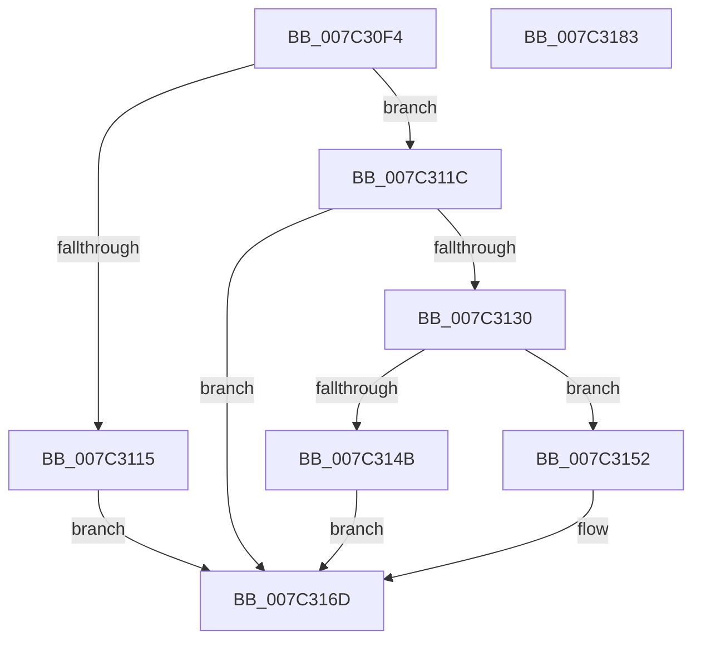

# EtwpAllocatePayloadFilterData

- RVA: `0x007C30F4`–`0x007C3184` (길이 `144` bytes)
- VA: `0x00000001407C30F4`
- 실행 섹션: `PAGE`
- PDB 이름 있음: `예`; PDB Function 태그: `아니요`
- unwind 정보 RVA: `0x0006F978`
- 디코드: `41`개 명령, `144/144` bytes 표시
- 미해석 바이트: `0` (있으면 어셈블리에 `.byte`로 보존)

> 이 문서는 커널 이미지의 기계어와 PDB 기호를 분석해 생성했습니다. 4번과 5번은 함수 원형과 자료형을 바이너리 사용 방식에서 추정한 C 해석이며 원본 소스 복구 결과는 아닙니다.

## 1. Dependencies

- 직접 호출 지점: **3**; 고유 호출 대상: **3**
- 직접 호출자로 확인된 함수: **1**
- RIP 상대 이미지 참조: **0**

### Outgoing calls
- `0x007C3125` → [EtwpValidatePayloadFilter](EtwpValidatePayloadFilter_function_007C3334.md) (function, `0x007C3334`)
- `0x007C313E` → [ExAllocatePool2](../../poolcode/B8/ExAllocatePool2_function_00B820F0.md) (function, `0x00B820F0`)
- `0x007C3163` → [memcpy](../../text/6C/memcpy_function_006C6840.md) (function, `0x006C6840`)

### Direct callers
- [EtwpAllocateFilter](../9F/EtwpAllocateFilter_function_009FC948.md) at `0x009FCB85`

### Static image references
- 디코드된 RIP-relative 메모리 참조가 없습니다.

## 2. Other-region calls and transfers

- 다른 실행 섹션으로 향하는 call: **2**
  - `0x007C313E` → [ExAllocatePool2](../../poolcode/B8/ExAllocatePool2_function_00B820F0.md) (`PAGE` → `POOLCODE`)
  - `0x007C3163` → [memcpy](../../text/6C/memcpy_function_006C6840.md) (`PAGE` → `.text`)
- 별도 외부 분기/꼬리 이동을 확인하지 못했습니다.

## 3. Assembly (complete function range)

```asm
007C30F4  48 89 5C 24 08                  mov qword ptr [rsp + 8], rbx
007C30F9  48 89 74 24 10                  mov qword ptr [rsp + 0x10], rsi
007C30FE  48 89 7C 24 18                  mov qword ptr [rsp + 0x18], rdi
007C3103  41 56                           push r14
007C3105  48 83 EC 20                     sub rsp, 0x20
007C3109  49 83 38 00                     cmp qword ptr [r8], 0
007C310D  4D 8B F0                        mov r14, r8
007C3110  48 8B FA                        mov rdi, rdx
007C3113  74 07                           je 0x1407c311c
007C3115  B8 0D 00 00 C0                  mov eax, 0xc000000d
007C311A  EB 51                           jmp 0x1407c316d
007C311C  8B 5A 08                        mov ebx, dword ptr [rdx + 8]
007C311F  44 8B C3                        mov r8d, ebx
007C3122  48 8B 12                        mov rdx, qword ptr [rdx]
007C3125  E8 0A 02 00 00                  call 0x1407c3334
007C312A  8B F0                           mov esi, eax
007C312C  85 C0                           test eax, eax
007C312E  78 3D                           js 0x1407c316d
007C3130  8D 53 08                        lea edx, [rbx + 8]
007C3133  B9 40 00 00 00                  mov ecx, 0x40
007C3138  41 B8 45 74 77 46               mov r8d, 0x46777445
007C313E  E8 AD EF 3B 00                  call 0x140b820f0
007C3143  48 8B D8                        mov rbx, rax
007C3146  48 85 C0                        test rax, rax
007C3149  75 07                           jne 0x1407c3152
007C314B  B8 17 00 00 C0                  mov eax, 0xc0000017
007C3150  EB 1B                           jmp 0x1407c316d
007C3152  44 8B 47 08                     mov r8d, dword ptr [rdi + 8]
007C3156  48 8D 48 08                     lea rcx, [rax + 8]
007C315A  48 8B 17                        mov rdx, qword ptr [rdi]
007C315D  C7 00 01 00 00 00               mov dword ptr [rax], 1
007C3163  E8 D8 36 F0 FF                  call 0x1406c6840
007C3168  8B C6                           mov eax, esi
007C316A  49 89 1E                        mov qword ptr [r14], rbx
007C316D  48 8B 5C 24 30                  mov rbx, qword ptr [rsp + 0x30]
007C3172  48 8B 74 24 38                  mov rsi, qword ptr [rsp + 0x38]
007C3177  48 8B 7C 24 40                  mov rdi, qword ptr [rsp + 0x40]
007C317C  48 83 C4 20                     add rsp, 0x20
007C3180  41 5E                           pop r14
007C3182  C3                              ret
007C3183  CC                              int3
```

## 4. C-style interpretation (structured pseudocode)

```c
__int64 __fastcall EtwpAllocatePayloadFilterData(__int64 a1, __int64 a2, __int64 a3)
{
    __int64 result;
    __int64 v_rsp;
    unsigned __int64 v_stack_p10;
    unsigned __int64 v_stack_p18;
    unsigned __int64 v_stack_p8;

    v_stack_p8 = v_rbx;
    v_stack_p10 = v_rsi;
    v_stack_p18 = v_rdi;
    v_rsp = (v_rsp) - (32);
    if ((*(unsigned __int64 *)(a3)) == 0) goto loc_007C311C;
    goto loc_007C316D;
loc_007C311C:
    result = EtwpValidatePayloadFilter(a1, *(unsigned __int64 *)(a2), (unsigned int)((unsigned int)((unsigned int)(*(unsigned int *)(a2 + 8)))), a4);
    if (sign_flag) goto loc_007C316D;
    result = ExAllocatePool2(64, (unsigned int)(*(unsigned int *)(a2 + 8)) + 8, (unsigned int)(0x46777445ULL), a4);
    if (result != 0) goto loc_007C3152;
    goto loc_007C316D;
loc_007C3152:
    *(unsigned int *)((unsigned int)(0xC0000017ULL)) = 1;
    result = memcpy((unsigned int)(0xC0000017ULL) + 8, *(unsigned __int64 *)(a2), (unsigned int)(*(unsigned int *)(a2 + 8)), a4);
    *(unsigned __int64 *)(a3) = result;
loc_007C316D:
    v_rsp = (v_rsp) + (32);
    return (unsigned int)((unsigned int)((unsigned int)((unsigned int)(result))));
}
```

## 5. (Beta) C Style

```c
int64_t EtwpAllocatePayloadFilterData(int64_t Arg1, void *Arg2, void *Arg3)
{
    uint8_t *arg2 = (uint8_t *)Arg2;
    uint8_t *arg3 = (uint8_t *)Arg3;

    int64_t result;
    int64_t local_rsp;
    uint64_t v_stack_p10;
    uint64_t v_stack_p18;
    uint64_t v_stack_p8;

    v_stack_p8 = local_rbx;
    v_stack_p10 = local_rsi;
    v_stack_p18 = local_rdi;
    local_rsp = (local_rsp) - (32);
    if ((*(uint64_t *)(arg3)) == 0) goto loc_007C311C;
    goto loc_007C316D;
loc_007C311C:
    result = EtwpValidatePayloadFilter(Arg1, *(uint64_t *)(arg2), (uint32_t)((uint32_t)((uint32_t)(*(uint32_t *)(arg2 + 0x8)))), a4);
    if (sign_flag) goto loc_007C316D;
    result = ExAllocatePool2(64, (uint32_t)(*(uint32_t *)(arg2 + 0x8)) + 8, (uint32_t)(0x46777445ULL), a4);
    if (result != 0) goto loc_007C3152;
    goto loc_007C316D;
loc_007C3152:
    *(uint32_t *)((uint32_t)(0xC0000017ULL)) = 1;
    result = memcpy((uint32_t)(0xC0000017ULL) + 8, *(uint64_t *)(arg2), (uint32_t)(*(uint32_t *)(arg2 + 0x8)), a4);
    *(uint64_t *)(arg3) = result;
loc_007C316D:
    local_rsp = (local_rsp) + (32);
    return (uint32_t)((uint32_t)((uint32_t)((uint32_t)(result))));
}
```

### 관측된 메모리 오프셋

구조체 형식이 확인되지 않은 접근은 인자 기준의 오프셋으로만 기록했습니다.

| 기준 인자 | 오프셋 표현 | 폭 (bit) | 접근 |
|---|---:|---:|---|
| `Arg2` | `+ 0x0` | `64` | `R` |
| `Arg2` | `+ 0x8` | `32` | `R` |
| `Arg3` | `+ 0x0` | `64` | `R` |
| `Arg3` | `+ 0x0` | `64` | `W` |

## 6. Execution-region graph

[열기: 2D/3D 그래프와 함수 탐색 컨트롤 패널](../../../control-panel.html?section=page&rva=0x007C30F4&view=graph)

- 2D 그래프는 위에서 아래로 흐르고, 3D 그래프는 빈 공간을 드래그해 회전합니다. Shift+드래그는 이동, 휠은 확대·축소, 함수 노드 선택은 대상 보고서 이동입니다.

### Static fallback


