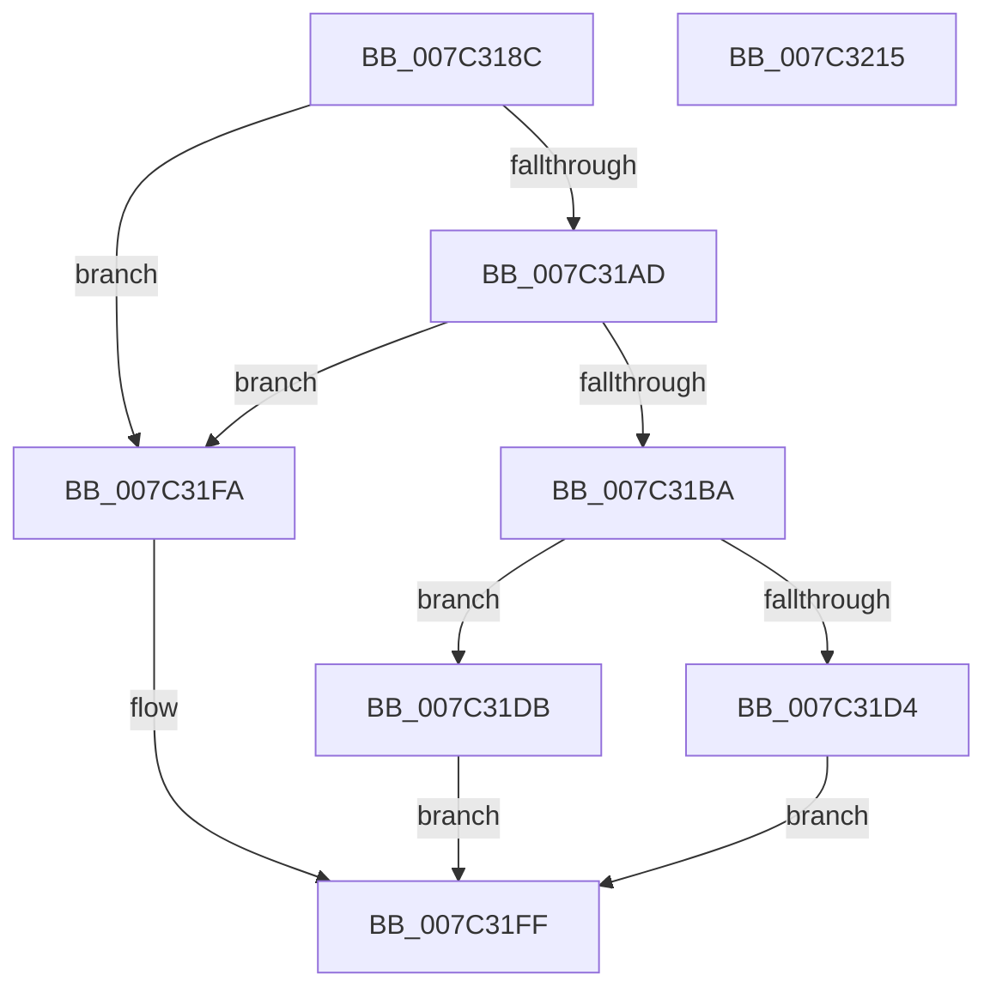

# EtwpAllocateSchematizedFilter

- RVA: `0x007C318C`–`0x007C3216` (길이 `138` bytes)
- VA: `0x00000001407C318C`
- 실행 섹션: `PAGE`
- PDB 이름 있음: `예`; PDB Function 태그: `아니요`
- unwind 정보 RVA: `0x0006F978`
- 디코드: `40`개 명령, `138/138` bytes 표시
- 미해석 바이트: `0` (있으면 어셈블리에 `.byte`로 보존)

> 이 문서는 커널 이미지의 기계어와 PDB 기호를 분석해 생성했습니다. 4번과 5번은 함수 원형과 자료형을 바이너리 사용 방식에서 추정한 C 해석이며 원본 소스 복구 결과는 아닙니다.

## 1. Dependencies

- 직접 호출 지점: **2**; 고유 호출 대상: **2**
- 직접 호출자로 확인된 함수: **1**
- RIP 상대 이미지 참조: **0**

### Outgoing calls
- `0x007C31C7` → [ExAllocatePool2](../../poolcode/B8/ExAllocatePool2_function_00B820F0.md) (function, `0x00B820F0`)
- `0x007C31E7` → [memcpy](../../text/6C/memcpy_function_006C6840.md) (function, `0x006C6840`)

### Direct callers
- [EtwpAllocateFilter](../9F/EtwpAllocateFilter_function_009FC948.md) at `0x009FCA84`

### Static image references
- 디코드된 RIP-relative 메모리 참조가 없습니다.

## 2. Other-region calls and transfers

- 다른 실행 섹션으로 향하는 call: **2**
  - `0x007C31C7` → [ExAllocatePool2](../../poolcode/B8/ExAllocatePool2_function_00B820F0.md) (`PAGE` → `POOLCODE`)
  - `0x007C31E7` → [memcpy](../../text/6C/memcpy_function_006C6840.md) (`PAGE` → `.text`)
- 별도 외부 분기/꼬리 이동을 확인하지 못했습니다.

## 3. Assembly (complete function range)

```asm
007C318C  48 89 5C 24 08                  mov qword ptr [rsp + 8], rbx
007C3191  48 89 74 24 10                  mov qword ptr [rsp + 0x10], rsi
007C3196  48 89 7C 24 18                  mov qword ptr [rsp + 0x18], rdi
007C319B  41 56                           push r14
007C319D  48 83 EC 20                     sub rsp, 0x20
007C31A1  48 83 3A 00                     cmp qword ptr [rdx], 0
007C31A5  4C 8B F2                        mov r14, rdx
007C31A8  48 8B F1                        mov rsi, rcx
007C31AB  75 4D                           jne 0x1407c31fa
007C31AD  8B 49 08                        mov ecx, dword ptr [rcx + 8]
007C31B0  8D 41 E8                        lea eax, [rcx - 0x18]
007C31B3  3D E8 03 00 00                  cmp eax, 0x3e8
007C31B8  77 40                           ja 0x1407c31fa
007C31BA  8B D1                           mov edx, ecx
007C31BC  41 B8 45 74 77 46               mov r8d, 0x46777445
007C31C2  B9 00 01 00 00                  mov ecx, 0x100
007C31C7  E8 24 EF 3B 00                  call 0x140b820f0
007C31CC  48 8B F8                        mov rdi, rax
007C31CF  48 85 C0                        test rax, rax
007C31D2  75 07                           jne 0x1407c31db
007C31D4  B8 17 00 00 C0                  mov eax, 0xc0000017
007C31D9  EB 24                           jmp 0x1407c31ff
007C31DB  8B 5E 08                        mov ebx, dword ptr [rsi + 8]
007C31DE  48 8B CF                        mov rcx, rdi
007C31E1  48 8B 16                        mov rdx, qword ptr [rsi]
007C31E4  44 8B C3                        mov r8d, ebx
007C31E7  E8 54 36 F0 FF                  call 0x1406c6840
007C31EC  83 67 14 00                     and dword ptr [rdi + 0x14], 0
007C31F0  89 5F 10                        mov dword ptr [rdi + 0x10], ebx
007C31F3  33 C0                           xor eax, eax
007C31F5  49 89 3E                        mov qword ptr [r14], rdi
007C31F8  EB 05                           jmp 0x1407c31ff
007C31FA  B8 0D 00 00 C0                  mov eax, 0xc000000d
007C31FF  48 8B 5C 24 30                  mov rbx, qword ptr [rsp + 0x30]
007C3204  48 8B 74 24 38                  mov rsi, qword ptr [rsp + 0x38]
007C3209  48 8B 7C 24 40                  mov rdi, qword ptr [rsp + 0x40]
007C320E  48 83 C4 20                     add rsp, 0x20
007C3212  41 5E                           pop r14
007C3214  C3                              ret
007C3215  CC                              int3
```

## 4. C-style interpretation (structured pseudocode)

```c
__int64 __fastcall EtwpAllocateSchematizedFilter(__int64 a1, __int64 a2)
{
    __int64 result;
    __int64 v_rsp;
    unsigned __int64 v_stack_p10;
    unsigned __int64 v_stack_p18;
    unsigned __int64 v_stack_p8;

    v_stack_p8 = v_rbx;
    v_stack_p10 = v_rsi;
    v_stack_p18 = v_rdi;
    v_rsp = (v_rsp) - (32);
    if ((*(unsigned __int64 *)(a2)) != 0) goto loc_007C31FA;
    if (((unsigned int)((unsigned int)(*(unsigned int *)(a1 + 8)) - 24)) > 1000) goto loc_007C31FA;
    result = ExAllocatePool2(256, (unsigned int)((unsigned int)((unsigned int)(*(unsigned int *)(a1 + 8)))), (unsigned int)(0x46777445ULL), a4);
    if (result != 0) goto loc_007C31DB;
    goto loc_007C31FF;
loc_007C31DB:
    result = memcpy(result, *(unsigned __int64 *)(a1), (unsigned int)((unsigned int)((unsigned int)(*(unsigned int *)(a1 + 8)))), a4);
    *(unsigned int *)(result + 16) = (unsigned int)((unsigned int)(*(unsigned int *)(a1 + 8)));
    result = 0;
    *(unsigned __int64 *)(a2) = 0;
    goto loc_007C31FF;
loc_007C31FA:
loc_007C31FF:
    v_rsp = (v_rsp) + (32);
    return (unsigned int)(0xC000000DULL);
}
```

## 5. (Beta) C Style

```c
int64_t EtwpAllocateSchematizedFilter(void *Arg1, void *Arg2)
{
    uint8_t *arg1 = (uint8_t *)Arg1;
    uint8_t *arg2 = (uint8_t *)Arg2;

    int64_t result;
    int64_t local_rsp;
    uint64_t v_stack_p10;
    uint64_t v_stack_p18;
    uint64_t v_stack_p8;

    v_stack_p8 = local_rbx;
    v_stack_p10 = local_rsi;
    v_stack_p18 = local_rdi;
    local_rsp = (local_rsp) - (32);
    if ((*(uint64_t *)(arg2)) != 0) goto loc_007C31FA;
    if (((uint32_t)((uint32_t)(*(uint32_t *)(arg1 + 0x8)) - 24)) > 1000) goto loc_007C31FA;
    result = ExAllocatePool2(256, (uint32_t)((uint32_t)((uint32_t)(*(uint32_t *)(arg1 + 0x8)))), (uint32_t)(0x46777445ULL), a4);
    if (result != 0) goto loc_007C31DB;
    goto loc_007C31FF;
loc_007C31DB:
    result = memcpy(result, *(uint64_t *)(arg1), (uint32_t)((uint32_t)((uint32_t)(*(uint32_t *)(arg1 + 0x8)))), a4);
    *(uint32_t *)(result + 0x10) = (uint32_t)((uint32_t)(*(uint32_t *)(arg1 + 0x8)));
    result = 0;
    *(uint64_t *)(arg2) = 0;
    goto loc_007C31FF;
loc_007C31FA:
loc_007C31FF:
    local_rsp = (local_rsp) + (32);
    return (uint32_t)(0xC000000DULL);
}
```

### 관측된 메모리 오프셋

구조체 형식이 확인되지 않은 접근은 인자 기준의 오프셋으로만 기록했습니다.

| 기준 인자 | 오프셋 표현 | 폭 (bit) | 접근 |
|---|---:|---:|---|
| `Arg1` | `+ 0x0` | `64` | `R` |
| `Arg1` | `+ 0x8` | `32` | `R` |
| `Arg2` | `+ 0x0` | `64` | `R` |
| `Arg2` | `+ 0x0` | `64` | `W` |

## 6. Execution-region graph

[열기: 2D/3D 그래프와 함수 탐색 컨트롤 패널](../../../control-panel.html?section=page&rva=0x007C318C&view=graph)

- 2D 그래프는 위에서 아래로 흐르고, 3D 그래프는 빈 공간을 드래그해 회전합니다. Shift+드래그는 이동, 휠은 확대·축소, 함수 노드 선택은 대상 보고서 이동입니다.

### Static fallback


