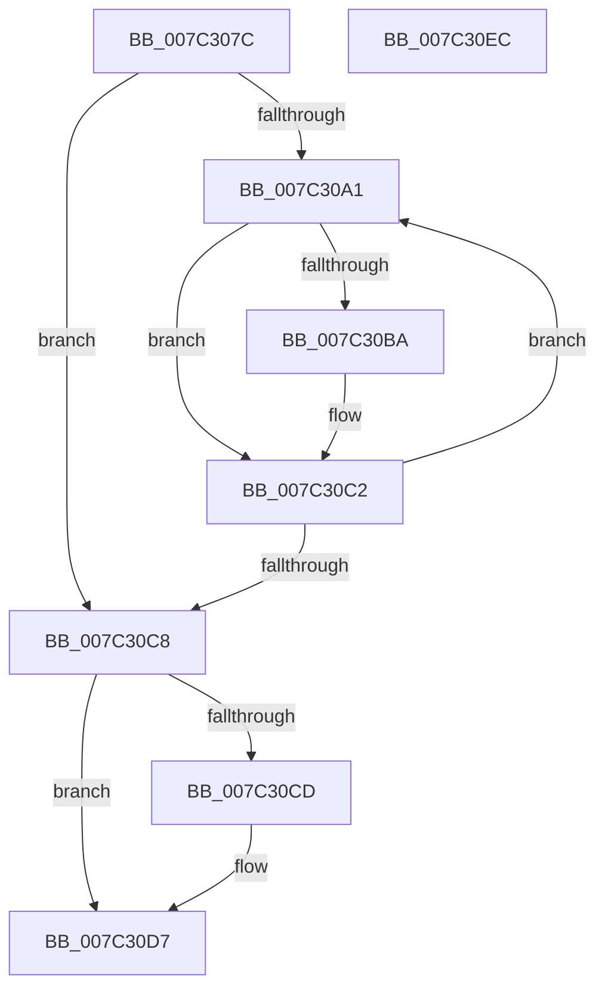

# EtwpCCSwapStop

- RVA: `0x007C307C`–`0x007C30ED` (길이 `113` bytes)
- VA: `0x00000001407C307C`
- 실행 섹션: `PAGE`
- PDB 이름 있음: `예`; PDB Function 태그: `아니요`
- unwind 정보 RVA: `0x0005C954`
- 디코드: `31`개 명령, `113/113` bytes 표시
- 미해석 바이트: `0` (있으면 어셈블리에 `.byte`로 보존)

> 이 문서는 커널 이미지의 기계어와 PDB 기호를 분석해 생성했습니다. 4번과 5번은 함수 원형과 자료형을 바이너리 사용 방식에서 추정한 C 해석이며 원본 소스 복구 결과는 아닙니다.

## 1. Dependencies

- 직접 호출 지점: **1**; 고유 호출 대상: **1**
- 직접 호출자로 확인된 함수: **2**
- RIP 상대 이미지 참조: **2**

### Outgoing calls
- `0x007C30A3` → [KeGetPrcb](../../text/2D/KeGetPrcb_function_002D85D0.md) (function, `0x002D85D0`)

### Direct callers
- [sub_006F7B6E](../../text/6F/Unknown_function_006F7B6E.md) at `0x006F7B76`
- [EtwpFlushTrace](../AF/EtwpFlushTrace_function_00AF47B4.md) at `0x00AF4932`

### Static image references
- `0x007C3090` → RVA `0x00FC6A80` (`ALMOSTRO`; read)
- `0x007C30CD` → RVA `0x00E68520` (`.data`; read)

## 2. Other-region calls and transfers

- 다른 실행 섹션으로 향하는 call: **1**
  - `0x007C30A3` → [KeGetPrcb](../../text/2D/KeGetPrcb_function_002D85D0.md) (`PAGE` → `.text`)
- 별도 외부 분기/꼬리 이동을 확인하지 못했습니다.

## 3. Assembly (complete function range)

```asm
007C307C  48 89 5C 24 08                  mov qword ptr [rsp + 8], rbx
007C3081  48 89 6C 24 10                  mov qword ptr [rsp + 0x10], rbp
007C3086  48 89 74 24 18                  mov qword ptr [rsp + 0x18], rsi
007C308B  57                              push rdi
007C308C  48 83 EC 20                     sub rsp, 0x20
007C3090  8B 35 EA 39 80 00               mov esi, dword ptr [rip + 0x8039ea]
007C3096  33 FF                           xor edi, edi
007C3098  8B D9                           mov ebx, ecx
007C309A  40 8A EA                        mov bpl, dl
007C309D  85 F6                           test esi, esi
007C309F  74 27                           je 0x1407c30c8
007C30A1  8B CF                           mov ecx, edi
007C30A3  E8 28 55 B1 FF                  call 0x1402d85d0
007C30A8  48 8B 88 A8 8B 00 00            mov rcx, qword ptr [rax + 0x8ba8]
007C30AF  48 83 BC D9 98 01 00 00 00      cmp qword ptr [rcx + rbx*8 + 0x198], 0
007C30B8  74 08                           je 0x1407c30c2
007C30BA  C6 84 0B 90 01 00 00 01         mov byte ptr [rbx + rcx + 0x190], 1
007C30C2  FF C7                           inc edi
007C30C4  3B FE                           cmp edi, esi
007C30C6  72 D9                           jb 0x1407c30a1
007C30C8  40 84 ED                        test bpl, bpl
007C30CB  74 0A                           je 0x1407c30d7
007C30CD  48 8D 05 4C 54 6A 00            lea rax, [rip + 0x6a544c]
007C30D4  FF 0C 98                        dec dword ptr [rax + rbx*4]
007C30D7  48 8B 5C 24 30                  mov rbx, qword ptr [rsp + 0x30]
007C30DC  48 8B 6C 24 38                  mov rbp, qword ptr [rsp + 0x38]
007C30E1  48 8B 74 24 40                  mov rsi, qword ptr [rsp + 0x40]
007C30E6  48 83 C4 20                     add rsp, 0x20
007C30EA  5F                              pop rdi
007C30EB  C3                              ret
007C30EC  CC                              int3
```

## 4. C-style interpretation (structured pseudocode)

```c
__int64 __fastcall EtwpCCSwapStop(int a1, unsigned __int8 a2)
{
    __int64 result;
    __int64 v_rdi;
    __int64 v_rsp;
    unsigned __int64 v_stack_p10;
    unsigned __int64 v_stack_p18;
    unsigned __int64 v_stack_p8;

    v_stack_p8 = v_rbx;
    v_stack_p10 = v_rbp;
    v_stack_p18 = v_rsi;
    v_rsp = (v_rsp) - (32);
    v_rdi = 0;
    if ((unsigned int)((unsigned int)(*(unsigned int *)(v_rip + 8403434))) == 0) goto loc_007C30C8;
loc_007C30A1:
    result = KeGetPrcb(0, a2, a3, a4);
    if ((*(unsigned __int64 *)(*(unsigned __int64 *)(result + 35752) + (unsigned int)(a1) * 8 + 408)) != 0) {
        *(unsigned __int8 *)((unsigned int)(a1) + *(unsigned __int64 *)(result + 35752) * 1 + 400) = 1;
    }
    v_rdi = (unsigned int)((v_rdi) + 1);
    if (((unsigned int)(v_rdi)) < ((unsigned int)((unsigned int)(*(unsigned int *)(v_rip + 8403434))))) goto loc_007C30A1;
loc_007C30C8:
    if (a2 != 0) {
        result = v_rip + 6968396;
    }
    v_rsp = (v_rsp) + (32);
    return result;
}
```

## 5. (Beta) C Style

```c
int64_t EtwpCCSwapStop(void *Arg1, uint8_t Arg2)
{
    uint8_t *arg1 = (uint8_t *)Arg1;

    int64_t result;
    int64_t local_rdi;
    int64_t local_rsp;
    uint64_t v_stack_p10;
    uint64_t v_stack_p18;
    uint64_t v_stack_p8;

    v_stack_p8 = local_rbx;
    v_stack_p10 = local_rbp;
    v_stack_p18 = local_rsi;
    local_rsp = (local_rsp) - (32);
    local_rdi = 0;
    if ((uint32_t)((uint32_t)(*(uint32_t *)(v_rip + 0x8039EA))) == 0) goto loc_007C30C8;
loc_007C30A1:
    result = KeGetPrcb(0, Arg2, a3, a4);
    if ((*(uint64_t *)(*(uint64_t *)(result + 0x8BA8) + (uint32_t)(arg1) * 8 + 0x198)) != 0) {
        *(uint8_t *)((uint32_t)(arg1) + *(uint64_t *)(result + 0x8BA8) * 1 + 0x190) = 1;
    }
    local_rdi = (uint32_t)((local_rdi) + 1);
    if (((uint32_t)(local_rdi)) < ((uint32_t)((uint32_t)(*(uint32_t *)(v_rip + 0x8039EA))))) goto loc_007C30A1;
loc_007C30C8:
    if (Arg2 != 0) {
        result = v_rip + 6968396;
    }
    local_rsp = (local_rsp) + (32);
    return result;
}
```

### 관측된 메모리 오프셋

구조체 형식이 확인되지 않은 접근은 인자 기준의 오프셋으로만 기록했습니다.

| 기준 인자 | 오프셋 표현 | 폭 (bit) | 접근 |
|---|---:|---:|---|
| `Arg1` | `+ 0x190 + rcx*1` | `8` | `W` |

## 6. Execution-region graph

[열기: 2D/3D 그래프와 함수 탐색 컨트롤 패널](../../../control-panel.html?section=page&rva=0x007C307C&view=graph)

- 2D 그래프는 위에서 아래로 흐르고, 3D 그래프는 빈 공간을 드래그해 회전합니다. Shift+드래그는 이동, 휠은 확대·축소, 함수 노드 선택은 대상 보고서 이동입니다.

### Static fallback


