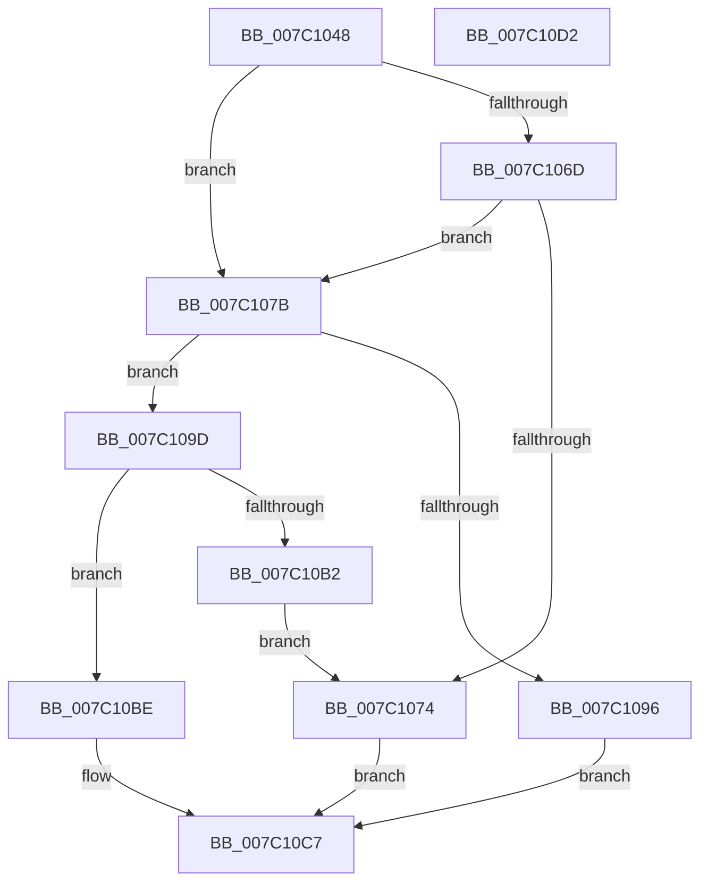

# EtwpConstructIptData

- RVA: `0x007C1048`–`0x007C10D3` (길이 `139` bytes)
- VA: `0x00000001407C1048`
- 실행 섹션: `PAGE`
- PDB 이름 있음: `예`; PDB Function 태그: `아니요`
- unwind 정보 RVA: `0x0005CAAC`
- 디코드: `39`개 명령, `139/139` bytes 표시
- 미해석 바이트: `0` (있으면 어셈블리에 `.byte`로 보존)

> 이 문서는 커널 이미지의 기계어와 PDB 기호를 분석해 생성했습니다. 4번과 5번은 함수 원형과 자료형을 바이너리 사용 방식에서 추정한 C 해석이며 원본 소스 복구 결과는 아닙니다.

## 1. Dependencies

- 직접 호출 지점: **4**; 고유 호출 대상: **4**
- 직접 호출자로 확인된 함수: **1**
- RIP 상대 이미지 참조: **2**

### Outgoing calls
- `0x007C105C` → [ZwLoadDriver](../../text/6A/ZwLoadDriver_function_006AF290.md) (function, `0x006AF290`)
- `0x007C1089` → [ExAllocatePool2](../../poolcode/B8/ExAllocatePool2_function_00B820F0.md) (function, `0x00B820F0`)
- `0x007C10A4` → [ExGetExtensionTable](../../text/42/ExGetExtensionTable_function_00428814.md) (function, `0x00428814`)
- `0x007C10B7` → [ExFreePoolWithTag](../../poolcode/B8/ExFreePoolWithTag_function_00B82870.md) (function, `0x00B82870`)

### Direct callers
- [EtwpUpdateProcessorTraceConfiguration](EtwpUpdateProcessorTraceConfiguration_function_007C11BC.md) at `0x007C11E3`

### Static image references
- `0x007C1055` → RVA `0x00E09288` (`.data`; read)
- `0x007C109D` → RVA `0x00EFF108` (`.data`; read)

## 2. Other-region calls and transfers

- 다른 실행 섹션으로 향하는 call: **4**
  - `0x007C105C` → [ZwLoadDriver](../../text/6A/ZwLoadDriver_function_006AF290.md) (`PAGE` → `.text`)
  - `0x007C1089` → [ExAllocatePool2](../../poolcode/B8/ExAllocatePool2_function_00B820F0.md) (`PAGE` → `POOLCODE`)
  - `0x007C10A4` → [ExGetExtensionTable](../../text/42/ExGetExtensionTable_function_00428814.md) (`PAGE` → `.text`)
  - `0x007C10B7` → [ExFreePoolWithTag](../../poolcode/B8/ExFreePoolWithTag_function_00B82870.md) (`PAGE` → `POOLCODE`)
- 별도 외부 분기/꼬리 이동을 확인하지 못했습니다.

## 3. Assembly (complete function range)

```asm
007C1048  48 89 5C 24 08                  mov qword ptr [rsp + 8], rbx
007C104D  57                              push rdi
007C104E  48 83 EC 20                     sub rsp, 0x20
007C1052  48 8B F9                        mov rdi, rcx
007C1055  48 8D 0D 2C 82 64 00            lea rcx, [rip + 0x64822c]
007C105C  E8 2F E2 EE FF                  call 0x1406af290
007C1061  B9 00 00 00 80                  mov ecx, 0x80000000
007C1066  8D 14 08                        lea edx, [rax + rcx]
007C1069  85 D1                           test ecx, edx
007C106B  75 0E                           jne 0x1407c107b
007C106D  3D 0E 01 00 C0                  cmp eax, 0xc000010e
007C1072  74 07                           je 0x1407c107b
007C1074  B8 6C 02 00 C0                  mov eax, 0xc000026c
007C1079  EB 4C                           jmp 0x1407c10c7
007C107B  BA 28 00 00 00                  mov edx, 0x28
007C1080  41 B8 45 74 77 69               mov r8d, 0x69777445
007C1086  8D 4A 18                        lea ecx, [rdx + 0x18]
007C1089  E8 62 10 3C 00                  call 0x140b820f0
007C108E  48 8B D8                        mov rbx, rax
007C1091  48 85 C0                        test rax, rax
007C1094  75 07                           jne 0x1407c109d
007C1096  B8 17 00 00 C0                  mov eax, 0xc0000017
007C109B  EB 2A                           jmp 0x1407c10c7
007C109D  48 8B 0D 64 E0 73 00            mov rcx, qword ptr [rip + 0x73e064]
007C10A4  E8 6B 77 C6 FF                  call 0x140428814
007C10A9  48 89 43 10                     mov qword ptr [rbx + 0x10], rax
007C10AD  48 85 C0                        test rax, rax
007C10B0  75 0C                           jne 0x1407c10be
007C10B2  33 D2                           xor edx, edx
007C10B4  48 8B CB                        mov rcx, rbx
007C10B7  E8 B4 17 3C 00                  call 0x140b82870
007C10BC  EB B6                           jmp 0x1407c1074
007C10BE  48 89 9F 38 04 00 00            mov qword ptr [rdi + 0x438], rbx
007C10C5  33 C0                           xor eax, eax
007C10C7  48 8B 5C 24 30                  mov rbx, qword ptr [rsp + 0x30]
007C10CC  48 83 C4 20                     add rsp, 0x20
007C10D0  5F                              pop rdi
007C10D1  C3                              ret
007C10D2  CC                              int3
```

## 4. C-style interpretation (structured pseudocode)

```c
__int64 __fastcall EtwpConstructIptData(__int64 a1)
{
    __int64 result;
    __int64 v_rsp;
    unsigned __int64 v_stack_p8;

    v_stack_p8 = v_rbx;
    v_rsp = (v_rsp) - (32);
    result = ZwLoadDriver(v_rip + 6586924, a2, a3, a4);
    if ((((unsigned int)((unsigned int)(0x80000000ULL))) & ((unsigned int)(result + (unsigned int)(0x80000000ULL) * 1))) != 0) goto loc_007C107B;
    if (((unsigned int)(result)) == 0xC000010EULL) goto loc_007C107B;
loc_007C1074:
    goto loc_007C10C7;
loc_007C107B:
    result = ExAllocatePool2(40 + 24, 40, (unsigned int)(0x69777445ULL), a4);
    if (result != 0) goto loc_007C109D;
    goto loc_007C10C7;
loc_007C109D:
    result = ExGetExtensionTable(*(unsigned __int64 *)(v_rip + 7594084), 40, (unsigned int)(0x69777445ULL), a4);
    *(unsigned __int64 *)(result + 16) = result;
    if (result != 0) goto loc_007C10BE;
    a2 = 0;
    result = ExFreePoolWithTag(result, a2, (unsigned int)(0x69777445ULL), a4);
    goto loc_007C1074;
loc_007C10BE:
    *(unsigned __int64 *)(a1 + 1080) = result;
    result = 0;
loc_007C10C7:
    v_rsp = (v_rsp) + (32);
    return result;
}
```

## 5. (Beta) C Style

```c
int64_t EtwpConstructIptData(void *Arg1)
{
    uint8_t *arg1 = (uint8_t *)Arg1;

    int64_t result;
    int64_t local_rsp;
    uint64_t v_stack_p8;

    v_stack_p8 = local_rbx;
    local_rsp = (local_rsp) - (32);
    result = ZwLoadDriver(v_rip + 6586924, a2, a3, a4);
    if ((((uint32_t)((uint32_t)(0x80000000ULL))) & ((uint32_t)(result + (uint32_t)(0x80000000ULL) * 1))) != 0) goto loc_007C107B;
    if (((uint32_t)(result)) == 0xC000010EULL) goto loc_007C107B;
loc_007C1074:
    goto loc_007C10C7;
loc_007C107B:
    result = ExAllocatePool2(40 + 24, 40, (uint32_t)(0x69777445ULL), a4);
    if (result != 0) goto loc_007C109D;
    goto loc_007C10C7;
loc_007C109D:
    result = ExGetExtensionTable(*(uint64_t *)(v_rip + 0x73E064), 40, (uint32_t)(0x69777445ULL), a4);
    *(uint64_t *)(result + 0x10) = result;
    if (result != 0) goto loc_007C10BE;
    a2 = 0;
    result = ExFreePoolWithTag(result, a2, (uint32_t)(0x69777445ULL), a4);
    goto loc_007C1074;
loc_007C10BE:
    *(uint64_t *)(arg1 + 0x438) = result;
    result = 0;
loc_007C10C7:
    local_rsp = (local_rsp) + (32);
    return result;
}
```

### 관측된 메모리 오프셋

구조체 형식이 확인되지 않은 접근은 인자 기준의 오프셋으로만 기록했습니다.

| 기준 인자 | 오프셋 표현 | 폭 (bit) | 접근 |
|---|---:|---:|---|
| `Arg1` | `+ 0x438` | `64` | `W` |

## 6. Execution-region graph

[열기: 2D/3D 그래프와 함수 탐색 컨트롤 패널](../../../control-panel.html?section=page&rva=0x007C1048&view=graph)

- 2D 그래프는 위에서 아래로 흐르고, 3D 그래프는 빈 공간을 드래그해 회전합니다. Shift+드래그는 이동, 휠은 확대·축소, 함수 노드 선택은 대상 보고서 이동입니다.

### Static fallback


