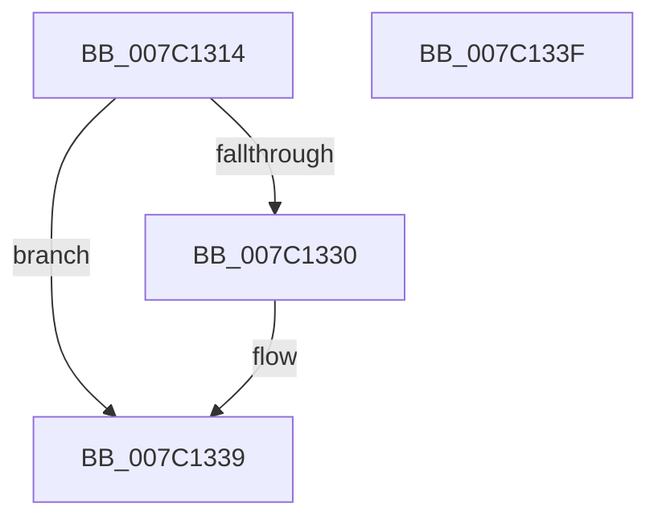

# EtwpCovSampApplyBounds

- RVA: `0x007C1314`–`0x007C1340` (길이 `44` bytes)
- VA: `0x00000001407C1314`
- 실행 섹션: `PAGE`
- PDB 이름 있음: `예`; PDB Function 태그: `아니요`
- unwind 정보 RVA: `0x000DB714`
- 디코드: `16`개 명령, `44/44` bytes 표시
- 미해석 바이트: `0` (있으면 어셈블리에 `.byte`로 보존)

> 이 문서는 커널 이미지의 기계어와 PDB 기호를 분석해 생성했습니다. 4번과 5번은 함수 원형과 자료형을 바이너리 사용 방식에서 추정한 C 해석이며 원본 소스 복구 결과는 아닙니다.

## 1. Dependencies

- 직접 호출 지점: **0**; 고유 호출 대상: **0**
- 직접 호출자로 확인된 함수: **1**
- RIP 상대 이미지 참조: **0**

### Outgoing calls
- 직접 디코드된 call 명령이 없습니다.

### Direct callers
- [EtwpSetCoverageSamplerInformation](EtwpSetCoverageSamplerInformation_function_007C288C.md) at `0x007C2A9F`
- [EtwpSetCoverageSamplerInformation](EtwpSetCoverageSamplerInformation_function_007C288C.md) at `0x007C2AB8`
- [EtwpSetCoverageSamplerInformation](EtwpSetCoverageSamplerInformation_function_007C288C.md) at `0x007C2AD3`
- [EtwpSetCoverageSamplerInformation](EtwpSetCoverageSamplerInformation_function_007C288C.md) at `0x007C2B31`
- [EtwpSetCoverageSamplerInformation](EtwpSetCoverageSamplerInformation_function_007C288C.md) at `0x007C2B41`
- [EtwpSetCoverageSamplerInformation](EtwpSetCoverageSamplerInformation_function_007C288C.md) at `0x007C2B51`
- [EtwpSetCoverageSamplerInformation](EtwpSetCoverageSamplerInformation_function_007C288C.md) at `0x007C2B61`
- [EtwpSetCoverageSamplerInformation](EtwpSetCoverageSamplerInformation_function_007C288C.md) at `0x007C2B73`
- [EtwpSetCoverageSamplerInformation](EtwpSetCoverageSamplerInformation_function_007C288C.md) at `0x007C2B82`
- [EtwpSetCoverageSamplerInformation](EtwpSetCoverageSamplerInformation_function_007C288C.md) at `0x007C2B91`
- [EtwpSetCoverageSamplerInformation](EtwpSetCoverageSamplerInformation_function_007C288C.md) at `0x007C2BA0`
- [EtwpSetCoverageSamplerInformation](EtwpSetCoverageSamplerInformation_function_007C288C.md) at `0x007C2BB8`
- [EtwpSetCoverageSamplerInformation](EtwpSetCoverageSamplerInformation_function_007C288C.md) at `0x007C2BD6`
- [EtwpSetCoverageSamplerInformation](EtwpSetCoverageSamplerInformation_function_007C288C.md) at `0x007C2BF2`
- [EtwpSetCoverageSamplerInformation](EtwpSetCoverageSamplerInformation_function_007C288C.md) at `0x007C2C1E`
- [EtwpSetCoverageSamplerInformation](EtwpSetCoverageSamplerInformation_function_007C288C.md) at `0x007C2C30`
- [EtwpSetCoverageSamplerInformation](EtwpSetCoverageSamplerInformation_function_007C288C.md) at `0x007C2C4B`
- [EtwpSetCoverageSamplerInformation](EtwpSetCoverageSamplerInformation_function_007C288C.md) at `0x007C2C5D`

### Static image references
- 디코드된 RIP-relative 메모리 참조가 없습니다.

## 2. Other-region calls and transfers

- 다른 실행 섹션으로 향하는 call: **0**
- 별도 외부 분기/꼬리 이동을 확인하지 못했습니다.

## 3. Assembly (complete function range)

```asm
007C1314  8B 01                           mov eax, dword ptr [rcx]
007C1316  45 33 D2                        xor r10d, r10d
007C1319  85 C0                           test eax, eax
007C131B  0F 44 C2                        cmove eax, edx
007C131E  41 3B C0                        cmp eax, r8d
007C1321  8B D0                           mov edx, eax
007C1323  41 0F 42 D0                     cmovb edx, r8d
007C1327  41 0F 92 C2                     setb r10b
007C132B  41 3B D1                        cmp edx, r9d
007C132E  76 09                           jbe 0x1407c1339
007C1330  41 BA 01 00 00 00               mov r10d, 1
007C1336  41 8B D1                        mov edx, r9d
007C1339  89 11                           mov dword ptr [rcx], edx
007C133B  41 8B C2                        mov eax, r10d
007C133E  C3                              ret
007C133F  CC                              int3
```

## 4. C-style interpretation (structured pseudocode)

```c
__int64 __fastcall EtwpCovSampApplyBounds(__int64 a1, int a2, int a3, int a4)
{
    __int64 result;
    __int64 v_r10;

    v_r10 = 0;
    result = (unsigned int)(*(unsigned int *)(a1));
    if ((unsigned int)((unsigned int)(*(unsigned int *)(a1))) == 0) { result = a2; }
    a2 = (unsigned int)((unsigned int)(result));
    if (((unsigned int)(result)) < a3) { a2 = a3; }
    v_r10 = (((unsigned int)(result)) < a3) ? 1 : 0;
    if (a2 >= = a4) {
        v_r10 = 1;
        a2 = a4;
    }
    *(unsigned int *)(a1) = a2;
    return (unsigned int)((unsigned int)(v_r10));
}
```

## 5. (Beta) C Style

```c
int64_t EtwpCovSampApplyBounds(void *Arg1, int32_t Arg2, int32_t Arg3, int32_t Arg4)
{
    uint8_t *arg1 = (uint8_t *)Arg1;

    int64_t result;
    int64_t local_r10;

    local_r10 = 0;
    result = (uint32_t)(*(uint32_t *)(arg1));
    if ((uint32_t)((uint32_t)(*(uint32_t *)(arg1))) == 0) { result = Arg2; }
    Arg2 = (uint32_t)((uint32_t)(result));
    if (((uint32_t)(result)) < Arg3) { Arg2 = Arg3; }
    local_r10 = (((uint32_t)(result)) < Arg3) ? 1 : 0;
    if (Arg2 >= = Arg4) {
        local_r10 = 1;
        Arg2 = Arg4;
    }
    *(uint32_t *)(arg1) = Arg2;
    return (uint32_t)((uint32_t)(local_r10));
}
```

### 관측된 메모리 오프셋

구조체 형식이 확인되지 않은 접근은 인자 기준의 오프셋으로만 기록했습니다.

| 기준 인자 | 오프셋 표현 | 폭 (bit) | 접근 |
|---|---:|---:|---|
| `Arg1` | `+ 0x0` | `32` | `R` |
| `Arg1` | `+ 0x0` | `32` | `W` |

## 6. Execution-region graph

[열기: 2D/3D 그래프와 함수 탐색 컨트롤 패널](../../../control-panel.html?section=page&rva=0x007C1314&view=graph)

- 2D 그래프는 위에서 아래로 흐르고, 3D 그래프는 빈 공간을 드래그해 회전합니다. Shift+드래그는 이동, 휠은 확대·축소, 함수 노드 선택은 대상 보고서 이동입니다.

### Static fallback


