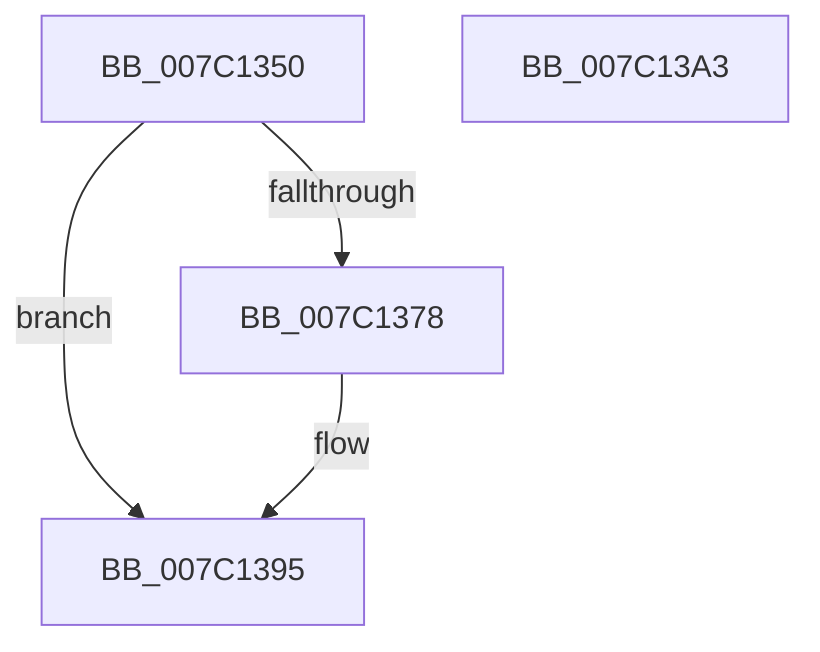

# EtwpCovSampCaptureAllocateApc

- RVA: `0x007C1350`–`0x007C13A4` (길이 `84` bytes)
- VA: `0x00000001407C1350`
- 실행 섹션: `PAGE`
- PDB 이름 있음: `예`; PDB Function 태그: `아니요`
- unwind 정보 RVA: `0x0005CAAC`
- 디코드: `24`개 명령, `84/84` bytes 표시
- 미해석 바이트: `0` (있으면 어셈블리에 `.byte`로 보존)

> 이 문서는 커널 이미지의 기계어와 PDB 기호를 분석해 생성했습니다. 4번과 5번은 함수 원형과 자료형을 바이너리 사용 방식에서 추정한 C 해석이며 원본 소스 복구 결과는 아닙니다.

## 1. Dependencies

- 직접 호출 지점: **2**; 고유 호출 대상: **2**
- 직접 호출자로 확인된 함수: **0**
- RIP 상대 이미지 참조: **0**

### Outgoing calls
- `0x007C136B` → [ExAllocatePool2](../../poolcode/B8/ExAllocatePool2_function_00B820F0.md) (function, `0x00B820F0`)
- `0x007C1383` → [memset](../../text/6C/memset_function_006C6C40.md) (function, `0x006C6C40`)

### Direct callers
- 이 함수 시작 RVA로 연결되는 직접 call은 확인되지 않았습니다. 간접 호출은 완전히 역산할 수 없습니다.

### Static image references
- 디코드된 RIP-relative 메모리 참조가 없습니다.

## 2. Other-region calls and transfers

- 다른 실행 섹션으로 향하는 call: **2**
  - `0x007C136B` → [ExAllocatePool2](../../poolcode/B8/ExAllocatePool2_function_00B820F0.md) (`PAGE` → `POOLCODE`)
  - `0x007C1383` → [memset](../../text/6C/memset_function_006C6C40.md) (`PAGE` → `.text`)
- 별도 외부 분기/꼬리 이동을 확인하지 못했습니다.

## 3. Assembly (complete function range)

```asm
007C1350  48 89 5C 24 08                  mov qword ptr [rsp + 8], rbx
007C1355  57                              push rdi
007C1356  48 83 EC 20                     sub rsp, 0x20
007C135A  48 8B FA                        mov rdi, rdx
007C135D  41 B8 45 74 77 56               mov r8d, 0x56777445
007C1363  BA A0 00 00 00                  mov edx, 0xa0
007C1368  8D 4A A0                        lea ecx, [rdx - 0x60]
007C136B  E8 80 0D 3C 00                  call 0x140b820f0
007C1370  48 8B D8                        mov rbx, rax
007C1373  48 85 C0                        test rax, rax
007C1376  74 1D                           je 0x1407c1395
007C1378  33 D2                           xor edx, edx
007C137A  41 B8 A0 00 00 00               mov r8d, 0xa0
007C1380  48 8B C8                        mov rcx, rax
007C1383  E8 B8 58 F0 FF                  call 0x1406c6c40
007C1388  B8 AC BC CA AB                  mov eax, 0xabcabcac
007C138D  48 89 7B 30                     mov qword ptr [rbx + 0x30], rdi
007C1391  48 89 43 10                     mov qword ptr [rbx + 0x10], rax
007C1395  48 8B C3                        mov rax, rbx
007C1398  48 8B 5C 24 30                  mov rbx, qword ptr [rsp + 0x30]
007C139D  48 83 C4 20                     add rsp, 0x20
007C13A1  5F                              pop rdi
007C13A2  C3                              ret
007C13A3  CC                              int3
```

## 4. C-style interpretation (structured pseudocode)

```c
__int64 __fastcall EtwpCovSampCaptureAllocateApc(__int64 a1, __int64 a2)
{
    __int64 result;
    __int64 v_rsp;
    unsigned __int64 v_stack_p8;

    v_stack_p8 = v_rbx;
    v_rsp = (v_rsp) - (32);
    result = ExAllocatePool2(160 - 96, 160, (unsigned int)(0x56777445ULL), a4);
    if (result != 0) {
        a2 = 0;
        a3 = 160;
        a1 = result;
        result = memset(a1, a2, a3, a4);
        result = 0xABCABCACULL;
        *(unsigned __int64 *)(result + 48) = 0;
        *(unsigned __int64 *)(result + 16) = result;
    }
    v_rsp = (v_rsp) + (32);
    return result;
}
```

## 5. (Beta) C Style

```c
int64_t EtwpCovSampCaptureAllocateApc(int64_t Arg1, int64_t Arg2)
{
    int64_t result;
    int64_t local_rsp;
    uint64_t v_stack_p8;

    v_stack_p8 = local_rbx;
    local_rsp = (local_rsp) - (32);
    result = ExAllocatePool2(160 - 96, 160, (uint32_t)(0x56777445ULL), a4);
    if (result != 0) {
        Arg2 = 0;
        a3 = 160;
        Arg1 = result;
        result = memset(Arg1, Arg2, a3, a4);
        result = 0xABCABCACULL;
        *(uint64_t *)(result + 0x30) = 0;
        *(uint64_t *)(result + 0x10) = result;
    }
    local_rsp = (local_rsp) + (32);
    return result;
}
```

## 6. Execution-region graph

[열기: 2D/3D 그래프와 함수 탐색 컨트롤 패널](../../../control-panel.html?section=page&rva=0x007C1350&view=graph)

- 2D 그래프는 위에서 아래로 흐르고, 3D 그래프는 빈 공간을 드래그해 회전합니다. Shift+드래그는 이동, 휠은 확대·축소, 함수 노드 선택은 대상 보고서 이동입니다.

### Static fallback


