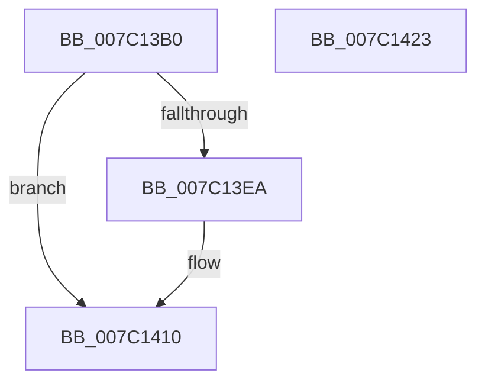

# EtwpCovSampCaptureAllocateCaptureBuffer

- RVA: `0x007C13B0`–`0x007C1424` (길이 `116` bytes)
- VA: `0x00000001407C13B0`
- 실행 섹션: `PAGE`
- PDB 이름 있음: `예`; PDB Function 태그: `아니요`
- unwind 정보 RVA: `0x00060BC4`
- 디코드: `30`개 명령, `116/116` bytes 표시
- 미해석 바이트: `0` (있으면 어셈블리에 `.byte`로 보존)

> 이 문서는 커널 이미지의 기계어와 PDB 기호를 분석해 생성했습니다. 4번과 5번은 함수 원형과 자료형을 바이너리 사용 방식에서 추정한 C 해석이며 원본 소스 복구 결과는 아닙니다.

## 1. Dependencies

- 직접 호출 지점: **2**; 고유 호출 대상: **2**
- 직접 호출자로 확인된 함수: **0**
- RIP 상대 이미지 참조: **0**

### Outgoing calls
- `0x007C13DD` → [ExAllocatePool2](../../poolcode/B8/ExAllocatePool2_function_00B820F0.md) (function, `0x00B820F0`)
- `0x007C13F3` → [memset](../../text/6C/memset_function_006C6C40.md) (function, `0x006C6C40`)

### Direct callers
- 이 함수 시작 RVA로 연결되는 직접 call은 확인되지 않았습니다. 간접 호출은 완전히 역산할 수 없습니다.

### Static image references
- 디코드된 RIP-relative 메모리 참조가 없습니다.

## 2. Other-region calls and transfers

- 다른 실행 섹션으로 향하는 call: **2**
  - `0x007C13DD` → [ExAllocatePool2](../../poolcode/B8/ExAllocatePool2_function_00B820F0.md) (`PAGE` → `POOLCODE`)
  - `0x007C13F3` → [memset](../../text/6C/memset_function_006C6C40.md) (`PAGE` → `.text`)
- 별도 외부 분기/꼬리 이동을 확인하지 못했습니다.

## 3. Assembly (complete function range)

```asm
007C13B0  48 89 5C 24 08                  mov qword ptr [rsp + 8], rbx
007C13B5  48 89 74 24 10                  mov qword ptr [rsp + 0x10], rsi
007C13BA  57                              push rdi
007C13BB  48 83 EC 20                     sub rsp, 0x20
007C13BF  8B 81 10 05 00 00               mov eax, dword ptr [rcx + 0x510]
007C13C5  48 8B F2                        mov rsi, rdx
007C13C8  48 8B F9                        mov rdi, rcx
007C13CB  41 B8 45 74 77 56               mov r8d, 0x56777445
007C13D1  B9 40 00 00 00                  mov ecx, 0x40
007C13D6  8D 14 C5 40 00 00 00            lea edx, [rax*8 + 0x40]
007C13DD  E8 0E 0D 3C 00                  call 0x140b820f0
007C13E2  48 8B D8                        mov rbx, rax
007C13E5  48 85 C0                        test rax, rax
007C13E8  74 26                           je 0x1407c1410
007C13EA  33 D2                           xor edx, edx
007C13EC  48 8B C8                        mov rcx, rax
007C13EF  44 8D 42 50                     lea r8d, [rdx + 0x50]
007C13F3  E8 48 58 F0 FF                  call 0x1406c6c40
007C13F8  B8 FF B0 BB CA                  mov eax, 0xcabbb0ff
007C13FD  48 89 73 30                     mov qword ptr [rbx + 0x30], rsi
007C1401  48 89 43 10                     mov qword ptr [rbx + 0x10], rax
007C1405  0F B7 8F 10 05 00 00            movzx ecx, word ptr [rdi + 0x510]
007C140C  66 89 4B 3C                     mov word ptr [rbx + 0x3c], cx
007C1410  48 8B 74 24 38                  mov rsi, qword ptr [rsp + 0x38]
007C1415  48 8B C3                        mov rax, rbx
007C1418  48 8B 5C 24 30                  mov rbx, qword ptr [rsp + 0x30]
007C141D  48 83 C4 20                     add rsp, 0x20
007C1421  5F                              pop rdi
007C1422  C3                              ret
007C1423  CC                              int3
```

## 4. C-style interpretation (structured pseudocode)

```c
__int64 __fastcall EtwpCovSampCaptureAllocateCaptureBuffer(__int64 a1, __int64 a2)
{
    __int64 result;
    __int64 v_rsp;
    unsigned __int64 v_stack_p10;
    unsigned __int64 v_stack_p8;

    v_stack_p8 = v_rbx;
    v_stack_p10 = v_rsi;
    v_rsp = (v_rsp) - (32);
    result = ExAllocatePool2(64, (unsigned int)(*(unsigned int *)(a1 + 1296)) * 8 + 64, (unsigned int)(0x56777445ULL), a4);
    if (result != 0) {
        a2 = 0;
        a1 = result;
        a3 = a2 + 80;
        result = memset(a1, a2, a3, a4);
        result = 0xCABBB0FFULL;
        *(unsigned __int64 *)(result + 48) = 0;
        *(unsigned __int64 *)(result + 16) = result;
        a1 = *(unsigned __int16 *)(a1 + 1296);
        *(unsigned __int16 *)(result + 60) = (unsigned __int16)(a1);
    }
    v_rsp = (v_rsp) + (32);
    return result;
}
```

## 5. (Beta) C Style

```c
int64_t EtwpCovSampCaptureAllocateCaptureBuffer(void *Arg1, int64_t Arg2)
{
    uint8_t *arg1 = (uint8_t *)Arg1;

    int64_t result;
    int64_t local_rsp;
    uint64_t v_stack_p10;
    uint64_t v_stack_p8;

    v_stack_p8 = local_rbx;
    v_stack_p10 = local_rsi;
    local_rsp = (local_rsp) - (32);
    result = ExAllocatePool2(64, (uint32_t)(*(uint32_t *)(arg1 + 0x510)) * 8 + 64, (uint32_t)(0x56777445ULL), a4);
    if (result != 0) {
        Arg2 = 0;
        Arg1 = result;
        a3 = Arg2 + 80;
        result = memset(Arg1, Arg2, a3, a4);
        result = 0xCABBB0FFULL;
        *(uint64_t *)(result + 0x30) = 0;
        *(uint64_t *)(result + 0x10) = result;
        Arg1 = *(uint16_t *)(arg1 + 0x510);
        *(uint16_t *)(result + 0x3C) = (uint16_t)(Arg1);
    }
    local_rsp = (local_rsp) + (32);
    return result;
}
```

### 관측된 메모리 오프셋

구조체 형식이 확인되지 않은 접근은 인자 기준의 오프셋으로만 기록했습니다.

| 기준 인자 | 오프셋 표현 | 폭 (bit) | 접근 |
|---|---:|---:|---|
| `Arg1` | `+ 0x510` | `16` | `R` |
| `Arg1` | `+ 0x510` | `32` | `R` |

## 6. Execution-region graph

[열기: 2D/3D 그래프와 함수 탐색 컨트롤 패널](../../../control-panel.html?section=page&rva=0x007C13B0&view=graph)

- 2D 그래프는 위에서 아래로 흐르고, 3D 그래프는 빈 공간을 드래그해 회전합니다. Shift+드래그는 이동, 휠은 확대·축소, 함수 노드 선택은 대상 보고서 이동입니다.

### Static fallback


