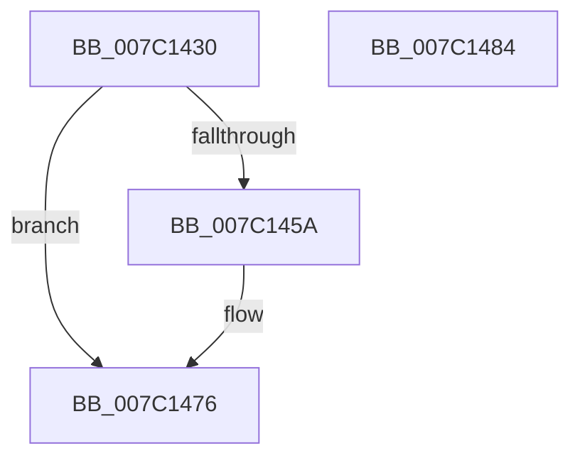

# EtwpCovSampCaptureAllocateSampleBuffer

- RVA: `0x007C1430`–`0x007C1485` (길이 `85` bytes)
- VA: `0x00000001407C1430`
- 실행 섹션: `PAGE`
- PDB 이름 있음: `예`; PDB Function 태그: `아니요`
- unwind 정보 RVA: `0x0005CAAC`
- 디코드: `24`개 명령, `85/85` bytes 표시
- 미해석 바이트: `0` (있으면 어셈블리에 `.byte`로 보존)

> 이 문서는 커널 이미지의 기계어와 PDB 기호를 분석해 생성했습니다. 4번과 5번은 함수 원형과 자료형을 바이너리 사용 방식에서 추정한 C 해석이며 원본 소스 복구 결과는 아닙니다.

## 1. Dependencies

- 직접 호출 지점: **2**; 고유 호출 대상: **2**
- 직접 호출자로 확인된 함수: **0**
- RIP 상대 이미지 참조: **0**

### Outgoing calls
- `0x007C144D` → [ExAllocatePool2](../../poolcode/B8/ExAllocatePool2_function_00B820F0.md) (function, `0x00B820F0`)
- `0x007C1463` → [memset](../../text/6C/memset_function_006C6C40.md) (function, `0x006C6C40`)

### Direct callers
- 이 함수 시작 RVA로 연결되는 직접 call은 확인되지 않았습니다. 간접 호출은 완전히 역산할 수 없습니다.

### Static image references
- 디코드된 RIP-relative 메모리 참조가 없습니다.

## 2. Other-region calls and transfers

- 다른 실행 섹션으로 향하는 call: **2**
  - `0x007C144D` → [ExAllocatePool2](../../poolcode/B8/ExAllocatePool2_function_00B820F0.md) (`PAGE` → `POOLCODE`)
  - `0x007C1463` → [memset](../../text/6C/memset_function_006C6C40.md) (`PAGE` → `.text`)
- 별도 외부 분기/꼬리 이동을 확인하지 못했습니다.

## 3. Assembly (complete function range)

```asm
007C1430  48 89 5C 24 08                  mov qword ptr [rsp + 8], rbx
007C1435  57                              push rdi
007C1436  48 83 EC 20                     sub rsp, 0x20
007C143A  8B B9 14 05 00 00               mov edi, dword ptr [rcx + 0x514]
007C1440  41 B8 45 74 77 56               mov r8d, 0x56777445
007C1446  8B D7                           mov edx, edi
007C1448  B9 40 00 00 00                  mov ecx, 0x40
007C144D  E8 9E 0C 3C 00                  call 0x140b820f0
007C1452  48 8B D8                        mov rbx, rax
007C1455  48 85 C0                        test rax, rax
007C1458  74 1C                           je 0x1407c1476
007C145A  33 D2                           xor edx, edx
007C145C  48 8B C8                        mov rcx, rax
007C145F  44 8D 42 60                     lea r8d, [rdx + 0x60]
007C1463  E8 D8 57 F0 FF                  call 0x1406c6c40
007C1468  8D 4F B8                        lea ecx, [rdi - 0x48]
007C146B  48 C7 43 10 FA B0 01 50         mov qword ptr [rbx + 0x10], 0x5001b0fa
007C1473  89 4B 40                        mov dword ptr [rbx + 0x40], ecx
007C1476  48 8B C3                        mov rax, rbx
007C1479  48 8B 5C 24 30                  mov rbx, qword ptr [rsp + 0x30]
007C147E  48 83 C4 20                     add rsp, 0x20
007C1482  5F                              pop rdi
007C1483  C3                              ret
007C1484  CC                              int3
```

## 4. C-style interpretation (structured pseudocode)

```c
__int64 __fastcall EtwpCovSampCaptureAllocateSampleBuffer(__int64 a1)
{
    __int64 result;
    __int64 v_rsp;
    unsigned __int64 v_stack_p8;

    v_stack_p8 = v_rbx;
    v_rsp = (v_rsp) - (32);
    result = ExAllocatePool2(64, (unsigned int)((unsigned int)((unsigned int)(*(unsigned int *)(a1 + 1300)))), (unsigned int)(0x56777445ULL), a4);
    if (result != 0) {
        a2 = 0;
        a1 = result;
        a3 = a2 + 96;
        result = memset(a1, a2, a3, a4);
        a1 = (unsigned int)(*(unsigned int *)(a1 + 1300)) - 72;
        *(unsigned __int64 *)(result + 16) = 0x5001B0FAULL;
        *(unsigned int *)(result + 64) = (unsigned int)(a1);
    }
    v_rsp = (v_rsp) + (32);
    return result;
}
```

## 5. (Beta) C Style

```c
int64_t EtwpCovSampCaptureAllocateSampleBuffer(void *Arg1)
{
    uint8_t *arg1 = (uint8_t *)Arg1;

    int64_t result;
    int64_t local_rsp;
    uint64_t v_stack_p8;

    v_stack_p8 = local_rbx;
    local_rsp = (local_rsp) - (32);
    result = ExAllocatePool2(64, (uint32_t)((uint32_t)((uint32_t)(*(uint32_t *)(arg1 + 0x514)))), (uint32_t)(0x56777445ULL), a4);
    if (result != 0) {
        a2 = 0;
        Arg1 = result;
        a3 = a2 + 96;
        result = memset(Arg1, a2, a3, a4);
        Arg1 = (uint32_t)(*(uint32_t *)(arg1 + 0x514)) - 72;
        *(uint64_t *)(result + 0x10) = 0x5001B0FAULL;
        *(uint32_t *)(result + 0x40) = (uint32_t)(Arg1);
    }
    local_rsp = (local_rsp) + (32);
    return result;
}
```

### 관측된 메모리 오프셋

구조체 형식이 확인되지 않은 접근은 인자 기준의 오프셋으로만 기록했습니다.

| 기준 인자 | 오프셋 표현 | 폭 (bit) | 접근 |
|---|---:|---:|---|
| `Arg1` | `+ 0x514` | `32` | `R` |

## 6. Execution-region graph

[열기: 2D/3D 그래프와 함수 탐색 컨트롤 패널](../../../control-panel.html?section=page&rva=0x007C1430&view=graph)

- 2D 그래프는 위에서 아래로 흐르고, 3D 그래프는 빈 공간을 드래그해 회전합니다. Shift+드래그는 이동, 휠은 확대·축소, 함수 노드 선택은 대상 보고서 이동입니다.

### Static fallback


