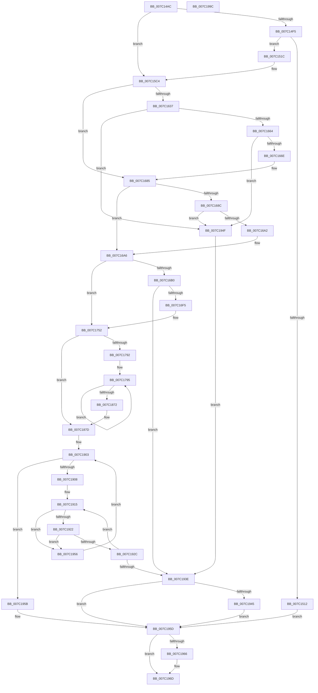

# EtwpCovSampCaptureContextStart

- RVA: `0x007C14AC`–`0x007C199D` (길이 `1,265` bytes)
- VA: `0x00000001407C14AC`
- 실행 섹션: `PAGE`
- PDB 이름 있음: `예`; PDB Function 태그: `아니요`
- unwind 정보 RVA: `0x000C98E4`
- 디코드: `302`개 명령, `1,265/1,265` bytes 표시
- 미해석 바이트: `0` (있으면 어셈블리에 `.byte`로 보존)

> 이 문서는 커널 이미지의 기계어와 PDB 기호를 분석해 생성했습니다. 4번과 5번은 함수 원형과 자료형을 바이너리 사용 방식에서 추정한 C 해석이며 원본 소스 복구 결과는 아닙니다.

## 1. Dependencies

- 직접 호출 지점: **33**; 고유 호출 대상: **20**
- 직접 호출자로 확인된 함수: **1**
- RIP 상대 이미지 참조: **12**

### Outgoing calls
- `0x007C1505` → [ExAllocatePool2](../../poolcode/B8/ExAllocatePool2_function_00B820F0.md) (function, `0x00B820F0`)
- `0x007C1524` → [memset](../../text/6C/memset_function_006C6C40.md) (function, `0x006C6C40`)
- `0x007C153A` → [KeInitializeEvent](../../text/40/KeInitializeEvent_function_0040DD10.md) (function, `0x0040DD10`)
- `0x007C1550` → [KeInitializeDpc](../../text/45/KeInitializeDpc_function_0045BBD0.md) (function, `0x0045BBD0`)
- `0x007C155C` → [InitializeSListHead](../../text/46/InitializeSListHead_function_00468A90.md) (function, `0x00468A90`)
- `0x007C156D` → [KeInitializeEvent](../../text/40/KeInitializeEvent_function_0040DD10.md) (function, `0x0040DD10`)
- `0x007C1583` → [KeInitializeDpc](../../text/45/KeInitializeDpc_function_0045BBD0.md) (function, `0x0045BBD0`)
- `0x007C1599` → [KeInitializeDpc](../../text/45/KeInitializeDpc_function_0045BBD0.md) (function, `0x0045BBD0`)
- `0x007C15AA` → [KeInitializeEvent](../../text/40/KeInitializeEvent_function_0040DD10.md) (function, `0x0040DD10`)
- `0x007C1603` → [EtwpCovSampLookasideControlInitialize](EtwpCovSampLookasideControlInitialize_function_007C1B24.md) (function, `0x007C1B24`)
- `0x007C162B` → [EtwpCovSampLookasideControlInitialize](EtwpCovSampLookasideControlInitialize_function_007C1B24.md) (function, `0x007C1B24`)
- `0x007C1641` → [EtwpCovSampStackHashTableAlloc](EtwpCovSampStackHashTableAlloc_function_007C1D3C.md) (function, `0x007C1D3C`)
- `0x007C1653` → [EtwpCovSampStackHashTableAlloc](EtwpCovSampStackHashTableAlloc_function_007C1D3C.md) (function, `0x007C1D3C`)
- `0x007C1677` → [ExGenRandom](../../text/41/ExGenRandom_function_0041B010.md) (function, `0x0041B010`)
- `0x007C1693` → [ExSaAllocate](../../text/3B/ExSaAllocate_function_003B3FB0.md) (function, `0x003B3FB0`)
- `0x007C16E6` → [PsCreateSystemThreadEx](../9E/PsCreateSystemThreadEx_function_009ED120.md) (function, `0x009ED120`)
- `0x007C171A` → [ObReferenceObjectByHandle](../86/ObReferenceObjectByHandle_function_00868DB0.md) (function, `0x00868DB0`)
- `0x007C174D` → [ZwSetInformationThread](../../text/6A/ZwSetInformationThread_function_006AD270.md) (function, `0x006AD270`)
- `0x007C1767` → [KeSetBasePriorityThread](../../text/3C/KeSetBasePriorityThread_function_003C6EB0.md) (function, `0x003C6EB0`)
- `0x007C177E` → [KeQueryMaximumProcessorCountEx](../../text/26/KeQueryMaximumProcessorCountEx_function_00264D60.md) (function, `0x00264D60`)
- `0x007C17F1` → [memset](../../text/6C/memset_function_006C6C40.md) (function, `0x006C6C40`)
- `0x007C1804` → [EtwpCovSampLookasideInitialize](EtwpCovSampLookasideInitialize_function_007C1BB8.md) (function, `0x007C1BB8`)
- `0x007C1813` → [EtwpCovSampLookasideInitialize](EtwpCovSampLookasideInitialize_function_007C1BB8.md) (function, `0x007C1BB8`)
- `0x007C1826` → [EtwpCovSampStrideSamplerInitialize](EtwpCovSampStrideSamplerInitialize_function_007C1DD8.md) (function, `0x007C1DD8`)
- `0x007C1839` → [EtwpCovSampStrideSamplerInitialize](EtwpCovSampStrideSamplerInitialize_function_007C1DD8.md) (function, `0x007C1DD8`)
- `0x007C184C` → [EtwpCovSampStrideSamplerInitialize](EtwpCovSampStrideSamplerInitialize_function_007C1DD8.md) (function, `0x007C1DD8`)
- `0x007C185F` → [EtwpCovSampStrideSamplerInitialize](EtwpCovSampStrideSamplerInitialize_function_007C1DD8.md) (function, `0x007C1DD8`)
- `0x007C18A3` → [EtwpCovSampLookasideControlInitialize](EtwpCovSampLookasideControlInitialize_function_007C1B24.md) (function, `0x007C1B24`)
- `0x007C18B5` → [EtwpCovSampLookasideInitialize](EtwpCovSampLookasideInitialize_function_007C1BB8.md) (function, `0x007C1BB8`)
- `0x007C1933` → [EtwpCovSampLookasideGrow](../../text/65/EtwpCovSampLookasideGrow_function_0065410C.md) (function, `0x0065410C`)
- `0x007C1948` → [EtwpCovSampCaptureFreeLookasides](../AC/EtwpCovSampCaptureFreeLookasides_function_00ACEDF0.md) (function, `0x00ACEDF0`)
- `0x007C1968` → [ObCloseHandle](../8A/ObCloseHandle_function_008A1870.md) (function, `0x008A1870`)
- `0x007C1976` → [_security_check_cookie](../../text/6A/_security_check_cookie_function_006AC640.md) (function, `0x006AC640`)

### Direct callers
- [EtwpCoverageSamplerStart](EtwpCoverageSamplerStart_function_007C2248.md) at `0x007C23E3`

### Static image references
- `0x007C14CF` → RVA `0x00E0A740` (`.data`; read)
- `0x007C14DD` → RVA `0x00EFF1E8` (`.data`; read)
- `0x007C1549` → RVA `0x00653EF0` (`EtwpCovSampCaptureRebalanceDpc`; read)
- `0x007C157C` → RVA `0x00462370` (`EtwpCovSampCaptureQueueDpc`; read)
- `0x007C1592` → RVA `0x00653C10` (`EtwpCovSampCaptureCleanupDpc`; read)
- `0x007C15BD` → RVA `0x00EFF1E8` (`.data`; write)
- `0x007C15E3` → RVA `0x007C1350` (`EtwpCovSampCaptureAllocateApc`; read)
- `0x007C1612` → RVA `0x007C13B0` (`EtwpCovSampCaptureAllocateCaptureBuffer`; read)
- `0x007C16B6` → RVA `0x007C19B0` (`EtwpCovSampCaptureWorkerThread`; read)
- `0x007C16FF` → RVA `0x00FC6AC8` (`ALMOSTRO`; read)
- `0x007C17CD` → RVA `0x00EFA278` (`.data`; read)
- `0x007C1889` → RVA `0x007C1430` (`EtwpCovSampCaptureAllocateSampleBuffer`; read)

## 2. Other-region calls and transfers

- 다른 실행 섹션으로 향하는 call: **17**
  - `0x007C1505` → [ExAllocatePool2](../../poolcode/B8/ExAllocatePool2_function_00B820F0.md) (`PAGE` → `POOLCODE`)
  - `0x007C1524` → [memset](../../text/6C/memset_function_006C6C40.md) (`PAGE` → `.text`)
  - `0x007C153A` → [KeInitializeEvent](../../text/40/KeInitializeEvent_function_0040DD10.md) (`PAGE` → `.text`)
  - `0x007C1550` → [KeInitializeDpc](../../text/45/KeInitializeDpc_function_0045BBD0.md) (`PAGE` → `.text`)
  - `0x007C155C` → [InitializeSListHead](../../text/46/InitializeSListHead_function_00468A90.md) (`PAGE` → `.text`)
  - `0x007C156D` → [KeInitializeEvent](../../text/40/KeInitializeEvent_function_0040DD10.md) (`PAGE` → `.text`)
  - `0x007C1583` → [KeInitializeDpc](../../text/45/KeInitializeDpc_function_0045BBD0.md) (`PAGE` → `.text`)
  - `0x007C1599` → [KeInitializeDpc](../../text/45/KeInitializeDpc_function_0045BBD0.md) (`PAGE` → `.text`)
  - `0x007C15AA` → [KeInitializeEvent](../../text/40/KeInitializeEvent_function_0040DD10.md) (`PAGE` → `.text`)
  - `0x007C1677` → [ExGenRandom](../../text/41/ExGenRandom_function_0041B010.md) (`PAGE` → `.text`)
  - `0x007C1693` → [ExSaAllocate](../../text/3B/ExSaAllocate_function_003B3FB0.md) (`PAGE` → `.text`)
  - `0x007C174D` → [ZwSetInformationThread](../../text/6A/ZwSetInformationThread_function_006AD270.md) (`PAGE` → `.text`)
  - `0x007C1767` → [KeSetBasePriorityThread](../../text/3C/KeSetBasePriorityThread_function_003C6EB0.md) (`PAGE` → `.text`)
  - `0x007C177E` → [KeQueryMaximumProcessorCountEx](../../text/26/KeQueryMaximumProcessorCountEx_function_00264D60.md) (`PAGE` → `.text`)
  - `0x007C17F1` → [memset](../../text/6C/memset_function_006C6C40.md) (`PAGE` → `.text`)
  - `0x007C1933` → [EtwpCovSampLookasideGrow](../../text/65/EtwpCovSampLookasideGrow_function_0065410C.md) (`PAGE` → `.text`)
  - `0x007C1976` → [_security_check_cookie](../../text/6A/_security_check_cookie_function_006AC640.md) (`PAGE` → `.text`)
- 별도 외부 분기/꼬리 이동을 확인하지 못했습니다.

## 3. Assembly (complete function range)

```asm
007C14AC  48 8B C4                        mov rax, rsp
007C14AF  48 89 58 10                     mov qword ptr [rax + 0x10], rbx
007C14B3  48 89 70 18                     mov qword ptr [rax + 0x18], rsi
007C14B7  48 89 78 20                     mov qword ptr [rax + 0x20], rdi
007C14BB  55                              push rbp
007C14BC  41 54                           push r12
007C14BE  41 55                           push r13
007C14C0  41 56                           push r14
007C14C2  41 57                           push r15
007C14C4  48 8D 68 A1                     lea rbp, [rax - 0x5f]
007C14C8  48 81 EC 90 00 00 00            sub rsp, 0x90
007C14CF  48 8B 05 6A 92 64 00            mov rax, qword ptr [rip + 0x64926a]
007C14D6  48 33 C4                        xor rax, rsp
007C14D9  48 89 45 27                     mov qword ptr [rbp + 0x27], rax
007C14DD  48 8B 3D 04 DD 73 00            mov rdi, qword ptr [rip + 0x73dd04]
007C14E4  48 8B F1                        mov rsi, rcx
007C14E7  48 83 65 F7 00                  and qword ptr [rbp - 9], 0
007C14EC  48 85 FF                        test rdi, rdi
007C14EF  0F 85 CF 00 00 00               jne 0x1407c15c4
007C14F5  BB 40 05 00 00                  mov ebx, 0x540
007C14FA  8D 4F 40                        lea ecx, [rdi + 0x40]
007C14FD  8B D3                           mov edx, ebx
007C14FF  41 B8 45 74 77 56               mov r8d, 0x56777445
007C1505  E8 E6 0B 3C 00                  call 0x140b820f0
007C150A  48 8B F8                        mov rdi, rax
007C150D  48 85 C0                        test rax, rax
007C1510  75 0A                           jne 0x1407c151c
007C1512  BB 9A 00 00 C0                  mov ebx, 0xc000009a
007C1517  E9 41 04 00 00                  jmp 0x1407c195d
007C151C  4C 8B C3                        mov r8, rbx
007C151F  33 D2                           xor edx, edx
007C1521  48 8B CF                        mov rcx, rdi
007C1524  E8 17 57 F0 FF                  call 0x1406c6c40
007C1529  48 83 4F 08 FF                  or qword ptr [rdi + 8], 0xffffffffffffffff
007C152E  48 8D 8F 10 04 00 00            lea rcx, [rdi + 0x410]
007C1535  45 33 C0                        xor r8d, r8d
007C1538  33 D2                           xor edx, edx
007C153A  E8 D1 C7 C4 FF                  call 0x14040dd10
007C153F  48 8D 8F D0 03 00 00            lea rcx, [rdi + 0x3d0]
007C1546  4C 8B C7                        mov r8, rdi
007C1549  48 8D 15 A0 29 E9 FF            lea rdx, [rip - 0x16d660]
007C1550  E8 7B A6 C9 FF                  call 0x14045bbd0
007C1555  48 8D 8F 30 04 00 00            lea rcx, [rdi + 0x430]
007C155C  E8 2F 75 CA FF                  call 0x140468a90
007C1561  48 8D 8F 50 04 00 00            lea rcx, [rdi + 0x450]
007C1568  45 33 C0                        xor r8d, r8d
007C156B  33 D2                           xor edx, edx
007C156D  E8 9E C7 C4 FF                  call 0x14040dd10
007C1572  48 8D 8F 68 04 00 00            lea rcx, [rdi + 0x468]
007C1579  4C 8B C7                        mov r8, rdi
007C157C  48 8D 15 ED 0D CA FF            lea rdx, [rip - 0x35f213]
007C1583  E8 48 A6 C9 FF                  call 0x14045bbd0
007C1588  48 8D 8F A8 04 00 00            lea rcx, [rdi + 0x4a8]
007C158F  4C 8B C7                        mov r8, rdi
007C1592  48 8D 15 77 26 E9 FF            lea rdx, [rip - 0x16d989]
007C1599  E8 32 A6 C9 FF                  call 0x14045bbd0
007C159E  48 8D 8F E8 04 00 00            lea rcx, [rdi + 0x4e8]
007C15A5  45 33 C0                        xor r8d, r8d
007C15A8  33 D2                           xor edx, edx
007C15AA  E8 61 C7 C4 FF                  call 0x14040dd10
007C15AF  8B 06                           mov eax, dword ptr [rsi]
007C15B1  C1 E8 0B                        shr eax, 0xb
007C15B4  83 E0 01                        and eax, 1
007C15B7  89 87 0C 05 00 00               mov dword ptr [rdi + 0x50c], eax
007C15BD  48 89 3D 24 DC 73 00            mov qword ptr [rip + 0x73dc24], rdi
007C15C4  48 8D 87 C0 03 00 00            lea rax, [rdi + 0x3c0]
007C15CB  48 8B CF                        mov rcx, rdi
007C15CE  4C 8D BF B0 03 00 00            lea r15, [rdi + 0x3b0]
007C15D5  4D 89 7F 08                     mov qword ptr [r15 + 8], r15
007C15D9  4C 8D A7 80 02 00 00            lea r12, [rdi + 0x280]
007C15E0  4D 89 3F                        mov qword ptr [r15], r15
007C15E3  4C 8D 05 66 FD FF FF            lea r8, [rip - 0x29a]
007C15EA  48 89 40 08                     mov qword ptr [rax + 8], rax
007C15EE  49 8B D4                        mov rdx, r12
007C15F1  48 89 00                        mov qword ptr [rax], rax
007C15F4  8B 46 24                        mov eax, dword ptr [rsi + 0x24]
007C15F7  89 44 24 20                     mov dword ptr [rsp + 0x20], eax
007C15FB  44 8D 0C 40                     lea r9d, [rax + rax*2]
007C15FF  41 C1 E9 02                     shr r9d, 2
007C1603  E8 1C 05 00 00                  call 0x1407c1b24
007C1608  8B 46 20                        mov eax, dword ptr [rsi + 0x20]
007C160B  4C 8D AF D0 02 00 00            lea r13, [rdi + 0x2d0]
007C1612  4C 8D 05 97 FD FF FF            lea r8, [rip - 0x269]
007C1619  89 44 24 20                     mov dword ptr [rsp + 0x20], eax
007C161D  49 8B D5                        mov rdx, r13
007C1620  48 8B CF                        mov rcx, rdi
007C1623  44 8D 0C 40                     lea r9d, [rax + rax*2]
007C1627  41 C1 E9 02                     shr r9d, 2
007C162B  E8 F4 04 00 00                  call 0x1407c1b24
007C1630  8B 56 4C                        mov edx, dword ptr [rsi + 0x4c]
007C1633  85 D2                           test edx, edx
007C1635  74 4E                           je 0x1407c1685
007C1637  48 8D 9F 28 05 00 00            lea rbx, [rdi + 0x528]
007C163E  48 8B CB                        mov rcx, rbx
007C1641  E8 F6 06 00 00                  call 0x1407c1d3c
007C1646  8B 56 4C                        mov edx, dword ptr [rsi + 0x4c]
007C1649  4C 8D B7 30 05 00 00            lea r14, [rdi + 0x530]
007C1650  49 8B CE                        mov rcx, r14
007C1653  E8 E4 06 00 00                  call 0x1407c1d3c
007C1658  48 8B 03                        mov rax, qword ptr [rbx]
007C165B  48 85 C0                        test rax, rax
007C165E  0F 84 EB 02 00 00               je 0x1407c194f
007C1664  49 83 3E 00                     cmp qword ptr [r14], 0
007C1668  0F 84 E1 02 00 00               je 0x1407c194f
007C166E  33 C9                           xor ecx, ecx
007C1670  48 89 87 20 05 00 00            mov qword ptr [rdi + 0x520], rax
007C1677  E8 94 99 C5 FF                  call 0x14041b010
007C167C  8B C0                           mov eax, eax
007C167E  48 89 87 38 05 00 00            mov qword ptr [rdi + 0x538], rax
007C1685  48 83 7F 08 FF                  cmp qword ptr [rdi + 8], -1
007C168A  75 1A                           jne 0x1407c16a6
007C168C  33 D2                           xor edx, edx
007C168E  B9 58 01 00 00                  mov ecx, 0x158
007C1693  E8 18 29 BF FF                  call 0x1403b3fb0
007C1698  48 83 F8 FF                     cmp rax, -1
007C169C  0F 84 AD 02 00 00               je 0x1407c194f
007C16A2  48 89 47 08                     mov qword ptr [rdi + 8], rax
007C16A6  48 83 3F 00                     cmp qword ptr [rdi], 0
007C16AA  0F 85 A2 00 00 00               jne 0x1407c1752
007C16B0  48 83 64 24 40 00               and qword ptr [rsp + 0x40], 0
007C16B6  48 8D 05 F3 02 00 00            lea rax, [rip + 0x2f3]
007C16BD  48 83 64 24 38 00               and qword ptr [rsp + 0x38], 0
007C16C3  48 8D 4D F7                     lea rcx, [rbp - 9]
007C16C7  48 89 7C 24 30                  mov qword ptr [rsp + 0x30], rdi
007C16CC  41 BE FF FF 1F 00               mov r14d, 0x1fffff
007C16D2  48 89 44 24 28                  mov qword ptr [rsp + 0x28], rax
007C16D7  45 33 C9                        xor r9d, r9d
007C16DA  48 83 64 24 20 00               and qword ptr [rsp + 0x20], 0
007C16E0  45 33 C0                        xor r8d, r8d
007C16E3  41 8B D6                        mov edx, r14d
007C16E6  E8 35 BA 22 00                  call 0x1409ed120
007C16EB  8B D8                           mov ebx, eax
007C16ED  85 C0                           test eax, eax
007C16EF  0F 88 49 02 00 00               js 0x1407c193e
007C16F5  48 83 64 24 28 00               and qword ptr [rsp + 0x28], 0
007C16FB  48 8D 45 0F                     lea rax, [rbp + 0xf]
007C16FF  4C 8B 05 C2 53 80 00            mov r8, qword ptr [rip + 0x8053c2]
007C1706  45 33 C9                        xor r9d, r9d
007C1709  48 8B 4D F7                     mov rcx, qword ptr [rbp - 9]
007C170D  41 8B D6                        mov edx, r14d
007C1710  48 83 65 0F 00                  and qword ptr [rbp + 0xf], 0
007C1715  48 89 44 24 20                  mov qword ptr [rsp + 0x20], rax
007C171A  E8 91 76 0A 00                  call 0x140868db0
007C171F  48 8B 45 0F                     mov rax, qword ptr [rbp + 0xf]
007C1723  4C 8D 45 17                     lea r8, [rbp + 0x17]
007C1727  41 B9 0C 00 00 00               mov r9d, 0xc
007C172D  48 89 07                        mov qword ptr [rdi], rax
007C1730  48 8B 4D F7                     mov rcx, qword ptr [rbp - 9]
007C1734  C7 45 17 01 00 00 00            mov dword ptr [rbp + 0x17], 1
007C173B  C7 45 1B 01 00 00 00            mov dword ptr [rbp + 0x1b], 1
007C1742  41 8D 51 25                     lea edx, [r9 + 0x25]
007C1746  C7 45 1F 01 00 00 00            mov dword ptr [rbp + 0x1f], 1
007C174D  E8 1E BB EE FF                  call 0x1406ad270
007C1752  8B 1E                           mov ebx, dword ptr [rsi]
007C1754  48 8B 0F                        mov rcx, qword ptr [rdi]
007C1757  81 E3 00 02 00 00               and ebx, 0x200
007C175D  8B C3                           mov eax, ebx
007C175F  F7 D8                           neg eax
007C1761  1B D2                           sbb edx, edx
007C1763  F7 DA                           neg edx
007C1765  FF CA                           dec edx
007C1767  E8 44 57 C0 FF                  call 0x1403c6eb0
007C176C  33 C0                           xor eax, eax
007C176E  B9 FF FF 00 00                  mov ecx, 0xffff
007C1773  85 DB                           test ebx, ebx
007C1775  0F 95 C0                        setne al
007C1778  89 87 18 05 00 00               mov dword ptr [rdi + 0x518], eax
007C177E  E8 DD 35 AA FF                  call 0x140264d60
007C1783  44 8B F0                        mov r14d, eax
007C1786  44 89 75 07                     mov dword ptr [rbp + 7], r14d
007C178A  85 C0                           test eax, eax
007C178C  0F 84 EB 00 00 00               je 0x1407c187d
007C1792  45 33 FF                        xor r15d, r15d
007C1795  48 8B 47 08                     mov rax, qword ptr [rdi + 8]
007C1799  41 B9 01 00 00 00               mov r9d, 1
007C179F  8B D0                           mov edx, eax
007C17A1  48 C1 E8 04                     shr rax, 4
007C17A5  C1 EA 0D                        shr edx, 0xd
007C17A8  25 FF 01 00 00                  and eax, 0x1ff
007C17AD  81 E2 FF FF 03 00               and edx, 0x3ffff
007C17B3  0F BD CA                        bsr ecx, edx
007C17B6  48 8D 1C C5 0F 00 00 00         lea rbx, [rax*8 + 0xf]
007C17BE  41 D3 E1                        shl r9d, cl
007C17C1  83 C1 FE                        add ecx, -2
007C17C4  44 8B C1                        mov r8d, ecx
007C17C7  44 33 CA                        xor r9d, edx
007C17CA  89 4D FF                        mov dword ptr [rbp - 1], ecx
007C17CD  48 8B 0D A4 8A 73 00            mov rcx, qword ptr [rip + 0x738aa4]
007C17D4  49 8B 14 0F                     mov rdx, qword ptr [r15 + rcx]
007C17D8  4A 8B 0C C2                     mov rcx, qword ptr [rdx + r8*8]
007C17DC  33 D2                           xor edx, edx
007C17DE  41 B8 48 01 00 00               mov r8d, 0x148
007C17E4  4A 03 5C C9 08                  add rbx, qword ptr [rcx + r9*8 + 8]
007C17E9  48 83 E3 F0                     and rbx, 0xfffffffffffffff0
007C17ED  48 8D 4B 08                     lea rcx, [rbx + 8]
007C17F1  E8 4A 54 F0 FF                  call 0x1406c6c40
007C17F6  48 83 23 00                     and qword ptr [rbx], 0
007C17FA  48 8D 53 10                     lea rdx, [rbx + 0x10]
007C17FE  4D 8B C4                        mov r8, r12
007C1801  48 8B CF                        mov rcx, rdi
007C1804  E8 AF 03 00 00                  call 0x1407c1bb8
007C1809  48 8D 53 50                     lea rdx, [rbx + 0x50]
007C180D  4D 8B C5                        mov r8, r13
007C1810  48 8B CF                        mov rcx, rdi
007C1813  E8 A0 03 00 00                  call 0x1407c1bb8
007C1818  44 8B 46 2C                     mov r8d, dword ptr [rsi + 0x2c]
007C181C  48 8D 8B 90 00 00 00            lea rcx, [rbx + 0x90]
007C1823  8B 56 28                        mov edx, dword ptr [rsi + 0x28]
007C1826  E8 AD 05 00 00                  call 0x1407c1dd8
007C182B  44 8B 46 34                     mov r8d, dword ptr [rsi + 0x34]
007C182F  48 8D 8B B8 00 00 00            lea rcx, [rbx + 0xb8]
007C1836  8B 56 30                        mov edx, dword ptr [rsi + 0x30]
007C1839  E8 9A 05 00 00                  call 0x1407c1dd8
007C183E  44 8B 46 3C                     mov r8d, dword ptr [rsi + 0x3c]
007C1842  48 8D 8B E0 00 00 00            lea rcx, [rbx + 0xe0]
007C1849  8B 56 38                        mov edx, dword ptr [rsi + 0x38]
007C184C  E8 87 05 00 00                  call 0x1407c1dd8
007C1851  44 8B 46 44                     mov r8d, dword ptr [rsi + 0x44]
007C1855  48 8D 8B 08 01 00 00            lea rcx, [rbx + 0x108]
007C185C  8B 56 40                        mov edx, dword ptr [rsi + 0x40]
007C185F  E8 74 05 00 00                  call 0x1407c1dd8
007C1864  4D 8D 7F 08                     lea r15, [r15 + 8]
007C1868  49 83 EE 01                     sub r14, 1
007C186C  0F 85 23 FF FF FF               jne 0x1407c1795
007C1872  44 8B 75 07                     mov r14d, dword ptr [rbp + 7]
007C1876  4C 8D BF B0 03 00 00            lea r15, [rdi + 0x3b0]
007C187D  44 0F AF 76 1C                  imul r14d, dword ptr [rsi + 0x1c]
007C1882  48 8D 9F 20 03 00 00            lea rbx, [rdi + 0x320]
007C1889  4C 8D 05 A0 FB FF FF            lea r8, [rip - 0x460]
007C1890  48 8B D3                        mov rdx, rbx
007C1893  48 8B CF                        mov rcx, rdi
007C1896  44 89 74 24 20                  mov dword ptr [rsp + 0x20], r14d
007C189B  47 8D 0C 76                     lea r9d, [r14 + r14*2]
007C189F  41 C1 E9 02                     shr r9d, 2
007C18A3  E8 7C 02 00 00                  call 0x1407c1b24
007C18A8  48 8D 97 70 03 00 00            lea rdx, [rdi + 0x370]
007C18AF  4C 8B C3                        mov r8, rbx
007C18B2  48 8B CF                        mov rcx, rdi
007C18B5  E8 FE 02 00 00                  call 0x1407c1bb8
007C18BA  45 33 E4                        xor r12d, r12d
007C18BD  48 B8 20 03 00 00 80 F7 FF FF   movabs rax, 0xfffff78000000320
007C18C7  8B 00                           mov eax, dword ptr [rax]
007C18C9  89 87 28 04 00 00               mov dword ptr [rdi + 0x428], eax
007C18CF  89 87 2C 04 00 00               mov dword ptr [rdi + 0x42c], eax
007C18D5  44 89 A7 08 05 00 00            mov dword ptr [rdi + 0x508], r12d
007C18DC  8B 46 48                        mov eax, dword ptr [rsi + 0x48]
007C18DF  89 87 10 05 00 00               mov dword ptr [rdi + 0x510], eax
007C18E5  8B 46 18                        mov eax, dword ptr [rsi + 0x18]
007C18E8  89 87 14 05 00 00               mov dword ptr [rdi + 0x514], eax
007C18EE  41 8D 44 24 01                  lea eax, [r12 + 1]
007C18F3  87 87 00 05 00 00               xchg dword ptr [rdi + 0x500], eax
007C18F9  4D 8B 37                        mov r14, qword ptr [r15]
007C18FC  44 89 A7 04 05 00 00            mov dword ptr [rdi + 0x504], r12d
007C1903  4D 3B F7                        cmp r14, r15
007C1906  74 53                           je 0x1407c195b
007C1908  B8 01 00 00 00                  mov eax, 1
007C190D  41 87 46 18                     xchg dword ptr [r14 + 0x18], eax
007C1911  45 89 66 1C                     mov dword ptr [r14 + 0x1c], r12d
007C1915  49 8B 4E 10                     mov rcx, qword ptr [r14 + 0x10]
007C1919  41 8B 46 24                     mov eax, dword ptr [r14 + 0x24]
007C191D  3B 41 38                        cmp eax, dword ptr [rcx + 0x38]
007C1920  73 34                           jae 0x1407c1956
007C1922  41 8B 46 24                     mov eax, dword ptr [r14 + 0x24]
007C1926  41 3B 46 28                     cmp eax, dword ptr [r14 + 0x28]
007C192A  73 2A                           jae 0x1407c1956
007C192C  49 8D 56 F0                     lea rdx, [r14 - 0x10]
007C1930  48 8B CF                        mov rcx, rdi
007C1933  E8 D4 27 E9 FF                  call 0x14065410c
007C1938  8B D8                           mov ebx, eax
007C193A  85 C0                           test eax, eax
007C193C  79 D7                           jns 0x1407c1915
007C193E  48 83 7F 08 FF                  cmp qword ptr [rdi + 8], -1
007C1943  74 18                           je 0x1407c195d
007C1945  48 8B CF                        mov rcx, rdi
007C1948  E8 A3 D4 30 00                  call 0x140acedf0
007C194D  EB 0E                           jmp 0x1407c195d
007C194F  BB 9A 00 00 C0                  mov ebx, 0xc000009a
007C1954  EB E8                           jmp 0x1407c193e
007C1956  4D 8B 36                        mov r14, qword ptr [r14]
007C1959  EB A8                           jmp 0x1407c1903
007C195B  33 DB                           xor ebx, ebx
007C195D  48 8B 4D F7                     mov rcx, qword ptr [rbp - 9]
007C1961  48 85 C9                        test rcx, rcx
007C1964  74 07                           je 0x1407c196d
007C1966  33 D2                           xor edx, edx
007C1968  E8 03 FF 0D 00                  call 0x1408a1870
007C196D  8B C3                           mov eax, ebx
007C196F  48 8B 4D 27                     mov rcx, qword ptr [rbp + 0x27]
007C1973  48 33 CC                        xor rcx, rsp
007C1976  E8 C5 AC EE FF                  call 0x1406ac640
007C197B  4C 8D 9C 24 90 00 00 00         lea r11, [rsp + 0x90]
007C1983  49 8B 5B 38                     mov rbx, qword ptr [r11 + 0x38]
007C1987  49 8B 73 40                     mov rsi, qword ptr [r11 + 0x40]
007C198B  49 8B 7B 48                     mov rdi, qword ptr [r11 + 0x48]
007C198F  49 8B E3                        mov rsp, r11
007C1992  41 5F                           pop r15
007C1994  41 5E                           pop r14
007C1996  41 5D                           pop r13
007C1998  41 5C                           pop r12
007C199A  5D                              pop rbp
007C199B  C3                              ret
007C199C  CC                              int3
```

## 4. C-style interpretation (structured pseudocode)

```c
__int64 __fastcall EtwpCovSampCaptureContextStart(__int64 a1)
{
    __int64 result;
    __int64 v_r12;
    __int64 v_r14;
    __int64 v_r15;
    __int64 v_rbx;
    __int64 v_rsp;
    unsigned __int64 v_stack_m28;
    unsigned __int64 v_stack_m78;
    unsigned __int64 v_stack_m80;
    unsigned __int64 v_stack_m88;
    unsigned __int64 v_stack_m90;
    unsigned int v_stack_m98;

    *(unsigned __int64 *)(v_rsp + 16) = v_rbx;
    *(unsigned __int64 *)(v_rsp + 24) = v_rsi;
    *(unsigned __int64 *)(v_rsp + 32) = v_rdi;
    v_rsp = (v_rsp) - (144);
    result = (*(unsigned __int64 *)(v_rip + 6591082)) ^ (v_rsp);
    *(unsigned __int64 *)(v_rsp - 95 + 39) = result;
    if (*(unsigned __int64 *)(v_rip + 7593220) != 0) goto loc_007C15C4;
    result = ExAllocatePool2(*(unsigned __int64 *)(v_rip + 7593220) + 64, (unsigned int)((unsigned int)((unsigned int)(0x540ULL))), (unsigned int)(0x56777445ULL), a4);
    if (result != 0) goto loc_007C151C;
    goto loc_007C195D;
loc_007C151C:
    a2 = 0;
    result = memset(result, a2, (unsigned int)(0xC000009AULL), a4);
    a3 = 0;
    a2 = 0;
    result = KeInitializeEvent(result + 1040, a2, a3, a4);
    result = KeInitializeDpc(result + 976, v_rip - 1496672, result, a4);
    result = InitializeSListHead(result + 1072, v_rip - 1496672, result, a4);
    a3 = 0;
    a2 = 0;
    result = KeInitializeEvent(result + 1104, a2, a3, a4);
    result = KeInitializeDpc(result + 1128, v_rip - 3535379, result, a4);
    result = KeInitializeDpc(result + 1192, v_rip - 1497481, result, a4);
    a3 = 0;
    a2 = 0;
    result = KeInitializeEvent(result + 1256, a2, a3, a4);
    result = (unsigned int)(((unsigned int)(*(unsigned int *)(a1))) >> (11));
    result = (unsigned int)((result) & (1));
    *(unsigned int *)(result + 1292) = (unsigned int)(result);
    *(unsigned __int64 *)(v_rip + 7592996) = result;
loc_007C15C4:
    *(unsigned __int64 *)(result + 944 + 8) = result + 944;
    *(unsigned __int64 *)(result + 944) = result + 944;
    *(unsigned __int64 *)(result + 960 + 8) = result + 960;
    *(unsigned __int64 *)(result + 960) = result + 960;
    v_stack_m98 = (unsigned int)((unsigned int)(*(unsigned int *)(a1 + 36)));
    a4 = (unsigned int)(((unsigned int)(*(unsigned int *)(a1 + 36)) + (unsigned int)(*(unsigned int *)(a1 + 36)) * 2) >> (2));
    result = EtwpCovSampLookasideControlInitialize(result, result + 640, v_rip - 666, a4);
    v_stack_m98 = (unsigned int)((unsigned int)(*(unsigned int *)(a1 + 32)));
    a4 = (unsigned int)(((unsigned int)(*(unsigned int *)(a1 + 32)) + (unsigned int)(*(unsigned int *)(a1 + 32)) * 2) >> (2));
    result = EtwpCovSampLookasideControlInitialize(result, result + 720, v_rip - 617, a4);
    if ((unsigned int)((unsigned int)(*(unsigned int *)(a1 + 76))) == 0) goto loc_007C1685;
    result = EtwpCovSampStackHashTableAlloc(result + 1320, (unsigned int)(*(unsigned int *)(a1 + 76)), v_rip - 617, a4);
    result = EtwpCovSampStackHashTableAlloc(result + 1328, (unsigned int)(*(unsigned int *)(a1 + 76)), v_rip - 617, a4);
    if (*(unsigned __int64 *)(result + 1320) == 0) goto loc_007C194F;
    if ((*(unsigned __int64 *)(result + 1328)) == 0) goto loc_007C194F;
    a1 = 0;
    *(unsigned __int64 *)(result + 1312) = *(unsigned __int64 *)(result + 1320);
    result = ExGenRandom(a1, (unsigned int)(*(unsigned int *)(a1 + 76)), v_rip - 617, a4);
    *(unsigned __int64 *)(result + 1336) = (unsigned int)((unsigned int)(result));
loc_007C1685:
    if ((*(unsigned __int64 *)(result + 8)) != -1) goto loc_007C16A6;
    a2 = 0;
    result = ExSaAllocate(344, a2, v_rip - 617, a4);
    if (result == -1) goto loc_007C194F;
    *(unsigned __int64 *)(result + 8) = result;
loc_007C16A6:
    if ((*(unsigned __int64 *)(result)) != 0) goto loc_007C1752;
    v_stack_m88 = result;
    v_stack_m90 = v_rip + 755;
    a4 = 0;
    a3 = 0;
    result = PsCreateSystemThreadEx(v_rsp - 95 - 9, (unsigned int)((unsigned int)((unsigned int)(0x1FFFFFULL))), a3, a4);
    if (sign_flag) goto loc_007C193E;
    a4 = 0;
    v_stack_m98 = v_rsp - 95 + 15;
    result = ObReferenceObjectByHandle(*(unsigned __int64 *)(v_rsp - 95 - 9), (unsigned int)((unsigned int)((unsigned int)(0x1FFFFFULL))), *(unsigned __int64 *)(v_rip + 8410050), a4);
    *(unsigned __int64 *)(result) = *(unsigned __int64 *)(v_rsp - 95 + 15);
    *(unsigned int *)(v_rsp - 95 + 23) = 1;
    *(unsigned int *)(v_rsp - 95 + 27) = 1;
    *(unsigned int *)(v_rsp - 95 + 31) = 1;
    result = ZwSetInformationThread(*(unsigned __int64 *)(v_rsp - 95 - 9), 12 + 37, v_rsp - 95 + 23, 12);
loc_007C1752:
    v_rbx = (unsigned int)(((unsigned int)(*(unsigned int *)(a1))) & (512));
    result = (unsigned int)(-((unsigned int)((unsigned int)(v_rbx))));
    a2 = (unsigned int)(-(12 + 37));
    a2 = (unsigned int)((a2) - 1);
    result = KeSetBasePriorityThread(*(unsigned __int64 *)(result), a2, v_rsp - 95 + 23, 12);
    result = 0;
    result = ((unsigned int)(v_rbx) != 0) ? 1 : 0;
    *(unsigned int *)(result + 1304) = (unsigned int)(result);
    result = KeQueryMaximumProcessorCountEx((unsigned int)(0xFFFFULL), a2, v_rsp - 95 + 23, 12);
    *(unsigned int *)(v_rsp - 95 + 7) = (unsigned int)((unsigned int)((unsigned int)(result)));
    if ((unsigned int)(result) == 0) goto loc_007C187D;
    v_r15 = 0;
loc_007C1795:
    result = (*(unsigned __int64 *)(result + 8)) >> (4);
    a2 = (unsigned int)(((unsigned int)((unsigned int)(*(unsigned __int64 *)(result + 8)))) >> (13));
    result = (unsigned int)((result) & (511));
    a2 = (unsigned int)((a2) & (0x3FFFFULL));
    a4 = (unsigned int)((1) << ((unsigned __int8)((unsigned int)(0xFFFFULL))));
    a1 = (unsigned int)(((unsigned int)(0xFFFFULL)) + (-2));
    a4 = (unsigned int)((a4) ^ ((unsigned int)(a2)));
    *(unsigned int *)(v_rsp - 95 - 1) = (unsigned int)(a1);
    a2 = 0;
    v_rbx = (result * 8 + 15) + (*(unsigned __int64 *)(*(unsigned __int64 *)(*(unsigned __int64 *)(v_r15 + *(unsigned __int64 *)(v_rip + 7572132) * 1) + (unsigned int)((unsigned int)(a1)) * 8) + a4 * 8 + 8));
    v_rbx = (v_rbx) & (-16);
    result = memset(v_rbx + 8, a2, 328, a4);
    result = EtwpCovSampLookasideInitialize(result, v_rbx + 16, result + 640, a4);
    result = EtwpCovSampLookasideInitialize(result, v_rbx + 80, result + 720, a4);
    result = EtwpCovSampStrideSamplerInitialize(v_rbx + 144, (unsigned int)(*(unsigned int *)(a1 + 40)), (unsigned int)(*(unsigned int *)(a1 + 44)), a4);
    result = EtwpCovSampStrideSamplerInitialize(v_rbx + 184, (unsigned int)(*(unsigned int *)(a1 + 48)), (unsigned int)(*(unsigned int *)(a1 + 52)), a4);
    result = EtwpCovSampStrideSamplerInitialize(v_rbx + 224, (unsigned int)(*(unsigned int *)(a1 + 56)), (unsigned int)(*(unsigned int *)(a1 + 60)), a4);
    result = EtwpCovSampStrideSamplerInitialize(v_rbx + 264, (unsigned int)(*(unsigned int *)(a1 + 64)), (unsigned int)(*(unsigned int *)(a1 + 68)), a4);
    v_r14 = ((unsigned int)((unsigned int)(result))) - (1);
    if (condition_is_not_equal) goto loc_007C1795;
loc_007C187D:
    v_r14 = (unsigned int)(((unsigned int)(*(unsigned int *)(v_rsp - 95 + 7))) * (*(unsigned int *)(a1 + 28)));
    v_stack_m98 = (unsigned int)(v_r14);
    a4 = (unsigned int)((v_r14 + v_r14 * 2) >> (2));
    result = EtwpCovSampLookasideControlInitialize(result, result + 800, v_rip - 1120, a4);
    result = EtwpCovSampLookasideInitialize(result, result + 880, result + 800, a4);
    v_r12 = 0;
    *(unsigned int *)(result + 1064) = (unsigned int)((unsigned int)(*(unsigned int *)(result)));
    *(unsigned int *)(result + 1068) = (unsigned int)((unsigned int)(*(unsigned int *)(result)));
    *(unsigned int *)(result + 1288) = 0;
    *(unsigned int *)(result + 1296) = (unsigned int)((unsigned int)(*(unsigned int *)(a1 + 72)));
    *(unsigned int *)(result + 1300) = (unsigned int)((unsigned int)(*(unsigned int *)(a1 + 24)));
    *(unsigned int *)(result + 1284) = 0;
loc_007C1903:
    if ((*(unsigned __int64 *)(result + 944)) == (result + 944)) goto loc_007C195B;
    *(unsigned int *)(*(unsigned __int64 *)(result + 944) + 28) = 0;
loc_007C1915:
    if (((unsigned int)((unsigned int)(*(unsigned int *)(*(unsigned __int64 *)(result + 944) + 36)))) >= (*(unsigned int *)(*(unsigned __int64 *)(*(unsigned __int64 *)(result + 944) + 16) + 56))) goto loc_007C1956;
    if (((unsigned int)((unsigned int)(*(unsigned int *)(*(unsigned __int64 *)(result + 944) + 36)))) >= (*(unsigned int *)(*(unsigned __int64 *)(result + 944) + 40))) goto loc_007C1956;
    result = EtwpCovSampLookasideGrow(result, *(unsigned __int64 *)(result + 944) - 16, result + 800, a4);
    if (!sign_flag) goto loc_007C1915;
loc_007C193E:
    if ((*(unsigned __int64 *)(result + 8)) == -1) goto loc_007C195D;
    result = EtwpCovSampCaptureFreeLookasides(result, *(unsigned __int64 *)(result + 944) - 16, result + 800, a4);
    goto loc_007C195D;
loc_007C194F:
    goto loc_007C193E;
loc_007C1956:
    goto loc_007C1903;
loc_007C195B:
    v_rbx = 0;
loc_007C195D:
    if (*(unsigned __int64 *)(v_rsp - 95 - 9) != 0) {
        a2 = 0;
        result = ObCloseHandle(*(unsigned __int64 *)(v_rsp - 95 - 9), a2, result + 800, a4);
    }
    a1 = (*(unsigned __int64 *)(v_rsp - 95 + 39)) ^ (v_rsp);
    result = _security_check_cookie(a1, a2, result + 800, a4);
    return result;
}
```

## 5. (Beta) C Style

```c
int64_t EtwpCovSampCaptureContextStart(void *Arg1)
{
    uint8_t *arg1 = (uint8_t *)Arg1;

    int64_t result;
    int64_t local_r12;
    int64_t local_r14;
    int64_t local_r15;
    int64_t local_rbx;
    int64_t local_rsp;
    uint64_t v_stack_m28;
    uint64_t v_stack_m78;
    uint64_t v_stack_m80;
    uint64_t v_stack_m88;
    uint64_t v_stack_m90;
    uint32_t v_stack_m98;

    *(uint64_t *)(local_rsp + 0x10) = local_rbx;
    *(uint64_t *)(local_rsp + 0x18) = local_rsi;
    *(uint64_t *)(local_rsp + 0x20) = local_rdi;
    local_rsp = (local_rsp) - (144);
    result = (*(uint64_t *)(v_rip + 0x64926A)) ^ (local_rsp);
    *(uint64_t *)(local_rsp - 0x5F + 0x27) = result;
    if (*(uint64_t *)(v_rip + 0x73DD04) != 0) goto loc_007C15C4;
    result = ExAllocatePool2(*(uint64_t *)(v_rip + 0x73DD04) + 64, (uint32_t)((uint32_t)((uint32_t)(0x540ULL))), (uint32_t)(0x56777445ULL), a4);
    if (result != 0) goto loc_007C151C;
    goto loc_007C195D;
loc_007C151C:
    a2 = 0;
    result = memset(result, a2, (uint32_t)(0xC000009AULL), a4);
    a3 = 0;
    a2 = 0;
    result = KeInitializeEvent(result + 1040, a2, a3, a4);
    result = KeInitializeDpc(result + 976, v_rip - 1496672, result, a4);
    result = InitializeSListHead(result + 1072, v_rip - 1496672, result, a4);
    a3 = 0;
    a2 = 0;
    result = KeInitializeEvent(result + 1104, a2, a3, a4);
    result = KeInitializeDpc(result + 1128, v_rip - 3535379, result, a4);
    result = KeInitializeDpc(result + 1192, v_rip - 1497481, result, a4);
    a3 = 0;
    a2 = 0;
    result = KeInitializeEvent(result + 1256, a2, a3, a4);
    result = (uint32_t)(((uint32_t)(*(uint32_t *)(arg1))) >> (11));
    result = (uint32_t)((result) & (1));
    *(uint32_t *)(result + 0x50C) = (uint32_t)(result);
    *(uint64_t *)(v_rip + 0x73DC24) = result;
loc_007C15C4:
    *(uint64_t *)(result + 0x3B0 + 0x8) = result + 944;
    *(uint64_t *)(result + 0x3B0) = result + 944;
    *(uint64_t *)(result + 0x3C0 + 0x8) = result + 960;
    *(uint64_t *)(result + 0x3C0) = result + 960;
    v_stack_m98 = (uint32_t)((uint32_t)(*(uint32_t *)(arg1 + 0x24)));
    a4 = (uint32_t)(((uint32_t)(*(uint32_t *)(arg1 + 0x24)) + (uint32_t)(*(uint32_t *)(arg1 + 0x24)) * 2) >> (2));
    result = EtwpCovSampLookasideControlInitialize(result, result + 640, v_rip - 666, a4);
    v_stack_m98 = (uint32_t)((uint32_t)(*(uint32_t *)(arg1 + 0x20)));
    a4 = (uint32_t)(((uint32_t)(*(uint32_t *)(arg1 + 0x20)) + (uint32_t)(*(uint32_t *)(arg1 + 0x20)) * 2) >> (2));
    result = EtwpCovSampLookasideControlInitialize(result, result + 720, v_rip - 617, a4);
    if ((uint32_t)((uint32_t)(*(uint32_t *)(arg1 + 0x4C))) == 0) goto loc_007C1685;
    result = EtwpCovSampStackHashTableAlloc(result + 1320, (uint32_t)(*(uint32_t *)(arg1 + 0x4C)), v_rip - 617, a4);
    result = EtwpCovSampStackHashTableAlloc(result + 1328, (uint32_t)(*(uint32_t *)(arg1 + 0x4C)), v_rip - 617, a4);
    if (*(uint64_t *)(result + 0x528) == 0) goto loc_007C194F;
    if ((*(uint64_t *)(result + 0x530)) == 0) goto loc_007C194F;
    Arg1 = 0;
    *(uint64_t *)(result + 0x520) = *(uint64_t *)(result + 0x528);
    result = ExGenRandom(Arg1, (uint32_t)(*(uint32_t *)(arg1 + 0x4C)), v_rip - 617, a4);
    *(uint64_t *)(result + 0x538) = (uint32_t)((uint32_t)(result));
loc_007C1685:
    if ((*(uint64_t *)(result + 0x8)) != -1) goto loc_007C16A6;
    a2 = 0;
    result = ExSaAllocate(344, a2, v_rip - 617, a4);
    if (result == -1) goto loc_007C194F;
    *(uint64_t *)(result + 0x8) = result;
loc_007C16A6:
    if ((*(uint64_t *)(result)) != 0) goto loc_007C1752;
    v_stack_m88 = result;
    v_stack_m90 = v_rip + 755;
    a4 = 0;
    a3 = 0;
    result = PsCreateSystemThreadEx(local_rsp - 95 - 9, (uint32_t)((uint32_t)((uint32_t)(0x1FFFFFULL))), a3, a4);
    if (sign_flag) goto loc_007C193E;
    a4 = 0;
    v_stack_m98 = local_rsp - 95 + 15;
    result = ObReferenceObjectByHandle(*(uint64_t *)(local_rsp - 0x5F - 0x9), (uint32_t)((uint32_t)((uint32_t)(0x1FFFFFULL))), *(uint64_t *)(v_rip + 0x8053C2), a4);
    *(uint64_t *)(result) = *(uint64_t *)(local_rsp - 0x5F + 0xF);
    *(uint32_t *)(local_rsp - 0x5F + 0x17) = 1;
    *(uint32_t *)(local_rsp - 0x5F + 0x1B) = 1;
    *(uint32_t *)(local_rsp - 0x5F + 0x1F) = 1;
    result = ZwSetInformationThread(*(uint64_t *)(local_rsp - 0x5F - 0x9), 12 + 37, local_rsp - 95 + 23, 12);
loc_007C1752:
    local_rbx = (uint32_t)(((uint32_t)(*(uint32_t *)(arg1))) & (512));
    result = (uint32_t)(-((uint32_t)((uint32_t)(local_rbx))));
    a2 = (uint32_t)(-(12 + 37));
    a2 = (uint32_t)((a2) - 1);
    result = KeSetBasePriorityThread(*(uint64_t *)(result), a2, local_rsp - 95 + 23, 12);
    result = 0;
    result = ((uint32_t)(local_rbx) != 0) ? 1 : 0;
    *(uint32_t *)(result + 0x518) = (uint32_t)(result);
    result = KeQueryMaximumProcessorCountEx((uint32_t)(0xFFFFULL), a2, local_rsp - 95 + 23, 12);
    *(uint32_t *)(local_rsp - 0x5F + 0x7) = (uint32_t)((uint32_t)((uint32_t)(result)));
    if ((uint32_t)(result) == 0) goto loc_007C187D;
    local_r15 = 0;
loc_007C1795:
    result = (*(uint64_t *)(result + 0x8)) >> (4);
    a2 = (uint32_t)(((uint32_t)((uint32_t)(*(uint64_t *)(result + 0x8)))) >> (13));
    result = (uint32_t)((result) & (511));
    a2 = (uint32_t)((a2) & (0x3FFFFULL));
    a4 = (uint32_t)((1) << ((uint8_t)((uint32_t)(0xFFFFULL))));
    Arg1 = (uint32_t)(((uint32_t)(0xFFFFULL)) + (-2));
    a4 = (uint32_t)((a4) ^ ((uint32_t)(a2)));
    *(uint32_t *)(local_rsp - 0x5F - 0x1) = (uint32_t)(Arg1);
    a2 = 0;
    local_rbx = (result * 8 + 15) + (*(uint64_t *)(*(uint64_t *)(*(uint64_t *)(local_r15 + *(uint64_t *)(v_rip + 0x738AA4) * 1) + (uint32_t)((uint32_t)(arg1)) * 8) + a4 * 8 + 0x8));
    local_rbx = (local_rbx) & (-16);
    result = memset(local_rbx + 8, a2, 328, a4);
    result = EtwpCovSampLookasideInitialize(result, local_rbx + 16, result + 640, a4);
    result = EtwpCovSampLookasideInitialize(result, local_rbx + 80, result + 720, a4);
    result = EtwpCovSampStrideSamplerInitialize(local_rbx + 144, (uint32_t)(*(uint32_t *)(arg1 + 0x28)), (uint32_t)(*(uint32_t *)(arg1 + 0x2C)), a4);
    result = EtwpCovSampStrideSamplerInitialize(local_rbx + 184, (uint32_t)(*(uint32_t *)(arg1 + 0x30)), (uint32_t)(*(uint32_t *)(arg1 + 0x34)), a4);
    result = EtwpCovSampStrideSamplerInitialize(local_rbx + 224, (uint32_t)(*(uint32_t *)(arg1 + 0x38)), (uint32_t)(*(uint32_t *)(arg1 + 0x3C)), a4);
    result = EtwpCovSampStrideSamplerInitialize(local_rbx + 264, (uint32_t)(*(uint32_t *)(arg1 + 0x40)), (uint32_t)(*(uint32_t *)(arg1 + 0x44)), a4);
    local_r14 = ((uint32_t)((uint32_t)(result))) - (1);
    if (condition_is_not_equal) goto loc_007C1795;
loc_007C187D:
    local_r14 = (uint32_t)(((uint32_t)(*(uint32_t *)(local_rsp - 0x5F + 0x7))) * (*(uint32_t *)(arg1 + 0x1C)));
    v_stack_m98 = (uint32_t)(local_r14);
    a4 = (uint32_t)((local_r14 + local_r14 * 2) >> (2));
    result = EtwpCovSampLookasideControlInitialize(result, result + 800, v_rip - 1120, a4);
    result = EtwpCovSampLookasideInitialize(result, result + 880, result + 800, a4);
    local_r12 = 0;
    *(uint32_t *)(result + 0x428) = (uint32_t)((uint32_t)(*(uint32_t *)(result)));
    *(uint32_t *)(result + 0x42C) = (uint32_t)((uint32_t)(*(uint32_t *)(result)));
    *(uint32_t *)(result + 0x508) = 0;
    *(uint32_t *)(result + 0x510) = (uint32_t)((uint32_t)(*(uint32_t *)(arg1 + 0x48)));
    *(uint32_t *)(result + 0x514) = (uint32_t)((uint32_t)(*(uint32_t *)(arg1 + 0x18)));
    *(uint32_t *)(result + 0x504) = 0;
loc_007C1903:
    if ((*(uint64_t *)(result + 0x3B0)) == (result + 944)) goto loc_007C195B;
    *(uint32_t *)(*(uint64_t *)(result + 0x3B0) + 0x1C) = 0;
loc_007C1915:
    if (((uint32_t)((uint32_t)(*(uint32_t *)(*(uint64_t *)(result + 0x3B0) + 0x24)))) >= (*(uint32_t *)(*(uint64_t *)(*(uint64_t *)(result + 0x3B0) + 0x10) + 0x38))) goto loc_007C1956;
    if (((uint32_t)((uint32_t)(*(uint32_t *)(*(uint64_t *)(result + 0x3B0) + 0x24)))) >= (*(uint32_t *)(*(uint64_t *)(result + 0x3B0) + 0x28))) goto loc_007C1956;
    result = EtwpCovSampLookasideGrow(result, *(uint64_t *)(result + 0x3B0) - 16, result + 800, a4);
    if (!sign_flag) goto loc_007C1915;
loc_007C193E:
    if ((*(uint64_t *)(result + 0x8)) == -1) goto loc_007C195D;
    result = EtwpCovSampCaptureFreeLookasides(result, *(uint64_t *)(result + 0x3B0) - 16, result + 800, a4);
    goto loc_007C195D;
loc_007C194F:
    goto loc_007C193E;
loc_007C1956:
    goto loc_007C1903;
loc_007C195B:
    local_rbx = 0;
loc_007C195D:
    if (*(uint64_t *)(local_rsp - 0x5F - 0x9) != 0) {
        a2 = 0;
        result = ObCloseHandle(*(uint64_t *)(local_rsp - 0x5F - 0x9), a2, result + 800, a4);
    }
    Arg1 = (*(uint64_t *)(local_rsp - 0x5F + 0x27)) ^ (local_rsp);
    result = _security_check_cookie(Arg1, a2, result + 800, a4);
    return result;
}
```

### 관측된 메모리 오프셋

구조체 형식이 확인되지 않은 접근은 인자 기준의 오프셋으로만 기록했습니다.

| 기준 인자 | 오프셋 표현 | 폭 (bit) | 접근 |
|---|---:|---:|---|
| `Arg1` | `+ 0x0` | `32` | `R` |
| `Arg1` | `+ 0x18` | `32` | `R` |
| `Arg1` | `+ 0x1C` | `32` | `R` |
| `Arg1` | `+ 0x20` | `32` | `R` |
| `Arg1` | `+ 0x24` | `32` | `R` |
| `Arg1` | `+ 0x28` | `32` | `R` |
| `Arg1` | `+ 0x2C` | `32` | `R` |
| `Arg1` | `+ 0x30` | `32` | `R` |
| `Arg1` | `+ 0x34` | `32` | `R` |
| `Arg1` | `+ 0x38` | `32` | `R` |
| `Arg1` | `+ 0x3C` | `32` | `R` |
| `Arg1` | `+ 0x40` | `32` | `R` |
| `Arg1` | `+ 0x44` | `32` | `R` |
| `Arg1` | `+ 0x48` | `32` | `R` |
| `Arg1` | `+ 0x4C` | `32` | `R` |

## 6. Execution-region graph

[열기: 2D/3D 그래프와 함수 탐색 컨트롤 패널](../../../control-panel.html?section=page&rva=0x007C14AC&view=graph)

- 2D 그래프는 위에서 아래로 흐르고, 3D 그래프는 빈 공간을 드래그해 회전합니다. Shift+드래그는 이동, 휠은 확대·축소, 함수 노드 선택은 대상 보고서 이동입니다.

### Static fallback


