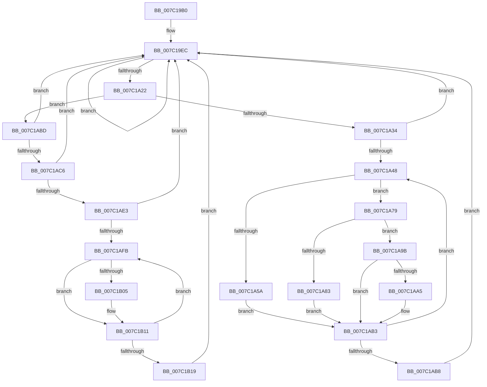

# EtwpCovSampCaptureWorkerThread

- RVA: `0x007C19B0`–`0x007C1B1E` (길이 `366` bytes)
- VA: `0x00000001407C19B0`
- 실행 섹션: `PAGE`
- PDB 이름 있음: `예`; PDB Function 태그: `아니요`
- unwind 정보 RVA: `0x000D3F1C`
- 디코드: `91`개 명령, `366/366` bytes 표시
- 미해석 바이트: `0` (있으면 어셈블리에 `.byte`로 보존)

> 이 문서는 커널 이미지의 기계어와 PDB 기호를 분석해 생성했습니다. 4번과 5번은 함수 원형과 자료형을 바이너리 사용 방식에서 추정한 C 해석이며 원본 소스 복구 결과는 아닙니다.

## 1. Dependencies

- 직접 호출 지점: **9**; 고유 호출 대상: **9**
- 직접 호출자로 확인된 함수: **0**
- RIP 상대 이미지 참조: **0**

### Outgoing calls
- `0x007C1A16` → [KeWaitForMultipleObjects](../../text/20/KeWaitForMultipleObjects_function_0020D110.md) (function, `0x0020D110`)
- `0x007C1A27` → [KeResetEvent](../../text/24/KeResetEvent_function_00248350.md) (function, `0x00248350`)
- `0x007C1A3B` → [ExpInterlockedFlushSList](../../text/6B/ExpInterlockedFlushSList_function_006BA5F0.md) (function, `0x006BA5F0`)
- `0x007C1A60` → [EtwpCovSampSampleBufferProcess](../8D/EtwpCovSampSampleBufferProcess_function_008D96EC.md) (function, `0x008D96EC`)
- `0x007C1A72` → [EtwpCovSampCaptureReleaseToLookaside](../../text/43/EtwpCovSampCaptureReleaseToLookaside_function_0043C630.md) (function, `0x0043C630`)
- `0x007C1A89` → [EtwpCovSampCaptureBufferProcess](../8D/EtwpCovSampCaptureBufferProcess_function_008D71C0.md) (function, `0x008D71C0`)
- `0x007C1A94` → [EtwpCovSampCaptureBufferRelease](../../text/43/EtwpCovSampCaptureBufferRelease_function_0043C4B4.md) (function, `0x0043C4B4`)
- `0x007C1AAE` → [KeSetEvent](../../text/33/KeSetEvent_function_0033F310.md) (function, `0x0033F310`)
- `0x007C1B0C` → [EtwpCovSampLookasideGrow](../../text/65/EtwpCovSampLookasideGrow_function_0065410C.md) (function, `0x0065410C`)

### Direct callers
- 이 함수 시작 RVA로 연결되는 직접 call은 확인되지 않았습니다. 간접 호출은 완전히 역산할 수 없습니다.

### Static image references
- 디코드된 RIP-relative 메모리 참조가 없습니다.

## 2. Other-region calls and transfers

- 다른 실행 섹션으로 향하는 call: **7**
  - `0x007C1A16` → [KeWaitForMultipleObjects](../../text/20/KeWaitForMultipleObjects_function_0020D110.md) (`PAGE` → `.text`)
  - `0x007C1A27` → [KeResetEvent](../../text/24/KeResetEvent_function_00248350.md) (`PAGE` → `.text`)
  - `0x007C1A3B` → [ExpInterlockedFlushSList](../../text/6B/ExpInterlockedFlushSList_function_006BA5F0.md) (`PAGE` → `.text`)
  - `0x007C1A72` → [EtwpCovSampCaptureReleaseToLookaside](../../text/43/EtwpCovSampCaptureReleaseToLookaside_function_0043C630.md) (`PAGE` → `.text`)
  - `0x007C1A94` → [EtwpCovSampCaptureBufferRelease](../../text/43/EtwpCovSampCaptureBufferRelease_function_0043C4B4.md) (`PAGE` → `.text`)
  - `0x007C1AAE` → [KeSetEvent](../../text/33/KeSetEvent_function_0033F310.md) (`PAGE` → `.text`)
  - `0x007C1B0C` → [EtwpCovSampLookasideGrow](../../text/65/EtwpCovSampLookasideGrow_function_0065410C.md) (`PAGE` → `.text`)
- 별도 외부 분기/꼬리 이동을 확인하지 못했습니다.

## 3. Assembly (complete function range)

```asm
007C19B0  4C 8B DC                        mov r11, rsp
007C19B3  49 89 5B 08                     mov qword ptr [r11 + 8], rbx
007C19B7  49 89 6B 10                     mov qword ptr [r11 + 0x10], rbp
007C19BB  49 89 73 18                     mov qword ptr [r11 + 0x18], rsi
007C19BF  49 89 7B 20                     mov qword ptr [r11 + 0x20], rdi
007C19C3  41 56                           push r14
007C19C5  48 81 EC B0 00 00 00            sub rsp, 0xb0
007C19CC  48 8D 81 50 04 00 00            lea rax, [rcx + 0x450]
007C19D3  48 8B D9                        mov rbx, rcx
007C19D6  49 89 43 88                     mov qword ptr [r11 - 0x78], rax
007C19DA  4C 8D B1 B0 03 00 00            lea r14, [rcx + 0x3b0]
007C19E1  48 8D 81 10 04 00 00            lea rax, [rcx + 0x410]
007C19E8  49 89 43 90                     mov qword ptr [r11 - 0x70], rax
007C19EC  45 33 C9                        xor r9d, r9d
007C19EF  48 8D 44 24 50                  lea rax, [rsp + 0x50]
007C19F4  48 89 44 24 38                  mov qword ptr [rsp + 0x38], rax
007C19F9  48 8D 54 24 40                  lea rdx, [rsp + 0x40]
007C19FE  48 83 64 24 30 00               and qword ptr [rsp + 0x30], 0
007C1A04  C6 44 24 28 00                  mov byte ptr [rsp + 0x28], 0
007C1A09  45 8D 41 01                     lea r8d, [r9 + 1]
007C1A0D  C6 44 24 20 00                  mov byte ptr [rsp + 0x20], 0
007C1A12  41 8D 49 02                     lea ecx, [r9 + 2]
007C1A16  E8 F5 B6 A4 FF                  call 0x14020d110
007C1A1B  8B F8                           mov edi, eax
007C1A1D  83 F8 02                        cmp eax, 2
007C1A20  73 CA                           jae 0x1407c19ec
007C1A22  48 8B 4C FC 40                  mov rcx, qword ptr [rsp + rdi*8 + 0x40]
007C1A27  E8 24 69 A8 FF                  call 0x140248350
007C1A2C  85 FF                           test edi, edi
007C1A2E  0F 85 89 00 00 00               jne 0x1407c1abd
007C1A34  48 8D 8B 40 04 00 00            lea rcx, [rbx + 0x440]
007C1A3B  E8 B0 8B EF FF                  call 0x1406ba5f0
007C1A40  48 8B F8                        mov rdi, rax
007C1A43  48 85 C0                        test rax, rax
007C1A46  74 A4                           je 0x1407c19ec
007C1A48  48 8B F7                        mov rsi, rdi
007C1A4B  48 8B 3F                        mov rdi, qword ptr [rdi]
007C1A4E  48 8B 46 10                     mov rax, qword ptr [rsi + 0x10]
007C1A52  48 3D FA B0 01 50               cmp rax, 0x5001b0fa
007C1A58  75 1F                           jne 0x1407c1a79
007C1A5A  48 8B D6                        mov rdx, rsi
007C1A5D  48 8B CB                        mov rcx, rbx
007C1A60  E8 87 7C 11 00                  call 0x1408d96ec
007C1A65  48 8D 93 70 03 00 00            lea rdx, [rbx + 0x370]
007C1A6C  4C 8B C6                        mov r8, rsi
007C1A6F  48 8B CB                        mov rcx, rbx
007C1A72  E8 B9 AB C7 FF                  call 0x14043c630
007C1A77  EB 3A                           jmp 0x1407c1ab3
007C1A79  B9 FF B0 BB CA                  mov ecx, 0xcabbb0ff
007C1A7E  48 3B C1                        cmp rax, rcx
007C1A81  75 18                           jne 0x1407c1a9b
007C1A83  48 8B D6                        mov rdx, rsi
007C1A86  48 8B CB                        mov rcx, rbx
007C1A89  E8 32 57 11 00                  call 0x1408d71c0
007C1A8E  48 8B D6                        mov rdx, rsi
007C1A91  48 8B CB                        mov rcx, rbx
007C1A94  E8 1B AA C7 FF                  call 0x14043c4b4
007C1A99  EB 18                           jmp 0x1407c1ab3
007C1A9B  B9 FA BF A5 F1                  mov ecx, 0xf1a5bffa
007C1AA0  48 3B C1                        cmp rax, rcx
007C1AA3  75 0E                           jne 0x1407c1ab3
007C1AA5  48 8D 4E 30                     lea rcx, [rsi + 0x30]
007C1AA9  45 33 C0                        xor r8d, r8d
007C1AAC  33 D2                           xor edx, edx
007C1AAE  E8 5D D8 B7 FF                  call 0x14033f310
007C1AB3  48 85 FF                        test rdi, rdi
007C1AB6  75 90                           jne 0x1407c1a48
007C1AB8  E9 2F FF FF FF                  jmp 0x1407c19ec
007C1ABD  83 FF 01                        cmp edi, 1
007C1AC0  0F 85 26 FF FF FF               jne 0x1407c19ec
007C1AC6  48 B9 20 03 00 00 80 F7 FF FF   movabs rcx, 0xfffff78000000320
007C1AD0  8B 09                           mov ecx, dword ptr [rcx]
007C1AD2  8B C1                           mov eax, ecx
007C1AD4  2B 83 28 04 00 00               sub eax, dword ptr [rbx + 0x428]
007C1ADA  83 F8 40                        cmp eax, 0x40
007C1ADD  0F 82 09 FF FF FF               jb 0x1407c19ec
007C1AE3  89 8B 28 04 00 00               mov dword ptr [rbx + 0x428], ecx
007C1AE9  89 8B 2C 04 00 00               mov dword ptr [rbx + 0x42c], ecx
007C1AEF  49 8B 3E                        mov rdi, qword ptr [r14]
007C1AF2  49 3B FE                        cmp rdi, r14
007C1AF5  0F 84 F1 FE FF FF               je 0x1407c19ec
007C1AFB  48 8D 57 F0                     lea rdx, [rdi - 0x10]
007C1AFF  83 7A 30 00                     cmp dword ptr [rdx + 0x30], 0
007C1B03  74 0C                           je 0x1407c1b11
007C1B05  83 62 30 00                     and dword ptr [rdx + 0x30], 0
007C1B09  48 8B CB                        mov rcx, rbx
007C1B0C  E8 FB 25 E9 FF                  call 0x14065410c
007C1B11  48 8B 3F                        mov rdi, qword ptr [rdi]
007C1B14  49 3B FE                        cmp rdi, r14
007C1B17  75 E2                           jne 0x1407c1afb
007C1B19  E9 CE FE FF FF                  jmp 0x1407c19ec
```

## 4. C-style interpretation (structured pseudocode)

```c
__int64 __fastcall EtwpCovSampCaptureWorkerThread(__int64 a1, __int64 a2, __int64 a3, int a4)
{
    __int64 result;
    __int64 v_rsp;
    unsigned __int64 v_stack_m68;
    unsigned __int64 v_stack_m78;
    unsigned __int64 v_stack_m80;
    unsigned __int64 v_stack_m88;
    unsigned __int8 v_stack_m90;
    unsigned __int8 v_stack_m98;

    *(unsigned __int64 *)(v_rsp + 8) = v_rbx;
    *(unsigned __int64 *)(v_rsp + 16) = v_rbp;
    *(unsigned __int64 *)(v_rsp + 24) = v_rsi;
    *(unsigned __int64 *)(v_rsp + 32) = v_rdi;
    v_rsp = (v_rsp) - (176);
    *(unsigned __int64 *)(v_rsp - 120) = a1 + 1104;
    *(unsigned __int64 *)(v_rsp - 112) = a1 + 1040;
loc_007C19EC:
    a4 = 0;
    v_stack_m80 = v_stack_m68;
    v_stack_m90 = 0;
    v_stack_m98 = 0;
    result = KeWaitForMultipleObjects(a4 + 2, v_stack_m78, a4 + 1, a4);
    if (((unsigned int)(result)) >= 2) goto loc_007C19EC;
    result = KeResetEvent(*(unsigned __int64 *)(v_rsp + (unsigned int)((unsigned int)(result)) * 8 + 64), v_stack_m78, a4 + 1, a4);
    if ((unsigned int)((unsigned int)((unsigned int)(result))) != 0) goto loc_007C1ABD;
    result = ExpInterlockedFlushSList(a1 + 1088, v_stack_m78, a4 + 1, a4);
    if (result == 0) goto loc_007C19EC;
loc_007C1A48:
    if ((*(unsigned __int64 *)(result + 16)) != 0x5001B0FAULL) goto loc_007C1A79;
    result = EtwpCovSampSampleBufferProcess(a1, result, a4 + 1, a4);
    result = EtwpCovSampCaptureReleaseToLookaside(a1, a1 + 880, result, a4);
    goto loc_007C1AB3;
loc_007C1A79:
    if (result != ((unsigned int)(0xCABBB0FFULL))) goto loc_007C1A9B;
    result = EtwpCovSampCaptureBufferProcess(a1, result, result, a4);
    result = EtwpCovSampCaptureBufferRelease(a1, result, result, a4);
    goto loc_007C1AB3;
loc_007C1A9B:
    if (result == ((unsigned int)(0xF1A5BFFAULL))) {
        a1 = result + 48;
        a3 = 0;
        a2 = 0;
        result = KeSetEvent(a1, a2, a3, a4);
    }
    if (*(unsigned __int64 *)(result) != 0) goto loc_007C1A48;
    goto loc_007C19EC;
loc_007C1ABD:
    if (((unsigned int)(*(unsigned __int64 *)(result))) != 1) goto loc_007C19EC;
    result = (unsigned int)(((unsigned int)((unsigned int)((unsigned int)(*(unsigned int *)(a1))))) - (*(unsigned int *)(a1 + 1064)));
    if (((unsigned int)(result)) < 64) goto loc_007C19EC;
    *(unsigned int *)(a1 + 1064) = (unsigned int)((unsigned int)(*(unsigned int *)(a1)));
    *(unsigned int *)(a1 + 1068) = (unsigned int)((unsigned int)(*(unsigned int *)(a1)));
    if ((*(unsigned __int64 *)(a1 + 944)) == (a1 + 944)) goto loc_007C19EC;
loc_007C1AFB:
    if ((*(unsigned int *)(*(unsigned __int64 *)(a1 + 944) - 16 + 48)) != 0) {
        a1 = a1;
        result = EtwpCovSampLookasideGrow(a1, *(unsigned __int64 *)(a1 + 944) - 16, a3, a4);
    }
    if ((*(unsigned __int64 *)(*(unsigned __int64 *)(a1 + 944))) != (a1 + 944)) goto loc_007C1AFB;
    goto loc_007C19EC;
}
```

## 5. (Beta) C Style

```c
int64_t EtwpCovSampCaptureWorkerThread(void *Arg1, int64_t Arg2, int64_t Arg3, int32_t Arg4)
{
    uint8_t *arg1 = (uint8_t *)Arg1;

    int64_t result;
    int64_t local_rsp;
    uint64_t v_stack_m68;
    uint64_t v_stack_m78;
    uint64_t v_stack_m80;
    uint64_t v_stack_m88;
    uint8_t v_stack_m90;
    uint8_t v_stack_m98;

    *(uint64_t *)(local_rsp + 0x8) = local_rbx;
    *(uint64_t *)(local_rsp + 0x10) = local_rbp;
    *(uint64_t *)(local_rsp + 0x18) = local_rsi;
    *(uint64_t *)(local_rsp + 0x20) = local_rdi;
    local_rsp = (local_rsp) - (176);
    *(void **)(local_rsp - 0x78) = Arg1 + 1104;
    *(void **)(local_rsp - 0x70) = Arg1 + 1040;
loc_007C19EC:
    Arg4 = 0;
    v_stack_m80 = v_stack_m68;
    v_stack_m90 = 0;
    v_stack_m98 = 0;
    result = KeWaitForMultipleObjects(Arg4 + 2, v_stack_m78, Arg4 + 1, Arg4);
    if (((uint32_t)(result)) >= 2) goto loc_007C19EC;
    result = KeResetEvent(*(uint64_t *)(local_rsp + (uint32_t)((uint32_t)(result)) * 8 + 0x40), v_stack_m78, Arg4 + 1, Arg4);
    if ((uint32_t)((uint32_t)((uint32_t)(result))) != 0) goto loc_007C1ABD;
    result = ExpInterlockedFlushSList(Arg1 + 1088, v_stack_m78, Arg4 + 1, Arg4);
    if (result == 0) goto loc_007C19EC;
loc_007C1A48:
    if ((*(uint64_t *)(result + 0x10)) != 0x5001B0FAULL) goto loc_007C1A79;
    result = EtwpCovSampSampleBufferProcess(Arg1, result, Arg4 + 1, Arg4);
    result = EtwpCovSampCaptureReleaseToLookaside(Arg1, Arg1 + 880, result, Arg4);
    goto loc_007C1AB3;
loc_007C1A79:
    if (result != ((uint32_t)(0xCABBB0FFULL))) goto loc_007C1A9B;
    result = EtwpCovSampCaptureBufferProcess(Arg1, result, result, Arg4);
    result = EtwpCovSampCaptureBufferRelease(Arg1, result, result, Arg4);
    goto loc_007C1AB3;
loc_007C1A9B:
    if (result == ((uint32_t)(0xF1A5BFFAULL))) {
        Arg1 = result + 48;
        Arg3 = 0;
        Arg2 = 0;
        result = KeSetEvent(Arg1, Arg2, Arg3, Arg4);
    }
    if (*(uint64_t *)(result) != 0) goto loc_007C1A48;
    goto loc_007C19EC;
loc_007C1ABD:
    if (((uint32_t)(*(uint64_t *)(result))) != 1) goto loc_007C19EC;
    result = (uint32_t)(((uint32_t)((uint32_t)((uint32_t)(*(uint32_t *)(arg1))))) - (*(uint32_t *)(arg1 + 0x428)));
    if (((uint32_t)(result)) < 64) goto loc_007C19EC;
    *(uint32_t *)(arg1 + 0x428) = (uint32_t)((uint32_t)(*(uint32_t *)(arg1)));
    *(uint32_t *)(arg1 + 0x42C) = (uint32_t)((uint32_t)(*(uint32_t *)(arg1)));
    if ((*(uint64_t *)(arg1 + 0x3B0)) == (Arg1 + 944)) goto loc_007C19EC;
loc_007C1AFB:
    if ((*(uint32_t *)(*(uint64_t *)(arg1 + 0x3B0) - 0x10 + 0x30)) != 0) {
        Arg1 = Arg1;
        result = EtwpCovSampLookasideGrow(Arg1, *(uint64_t *)(arg1 + 0x3B0) - 16, Arg3, Arg4);
    }
    if ((*(uint64_t *)(*(uint64_t *)(arg1 + 0x3B0))) != (Arg1 + 944)) goto loc_007C1AFB;
    goto loc_007C19EC;
}
```

### 관측된 메모리 오프셋

구조체 형식이 확인되지 않은 접근은 인자 기준의 오프셋으로만 기록했습니다.

| 기준 인자 | 오프셋 표현 | 폭 (bit) | 접근 |
|---|---:|---:|---|
| `Arg1` | `+ 0x0` | `64` | `R` |
| `Arg1` | `+ 0x370` | `64` | `R` |
| `Arg1` | `+ 0x3B0` | `64` | `R` |
| `Arg1` | `+ 0x410` | `64` | `R` |
| `Arg1` | `+ 0x428` | `32` | `R` |
| `Arg1` | `+ 0x428` | `32` | `W` |
| `Arg1` | `+ 0x42C` | `32` | `W` |
| `Arg1` | `+ 0x440` | `64` | `R` |
| `Arg1` | `+ 0x450` | `64` | `R` |

## 6. Execution-region graph

[열기: 2D/3D 그래프와 함수 탐색 컨트롤 패널](../../../control-panel.html?section=page&rva=0x007C19B0&view=graph)

- 2D 그래프는 위에서 아래로 흐르고, 3D 그래프는 빈 공간을 드래그해 회전합니다. Shift+드래그는 이동, 휠은 확대·축소, 함수 노드 선택은 대상 보고서 이동입니다.

### Static fallback


