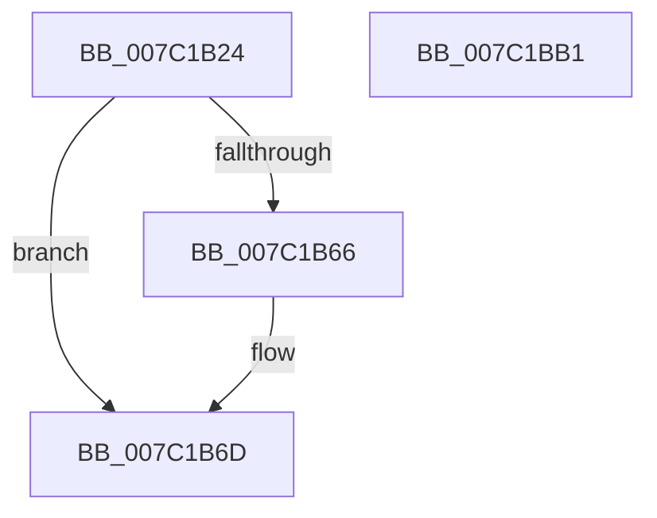

# EtwpCovSampLookasideControlInitialize

- RVA: `0x007C1B24`–`0x007C1BB2` (길이 `142` bytes)
- VA: `0x00000001407C1B24`
- 실행 섹션: `PAGE`
- PDB 이름 있음: `예`; PDB Function 태그: `아니요`
- unwind 정보 RVA: `0x0005C954`
- 디코드: `40`개 명령, `142/142` bytes 표시
- 미해석 바이트: `0` (있으면 어셈블리에 `.byte`로 보존)

> 이 문서는 커널 이미지의 기계어와 PDB 기호를 분석해 생성했습니다. 4번과 5번은 함수 원형과 자료형을 바이너리 사용 방식에서 추정한 C 해석이며 원본 소스 복구 결과는 아닙니다.

## 1. Dependencies

- 직접 호출 지점: **2**; 고유 호출 대상: **2**
- 직접 호출자로 확인된 함수: **1**
- RIP 상대 이미지 참조: **0**

### Outgoing calls
- `0x007C1B4D` → [memset](../../text/6C/memset_function_006C6C40.md) (function, `0x006C6C40`)
- `0x007C1B7E` → [InitializeSListHead](../../text/46/InitializeSListHead_function_00468A90.md) (function, `0x00468A90`)

### Direct callers
- [EtwpCovSampCaptureContextStart](EtwpCovSampCaptureContextStart_function_007C14AC.md) at `0x007C1603`
- [EtwpCovSampCaptureContextStart](EtwpCovSampCaptureContextStart_function_007C14AC.md) at `0x007C162B`
- [EtwpCovSampCaptureContextStart](EtwpCovSampCaptureContextStart_function_007C14AC.md) at `0x007C18A3`

### Static image references
- 디코드된 RIP-relative 메모리 참조가 없습니다.

## 2. Other-region calls and transfers

- 다른 실행 섹션으로 향하는 call: **2**
  - `0x007C1B4D` → [memset](../../text/6C/memset_function_006C6C40.md) (`PAGE` → `.text`)
  - `0x007C1B7E` → [InitializeSListHead](../../text/46/InitializeSListHead_function_00468A90.md) (`PAGE` → `.text`)
- 별도 외부 분기/꼬리 이동을 확인하지 못했습니다.

## 3. Assembly (complete function range)

```asm
007C1B24  48 89 5C 24 08                  mov qword ptr [rsp + 8], rbx
007C1B29  48 89 6C 24 10                  mov qword ptr [rsp + 0x10], rbp
007C1B2E  48 89 74 24 18                  mov qword ptr [rsp + 0x18], rsi
007C1B33  57                              push rdi
007C1B34  48 83 EC 20                     sub rsp, 0x20
007C1B38  48 8B FA                        mov rdi, rdx
007C1B3B  49 8B E8                        mov rbp, r8
007C1B3E  33 D2                           xor edx, edx
007C1B40  48 8B D9                        mov rbx, rcx
007C1B43  48 8B CF                        mov rcx, rdi
007C1B46  41 8B F1                        mov esi, r9d
007C1B49  44 8D 42 50                     lea r8d, [rdx + 0x50]
007C1B4D  E8 EE 50 F0 FF                  call 0x1406c6c40
007C1B52  48 81 C3 C0 03 00 00            add rbx, 0x3c0
007C1B59  48 8D 47 10                     lea rax, [rdi + 0x10]
007C1B5D  48 8B 4B 08                     mov rcx, qword ptr [rbx + 8]
007C1B61  48 39 19                        cmp qword ptr [rcx], rbx
007C1B64  74 07                           je 0x1407c1b6d
007C1B66  B9 03 00 00 00                  mov ecx, 3
007C1B6B  CD 29                           int 0x29
007C1B6D  48 89 48 08                     mov qword ptr [rax + 8], rcx
007C1B71  48 89 18                        mov qword ptr [rax], rbx
007C1B74  48 89 01                        mov qword ptr [rcx], rax
007C1B77  48 8B CF                        mov rcx, rdi
007C1B7A  48 89 43 08                     mov qword ptr [rbx + 8], rax
007C1B7E  E8 0D 6F CA FF                  call 0x140468a90
007C1B83  48 8B 5C 24 30                  mov rbx, qword ptr [rsp + 0x30]
007C1B88  48 8D 47 20                     lea rax, [rdi + 0x20]
007C1B8C  48 89 40 08                     mov qword ptr [rax + 8], rax
007C1B90  48 89 00                        mov qword ptr [rax], rax
007C1B93  8B 44 24 50                     mov eax, dword ptr [rsp + 0x50]
007C1B97  48 89 6F 30                     mov qword ptr [rdi + 0x30], rbp
007C1B9B  48 8B 6C 24 38                  mov rbp, qword ptr [rsp + 0x38]
007C1BA0  89 77 38                        mov dword ptr [rdi + 0x38], esi
007C1BA3  48 8B 74 24 40                  mov rsi, qword ptr [rsp + 0x40]
007C1BA8  89 47 3C                        mov dword ptr [rdi + 0x3c], eax
007C1BAB  48 83 C4 20                     add rsp, 0x20
007C1BAF  5F                              pop rdi
007C1BB0  C3                              ret
007C1BB1  CC                              int3
```

## 4. C-style interpretation (structured pseudocode)

```c
__int64 __fastcall EtwpCovSampLookasideControlInitialize(__int64 a1, __int64 a2, __int64 a3, int a4, unsigned int a5)
{
    __int64 result;
    __int64 v_rbx;
    __int64 v_rsp;
    unsigned __int64 v_stack_p10;
    unsigned __int64 v_stack_p18;
    unsigned __int64 v_stack_p8;

    v_stack_p8 = v_rbx;
    v_stack_p10 = v_rbp;
    v_stack_p18 = v_rsi;
    v_rsp = (v_rsp) - (32);
    a2 = 0;
    result = memset(0, a2, a2 + 80, a4);
    v_rbx = (a1) + (960);
    if ((*(unsigned __int64 *)(*(unsigned __int64 *)(v_rbx + 8))) != v_rbx) {
        a1 = 3;
    }
    *(unsigned __int64 *)(a2 + 16 + 8) = a1;
    *(unsigned __int64 *)(a2 + 16) = v_rbx;
    *(unsigned __int64 *)(a1) = a2 + 16;
    *(unsigned __int64 *)(v_rbx + 8) = a2 + 16;
    result = InitializeSListHead(0, a2, a2 + 80, a4);
    *(unsigned __int64 *)(a2 + 32 + 8) = a2 + 32;
    *(unsigned __int64 *)(a2 + 32) = a2 + 32;
    *(unsigned __int64 *)(a2 + 48) = a3;
    *(unsigned int *)(a2 + 56) = (unsigned int)((unsigned int)(a4));
    *(unsigned int *)(a2 + 60) = (unsigned int)((unsigned int)(a5));
    v_rsp = (v_rsp) + (32);
    return (unsigned int)(a5);
}
```

## 5. (Beta) C Style

```c
int64_t EtwpCovSampLookasideControlInitialize(void *Arg1, void *Arg2, int64_t Arg3, int32_t Arg4, uint32_t Arg5)
{
    uint8_t *arg1 = (uint8_t *)Arg1;
    uint8_t *arg2 = (uint8_t *)Arg2;

    int64_t result;
    int64_t local_rbx;
    int64_t local_rsp;
    uint64_t v_stack_p10;
    uint64_t v_stack_p18;
    uint64_t v_stack_p8;

    v_stack_p8 = local_rbx;
    v_stack_p10 = local_rbp;
    v_stack_p18 = local_rsi;
    local_rsp = (local_rsp) - (32);
    Arg2 = 0;
    result = memset(0, Arg2, Arg2 + 80, Arg4);
    local_rbx = (Arg1) + (960);
    if ((*(uint64_t *)(*(uint64_t *)(local_rbx + 0x8))) != local_rbx) {
        Arg1 = 3;
    }
    *(void **)(arg2 + 0x10 + 0x8) = Arg1;
    *(uint64_t *)(arg2 + 0x10) = local_rbx;
    *(void **)(arg1) = Arg2 + 16;
    *(void **)(local_rbx + 0x8) = Arg2 + 16;
    result = InitializeSListHead(0, Arg2, Arg2 + 80, Arg4);
    *(void **)(arg2 + 0x20 + 0x8) = Arg2 + 32;
    *(void **)(arg2 + 0x20) = Arg2 + 32;
    *(uint64_t *)(arg2 + 0x30) = Arg3;
    *(uint32_t *)(arg2 + 0x38) = (uint32_t)((uint32_t)(Arg4));
    *(uint32_t *)(arg2 + 0x3C) = (uint32_t)((uint32_t)(Arg5));
    local_rsp = (local_rsp) + (32);
    return (uint32_t)(Arg5);
}
```

### 관측된 메모리 오프셋

구조체 형식이 확인되지 않은 접근은 인자 기준의 오프셋으로만 기록했습니다.

| 기준 인자 | 오프셋 표현 | 폭 (bit) | 접근 |
|---|---:|---:|---|
| `Arg1` | `+ 0x8` | `64` | `R` |
| `Arg1` | `+ 0x8` | `64` | `W` |
| `Arg2` | `+ 0x0` | `64` | `W` |
| `Arg2` | `+ 0x8` | `64` | `W` |
| `Arg2` | `+ 0x10` | `64` | `R` |
| `Arg2` | `+ 0x20` | `64` | `R` |
| `Arg2` | `+ 0x30` | `64` | `W` |
| `Arg2` | `+ 0x38` | `32` | `W` |
| `Arg2` | `+ 0x3C` | `32` | `W` |

## 6. Execution-region graph

[열기: 2D/3D 그래프와 함수 탐색 컨트롤 패널](../../../control-panel.html?section=page&rva=0x007C1B24&view=graph)

- 2D 그래프는 위에서 아래로 흐르고, 3D 그래프는 빈 공간을 드래그해 회전합니다. Shift+드래그는 이동, 휠은 확대·축소, 함수 노드 선택은 대상 보고서 이동입니다.

### Static fallback


