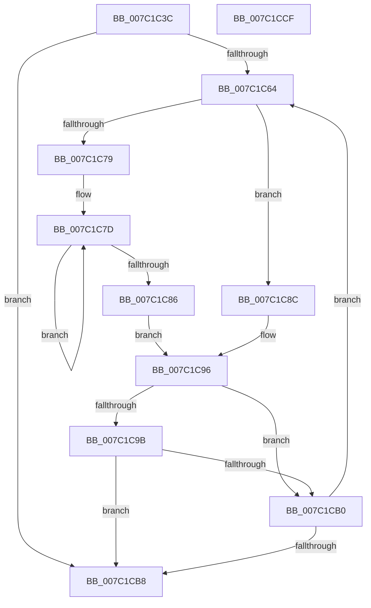

# EtwpCovSampSplitSegments

- RVA: `0x007C1C3C`–`0x007C1CD0` (길이 `148` bytes)
- VA: `0x00000001407C1C3C`
- 실행 섹션: `PAGE`
- PDB 이름 있음: `예`; PDB Function 태그: `아니요`
- unwind 정보 RVA: `0x0005C954`
- 디코드: `47`개 명령, `148/148` bytes 표시
- 미해석 바이트: `0` (있으면 어셈블리에 `.byte`로 보존)

> 이 문서는 커널 이미지의 기계어와 PDB 기호를 분석해 생성했습니다. 4번과 5번은 함수 원형과 자료형을 바이너리 사용 방식에서 추정한 C 해석이며 원본 소스 복구 결과는 아닙니다.

## 1. Dependencies

- 직접 호출 지점: **2**; 고유 호출 대상: **2**
- 직접 호출자로 확인된 함수: **1**
- RIP 상대 이미지 참조: **0**

### Outgoing calls
- `0x007C1C56` → [wcslwr](../../text/50/wcslwr_function_005000E0.md) (function, `0x005000E0`)
- `0x007C1C6C` → [wcschr](../../text/50/wcschr_function_00501A60.md) (function, `0x00501A60`)

### Direct callers
- [EtwpSetCoverageSamplerInformation](EtwpSetCoverageSamplerInformation_function_007C288C.md) at `0x007C2E94`
- [EtwpSetCoverageSamplerInformation](EtwpSetCoverageSamplerInformation_function_007C288C.md) at `0x007C2EAA`

### Static image references
- 디코드된 RIP-relative 메모리 참조가 없습니다.

## 2. Other-region calls and transfers

- 다른 실행 섹션으로 향하는 call: **2**
  - `0x007C1C56` → [wcslwr](../../text/50/wcslwr_function_005000E0.md) (`PAGE` → `.text`)
  - `0x007C1C6C` → [wcschr](../../text/50/wcschr_function_00501A60.md) (`PAGE` → `.text`)
- 별도 외부 분기/꼬리 이동을 확인하지 못했습니다.

## 3. Assembly (complete function range)

```asm
007C1C3C  48 89 5C 24 08                  mov qword ptr [rsp + 8], rbx
007C1C41  48 89 6C 24 10                  mov qword ptr [rsp + 0x10], rbp
007C1C46  48 89 74 24 18                  mov qword ptr [rsp + 0x18], rsi
007C1C4B  57                              push rdi
007C1C4C  48 83 EC 20                     sub rsp, 0x20
007C1C50  48 8B F2                        mov rsi, rdx
007C1C53  48 8B D9                        mov rbx, rcx
007C1C56  E8 85 E4 D3 FF                  call 0x1405000e0
007C1C5B  33 ED                           xor ebp, ebp
007C1C5D  8B FD                           mov edi, ebp
007C1C5F  66 39 2B                        cmp word ptr [rbx], bp
007C1C62  74 54                           je 0x1407c1cb8
007C1C64  BA 3A 00 00 00                  mov edx, 0x3a
007C1C69  48 8B CB                        mov rcx, rbx
007C1C6C  E8 EF FD D3 FF                  call 0x140501a60
007C1C71  48 8B D0                        mov rdx, rax
007C1C74  48 85 C0                        test rax, rax
007C1C77  75 13                           jne 0x1407c1c8c
007C1C79  48 83 C8 FF                     or rax, 0xffffffffffffffff
007C1C7D  48 FF C0                        inc rax
007C1C80  66 39 2C 43                     cmp word ptr [rbx + rax*2], bp
007C1C84  75 F7                           jne 0x1407c1c7d
007C1C86  48 8D 14 43                     lea rdx, [rbx + rax*2]
007C1C8A  EB 0A                           jmp 0x1407c1c96
007C1C8C  48 2B C3                        sub rax, rbx
007C1C8F  48 D1 F8                        sar rax, 1
007C1C92  48 83 C2 02                     add rdx, 2
007C1C96  48 85 C0                        test rax, rax
007C1C99  74 15                           je 0x1407c1cb0
007C1C9B  8B CF                           mov ecx, edi
007C1C9D  FF C7                           inc edi
007C1C9F  48 03 C9                        add rcx, rcx
007C1CA2  48 89 1C CE                     mov qword ptr [rsi + rcx*8], rbx
007C1CA6  48 89 44 CE 08                  mov qword ptr [rsi + rcx*8 + 8], rax
007C1CAB  83 FF 0A                        cmp edi, 0xa
007C1CAE  73 08                           jae 0x1407c1cb8
007C1CB0  48 8B DA                        mov rbx, rdx
007C1CB3  66 39 2A                        cmp word ptr [rdx], bp
007C1CB6  75 AC                           jne 0x1407c1c64
007C1CB8  48 8B 5C 24 30                  mov rbx, qword ptr [rsp + 0x30]
007C1CBD  8B C7                           mov eax, edi
007C1CBF  48 8B 6C 24 38                  mov rbp, qword ptr [rsp + 0x38]
007C1CC4  48 8B 74 24 40                  mov rsi, qword ptr [rsp + 0x40]
007C1CC9  48 83 C4 20                     add rsp, 0x20
007C1CCD  5F                              pop rdi
007C1CCE  C3                              ret
007C1CCF  CC                              int3
```

## 4. C-style interpretation (structured pseudocode)

```c
__int64 __fastcall EtwpCovSampSplitSegments(__int64 a1, __int64 a2)
{
    __int64 result;
    __int64 v_rbp;
    __int64 v_rdi;
    __int64 v_rsp;
    unsigned __int64 v_stack_p10;
    unsigned __int64 v_stack_p18;
    unsigned __int64 v_stack_p8;

    v_stack_p8 = v_rbx;
    v_stack_p10 = v_rbp;
    v_stack_p18 = v_rsi;
    v_rsp = (v_rsp) - (32);
    result = wcslwr(a1, a2, a3, a4);
    v_rbp = 0;
    if ((*(unsigned __int16 *)(a1)) == 0) goto loc_007C1CB8;
loc_007C1C64:
    result = wcschr(a1, 58, a3, a4);
    if (result != 0) goto loc_007C1C8C;
    result = (result) | (-1);
loc_007C1C7D:
    result = (result) + 1;
    if ((*(unsigned __int16 *)(a1 + result * 2)) != 0) goto loc_007C1C7D;
    goto loc_007C1C96;
loc_007C1C8C:
    result = (result) - (a1);
    result = (result) >> (1);
    a2 = (a1 + result * 2) + (2);
loc_007C1C96:
    if (result == 0) goto loc_007C1CB0;
    v_rdi = (unsigned int)((0) + 1);
    a1 = (0) + (0);
    *(unsigned __int64 *)(a2 + a1 * 8) = a1;
    *(unsigned __int64 *)(a2 + a1 * 8 + 8) = result;
    if (((unsigned int)(v_rdi)) >= 10) goto loc_007C1CB8;
loc_007C1CB0:
    if ((*(unsigned __int16 *)(a2)) != 0) goto loc_007C1C64;
loc_007C1CB8:
    v_rsp = (v_rsp) + (32);
    return (unsigned int)((unsigned int)(v_rdi));
}
```

## 5. (Beta) C Style

```c
int64_t EtwpCovSampSplitSegments(void *Arg1, void *Arg2)
{
    uint8_t *arg1 = (uint8_t *)Arg1;
    uint8_t *arg2 = (uint8_t *)Arg2;

    int64_t result;
    int64_t local_rbp;
    int64_t local_rdi;
    int64_t local_rsp;
    uint64_t v_stack_p10;
    uint64_t v_stack_p18;
    uint64_t v_stack_p8;

    v_stack_p8 = local_rbx;
    v_stack_p10 = local_rbp;
    v_stack_p18 = local_rsi;
    local_rsp = (local_rsp) - (32);
    result = wcslwr(Arg1, Arg2, a3, a4);
    local_rbp = 0;
    if ((*(uint16_t *)(arg1)) == 0) goto loc_007C1CB8;
loc_007C1C64:
    result = wcschr(Arg1, 58, a3, a4);
    if (result != 0) goto loc_007C1C8C;
    result = (result) | (-1);
loc_007C1C7D:
    result = (result) + 1;
    if ((*(uint16_t *)(arg1 + result * 2)) != 0) goto loc_007C1C7D;
    goto loc_007C1C96;
loc_007C1C8C:
    result = (result) - (Arg1);
    result = (result) >> (1);
    Arg2 = (Arg1 + result * 2) + (2);
loc_007C1C96:
    if (result == 0) goto loc_007C1CB0;
    local_rdi = (uint32_t)((0) + 1);
    Arg1 = (0) + (0);
    *(void **)(arg2 + arg1 * 8) = Arg1;
    *(uint64_t *)(arg2 + arg1 * 8 + 0x8) = result;
    if (((uint32_t)(local_rdi)) >= 10) goto loc_007C1CB8;
loc_007C1CB0:
    if ((*(uint16_t *)(arg2)) != 0) goto loc_007C1C64;
loc_007C1CB8:
    local_rsp = (local_rsp) + (32);
    return (uint32_t)((uint32_t)(local_rdi));
}
```

### 관측된 메모리 오프셋

구조체 형식이 확인되지 않은 접근은 인자 기준의 오프셋으로만 기록했습니다.

| 기준 인자 | 오프셋 표현 | 폭 (bit) | 접근 |
|---|---:|---:|---|
| `Arg1` | `+ 0x0` | `16` | `R` |
| `Arg2` | `+ 0x0 + rcx*8` | `64` | `W` |
| `Arg2` | `+ 0x8 + rcx*8` | `64` | `W` |

## 6. Execution-region graph

[열기: 2D/3D 그래프와 함수 탐색 컨트롤 패널](../../../control-panel.html?section=page&rva=0x007C1C3C&view=graph)

- 2D 그래프는 위에서 아래로 흐르고, 3D 그래프는 빈 공간을 드래그해 회전합니다. Shift+드래그는 이동, 휠은 확대·축소, 함수 노드 선택은 대상 보고서 이동입니다.

### Static fallback


