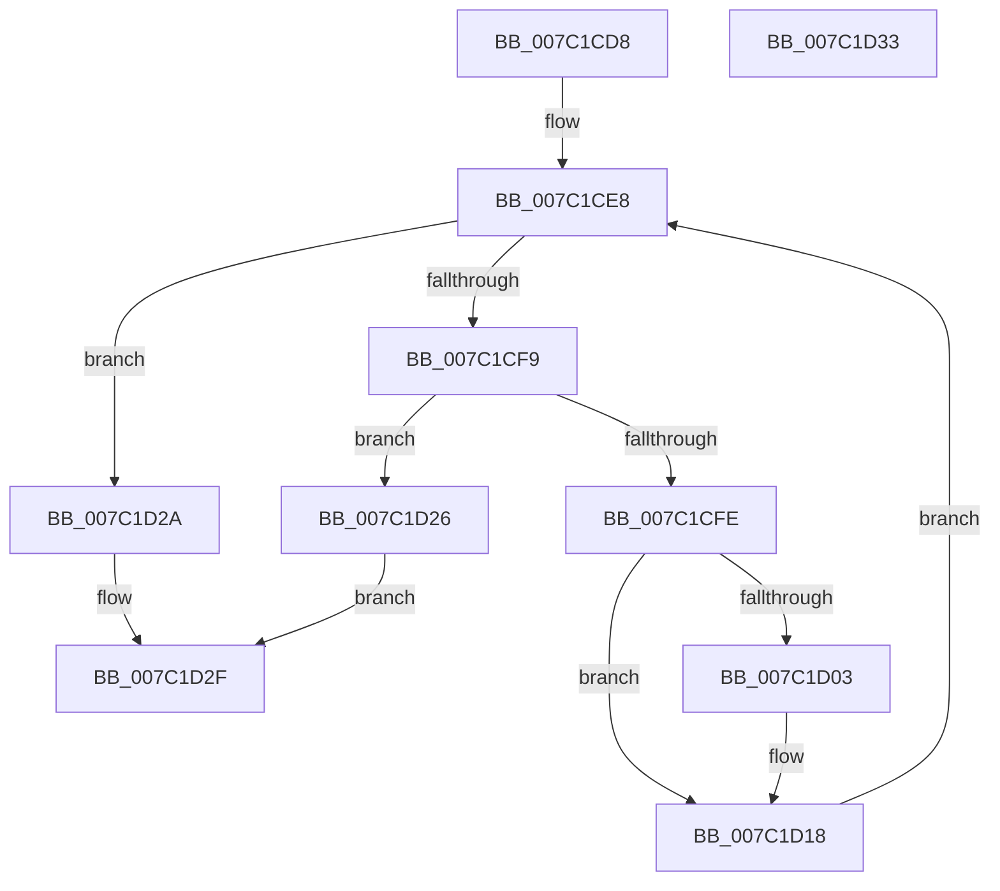

# EtwpCovSampStackHashLookup

- RVA: `0x007C1CD8`–`0x007C1D34` (길이 `92` bytes)
- VA: `0x00000001407C1CD8`
- 실행 섹션: `PAGE`
- PDB 이름 있음: `예`; PDB Function 태그: `아니요`
- unwind 정보 RVA: `0x000DB714`
- 디코드: `32`개 명령, `92/92` bytes 표시
- 미해석 바이트: `0` (있으면 어셈블리에 `.byte`로 보존)

> 이 문서는 커널 이미지의 기계어와 PDB 기호를 분석해 생성했습니다. 4번과 5번은 함수 원형과 자료형을 바이너리 사용 방식에서 추정한 C 해석이며 원본 소스 복구 결과는 아닙니다.

## 1. Dependencies

- 직접 호출 지점: **0**; 고유 호출 대상: **0**
- 직접 호출자로 확인된 함수: **3**
- RIP 상대 이미지 참조: **0**

### Outgoing calls
- 직접 디코드된 call 명령이 없습니다.

### Direct callers
- [sub_00B1BC18](../B1/Unknown_function_00B1BC18.md) at `0x00B1BD82`
- [sub_00B1BC18](../B1/Unknown_function_00B1BC18.md) at `0x00B1BF03`
- [sub_00B1BC18](../B1/Unknown_function_00B1BC18.md) at `0x00B1BF45`
- [sub_00B1BF5E](../B1/Unknown_function_00B1BF5E.md) at `0x00B1C0C3`
- [sub_00B1BF5E](../B1/Unknown_function_00B1BF5E.md) at `0x00B1C263`
- [sub_00B1BF5E](../B1/Unknown_function_00B1BF5E.md) at `0x00B1C2B1`
- [sub_00B49312](../B4/Unknown_function_00B49312.md) at `0x00B4947A`
- [sub_00B49312](../B4/Unknown_function_00B49312.md) at `0x00B4952D`
- [sub_00B49312](../B4/Unknown_function_00B49312.md) at `0x00B49629`

### Static image references
- 디코드된 RIP-relative 메모리 참조가 없습니다.

## 2. Other-region calls and transfers

- 다른 실행 섹션으로 향하는 call: **0**
- 별도 외부 분기/꼬리 이동을 확인하지 못했습니다.

## 3. Assembly (complete function range)

```asm
007C1CD8  44 8B 49 14                     mov r9d, dword ptr [rcx + 0x14]
007C1CDC  45 33 D2                        xor r10d, r10d
007C1CDF  41 FF C9                        dec r9d
007C1CE2  4C 8B D9                        mov r11, rcx
007C1CE5  44 23 CA                        and r9d, edx
007C1CE8  41 8B C9                        mov ecx, r9d
007C1CEB  48 83 C1 06                     add rcx, 6
007C1CEF  49 8D 0C 8B                     lea rcx, [r11 + rcx*4]
007C1CF3  8B 01                           mov eax, dword ptr [rcx]
007C1CF5  3B C2                           cmp eax, edx
007C1CF7  74 31                           je 0x1407c1d2a
007C1CF9  83 39 00                        cmp dword ptr [rcx], 0
007C1CFC  74 28                           je 0x1407c1d26
007C1CFE  45 85 D2                        test r10d, r10d
007C1D01  75 15                           jne 0x1407c1d18
007C1D03  8B C2                           mov eax, edx
007C1D05  B9 B1 79 37 9E                  mov ecx, 0x9e3779b1
007C1D0A  48 0F AF C1                     imul rax, rcx
007C1D0E  A8 01                           test al, 1
007C1D10  44 8D 50 01                     lea r10d, [rax + 1]
007C1D14  44 0F 45 D0                     cmovne r10d, eax
007C1D18  41 8B 43 14                     mov eax, dword ptr [r11 + 0x14]
007C1D1C  45 03 CA                        add r9d, r10d
007C1D1F  FF C8                           dec eax
007C1D21  44 23 C8                        and r9d, eax
007C1D24  EB C2                           jmp 0x1407c1ce8
007C1D26  33 C0                           xor eax, eax
007C1D28  EB 05                           jmp 0x1407c1d2f
007C1D2A  B8 01 00 00 00                  mov eax, 1
007C1D2F  49 89 08                        mov qword ptr [r8], rcx
007C1D32  C3                              ret
007C1D33  CC                              int3
```

## 4. C-style interpretation (structured pseudocode)

```c
__int64 __fastcall EtwpCovSampStackHashLookup(__int64 a1, int a2, __int64 a3)
{
    __int64 result;
    __int64 v_r10;

    v_r10 = 0;
    a4 = (unsigned int)(((unsigned int)(*(unsigned int *)(a1 + 20))) - 1);
    a4 = (unsigned int)((a4) & (a2));
loc_007C1CE8:
    a1 = ((unsigned int)((unsigned int)(a4))) + (6);
    if (((unsigned int)((unsigned int)(*(unsigned int *)(a1 + a1 * 4)))) == a2) goto loc_007C1D2A;
    if ((*(unsigned int *)(a1 + a1 * 4)) == 0) goto loc_007C1D26;
    result = (unsigned int)(*(unsigned int *)(a1 + a1 * 4));
    if (0 == 0) {
        result = a2;
        a1 = 0x9E3779B1ULL;
        result = (result) * (a1);
        v_r10 = result + 1;
        if ((((unsigned __int8)(result)) & (1)) != 0) { v_r10 = (unsigned int)(result); }
    }
    a4 = (unsigned int)((a4) + ((unsigned int)(v_r10)));
    result = (unsigned int)(((unsigned int)(*(unsigned int *)(a1 + 20))) - 1);
    a4 = (unsigned int)((a4) & ((unsigned int)(result)));
    goto loc_007C1CE8;
loc_007C1D26:
    result = 0;
    goto loc_007C1D2F;
loc_007C1D2A:
loc_007C1D2F:
    *(unsigned __int64 *)(a3) = a1;
    return 1;
}
```

## 5. (Beta) C Style

```c
int64_t EtwpCovSampStackHashLookup(void *Arg1, int32_t Arg2, void *Arg3)
{
    uint8_t *arg1 = (uint8_t *)Arg1;
    uint8_t *arg3 = (uint8_t *)Arg3;

    int64_t result;
    int64_t local_r10;

    local_r10 = 0;
    a4 = (uint32_t)(((uint32_t)(*(uint32_t *)(arg1 + 0x14))) - 1);
    a4 = (uint32_t)((a4) & (Arg2));
loc_007C1CE8:
    Arg1 = ((uint32_t)((uint32_t)(a4))) + (6);
    if (((uint32_t)((uint32_t)(*(uint32_t *)(arg1 + arg1 * 4)))) == Arg2) goto loc_007C1D2A;
    if ((*(uint32_t *)(arg1 + arg1 * 4)) == 0) goto loc_007C1D26;
    result = (uint32_t)(*(uint32_t *)(arg1 + arg1 * 4));
    if (0 == 0) {
        result = Arg2;
        Arg1 = 0x9E3779B1ULL;
        result = (result) * (Arg1);
        local_r10 = result + 1;
        if ((((uint8_t)(result)) & (1)) != 0) { local_r10 = (uint32_t)(result); }
    }
    a4 = (uint32_t)((a4) + ((uint32_t)(local_r10)));
    result = (uint32_t)(((uint32_t)(*(uint32_t *)(arg1 + 0x14))) - 1);
    a4 = (uint32_t)((a4) & ((uint32_t)(result)));
    goto loc_007C1CE8;
loc_007C1D26:
    result = 0;
    goto loc_007C1D2F;
loc_007C1D2A:
loc_007C1D2F:
    *(void **)(arg3) = Arg1;
    return 1;
}
```

### 관측된 메모리 오프셋

구조체 형식이 확인되지 않은 접근은 인자 기준의 오프셋으로만 기록했습니다.

| 기준 인자 | 오프셋 표현 | 폭 (bit) | 접근 |
|---|---:|---:|---|
| `Arg1` | `+ 0x0` | `32` | `R` |
| `Arg1` | `+ 0x0 + rcx*4` | `64` | `R` |
| `Arg1` | `+ 0x14` | `32` | `R` |
| `Arg3` | `+ 0x0` | `64` | `W` |

## 6. Execution-region graph

[열기: 2D/3D 그래프와 함수 탐색 컨트롤 패널](../../../control-panel.html?section=page&rva=0x007C1CD8&view=graph)

- 2D 그래프는 위에서 아래로 흐르고, 3D 그래프는 빈 공간을 드래그해 회전합니다. Shift+드래그는 이동, 휠은 확대·축소, 함수 노드 선택은 대상 보고서 이동입니다.

### Static fallback


