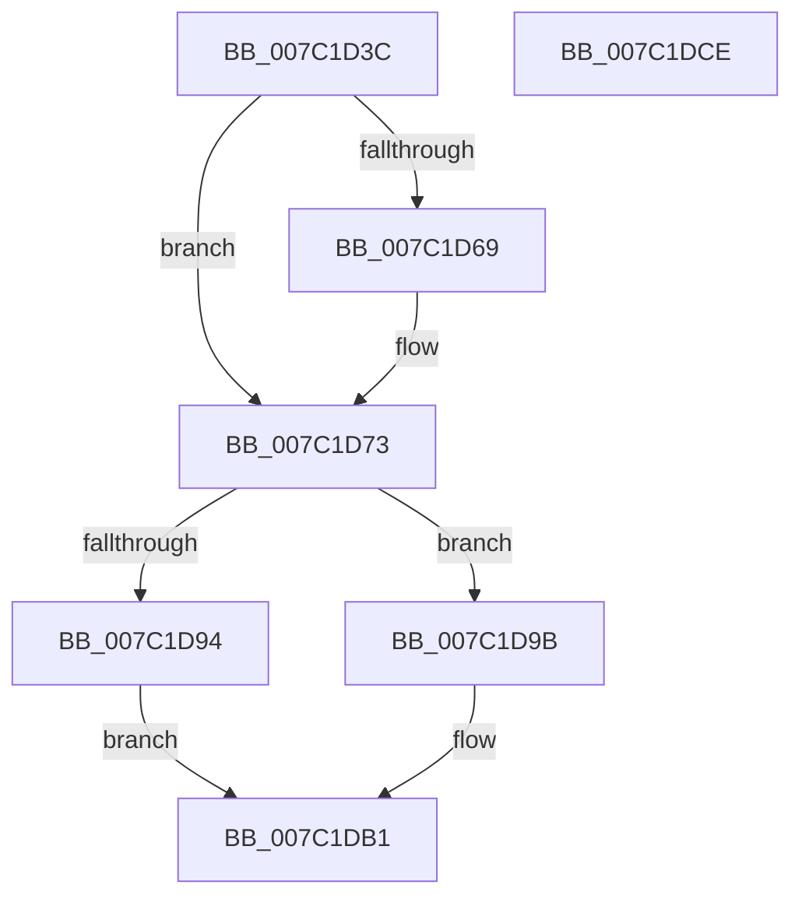

# EtwpCovSampStackHashTableAlloc

- RVA: `0x007C1D3C`–`0x007C1DCF` (길이 `147` bytes)
- VA: `0x00000001407C1D3C`
- 실행 섹션: `PAGE`
- PDB 이름 있음: `예`; PDB Function 태그: `아니요`
- unwind 정보 RVA: `0x0005E6B4`
- 디코드: `44`개 명령, `147/147` bytes 표시
- 미해석 바이트: `0` (있으면 어셈블리에 `.byte`로 보존)

> 이 문서는 커널 이미지의 기계어와 PDB 기호를 분석해 생성했습니다. 4번과 5번은 함수 원형과 자료형을 바이너리 사용 방식에서 추정한 C 해석이며 원본 소스 복구 결과는 아닙니다.

## 1. Dependencies

- 직접 호출 지점: **3**; 고유 호출 대상: **3**
- 직접 호출자로 확인된 함수: **1**
- RIP 상대 이미지 참조: **0**

### Outgoing calls
- `0x007C1D6B` → [ExFreePoolWithTag](../../poolcode/B8/ExFreePoolWithTag_function_00B82870.md) (function, `0x00B82870`)
- `0x007C1D87` → [ExAllocatePool2](../../poolcode/B8/ExAllocatePool2_function_00B820F0.md) (function, `0x00B820F0`)
- `0x007C1DA3` → [memset](../../text/6C/memset_function_006C6C40.md) (function, `0x006C6C40`)

### Direct callers
- [EtwpCovSampCaptureContextStart](EtwpCovSampCaptureContextStart_function_007C14AC.md) at `0x007C1641`
- [EtwpCovSampCaptureContextStart](EtwpCovSampCaptureContextStart_function_007C14AC.md) at `0x007C1653`

### Static image references
- 디코드된 RIP-relative 메모리 참조가 없습니다.

## 2. Other-region calls and transfers

- 다른 실행 섹션으로 향하는 call: **3**
  - `0x007C1D6B` → [ExFreePoolWithTag](../../poolcode/B8/ExFreePoolWithTag_function_00B82870.md) (`PAGE` → `POOLCODE`)
  - `0x007C1D87` → [ExAllocatePool2](../../poolcode/B8/ExAllocatePool2_function_00B820F0.md) (`PAGE` → `POOLCODE`)
  - `0x007C1DA3` → [memset](../../text/6C/memset_function_006C6C40.md) (`PAGE` → `.text`)
- 별도 외부 분기/꼬리 이동을 확인하지 못했습니다.

## 3. Assembly (complete function range)

```asm
007C1D3C  48 8B C4                        mov rax, rsp
007C1D3F  48 89 58 08                     mov qword ptr [rax + 8], rbx
007C1D43  48 89 68 10                     mov qword ptr [rax + 0x10], rbp
007C1D47  48 89 70 18                     mov qword ptr [rax + 0x18], rsi
007C1D4B  48 89 78 20                     mov qword ptr [rax + 0x20], rdi
007C1D4F  41 56                           push r14
007C1D51  48 83 EC 20                     sub rsp, 0x20
007C1D55  48 8B F1                        mov rsi, rcx
007C1D58  33 DB                           xor ebx, ebx
007C1D5A  48 8B 09                        mov rcx, qword ptr [rcx]
007C1D5D  8B EA                           mov ebp, edx
007C1D5F  BF 45 74 77 56                  mov edi, 0x56777445
007C1D64  48 85 C9                        test rcx, rcx
007C1D67  74 0A                           je 0x1407c1d73
007C1D69  8B D7                           mov edx, edi
007C1D6B  E8 00 0B 3C 00                  call 0x140b82870
007C1D70  48 89 1E                        mov qword ptr [rsi], rbx
007C1D73  8D 04 AD 18 00 00 00            lea eax, [rbp*4 + 0x18]
007C1D7A  44 8B C7                        mov r8d, edi
007C1D7D  8B D0                           mov edx, eax
007C1D7F  B9 00 01 00 00                  mov ecx, 0x100
007C1D84  44 8B F0                        mov r14d, eax
007C1D87  E8 64 03 3C 00                  call 0x140b820f0
007C1D8C  48 8B F8                        mov rdi, rax
007C1D8F  48 85 C0                        test rax, rax
007C1D92  75 07                           jne 0x1407c1d9b
007C1D94  BB 9A 00 00 C0                  mov ebx, 0xc000009a
007C1D99  EB 16                           jmp 0x1407c1db1
007C1D9B  4D 8B C6                        mov r8, r14
007C1D9E  33 D2                           xor edx, edx
007C1DA0  48 8B CF                        mov rcx, rdi
007C1DA3  E8 98 4E F0 FF                  call 0x1406c6c40
007C1DA8  89 6F 14                        mov dword ptr [rdi + 0x14], ebp
007C1DAB  48 89 1F                        mov qword ptr [rdi], rbx
007C1DAE  48 89 3E                        mov qword ptr [rsi], rdi
007C1DB1  48 8B 6C 24 38                  mov rbp, qword ptr [rsp + 0x38]
007C1DB6  8B C3                           mov eax, ebx
007C1DB8  48 8B 5C 24 30                  mov rbx, qword ptr [rsp + 0x30]
007C1DBD  48 8B 74 24 40                  mov rsi, qword ptr [rsp + 0x40]
007C1DC2  48 8B 7C 24 48                  mov rdi, qword ptr [rsp + 0x48]
007C1DC7  48 83 C4 20                     add rsp, 0x20
007C1DCB  41 5E                           pop r14
007C1DCD  C3                              ret
007C1DCE  CC                              int3
```

## 4. C-style interpretation (structured pseudocode)

```c
__int64 __fastcall EtwpCovSampStackHashTableAlloc(__int64 a1, int a2)
{
    __int64 result;
    __int64 v_rbx;
    __int64 v_rsp;
    unsigned __int64 v_stack_p10;
    unsigned __int64 v_stack_p18;
    unsigned __int64 v_stack_p20;
    unsigned __int64 v_stack_p8;

    *(unsigned __int64 *)(v_rsp + 8) = v_rbx;
    *(unsigned __int64 *)(v_rsp + 16) = v_rbp;
    *(unsigned __int64 *)(v_rsp + 24) = v_rsi;
    *(unsigned __int64 *)(v_rsp + 32) = v_rdi;
    v_rsp = (v_rsp) - (32);
    v_rbx = 0;
    result = v_rsp;
    if (*(unsigned __int64 *)(a1) != 0) {
        a2 = (unsigned int)((unsigned int)(0x56777445ULL));
        result = ExFreePoolWithTag(*(unsigned __int64 *)(a1), a2, a3, a4);
        *(unsigned __int64 *)(a1) = 0;
    }
    result = ExAllocatePool2(256, (unsigned int)((unsigned int)((unsigned int)(a2) * 4 + 24)), (unsigned int)((unsigned int)((unsigned int)(0x56777445ULL))), a4);
    if (result != 0) goto loc_007C1D9B;
    goto loc_007C1DB1;
loc_007C1D9B:
    a2 = 0;
    result = memset(result, a2, (unsigned int)((unsigned int)((unsigned int)(a2) * 4 + 24)), a4);
    *(unsigned int *)(result + 20) = (unsigned int)((unsigned int)(a2));
    *(unsigned __int64 *)(result) = (unsigned int)(0xC000009AULL);
    *(unsigned __int64 *)(a1) = result;
loc_007C1DB1:
    v_rsp = (v_rsp) + (32);
    return (unsigned int)((unsigned int)((unsigned int)(0xC000009AULL)));
}
```

## 5. (Beta) C Style

```c
int64_t EtwpCovSampStackHashTableAlloc(void *Arg1, int32_t Arg2)
{
    uint8_t *arg1 = (uint8_t *)Arg1;

    int64_t result;
    int64_t local_rbx;
    int64_t local_rsp;
    uint64_t v_stack_p10;
    uint64_t v_stack_p18;
    uint64_t v_stack_p20;
    uint64_t v_stack_p8;

    *(uint64_t *)(local_rsp + 0x8) = local_rbx;
    *(uint64_t *)(local_rsp + 0x10) = local_rbp;
    *(uint64_t *)(local_rsp + 0x18) = local_rsi;
    *(uint64_t *)(local_rsp + 0x20) = local_rdi;
    local_rsp = (local_rsp) - (32);
    local_rbx = 0;
    result = local_rsp;
    if (*(uint64_t *)(arg1) != 0) {
        Arg2 = (uint32_t)((uint32_t)(0x56777445ULL));
        result = ExFreePoolWithTag(*(uint64_t *)(arg1), Arg2, a3, a4);
        *(uint64_t *)(arg1) = 0;
    }
    result = ExAllocatePool2(256, (uint32_t)((uint32_t)((uint32_t)(Arg2) * 4 + 24)), (uint32_t)((uint32_t)((uint32_t)(0x56777445ULL))), a4);
    if (result != 0) goto loc_007C1D9B;
    goto loc_007C1DB1;
loc_007C1D9B:
    Arg2 = 0;
    result = memset(result, Arg2, (uint32_t)((uint32_t)((uint32_t)(Arg2) * 4 + 24)), a4);
    *(uint32_t *)(result + 0x14) = (uint32_t)((uint32_t)(Arg2));
    *(uint64_t *)(result) = (uint32_t)(0xC000009AULL);
    *(uint64_t *)(arg1) = result;
loc_007C1DB1:
    local_rsp = (local_rsp) + (32);
    return (uint32_t)((uint32_t)((uint32_t)(0xC000009AULL)));
}
```

### 관측된 메모리 오프셋

구조체 형식이 확인되지 않은 접근은 인자 기준의 오프셋으로만 기록했습니다.

| 기준 인자 | 오프셋 표현 | 폭 (bit) | 접근 |
|---|---:|---:|---|
| `Arg1` | `+ 0x0` | `64` | `R` |
| `Arg1` | `+ 0x0` | `64` | `W` |

## 6. Execution-region graph

[열기: 2D/3D 그래프와 함수 탐색 컨트롤 패널](../../../control-panel.html?section=page&rva=0x007C1D3C&view=graph)

- 2D 그래프는 위에서 아래로 흐르고, 3D 그래프는 빈 공간을 드래그해 회전합니다. Shift+드래그는 이동, 휠은 확대·축소, 함수 노드 선택은 대상 보고서 이동입니다.

### Static fallback


