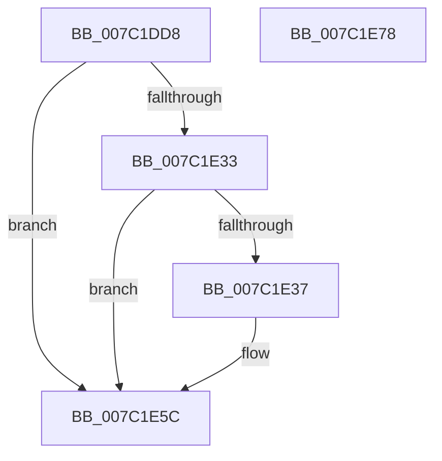

# EtwpCovSampStrideSamplerInitialize

- RVA: `0x007C1DD8`–`0x007C1E79` (길이 `161` bytes)
- VA: `0x00000001407C1DD8`
- 실행 섹션: `PAGE`
- PDB 이름 있음: `예`; PDB Function 태그: `아니요`
- unwind 정보 RVA: `0x00060BC4`
- 디코드: `50`개 명령, `161/161` bytes 표시
- 미해석 바이트: `0` (있으면 어셈블리에 `.byte`로 보존)

> 이 문서는 커널 이미지의 기계어와 PDB 기호를 분석해 생성했습니다. 4번과 5번은 함수 원형과 자료형을 바이너리 사용 방식에서 추정한 C 해석이며 원본 소스 복구 결과는 아닙니다.

## 1. Dependencies

- 직접 호출 지점: **1**; 고유 호출 대상: **1**
- 직접 호출자로 확인된 함수: **1**
- RIP 상대 이미지 참조: **1**

### Outgoing calls
- `0x007C1E01` → [ExGenRandom](../../text/41/ExGenRandom_function_0041B010.md) (function, `0x0041B010`)

### Direct callers
- [EtwpCovSampCaptureContextStart](EtwpCovSampCaptureContextStart_function_007C14AC.md) at `0x007C1826`
- [EtwpCovSampCaptureContextStart](EtwpCovSampCaptureContextStart_function_007C14AC.md) at `0x007C1839`
- [EtwpCovSampCaptureContextStart](EtwpCovSampCaptureContextStart_function_007C14AC.md) at `0x007C184C`
- [EtwpCovSampCaptureContextStart](EtwpCovSampCaptureContextStart_function_007C14AC.md) at `0x007C185F`

### Static image references
- `0x007C1E10` → RVA `0x00FC6AA0` (`ALMOSTRO`; read)

## 2. Other-region calls and transfers

- 다른 실행 섹션으로 향하는 call: **1**
  - `0x007C1E01` → [ExGenRandom](../../text/41/ExGenRandom_function_0041B010.md) (`PAGE` → `.text`)
- 별도 외부 분기/꼬리 이동을 확인하지 못했습니다.

## 3. Assembly (complete function range)

```asm
007C1DD8  48 89 5C 24 08                  mov qword ptr [rsp + 8], rbx
007C1DDD  48 89 74 24 10                  mov qword ptr [rsp + 0x10], rsi
007C1DE2  57                              push rdi
007C1DE3  48 83 EC 20                     sub rsp, 0x20
007C1DE7  0F 57 C0                        xorps xmm0, xmm0
007C1DEA  41 8B D8                        mov ebx, r8d
007C1DED  0F 11 01                        movups xmmword ptr [rcx], xmm0
007C1DF0  33 C0                           xor eax, eax
007C1DF2  48 8B F9                        mov rdi, rcx
007C1DF5  0F 11 41 10                     movups xmmword ptr [rcx + 0x10], xmm0
007C1DF9  48 89 41 20                     mov qword ptr [rcx + 0x20], rax
007C1DFD  8B F2                           mov esi, edx
007C1DFF  33 C9                           xor ecx, ecx
007C1E01  E8 0A 92 C5 FF                  call 0x14041b010
007C1E06  89 47 24                        mov dword ptr [rdi + 0x24], eax
007C1E09  33 D2                           xor edx, edx
007C1E0B  8D 04 B6                        lea eax, [rsi + rsi*4]
007C1E0E  03 C0                           add eax, eax
007C1E10  F7 35 8A 4C 80 00               div dword ptr [rip + 0x804c8a]
007C1E16  89 47 08                        mov dword ptr [rdi + 8], eax
007C1E19  48 B8 20 03 00 00 80 F7 FF FF   movabs rax, 0xfffff78000000320
007C1E23  8B 00                           mov eax, dword ptr [rax]
007C1E25  8B 4F 08                        mov ecx, dword ptr [rdi + 8]
007C1E28  2B C1                           sub eax, ecx
007C1E2A  FF C8                           dec eax
007C1E2C  89 47 04                        mov dword ptr [rdi + 4], eax
007C1E2F  85 C9                           test ecx, ecx
007C1E31  75 29                           jne 0x1407c1e5c
007C1E33  85 F6                           test esi, esi
007C1E35  74 25                           je 0x1407c1e5c
007C1E37  B8 CD CC CC CC                  mov eax, 0xcccccccd
007C1E3C  F7 25 5E 4C 80 00               mul dword ptr [rip + 0x804c5e]
007C1E42  8B C2                           mov eax, edx
007C1E44  33 D2                           xor edx, edx
007C1E46  C1 E8 03                        shr eax, 3
007C1E49  F7 F6                           div esi
007C1E4B  8B C8                           mov ecx, eax
007C1E4D  48 0F AF CB                     imul rcx, rbx
007C1E51  BB 00 00 00 10                  mov ebx, 0x10000000
007C1E56  48 3B CB                        cmp rcx, rbx
007C1E59  0F 42 D9                        cmovb ebx, ecx
007C1E5C  48 8B 74 24 38                  mov rsi, qword ptr [rsp + 0x38]
007C1E61  8D 04 9D 00 00 00 00            lea eax, [rbx*4]
007C1E68  89 1F                           mov dword ptr [rdi], ebx
007C1E6A  48 8B 5C 24 30                  mov rbx, qword ptr [rsp + 0x30]
007C1E6F  89 47 0C                        mov dword ptr [rdi + 0xc], eax
007C1E72  48 83 C4 20                     add rsp, 0x20
007C1E76  5F                              pop rdi
007C1E77  C3                              ret
007C1E78  CC                              int3
```

## 4. C-style interpretation (structured pseudocode)

```c
__int64 __fastcall EtwpCovSampStrideSamplerInitialize(__int64 a1, int a2, int a3)
{
    __int64 result;
    __int64 v_rbx;
    __int64 v_rsp;
    unsigned __int64 v_stack_p10;
    unsigned __int64 v_stack_p8;

    v_stack_p8 = v_rbx;
    v_stack_p10 = v_rsi;
    v_rsp = (v_rsp) - (32);
    *(unsigned __int64 *)(a1) = v_xmm0;
    result = 0;
    *(unsigned __int64 *)(a1 + 16) = v_xmm0;
    *(unsigned __int64 *)(a1 + 32) = 0;
    a1 = 0;
    result = ExGenRandom(a1, a2, a3, a4);
    *(unsigned int *)(a1 + 36) = (unsigned int)(result);
    a2 = 0;
    result = (unsigned int)(((unsigned int)(a2) + (unsigned int)(a2) * 4) + ((unsigned int)((unsigned int)(a2) + (unsigned int)(a2) * 4)));
    *(unsigned int *)(a1 + 8) = (unsigned int)(result);
    result = (unsigned int)(((unsigned int)(*(unsigned int *)(result))) - ((unsigned int)((unsigned int)(*(unsigned int *)(a1 + 8)))));
    result = (unsigned int)((result) - 1);
    *(unsigned int *)(a1 + 4) = (unsigned int)(result);
    if ((unsigned int)((unsigned int)(*(unsigned int *)(a1 + 8))) != 0) goto loc_007C1E5C;
    v_rbx = (unsigned int)(a3);
    if ((unsigned int)((unsigned int)(a2)) != 0) {
        result = 0xCCCCCCCDULL;
        result = 0;
        a2 = 0;
        result = (unsigned int)((result) >> (3));
        a1 = (unsigned int)(result);
        a1 = (a1) * ((unsigned int)(a3));
        v_rbx = 0x10000000ULL;
        if (a1 < v_rbx) { v_rbx = (unsigned int)(a1); }
    }
    *(unsigned int *)(a1) = (unsigned int)(v_rbx);
    *(unsigned int *)(a1 + 12) = (unsigned int)(v_rbx * 4);
    v_rsp = (v_rsp) + (32);
    return v_rbx * 4;
}
```

## 5. (Beta) C Style

```c
int64_t EtwpCovSampStrideSamplerInitialize(void *Arg1, void *Arg2, int32_t Arg3)
{
    uint8_t *arg1 = (uint8_t *)Arg1;
    uint8_t *arg2 = (uint8_t *)Arg2;

    int64_t result;
    int64_t local_rbx;
    int64_t local_rsp;
    uint64_t v_stack_p10;
    uint64_t v_stack_p8;

    v_stack_p8 = local_rbx;
    v_stack_p10 = local_rsi;
    local_rsp = (local_rsp) - (32);
    *(uint64_t *)(arg1) = v_xmm0;
    result = 0;
    *(uint64_t *)(arg1 + 0x10) = v_xmm0;
    *(uint64_t *)(arg1 + 0x20) = 0;
    Arg1 = 0;
    result = ExGenRandom(Arg1, Arg2, Arg3, a4);
    *(uint32_t *)(arg1 + 0x24) = (uint32_t)(result);
    Arg2 = 0;
    result = (uint32_t)(((uint32_t)(Arg2) + (uint32_t)(Arg2) * 4) + ((uint32_t)((uint32_t)(Arg2) + (uint32_t)(Arg2) * 4)));
    *(uint32_t *)(arg1 + 0x8) = (uint32_t)(result);
    result = (uint32_t)(((uint32_t)(*(uint32_t *)(result))) - ((uint32_t)((uint32_t)(*(uint32_t *)(arg1 + 0x8)))));
    result = (uint32_t)((result) - 1);
    *(uint32_t *)(arg1 + 0x4) = (uint32_t)(result);
    if ((uint32_t)((uint32_t)(*(uint32_t *)(arg1 + 0x8))) != 0) goto loc_007C1E5C;
    local_rbx = (uint32_t)(Arg3);
    if ((uint32_t)((uint32_t)(Arg2)) != 0) {
        result = 0xCCCCCCCDULL;
        result = 0;
        Arg2 = 0;
        result = (uint32_t)((result) >> (3));
        Arg1 = (uint32_t)(result);
        Arg1 = (Arg1) * ((uint32_t)(Arg3));
        local_rbx = 0x10000000ULL;
        if (Arg1 < local_rbx) { local_rbx = (uint32_t)(Arg1); }
    }
    *(uint32_t *)(arg1) = (uint32_t)(local_rbx);
    *(uint32_t *)(arg1 + 0xC) = (uint32_t)(local_rbx * 4);
    local_rsp = (local_rsp) + (32);
    return local_rbx * 4;
}
```

### 관측된 메모리 오프셋

구조체 형식이 확인되지 않은 접근은 인자 기준의 오프셋으로만 기록했습니다.

| 기준 인자 | 오프셋 표현 | 폭 (bit) | 접근 |
|---|---:|---:|---|
| `Arg1` | `+ 0x0` | `32` | `W` |
| `Arg1` | `+ 0x0` | `128` | `R` |
| `Arg1` | `+ 0x4` | `32` | `W` |
| `Arg1` | `+ 0x8` | `32` | `R` |
| `Arg1` | `+ 0x8` | `32` | `W` |
| `Arg1` | `+ 0xC` | `32` | `W` |
| `Arg1` | `+ 0x10` | `128` | `R` |
| `Arg1` | `+ 0x20` | `64` | `W` |
| `Arg1` | `+ 0x24` | `32` | `W` |
| `Arg2` | `+ 0x0 + rsi*4` | `32` | `R` |

## 6. Execution-region graph

[열기: 2D/3D 그래프와 함수 탐색 컨트롤 패널](../../../control-panel.html?section=page&rva=0x007C1DD8&view=graph)

- 2D 그래프는 위에서 아래로 흐르고, 3D 그래프는 빈 공간을 드래그해 회전합니다. Shift+드래그는 이동, 휠은 확대·축소, 함수 노드 선택은 대상 보고서 이동입니다.

### Static fallback


