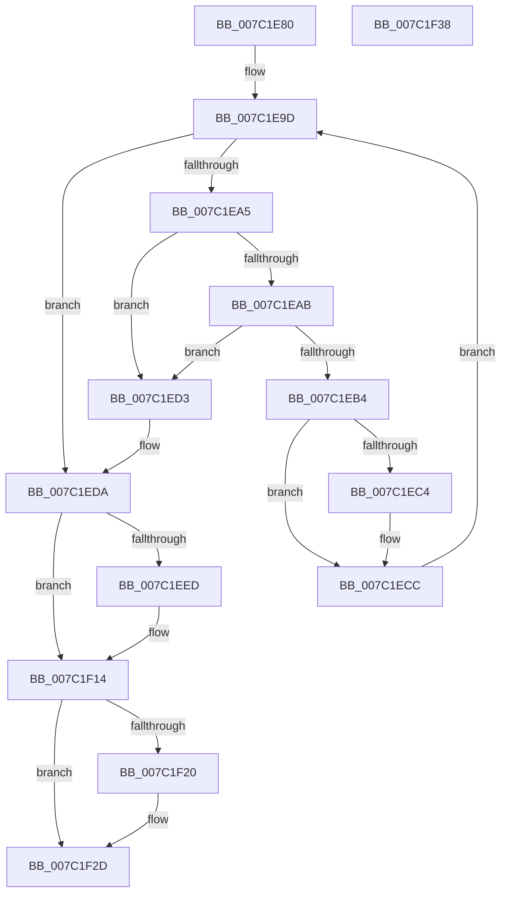

# EtwpCoverageSamplerCleanup

- RVA: `0x007C1E80`–`0x007C1F39` (길이 `185` bytes)
- VA: `0x00000001407C1E80`
- 실행 섹션: `PAGE`
- PDB 이름 있음: `예`; PDB Function 태그: `아니요`
- unwind 정보 RVA: `0x0005CAAC`
- 디코드: `44`개 명령, `185/185` bytes 표시
- 미해석 바이트: `0` (있으면 어셈블리에 `.byte`로 보존)

> 이 문서는 커널 이미지의 기계어와 PDB 기호를 분석해 생성했습니다. 4번과 5번은 함수 원형과 자료형을 바이너리 사용 방식에서 추정한 C 해석이며 원본 소스 복구 결과는 아닙니다.

## 1. Dependencies

- 직접 호출 지점: **4**; 고유 호출 대상: **4**
- 직접 호출자로 확인된 함수: **1**
- RIP 상대 이미지 참조: **0**

### Outgoing calls
- `0x007C1E91` → [EtwpCovSampContextCleanup](../6F/EtwpCovSampContextCleanup_function_006FDF84.md) (function, `0x006FDF84`)
- `0x007C1ECC` → [EtwpCoverageSamplerFreeTable](../A8/EtwpCoverageSamplerFreeTable_function_00A878A4.md) (function, `0x00A878A4`)
- `0x007C1EF2` → [MiRemoveFromSystemSpace](../../text/29/MiRemoveFromSystemSpace_function_002962FC.md) (function, `0x002962FC`)
- `0x007C1F20` → [ObfDereferenceObject](../../text/2F/ObfDereferenceObject_function_002F9350.md) (function, `0x002F9350`)

### Direct callers
- [EtwpCoverageSamplerDelete](EtwpCoverageSamplerDelete_function_007C2040.md) at `0x007C2044`

### Static image references
- 디코드된 RIP-relative 메모리 참조가 없습니다.

## 2. Other-region calls and transfers

- 다른 실행 섹션으로 향하는 call: **2**
  - `0x007C1EF2` → [MiRemoveFromSystemSpace](../../text/29/MiRemoveFromSystemSpace_function_002962FC.md) (`PAGE` → `.text`)
  - `0x007C1F20` → [ObfDereferenceObject](../../text/2F/ObfDereferenceObject_function_002F9350.md) (`PAGE` → `.text`)
- 별도 외부 분기/꼬리 이동을 확인하지 못했습니다.

## 3. Assembly (complete function range)

```asm
007C1E80  48 89 5C 24 08                  mov qword ptr [rsp + 8], rbx
007C1E85  57                              push rdi
007C1E86  48 83 EC 20                     sub rsp, 0x20
007C1E8A  48 8B D9                        mov rbx, rcx
007C1E8D  48 83 C1 10                     add rcx, 0x10
007C1E91  E8 EE C0 F3 FF                  call 0x1406fdf84
007C1E96  48 8D BB 90 06 00 00            lea rdi, [rbx + 0x690]
007C1E9D  48 8B 0F                        mov rcx, qword ptr [rdi]
007C1EA0  48 3B CF                        cmp rcx, rdi
007C1EA3  74 35                           je 0x1407c1eda
007C1EA5  48 39 79 08                     cmp qword ptr [rcx + 8], rdi
007C1EA9  75 28                           jne 0x1407c1ed3
007C1EAB  48 8B 01                        mov rax, qword ptr [rcx]
007C1EAE  48 39 48 08                     cmp qword ptr [rax + 8], rcx
007C1EB2  75 1F                           jne 0x1407c1ed3
007C1EB4  48 89 07                        mov qword ptr [rdi], rax
007C1EB7  48 89 78 08                     mov qword ptr [rax + 8], rdi
007C1EBB  48 3B 8B 80 06 00 00            cmp rcx, qword ptr [rbx + 0x680]
007C1EC2  75 08                           jne 0x1407c1ecc
007C1EC4  48 83 A3 80 06 00 00 00         and qword ptr [rbx + 0x680], 0
007C1ECC  E8 D3 59 2C 00                  call 0x140a878a4
007C1ED1  EB CA                           jmp 0x1407c1e9d
007C1ED3  B9 03 00 00 00                  mov ecx, 3
007C1ED8  CD 29                           int 0x29
007C1EDA  83 A3 A0 06 00 00 00            and dword ptr [rbx + 0x6a0], 0
007C1EE1  48 8B 8B A8 06 00 00            mov rcx, qword ptr [rbx + 0x6a8]
007C1EE8  48 85 C9                        test rcx, rcx
007C1EEB  74 27                           je 0x1407c1f14
007C1EED  BA 01 00 00 00                  mov edx, 1
007C1EF2  E8 05 44 AD FF                  call 0x1402962fc
007C1EF7  48 83 A3 A8 06 00 00 00         and qword ptr [rbx + 0x6a8], 0
007C1EFF  83 A3 B4 06 00 00 00            and dword ptr [rbx + 0x6b4], 0
007C1F06  83 A3 B0 06 00 00 00            and dword ptr [rbx + 0x6b0], 0
007C1F0D  83 A3 B8 06 00 00 00            and dword ptr [rbx + 0x6b8], 0
007C1F14  48 8B 8B 88 06 00 00            mov rcx, qword ptr [rbx + 0x688]
007C1F1B  48 85 C9                        test rcx, rcx
007C1F1E  74 0D                           je 0x1407c1f2d
007C1F20  E8 2B 74 B3 FF                  call 0x1402f9350
007C1F25  48 83 A3 88 06 00 00 00         and qword ptr [rbx + 0x688], 0
007C1F2D  48 8B 5C 24 30                  mov rbx, qword ptr [rsp + 0x30]
007C1F32  48 83 C4 20                     add rsp, 0x20
007C1F36  5F                              pop rdi
007C1F37  C3                              ret
007C1F38  CC                              int3
```

## 4. C-style interpretation (structured pseudocode)

```c
__int64 __fastcall EtwpCoverageSamplerCleanup(__int64 a1)
{
    __int64 result;
    __int64 v_rsp;
    unsigned __int64 v_stack_p8;

    v_stack_p8 = v_rbx;
    v_rsp = (v_rsp) - (32);
    a1 = (a1) + (16);
    result = EtwpCovSampContextCleanup(a1, a2, a3, a4);
loc_007C1E9D:
    if ((*(unsigned __int64 *)(a1 + 1680)) == (a1 + 1680)) goto loc_007C1EDA;
    if ((*(unsigned __int64 *)(*(unsigned __int64 *)(a1 + 1680) + 8)) != (a1 + 1680)) goto loc_007C1ED3;
    if ((*(unsigned __int64 *)(*(unsigned __int64 *)(*(unsigned __int64 *)(a1 + 1680)) + 8)) != (*(unsigned __int64 *)(a1 + 1680))) goto loc_007C1ED3;
    *(unsigned __int64 *)(a1 + 1680) = *(unsigned __int64 *)(*(unsigned __int64 *)(a1 + 1680));
    *(unsigned __int64 *)(*(unsigned __int64 *)(*(unsigned __int64 *)(a1 + 1680)) + 8) = a1 + 1680;
    if ((*(unsigned __int64 *)(a1 + 1680)) == (*(unsigned __int64 *)(a1 + 1664))) {
    }
    result = EtwpCoverageSamplerFreeTable(*(unsigned __int64 *)(a1 + 1680), a2, a3, a4);
    goto loc_007C1E9D;
loc_007C1ED3:
loc_007C1EDA:
    if (*(unsigned __int64 *)(a1 + 1704) != 0) {
        a2 = 1;
        result = MiRemoveFromSystemSpace(*(unsigned __int64 *)(a1 + 1704), a2, a3, a4);
    }
    if (*(unsigned __int64 *)(a1 + 1672) != 0) {
        result = ObfDereferenceObject(*(unsigned __int64 *)(a1 + 1672), a2, a3, a4);
    }
    v_rsp = (v_rsp) + (32);
    return result;
}
```

## 5. (Beta) C Style

```c
int64_t EtwpCoverageSamplerCleanup(void *Arg1)
{
    uint8_t *arg1 = (uint8_t *)Arg1;

    int64_t result;
    int64_t local_rsp;
    uint64_t v_stack_p8;

    v_stack_p8 = local_rbx;
    local_rsp = (local_rsp) - (32);
    Arg1 = (Arg1) + (16);
    result = EtwpCovSampContextCleanup(Arg1, a2, a3, a4);
loc_007C1E9D:
    if ((*(uint64_t *)(arg1 + 0x690)) == (Arg1 + 1680)) goto loc_007C1EDA;
    if ((*(uint64_t *)(*(uint64_t *)(arg1 + 0x690) + 0x8)) != (Arg1 + 1680)) goto loc_007C1ED3;
    if ((*(uint64_t *)(*(uint64_t *)(*(uint64_t *)(arg1 + 0x690)) + 0x8)) != (*(uint64_t *)(arg1 + 0x690))) goto loc_007C1ED3;
    *(uint64_t *)(arg1 + 0x690) = *(uint64_t *)(*(uint64_t *)(arg1 + 0x690));
    *(void **)(*(uint64_t *)(*(uint64_t *)(arg1 + 0x690)) + 0x8) = Arg1 + 1680;
    if ((*(uint64_t *)(arg1 + 0x690)) == (*(uint64_t *)(arg1 + 0x680))) {
    }
    result = EtwpCoverageSamplerFreeTable(*(uint64_t *)(arg1 + 0x690), a2, a3, a4);
    goto loc_007C1E9D;
loc_007C1ED3:
loc_007C1EDA:
    if (*(uint64_t *)(arg1 + 0x6A8) != 0) {
        a2 = 1;
        result = MiRemoveFromSystemSpace(*(uint64_t *)(arg1 + 0x6A8), a2, a3, a4);
    }
    if (*(uint64_t *)(arg1 + 0x688) != 0) {
        result = ObfDereferenceObject(*(uint64_t *)(arg1 + 0x688), a2, a3, a4);
    }
    local_rsp = (local_rsp) + (32);
    return result;
}
```

### 관측된 메모리 오프셋

구조체 형식이 확인되지 않은 접근은 인자 기준의 오프셋으로만 기록했습니다.

| 기준 인자 | 오프셋 표현 | 폭 (bit) | 접근 |
|---|---:|---:|---|
| `Arg1` | `+ 0x0` | `64` | `R` |
| `Arg1` | `+ 0x0` | `64` | `W` |
| `Arg1` | `+ 0x680` | `64` | `R` |
| `Arg1` | `+ 0x680` | `64` | `R/W` |
| `Arg1` | `+ 0x688` | `64` | `R` |
| `Arg1` | `+ 0x688` | `64` | `R/W` |
| `Arg1` | `+ 0x690` | `64` | `R` |
| `Arg1` | `+ 0x6A0` | `32` | `R/W` |
| `Arg1` | `+ 0x6A8` | `64` | `R` |
| `Arg1` | `+ 0x6A8` | `64` | `R/W` |
| `Arg1` | `+ 0x6B0` | `32` | `R/W` |
| `Arg1` | `+ 0x6B4` | `32` | `R/W` |
| `Arg1` | `+ 0x6B8` | `32` | `R/W` |

## 6. Execution-region graph

[열기: 2D/3D 그래프와 함수 탐색 컨트롤 패널](../../../control-panel.html?section=page&rva=0x007C1E80&view=graph)

- 2D 그래프는 위에서 아래로 흐르고, 3D 그래프는 빈 공간을 드래그해 회전합니다. Shift+드래그는 이동, 휠은 확대·축소, 함수 노드 선택은 대상 보고서 이동입니다.

### Static fallback


