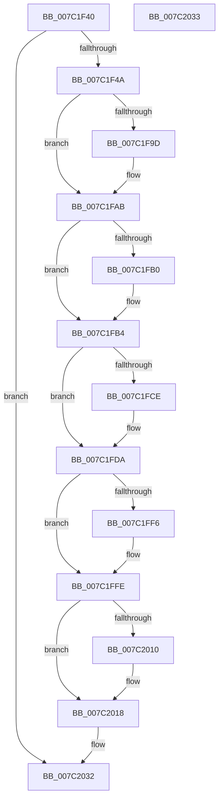

# EtwpCoverageSamplerClose

- RVA: `0x007C1F40`–`0x007C2034` (길이 `244` bytes)
- VA: `0x00000001407C1F40`
- 실행 섹션: `PAGE`
- PDB 이름 있음: `예`; PDB Function 태그: `아니요`
- unwind 정보 RVA: `0x000D3F38`
- 디코드: `60`개 명령, `244/244` bytes 표시
- 미해석 바이트: `0` (있으면 어셈블리에 `.byte`로 보존)

> 이 문서는 커널 이미지의 기계어와 PDB 기호를 분석해 생성했습니다. 4번과 5번은 함수 원형과 자료형을 바이너리 사용 방식에서 추정한 C 해석이며 원본 소스 복구 결과는 아닙니다.

## 1. Dependencies

- 직접 호출 지점: **6**; 고유 호출 대상: **6**
- 직접 호출자로 확인된 함수: **0**
- RIP 상대 이미지 참조: **3**

### Outgoing calls
- `0x007C1F8D` → [KeAbPreAcquire](../../text/21/KeAbPreAcquire_function_00210230.md) (function, `0x00210230`)
- `0x007C1FA6` → [ExfAcquirePushLockExclusiveEx](../../text/20/ExfAcquirePushLockExclusiveEx_function_0020FC90.md) (function, `0x0020FC90`)
- `0x007C1FF9` → [ExfTryToWakePushLock](../../text/26/ExfTryToWakePushLock_function_00265DD0.md) (function, `0x00265DD0`)
- `0x007C2001` → [KeAbPostRelease](../../text/2E/KeAbPostRelease_function_002E1600.md) (function, `0x002E1600`)
- `0x007C2006` → [KeLeaveCriticalRegion](../../text/25/KeLeaveCriticalRegion_function_0025D8B0.md) (function, `0x0025D8B0`)
- `0x007C2013` → [EtwpCoverageSamplerStop](EtwpCoverageSamplerStop_function_007C2564.md) (function, `0x007C2564`)

### Direct callers
- 이 함수 시작 RVA로 연결되는 직접 call은 확인되지 않았습니다. 간접 호출은 완전히 역산할 수 없습니다.

### Static image references
- `0x007C1F6C` → RVA `0x00EFF1C0` (`.data`; read)
- `0x007C1FBD` → RVA `0x00EFF1C8` (`.data`; write)
- `0x007C1FE5` → RVA `0x00EFF1C0` (`.data`; read/write)

## 2. Other-region calls and transfers

- 다른 실행 섹션으로 향하는 call: **5**
  - `0x007C1F8D` → [KeAbPreAcquire](../../text/21/KeAbPreAcquire_function_00210230.md) (`PAGE` → `.text`)
  - `0x007C1FA6` → [ExfAcquirePushLockExclusiveEx](../../text/20/ExfAcquirePushLockExclusiveEx_function_0020FC90.md) (`PAGE` → `.text`)
  - `0x007C1FF9` → [ExfTryToWakePushLock](../../text/26/ExfTryToWakePushLock_function_00265DD0.md) (`PAGE` → `.text`)
  - `0x007C2001` → [KeAbPostRelease](../../text/2E/KeAbPostRelease_function_002E1600.md) (`PAGE` → `.text`)
  - `0x007C2006` → [KeLeaveCriticalRegion](../../text/25/KeLeaveCriticalRegion_function_0025D8B0.md) (`PAGE` → `.text`)
- 별도 외부 분기/꼬리 이동을 확인하지 못했습니다.

## 3. Assembly (complete function range)

```asm
007C1F40  49 83 F9 01                     cmp r9, 1
007C1F44  0F 85 E8 00 00 00               jne 0x1407c2032
007C1F4A  48 8B C4                        mov rax, rsp
007C1F4D  48 89 58 08                     mov qword ptr [rax + 8], rbx
007C1F51  48 89 68 10                     mov qword ptr [rax + 0x10], rbp
007C1F55  48 89 70 18                     mov qword ptr [rax + 0x18], rsi
007C1F59  48 89 78 20                     mov qword ptr [rax + 0x20], rdi
007C1F5D  41 56                           push r14
007C1F5F  48 83 EC 20                     sub rsp, 0x20
007C1F63  65 48 8B 04 25 88 01 00 00      mov rax, qword ptr gs:[0x188]
007C1F6C  4C 8D 35 4D D2 73 00            lea r14, [rip + 0x73d24d]
007C1F73  48 8B FA                        mov rdi, rdx
007C1F76  48 83 CB FF                     or rbx, 0xffffffffffffffff
007C1F7A  45 33 C0                        xor r8d, r8d
007C1F7D  33 D2                           xor edx, edx
007C1F7F  49 8B CE                        mov rcx, r14
007C1F82  40 32 ED                        xor bpl, bpl
007C1F85  66 01 98 E4 01 00 00            add word ptr [rax + 0x1e4], bx
007C1F8C  90                              nop
007C1F8D  E8 9E E2 A4 FF                  call 0x140210230
007C1F92  F0 49 0F BA 2E 00               lock bts qword ptr [r14], 0
007C1F98  48 8B F0                        mov rsi, rax
007C1F9B  73 0E                           jae 0x1407c1fab
007C1F9D  4D 8B C6                        mov r8, r14
007C1FA0  48 8B D0                        mov rdx, rax
007C1FA3  49 8B CE                        mov rcx, r14
007C1FA6  E8 E5 DC A4 FF                  call 0x14020fc90
007C1FAB  48 85 F6                        test rsi, rsi
007C1FAE  74 04                           je 0x1407c1fb4
007C1FB0  C6 46 0A 01                     mov byte ptr [rsi + 0xa], 1
007C1FB4  65 48 8B 04 25 88 01 00 00      mov rax, qword ptr gs:[0x188]
007C1FBD  48 89 05 04 D2 73 00            mov qword ptr [rip + 0x73d204], rax
007C1FC4  8B 87 C0 06 00 00               mov eax, dword ptr [rdi + 0x6c0]
007C1FCA  A8 01                           test al, 1
007C1FCC  75 0C                           jne 0x1407c1fda
007C1FCE  83 C8 01                        or eax, 1
007C1FD1  40 B5 01                        mov bpl, 1
007C1FD4  89 87 C0 06 00 00               mov dword ptr [rdi + 0x6c0], eax
007C1FDA  48 C7 05 E3 D1 73 00 00 00 00 00  mov qword ptr [rip + 0x73d1e3], 0
007C1FE5  F0 48 0F C1 1D D2 D1 73 00      lock xadd qword ptr [rip + 0x73d1d2], rbx
007C1FEE  80 E3 06                        and bl, 6
007C1FF1  80 FB 02                        cmp bl, 2
007C1FF4  75 08                           jne 0x1407c1ffe
007C1FF6  49 8B CE                        mov rcx, r14
007C1FF9  E8 D2 3D AA FF                  call 0x140265dd0
007C1FFE  49 8B CE                        mov rcx, r14
007C2001  E8 FA F5 B1 FF                  call 0x1402e1600
007C2006  E8 A5 B8 A9 FF                  call 0x14025d8b0
007C200B  40 84 ED                        test bpl, bpl
007C200E  74 08                           je 0x1407c2018
007C2010  48 8B CF                        mov rcx, rdi
007C2013  E8 4C 05 00 00                  call 0x1407c2564
007C2018  48 8B 5C 24 30                  mov rbx, qword ptr [rsp + 0x30]
007C201D  48 8B 6C 24 38                  mov rbp, qword ptr [rsp + 0x38]
007C2022  48 8B 74 24 40                  mov rsi, qword ptr [rsp + 0x40]
007C2027  48 8B 7C 24 48                  mov rdi, qword ptr [rsp + 0x48]
007C202C  48 83 C4 20                     add rsp, 0x20
007C2030  41 5E                           pop r14
007C2032  C3                              ret
007C2033  CC                              int3
```

## 4. C-style interpretation (structured pseudocode)

```c
__int64 __fastcall EtwpCoverageSamplerClose(__int64 a1, __int64 a2, int a3, __int64 a4)
{
    __int64 result;
    __int64 v_rbp;
    __int64 v_rbx;
    __int64 v_rsp;
    unsigned __int64 v_stack_p10;
    unsigned __int64 v_stack_p18;
    unsigned __int64 v_stack_p20;
    unsigned __int64 v_stack_p8;

    if (a4 != 1) goto loc_007C2032;
    *(unsigned __int64 *)(v_rsp + 8) = v_rbx;
    *(unsigned __int64 *)(v_rsp + 16) = v_rbp;
    *(unsigned __int64 *)(v_rsp + 24) = v_rsi;
    *(unsigned __int64 *)(v_rsp + 32) = v_rdi;
    v_rsp = (v_rsp) - (32);
    v_rbx = (v_rbx) | (-1);
    a3 = 0;
    a2 = 0;
    v_rbp = 0;
    result = KeAbPreAcquire(v_rip + 7590477, a2, a3, a4);
    if (!(condition_is_above_or_equal)) {
        a3 = v_rip + 7590477;
        a2 = result;
        a1 = v_rip + 7590477;
        result = ExfAcquirePushLockExclusiveEx(a1, a2, a3, a4);
    }
    if (result != 0) {
        *(unsigned __int8 *)(result + 10) = 1;
    }
    *(unsigned __int64 *)(v_rip + 7590404) = *(unsigned __int64 *)(gs_base + (0 + 392));
    result = (unsigned int)(*(unsigned int *)(a2 + 1728));
    if ((((unsigned __int8)((unsigned int)(*(unsigned int *)(a2 + 1728)))) & (1)) == 0) {
        result = (unsigned int)(((unsigned int)(*(unsigned int *)(a2 + 1728))) | (1));
        v_rbp = 1;
        *(unsigned int *)(a2 + 1728) = (unsigned int)(result);
    }
    *(unsigned __int64 *)(v_rip + 7590371) = 0;
    v_rbx = (unsigned __int8)((v_rbx) & (6));
    if (((unsigned __int8)(v_rbx)) == 2) {
        a1 = v_rip + 7590477;
        result = ExfTryToWakePushLock(a1, a2, a3, a4);
    }
    result = KeAbPostRelease(v_rip + 7590477, a2, a3, a4);
    result = KeLeaveCriticalRegion(v_rip + 7590477, a2, a3, a4);
    if ((unsigned __int8)(v_rbp) != 0) {
        a1 = a2;
        result = EtwpCoverageSamplerStop(a1, a2, a3, a4);
    }
    v_rsp = (v_rsp) + (32);
loc_007C2032:
    return result;
}
```

## 5. (Beta) C Style

```c
int64_t EtwpCoverageSamplerClose(int64_t Arg1, void *Arg2, int32_t Arg3, int64_t Arg4)
{
    uint8_t *arg2 = (uint8_t *)Arg2;

    int64_t result;
    int64_t local_rbp;
    int64_t local_rbx;
    int64_t local_rsp;
    uint64_t v_stack_p10;
    uint64_t v_stack_p18;
    uint64_t v_stack_p20;
    uint64_t v_stack_p8;

    if (Arg4 != 1) goto loc_007C2032;
    *(uint64_t *)(local_rsp + 0x8) = local_rbx;
    *(uint64_t *)(local_rsp + 0x10) = local_rbp;
    *(uint64_t *)(local_rsp + 0x18) = local_rsi;
    *(uint64_t *)(local_rsp + 0x20) = local_rdi;
    local_rsp = (local_rsp) - (32);
    local_rbx = (local_rbx) | (-1);
    Arg3 = 0;
    Arg2 = 0;
    local_rbp = 0;
    result = KeAbPreAcquire(v_rip + 7590477, Arg2, Arg3, Arg4);
    if (!(condition_is_above_or_equal)) {
        Arg3 = v_rip + 7590477;
        Arg2 = result;
        Arg1 = v_rip + 7590477;
        result = ExfAcquirePushLockExclusiveEx(Arg1, Arg2, Arg3, Arg4);
    }
    if (result != 0) {
        *(uint8_t *)(result + 0xA) = 1;
    }
    *(uint64_t *)(v_rip + 0x73D204) = *(uint64_t *)(gs_base + (0 + 0x188));
    result = (uint32_t)(*(uint32_t *)(arg2 + 0x6C0));
    if ((((uint8_t)((uint32_t)(*(uint32_t *)(arg2 + 0x6C0)))) & (1)) == 0) {
        result = (uint32_t)(((uint32_t)(*(uint32_t *)(arg2 + 0x6C0))) | (1));
        local_rbp = 1;
        *(uint32_t *)(arg2 + 0x6C0) = (uint32_t)(result);
    }
    *(uint64_t *)(v_rip + 0x73D1E3) = 0;
    local_rbx = (uint8_t)((local_rbx) & (6));
    if (((uint8_t)(local_rbx)) == 2) {
        Arg1 = v_rip + 7590477;
        result = ExfTryToWakePushLock(Arg1, Arg2, Arg3, Arg4);
    }
    result = KeAbPostRelease(v_rip + 7590477, Arg2, Arg3, Arg4);
    result = KeLeaveCriticalRegion(v_rip + 7590477, Arg2, Arg3, Arg4);
    if ((uint8_t)(local_rbp) != 0) {
        Arg1 = Arg2;
        result = EtwpCoverageSamplerStop(Arg1, Arg2, Arg3, Arg4);
    }
    local_rsp = (local_rsp) + (32);
loc_007C2032:
    return result;
}
```

### 관측된 메모리 오프셋

구조체 형식이 확인되지 않은 접근은 인자 기준의 오프셋으로만 기록했습니다.

| 기준 인자 | 오프셋 표현 | 폭 (bit) | 접근 |
|---|---:|---:|---|
| `Arg2` | `+ 0x6C0` | `32` | `R` |
| `Arg2` | `+ 0x6C0` | `32` | `W` |

## 6. Execution-region graph

[열기: 2D/3D 그래프와 함수 탐색 컨트롤 패널](../../../control-panel.html?section=page&rva=0x007C1F40&view=graph)

- 2D 그래프는 위에서 아래로 흐르고, 3D 그래프는 빈 공간을 드래그해 회전합니다. Shift+드래그는 이동, 휠은 확대·축소, 함수 노드 선택은 대상 보고서 이동입니다.

### Static fallback


