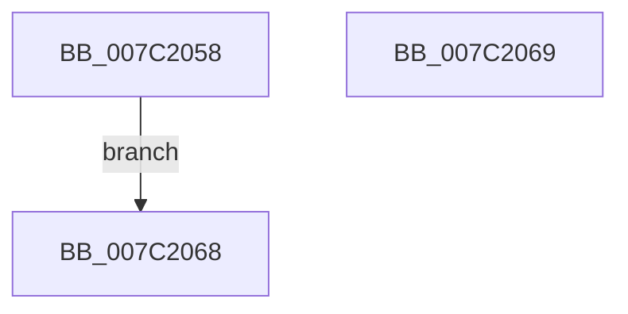

# EtwpCoverageSamplerQueryStatusInformation

- RVA: `0x007C2058`–`0x007C206A` (길이 `18` bytes)
- VA: `0x00000001407C2058`
- 실행 섹션: `PAGE`
- PDB 이름 있음: `예`; PDB Function 태그: `아니요`
- unwind 정보 RVA: `0x000D3F54`
- 디코드: `7`개 명령, `18/18` bytes 표시
- 미해석 바이트: `0` (있으면 어셈블리에 `.byte`로 보존)

> 이 문서는 커널 이미지의 기계어와 PDB 기호를 분석해 생성했습니다. 4번과 5번은 함수 원형과 자료형을 바이너리 사용 방식에서 추정한 C 해석이며 원본 소스 복구 결과는 아닙니다.

## 1. Dependencies

- 직접 호출 지점: **0**; 고유 호출 대상: **0**
- 직접 호출자로 확인된 함수: **1**
- RIP 상대 이미지 참조: **1**

### Outgoing calls
- 직접 디코드된 call 명령이 없습니다.

### Direct callers
- [sub_00B27B2E](../B2/Unknown_function_00B27B2E.md) at `0x00B27B65`

### Static image references
- `0x007C205A` → RVA `0x00EFF1D8` (`.data`; read)

## 2. Other-region calls and transfers

- 다른 실행 섹션으로 향하는 call: **0**
- 별도 외부 분기/꼬리 이동을 확인하지 못했습니다.

## 3. Assembly (complete function range)

```asm
007C2058  33 C0                           xor eax, eax
007C205A  48 39 05 77 D1 73 00            cmp qword ptr [rip + 0x73d177], rax
007C2061  0F 95 C2                        setne dl
007C2064  88 11                           mov byte ptr [rcx], dl
007C2066  EB 00                           jmp 0x1407c2068
007C2068  C3                              ret
007C2069  CC                              int3
```

## 4. C-style interpretation (structured pseudocode)

```c
__int64 __fastcall EtwpCoverageSamplerQueryStatusInformation(__int64 a1)
{
    __int64 result;

    result = 0;
    a2 = ((*(unsigned __int64 *)(v_rip + 7590263)) != 0) ? 1 : 0;
    *(unsigned __int8 *)(a1) = (unsigned __int8)(a2);
    goto loc_007C2068;
loc_007C2068:
    return result;
}
```

## 5. (Beta) C Style

```c
int64_t EtwpCoverageSamplerQueryStatusInformation(void *Arg1)
{
    uint8_t *arg1 = (uint8_t *)Arg1;

    int64_t result;

    result = 0;
    a2 = ((*(uint64_t *)(v_rip + 0x73D177)) != 0) ? 1 : 0;
    *(uint8_t *)(arg1) = (uint8_t)(a2);
    goto loc_007C2068;
loc_007C2068:
    return result;
}
```

### 관측된 메모리 오프셋

구조체 형식이 확인되지 않은 접근은 인자 기준의 오프셋으로만 기록했습니다.

| 기준 인자 | 오프셋 표현 | 폭 (bit) | 접근 |
|---|---:|---:|---|
| `Arg1` | `+ 0x0` | `8` | `W` |

## 6. Execution-region graph

[열기: 2D/3D 그래프와 함수 탐색 컨트롤 패널](../../../control-panel.html?section=page&rva=0x007C2058&view=graph)

- 2D 그래프는 위에서 아래로 흐르고, 3D 그래프는 빈 공간을 드래그해 회전합니다. Shift+드래그는 이동, 휠은 확대·축소, 함수 노드 선택은 대상 보고서 이동입니다.

### Static fallback


