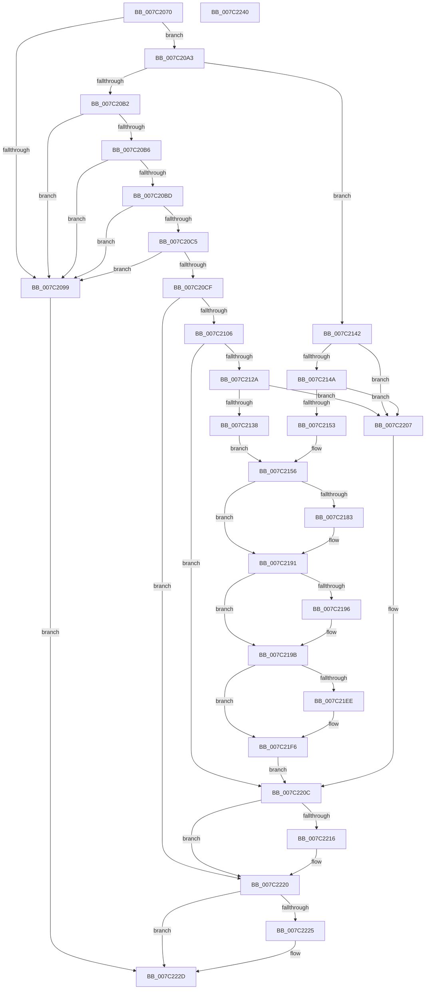

# EtwpCoverageSamplerSetBloomFilter

- RVA: `0x007C2070`–`0x007C2241` (길이 `465` bytes)
- VA: `0x00000001407C2070`
- 실행 섹션: `PAGE`
- PDB 이름 있음: `예`; PDB Function 태그: `아니요`
- unwind 정보 RVA: `0x000BF984`
- 디코드: `124`개 명령, `465/465` bytes 표시
- 미해석 바이트: `0` (있으면 어셈블리에 `.byte`로 보존)

> 이 문서는 커널 이미지의 기계어와 PDB 기호를 분석해 생성했습니다. 4번과 5번은 함수 원형과 자료형을 바이너리 사용 방식에서 추정한 C 해석이며 원본 소스 복구 결과는 아닙니다.

## 1. Dependencies

- 직접 호출 지점: **9**; 고유 호출 대상: **9**
- 직접 호출자로 확인된 함수: **1**
- RIP 상대 이미지 참조: **1**

### Outgoing calls
- `0x007C20F2` → [ObReferenceObjectByHandle](../86/ObReferenceObjectByHandle_function_00868DB0.md) (function, `0x00868DB0`)
- `0x007C211B` → [MmMapViewInSessionSpace](../98/MmMapViewInSessionSpace_function_00982480.md) (function, `0x00982480`)
- `0x007C2173` → [KeAbPreAcquire](../../text/21/KeAbPreAcquire_function_00210230.md) (function, `0x00210230`)
- `0x007C218C` → [ExfAcquirePushLockExclusiveEx](../../text/20/ExfAcquirePushLockExclusiveEx_function_0020FC90.md) (function, `0x0020FC90`)
- `0x007C21F1` → [ExfTryToWakePushLock](../../text/26/ExfTryToWakePushLock_function_00265DD0.md) (function, `0x00265DD0`)
- `0x007C21F9` → [KeAbPostRelease](../../text/2E/KeAbPostRelease_function_002E1600.md) (function, `0x002E1600`)
- `0x007C21FE` → [KeLeaveCriticalRegion](../../text/25/KeLeaveCriticalRegion_function_0025D8B0.md) (function, `0x0025D8B0`)
- `0x007C221B` → [MiRemoveFromSystemSpace](../../text/29/MiRemoveFromSystemSpace_function_002962FC.md) (function, `0x002962FC`)
- `0x007C2228` → [ObfDereferenceObject](../../text/2F/ObfDereferenceObject_function_002F9350.md) (function, `0x002F9350`)

### Direct callers
- [EtwpSetCoverageSamplerInformation](EtwpSetCoverageSamplerInformation_function_007C288C.md) at `0x007C29BD`
- [EtwpSetCoverageSamplerInformation](EtwpSetCoverageSamplerInformation_function_007C288C.md) at `0x007C2ECD`

### Static image references
- `0x007C20CF` → RVA `0x00FC6BD8` (`ALMOSTRO`; read)

## 2. Other-region calls and transfers

- 다른 실행 섹션으로 향하는 call: **7**
  - `0x007C2173` → [KeAbPreAcquire](../../text/21/KeAbPreAcquire_function_00210230.md) (`PAGE` → `.text`)
  - `0x007C218C` → [ExfAcquirePushLockExclusiveEx](../../text/20/ExfAcquirePushLockExclusiveEx_function_0020FC90.md) (`PAGE` → `.text`)
  - `0x007C21F1` → [ExfTryToWakePushLock](../../text/26/ExfTryToWakePushLock_function_00265DD0.md) (`PAGE` → `.text`)
  - `0x007C21F9` → [KeAbPostRelease](../../text/2E/KeAbPostRelease_function_002E1600.md) (`PAGE` → `.text`)
  - `0x007C21FE` → [KeLeaveCriticalRegion](../../text/25/KeLeaveCriticalRegion_function_0025D8B0.md) (`PAGE` → `.text`)
  - `0x007C221B` → [MiRemoveFromSystemSpace](../../text/29/MiRemoveFromSystemSpace_function_002962FC.md) (`PAGE` → `.text`)
  - `0x007C2228` → [ObfDereferenceObject](../../text/2F/ObfDereferenceObject_function_002F9350.md) (`PAGE` → `.text`)
- 별도 외부 분기/꼬리 이동을 확인하지 못했습니다.

## 3. Assembly (complete function range)

```asm
007C2070  48 89 5C 24 18                  mov qword ptr [rsp + 0x18], rbx
007C2075  55                              push rbp
007C2076  56                              push rsi
007C2077  57                              push rdi
007C2078  41 56                           push r14
007C207A  41 57                           push r15
007C207C  48 83 EC 30                     sub rsp, 0x30
007C2080  48 83 64 24 60 00               and qword ptr [rsp + 0x60], 0
007C2086  33 ED                           xor ebp, ebp
007C2088  8B 41 1C                        mov eax, dword ptr [rcx + 0x1c]
007C208B  45 8A C8                        mov r9b, r8b
007C208E  48 8B F2                        mov rsi, rdx
007C2091  48 8B F9                        mov rdi, rcx
007C2094  39 42 0C                        cmp dword ptr [rdx + 0xc], eax
007C2097  74 0A                           je 0x1407c20a3
007C2099  BB 0D 00 00 C0                  mov ebx, 0xc000000d
007C209E  E9 8A 01 00 00                  jmp 0x1407c222d
007C20A3  4C 8B 12                        mov r10, qword ptr [rdx]
007C20A6  8B 4A 08                        mov ecx, dword ptr [rdx + 8]
007C20A9  4D 85 D2                        test r10, r10
007C20AC  0F 84 90 00 00 00               je 0x1407c2142
007C20B2  85 C9                           test ecx, ecx
007C20B4  74 E3                           je 0x1407c2099
007C20B6  8D 41 FF                        lea eax, [rcx - 1]
007C20B9  85 C1                           test ecx, eax
007C20BB  75 DC                           jne 0x1407c2099
007C20BD  81 F9 00 00 00 08               cmp ecx, 0x8000000
007C20C3  77 D4                           ja 0x1407c2099
007C20C5  8B 42 10                        mov eax, dword ptr [rdx + 0x10]
007C20C8  FF C8                           dec eax
007C20CA  83 F8 09                        cmp eax, 9
007C20CD  77 CA                           ja 0x1407c2099
007C20CF  4C 8B 05 02 4B 80 00            mov r8, qword ptr [rip + 0x804b02]
007C20D6  48 8D 44 24 68                  lea rax, [rsp + 0x68]
007C20DB  48 21 6C 24 28                  and qword ptr [rsp + 0x28], rbp
007C20E0  BA 04 00 00 00                  mov edx, 4
007C20E5  48 21 6C 24 68                  and qword ptr [rsp + 0x68], rbp
007C20EA  49 8B CA                        mov rcx, r10
007C20ED  48 89 44 24 20                  mov qword ptr [rsp + 0x20], rax
007C20F2  E8 B9 6C 0A 00                  call 0x140868db0
007C20F7  48 8B 6C 24 68                  mov rbp, qword ptr [rsp + 0x68]
007C20FC  8B D8                           mov ebx, eax
007C20FE  85 C0                           test eax, eax
007C2100  0F 88 1A 01 00 00               js 0x1407c2220
007C2106  8B 46 08                        mov eax, dword ptr [rsi + 8]
007C2109  4C 8D 44 24 78                  lea r8, [rsp + 0x78]
007C210E  48 8D 54 24 60                  lea rdx, [rsp + 0x60]
007C2113  48 89 44 24 78                  mov qword ptr [rsp + 0x78], rax
007C2118  48 8B CD                        mov rcx, rbp
007C211B  E8 60 03 1C 00                  call 0x140982480
007C2120  8B D8                           mov ebx, eax
007C2122  85 C0                           test eax, eax
007C2124  0F 88 E2 00 00 00               js 0x1407c220c
007C212A  8B 46 08                        mov eax, dword ptr [rsi + 8]
007C212D  48 39 44 24 78                  cmp qword ptr [rsp + 0x78], rax
007C2132  0F 85 CF 00 00 00               jne 0x1407c2207
007C2138  44 8D 3C C5 FF FF FF FF         lea r15d, [rax*8 - 1]
007C2140  EB 14                           jmp 0x1407c2156
007C2142  85 C9                           test ecx, ecx
007C2144  0F 85 BD 00 00 00               jne 0x1407c2207
007C214A  39 6A 10                        cmp dword ptr [rdx + 0x10], ebp
007C214D  0F 85 B4 00 00 00               jne 0x1407c2207
007C2153  45 33 FF                        xor r15d, r15d
007C2156  65 48 8B 04 25 88 01 00 00      mov rax, qword ptr gs:[0x188]
007C215F  48 83 CB FF                     or rbx, 0xffffffffffffffff
007C2163  45 33 C0                        xor r8d, r8d
007C2166  33 D2                           xor edx, edx
007C2168  48 8B CF                        mov rcx, rdi
007C216B  66 01 98 E4 01 00 00            add word ptr [rax + 0x1e4], bx
007C2172  90                              nop
007C2173  E8 B8 E0 A4 FF                  call 0x140210230
007C2178  F0 48 0F BA 2F 00               lock bts qword ptr [rdi], 0
007C217E  4C 8B F0                        mov r14, rax
007C2181  73 0E                           jae 0x1407c2191
007C2183  4C 8B C7                        mov r8, rdi
007C2186  48 8B D0                        mov rdx, rax
007C2189  48 8B CF                        mov rcx, rdi
007C218C  E8 FF DA A4 FF                  call 0x14020fc90
007C2191  4D 85 F6                        test r14, r14
007C2194  74 05                           je 0x1407c219b
007C2196  41 C6 46 0A 01                  mov byte ptr [r14 + 0xa], 1
007C219B  65 48 8B 04 25 88 01 00 00      mov rax, qword ptr gs:[0x188]
007C21A4  48 89 47 08                     mov qword ptr [rdi + 8], rax
007C21A8  48 8B 44 24 60                  mov rax, qword ptr [rsp + 0x60]
007C21AD  48 8B 8F A8 06 00 00            mov rcx, qword ptr [rdi + 0x6a8]
007C21B4  48 89 87 A8 06 00 00            mov qword ptr [rdi + 0x6a8], rax
007C21BB  8B 46 08                        mov eax, dword ptr [rsi + 8]
007C21BE  89 87 B0 06 00 00               mov dword ptr [rdi + 0x6b0], eax
007C21C4  44 89 BF B4 06 00 00            mov dword ptr [rdi + 0x6b4], r15d
007C21CB  8B 46 10                        mov eax, dword ptr [rsi + 0x10]
007C21CE  89 87 B8 06 00 00               mov dword ptr [rdi + 0x6b8], eax
007C21D4  48 89 4C 24 60                  mov qword ptr [rsp + 0x60], rcx
007C21D9  48 C7 47 08 00 00 00 00         mov qword ptr [rdi + 8], 0
007C21E1  F0 48 0F C1 1F                  lock xadd qword ptr [rdi], rbx
007C21E6  80 E3 06                        and bl, 6
007C21E9  80 FB 02                        cmp bl, 2
007C21EC  75 08                           jne 0x1407c21f6
007C21EE  48 8B CF                        mov rcx, rdi
007C21F1  E8 DA 3B AA FF                  call 0x140265dd0
007C21F6  48 8B CF                        mov rcx, rdi
007C21F9  E8 02 F4 B1 FF                  call 0x1402e1600
007C21FE  E8 AD B6 A9 FF                  call 0x14025d8b0
007C2203  33 DB                           xor ebx, ebx
007C2205  EB 05                           jmp 0x1407c220c
007C2207  BB 0D 00 00 C0                  mov ebx, 0xc000000d
007C220C  48 8B 4C 24 60                  mov rcx, qword ptr [rsp + 0x60]
007C2211  48 85 C9                        test rcx, rcx
007C2214  74 0A                           je 0x1407c2220
007C2216  BA 01 00 00 00                  mov edx, 1
007C221B  E8 DC 40 AD FF                  call 0x1402962fc
007C2220  48 85 ED                        test rbp, rbp
007C2223  74 08                           je 0x1407c222d
007C2225  48 8B CD                        mov rcx, rbp
007C2228  E8 23 71 B3 FF                  call 0x1402f9350
007C222D  8B C3                           mov eax, ebx
007C222F  48 8B 5C 24 70                  mov rbx, qword ptr [rsp + 0x70]
007C2234  48 83 C4 30                     add rsp, 0x30
007C2238  41 5F                           pop r15
007C223A  41 5E                           pop r14
007C223C  5F                              pop rdi
007C223D  5E                              pop rsi
007C223E  5D                              pop rbp
007C223F  C3                              ret
007C2240  CC                              int3
```

## 4. C-style interpretation (structured pseudocode)

```c
__int64 __fastcall EtwpCoverageSamplerSetBloomFilter(__int64 a1, __int64 a2, unsigned __int8 a3)
{
    __int64 result;
    __int64 v_r15;
    __int64 v_rbp;
    __int64 v_rbx;
    __int64 v_rsp;
    unsigned __int64 v_stack_m30;
    unsigned __int64 v_stack_m38;
    unsigned __int64 v_stack_p10;
    unsigned __int64 v_stack_p18;
    unsigned __int64 v_stack_p20;
    unsigned __int64 v_stack_p8;

    v_stack_p18 = v_rbx;
    v_rsp = (v_rsp) - (48);
    v_rbp = 0;
    if ((*(unsigned int *)(a2 + 12)) == ((unsigned int)((unsigned int)(*(unsigned int *)(a1 + 28))))) goto loc_007C20A3;
loc_007C2099:
    goto loc_007C222D;
loc_007C20A3:
    if (*(unsigned __int64 *)(a2) == 0) goto loc_007C2142;
    if ((unsigned int)((unsigned int)(*(unsigned int *)(a2 + 8))) == 0) goto loc_007C2099;
    if ((((unsigned int)((unsigned int)(*(unsigned int *)(a2 + 8)))) & ((unsigned int)((unsigned int)(*(unsigned int *)(a2 + 8)) - 1))) != 0) goto loc_007C2099;
    if (((unsigned int)((unsigned int)(*(unsigned int *)(a2 + 8)))) > 0x8000000ULL) goto loc_007C2099;
    result = (unsigned int)(((unsigned int)(*(unsigned int *)(a2 + 16))) - 1);
    if (((unsigned int)(result)) > 9) goto loc_007C2099;
    v_stack_m38 = v_stack_p10;
    result = ObReferenceObjectByHandle(*(unsigned __int64 *)(a2), 4, *(unsigned __int64 *)(v_rip + 8407810), a3);
    if (sign_flag) goto loc_007C2220;
    v_stack_p20 = (unsigned int)(*(unsigned int *)(a2 + 8));
    result = MmMapViewInSessionSpace(v_stack_p10, v_stack_p8, v_stack_p20, a3);
    if (sign_flag) goto loc_007C220C;
    if (v_stack_p20 != ((unsigned int)(*(unsigned int *)(a2 + 8)))) goto loc_007C2207;
    goto loc_007C2156;
loc_007C2142:
    if ((unsigned int)(v_stack_p10) != 0) goto loc_007C2207;
    if ((*(unsigned int *)(v_stack_p8 + 16)) != ((unsigned int)(v_stack_p10))) goto loc_007C2207;
    v_r15 = 0;
loc_007C2156:
    v_rbx = ((unsigned int)((unsigned int)(result))) | (-1);
    a3 = 0;
    a2 = 0;
    result = KeAbPreAcquire(a1, a2, a3, a3);
    if (!(condition_is_above_or_equal)) {
        a3 = a1;
        a2 = result;
        a1 = a1;
        result = ExfAcquirePushLockExclusiveEx(a1, a2, a3, a3);
    }
    if (result != 0) {
        *(unsigned __int8 *)(result + 10) = 1;
    }
    *(unsigned __int64 *)(a1 + 8) = *(unsigned __int64 *)(gs_base + (0 + 392));
    *(unsigned __int64 *)(a1 + 1704) = v_stack_p8;
    *(unsigned int *)(a1 + 1712) = (unsigned int)((unsigned int)(*(unsigned int *)(a2 + 8)));
    *(unsigned int *)(a1 + 1716) = 0;
    *(unsigned int *)(a1 + 1720) = (unsigned int)((unsigned int)(*(unsigned int *)(a2 + 16)));
    v_stack_p8 = *(unsigned __int64 *)(a1 + 1704);
    *(unsigned __int64 *)(a1 + 8) = 0;
    v_rbx = (unsigned __int8)((v_rbx) & (6));
    result = (unsigned int)(*(unsigned int *)(a2 + 16));
    if (((unsigned __int8)(v_rbx)) == 2) {
        a1 = a1;
        result = ExfTryToWakePushLock(a1, a2, a3, a3);
    }
    result = KeAbPostRelease(a1, a2, a3, a3);
    result = KeLeaveCriticalRegion(a1, a2, a3, a3);
    v_rbx = 0;
    goto loc_007C220C;
loc_007C2207:
loc_007C220C:
    if (v_stack_p8 != 0) {
        a2 = 1;
        result = MiRemoveFromSystemSpace(v_stack_p8, a2, a3, a3);
    }
    if (v_stack_p10 != 0) {
        a1 = v_stack_p10;
        result = ObfDereferenceObject(a1, a2, a3, a3);
    }
    v_rsp = (v_rsp) + (48);
    return (unsigned int)((unsigned int)((unsigned int)(0xC000000DULL)));
}
```

## 5. (Beta) C Style

```c
int64_t EtwpCoverageSamplerSetBloomFilter(void *Arg1, void *Arg2, uint8_t Arg3)
{
    uint8_t *arg1 = (uint8_t *)Arg1;
    uint8_t *arg2 = (uint8_t *)Arg2;

    int64_t result;
    int64_t local_r15;
    int64_t local_rbp;
    int64_t local_rbx;
    int64_t local_rsp;
    uint64_t v_stack_m30;
    uint64_t v_stack_m38;
    uint64_t v_stack_p10;
    uint64_t v_stack_p18;
    uint64_t v_stack_p20;
    uint64_t v_stack_p8;

    v_stack_p18 = local_rbx;
    local_rsp = (local_rsp) - (48);
    local_rbp = 0;
    if ((*(uint32_t *)(arg2 + 0xC)) == ((uint32_t)((uint32_t)(*(uint32_t *)(arg1 + 0x1C))))) goto loc_007C20A3;
loc_007C2099:
    goto loc_007C222D;
loc_007C20A3:
    if (*(uint64_t *)(arg2) == 0) goto loc_007C2142;
    if ((uint32_t)((uint32_t)(*(uint32_t *)(arg2 + 0x8))) == 0) goto loc_007C2099;
    if ((((uint32_t)((uint32_t)(*(uint32_t *)(arg2 + 0x8)))) & ((uint32_t)((uint32_t)(*(uint32_t *)(arg2 + 0x8)) - 1))) != 0) goto loc_007C2099;
    if (((uint32_t)((uint32_t)(*(uint32_t *)(arg2 + 0x8)))) > 0x8000000ULL) goto loc_007C2099;
    result = (uint32_t)(((uint32_t)(*(uint32_t *)(arg2 + 0x10))) - 1);
    if (((uint32_t)(result)) > 9) goto loc_007C2099;
    v_stack_m38 = v_stack_p10;
    result = ObReferenceObjectByHandle(*(uint64_t *)(arg2), 4, *(uint64_t *)(v_rip + 0x804B02), Arg3);
    if (sign_flag) goto loc_007C2220;
    v_stack_p20 = (uint32_t)(*(uint32_t *)(arg2 + 0x8));
    result = MmMapViewInSessionSpace(v_stack_p10, v_stack_p8, v_stack_p20, Arg3);
    if (sign_flag) goto loc_007C220C;
    if (v_stack_p20 != ((uint32_t)(*(uint32_t *)(arg2 + 0x8)))) goto loc_007C2207;
    goto loc_007C2156;
loc_007C2142:
    if ((uint32_t)(v_stack_p10) != 0) goto loc_007C2207;
    if ((*(uint32_t *)(v_stack_p8 + 0x10)) != ((uint32_t)(v_stack_p10))) goto loc_007C2207;
    local_r15 = 0;
loc_007C2156:
    local_rbx = ((uint32_t)((uint32_t)(result))) | (-1);
    Arg3 = 0;
    Arg2 = 0;
    result = KeAbPreAcquire(Arg1, Arg2, Arg3, Arg3);
    if (!(condition_is_above_or_equal)) {
        Arg3 = Arg1;
        Arg2 = result;
        Arg1 = Arg1;
        result = ExfAcquirePushLockExclusiveEx(Arg1, Arg2, Arg3, Arg3);
    }
    if (result != 0) {
        *(uint8_t *)(result + 0xA) = 1;
    }
    *(uint64_t *)(arg1 + 0x8) = *(uint64_t *)(gs_base + (0 + 0x188));
    *(uint64_t *)(arg1 + 0x6A8) = v_stack_p8;
    *(uint32_t *)(arg1 + 0x6B0) = (uint32_t)((uint32_t)(*(uint32_t *)(arg2 + 0x8)));
    *(uint32_t *)(arg1 + 0x6B4) = 0;
    *(uint32_t *)(arg1 + 0x6B8) = (uint32_t)((uint32_t)(*(uint32_t *)(arg2 + 0x10)));
    v_stack_p8 = *(uint64_t *)(arg1 + 0x6A8);
    *(uint64_t *)(arg1 + 0x8) = 0;
    local_rbx = (uint8_t)((local_rbx) & (6));
    result = (uint32_t)(*(uint32_t *)(arg2 + 0x10));
    if (((uint8_t)(local_rbx)) == 2) {
        Arg1 = Arg1;
        result = ExfTryToWakePushLock(Arg1, Arg2, Arg3, Arg3);
    }
    result = KeAbPostRelease(Arg1, Arg2, Arg3, Arg3);
    result = KeLeaveCriticalRegion(Arg1, Arg2, Arg3, Arg3);
    local_rbx = 0;
    goto loc_007C220C;
loc_007C2207:
loc_007C220C:
    if (v_stack_p8 != 0) {
        Arg2 = 1;
        result = MiRemoveFromSystemSpace(v_stack_p8, Arg2, Arg3, Arg3);
    }
    if (v_stack_p10 != 0) {
        Arg1 = v_stack_p10;
        result = ObfDereferenceObject(Arg1, Arg2, Arg3, Arg3);
    }
    local_rsp = (local_rsp) + (48);
    return (uint32_t)((uint32_t)((uint32_t)(0xC000000DULL)));
}
```

### 관측된 메모리 오프셋

구조체 형식이 확인되지 않은 접근은 인자 기준의 오프셋으로만 기록했습니다.

| 기준 인자 | 오프셋 표현 | 폭 (bit) | 접근 |
|---|---:|---:|---|
| `Arg1` | `+ 0x0` | `64` | `R/W` |
| `Arg1` | `+ 0x8` | `64` | `W` |
| `Arg1` | `+ 0x1C` | `32` | `R` |
| `Arg1` | `+ 0x6A8` | `64` | `R` |
| `Arg1` | `+ 0x6A8` | `64` | `W` |
| `Arg1` | `+ 0x6B0` | `32` | `W` |
| `Arg1` | `+ 0x6B4` | `32` | `W` |
| `Arg1` | `+ 0x6B8` | `32` | `W` |
| `Arg2` | `+ 0x0` | `64` | `R` |
| `Arg2` | `+ 0x8` | `32` | `R` |
| `Arg2` | `+ 0xC` | `32` | `R` |
| `Arg2` | `+ 0x10` | `32` | `R` |

## 6. Execution-region graph

[열기: 2D/3D 그래프와 함수 탐색 컨트롤 패널](../../../control-panel.html?section=page&rva=0x007C2070&view=graph)

- 2D 그래프는 위에서 아래로 흐르고, 3D 그래프는 빈 공간을 드래그해 회전합니다. Shift+드래그는 이동, 휠은 확대·축소, 함수 노드 선택은 대상 보고서 이동입니다.

### Static fallback


