# EtwpCoverageSamplerStart

- RVA: `0x007C2248`–`0x007C255C` (길이 `788` bytes)
- VA: `0x00000001407C2248`
- 실행 섹션: `PAGE`
- PDB 이름 있음: `예`; PDB Function 태그: `아니요`
- unwind 정보 RVA: `0x000C838C`
- 디코드: `191`개 명령, `788/788` bytes 표시
- 미해석 바이트: `0` (있으면 어셈블리에 `.byte`로 보존)

> 이 문서는 커널 이미지의 기계어와 PDB 기호를 분석해 생성했습니다. 4번과 5번은 함수 원형과 자료형을 바이너리 사용 방식에서 추정한 C 해석이며 원본 소스 복구 결과는 아닙니다.

## 1. Dependencies

- 직접 호출 지점: **16**; 고유 호출 대상: **16**
- 직접 호출자로 확인된 함수: **1**
- RIP 상대 이미지 참조: **17**

### Outgoing calls
- `0x007C227D` → [EtwpCoverageSamplerAllocateTable](../8D/EtwpCoverageSamplerAllocateTable_function_008D9654.md) (function, `0x008D9654`)
- `0x007C230C` → [guard_dispatch_icall](../../text/6B/guard_dispatch_icall_function_006BAAD0.md) (function, `0x006BAAD0`)
- `0x007C2388` → [KeAbPreAcquire](../../text/21/KeAbPreAcquire_function_00210230.md) (function, `0x00210230`)
- `0x007C23AD` → [ExfAcquirePushLockExclusiveEx](../../text/20/ExfAcquirePushLockExclusiveEx_function_0020FC90.md) (function, `0x0020FC90`)
- `0x007C23E3` → [EtwpCovSampCaptureContextStart](EtwpCovSampCaptureContextStart_function_007C14AC.md) (function, `0x007C14AC`)
- `0x007C23FC` → [ObfReferenceObject](../../text/20/ObfReferenceObject_function_0020FA20.md) (function, `0x0020FA20`)
- `0x007C2421` → [PsSetLoadImageNotifyRoutineEx](../AA/PsSetLoadImageNotifyRoutineEx_function_00AA19A0.md) (function, `0x00AA19A0`)
- `0x007C2442` → [PsEnumProcesses](../91/PsEnumProcesses_function_0091BE84.md) (function, `0x0091BE84`)
- `0x007C2452` → [MmEnumerateSystemImages](../../text/4F/MmEnumerateSystemImages_function_004FC7B0.md) (function, `0x004FC7B0`)
- `0x007C24A1` → [EtwpUpdateGlobalGroupMasks](../A4/EtwpUpdateGlobalGroupMasks_function_00A4F55C.md) (function, `0x00A4F55C`)
- `0x007C24C5` → [KeInitializeProfileCallback](../6F/KeInitializeProfileCallback_function_006FF624.md) (function, `0x006FF624`)
- `0x007C24D5` → [KeSetIntervalProfile](../AD/KeSetIntervalProfile_function_00ADB5A8.md) (function, `0x00ADB5A8`)
- `0x007C24DE` → [KeStartProfile](../../text/4E/KeStartProfile_function_004E1120.md) (function, `0x004E1120`)
- `0x007C252A` → [ExfTryToWakePushLock](../../text/26/ExfTryToWakePushLock_function_00265DD0.md) (function, `0x00265DD0`)
- `0x007C2536` → [KeAbPostRelease](../../text/2E/KeAbPostRelease_function_002E1600.md) (function, `0x002E1600`)
- `0x007C253B` → [KeLeaveCriticalRegion](../../text/25/KeLeaveCriticalRegion_function_0025D8B0.md) (function, `0x0025D8B0`)

### Direct callers
- [EtwpSetCoverageSamplerInformation](EtwpSetCoverageSamplerInformation_function_007C288C.md) at `0x007C2F2A`

### Static image references
- `0x007C22E8` → RVA `0x00E00638` (`.data`; read)
- `0x007C231C` → RVA `0x00EFF288` (`.data`; read)
- `0x007C2355` → RVA `0x00FC6B04` (`ALMOSTRO`; read)
- `0x007C2363` → RVA `0x00E0EB28` (`.data`; read)
- `0x007C2374` → RVA `0x00EFF1C0` (`.data`; read)
- `0x007C238D` → RVA `0x00EFF1C0` (`.data`; read/write)
- `0x007C23C4` → RVA `0x00EFF1D8` (`.data`; read)
- `0x007C23CC` → RVA `0x00EFF1C8` (`.data`; write)
- `0x007C23F2` → RVA `0x00EFF1E8` (`.data`; read)
- `0x007C2401` → RVA `0x00EFF1D8` (`.data`; write)
- `0x007C2408` → RVA `0x008D70C0` (`EtwpCovSampImageNotify`; read)
- `0x007C2413` → RVA `0x00EFF1E0` (`.data`; read/write)
- `0x007C243B` → RVA `0x0097D9B0` (`EtwpCovSampEnumerateProcess`; read)
- `0x007C244B` → RVA `0x00ABB340` (`EtwpCovSampEnumerateDriver`; read)
- `0x007C2457` → RVA `0x00FC6AA8` (`ALMOSTRO`; read)
- `0x007C24B7` → RVA `0x00654210` (`EtwpCovSampProfileInterrupt`; read)
- `0x007C24F2` → RVA `0x00EFF1C8` (`.data`; read)

## 2. Other-region calls and transfers

- 다른 실행 섹션으로 향하는 call: **9**
  - `0x007C230C` → [guard_dispatch_icall](../../text/6B/guard_dispatch_icall_function_006BAAD0.md) (`PAGE` → `.text`)
  - `0x007C2388` → [KeAbPreAcquire](../../text/21/KeAbPreAcquire_function_00210230.md) (`PAGE` → `.text`)
  - `0x007C23AD` → [ExfAcquirePushLockExclusiveEx](../../text/20/ExfAcquirePushLockExclusiveEx_function_0020FC90.md) (`PAGE` → `.text`)
  - `0x007C23FC` → [ObfReferenceObject](../../text/20/ObfReferenceObject_function_0020FA20.md) (`PAGE` → `.text`)
  - `0x007C2452` → [MmEnumerateSystemImages](../../text/4F/MmEnumerateSystemImages_function_004FC7B0.md) (`PAGE` → `.text`)
  - `0x007C24DE` → [KeStartProfile](../../text/4E/KeStartProfile_function_004E1120.md) (`PAGE` → `.text`)
  - `0x007C252A` → [ExfTryToWakePushLock](../../text/26/ExfTryToWakePushLock_function_00265DD0.md) (`PAGE` → `.text`)
  - `0x007C2536` → [KeAbPostRelease](../../text/2E/KeAbPostRelease_function_002E1600.md) (`PAGE` → `.text`)
  - `0x007C253B` → [KeLeaveCriticalRegion](../../text/25/KeLeaveCriticalRegion_function_0025D8B0.md) (`PAGE` → `.text`)
- 별도 외부 분기/꼬리 이동을 확인하지 못했습니다.

## 3. Assembly (complete function range)

```asm
007C2248  4C 8B DC                        mov r11, rsp
007C224B  49 89 5B 10                     mov qword ptr [r11 + 0x10], rbx
007C224F  49 89 6B 18                     mov qword ptr [r11 + 0x18], rbp
007C2253  56                              push rsi
007C2254  57                              push rdi
007C2255  41 54                           push r12
007C2257  41 56                           push r14
007C2259  41 57                           push r15
007C225B  48 83 EC 50                     sub rsp, 0x50
007C225F  33 C0                           xor eax, eax
007C2261  0F 57 C0                        xorps xmm0, xmm0
007C2264  41 21 43 08                     and dword ptr [r11 + 8], eax
007C2268  48 8B F1                        mov rsi, rcx
007C226B  8B 49 24                        mov ecx, dword ptr [rcx + 0x24]
007C226E  45 33 F6                        xor r14d, r14d
007C2271  0F 11 44 24 30                  movups xmmword ptr [rsp + 0x30], xmm0
007C2276  49 89 43 C8                     mov qword ptr [r11 - 0x38], rax
007C227A  45 33 E4                        xor r12d, r12d
007C227D  E8 D2 73 11 00                  call 0x1408d9654
007C2282  48 83 CB FF                     or rbx, 0xffffffffffffffff
007C2286  48 89 86 80 06 00 00            mov qword ptr [rsi + 0x680], rax
007C228D  48 85 C0                        test rax, rax
007C2290  75 0A                           jne 0x1407c229c
007C2292  BF 9A 00 00 C0                  mov edi, 0xc000009a
007C2297  E9 56 02 00 00                  jmp 0x1407c24f2
007C229C  FF 86 A0 06 00 00               inc dword ptr [rsi + 0x6a0]
007C22A2  48 8D 8E 90 06 00 00            lea rcx, [rsi + 0x690]
007C22A9  48 8B 51 08                     mov rdx, qword ptr [rcx + 8]
007C22AD  48 39 0A                        cmp qword ptr [rdx], rcx
007C22B0  74 07                           je 0x1407c22b9
007C22B2  B9 03 00 00 00                  mov ecx, 3
007C22B7  CD 29                           int 0x29
007C22B9  48 89 08                        mov qword ptr [rax], rcx
007C22BC  48 89 50 08                     mov qword ptr [rax + 8], rdx
007C22C0  48 89 02                        mov qword ptr [rdx], rax
007C22C3  48 89 41 08                     mov qword ptr [rcx + 8], rax
007C22C7  8B 4E 44                        mov ecx, dword ptr [rsi + 0x44]
007C22CA  8B 7E 40                        mov edi, dword ptr [rsi + 0x40]
007C22CD  85 C9                           test ecx, ecx
007C22CF  74 08                           je 0x1407c22d9
007C22D1  8B C7                           mov eax, edi
007C22D3  33 D2                           xor edx, edx
007C22D5  F7 F1                           div ecx
007C22D7  8B F8                           mov edi, eax
007C22D9  8B 46 18                        mov eax, dword ptr [rsi + 0x18]
007C22DC  A8 04                           test al, 4
007C22DE  0F 85 87 00 00 00               jne 0x1407c236b
007C22E4  A8 02                           test al, 2
007C22E6  75 6D                           jne 0x1407c2355
007C22E8  48 8B 05 49 E3 63 00            mov rax, qword ptr [rip + 0x63e349]
007C22EF  4C 8D 8C 24 80 00 00 00         lea r9, [rsp + 0x80]
007C22F7  BA 18 00 00 00                  mov edx, 0x18
007C22FC  C7 44 24 30 02 00 00 00         mov dword ptr [rsp + 0x30], 2
007C2304  4C 8D 44 24 30                  lea r8, [rsp + 0x30]
007C2309  8D 4A E9                        lea ecx, [rdx - 0x17]
007C230C  E8 BF 87 EF FF                  call 0x1406baad0
007C2311  85 C0                           test eax, eax
007C2313  78 2F                           js 0x1407c2344
007C2315  44 38 64 24 34                  cmp byte ptr [rsp + 0x34], r12b
007C231A  74 28                           je 0x1407c2344
007C231C  8B 0D 66 CF 73 00               mov ecx, dword ptr [rip + 0x73cf66]
007C2322  41 BC 02 00 00 00               mov r12d, 2
007C2328  8B C7                           mov eax, edi
007C232A  48 0F AF C8                     imul rcx, rax
007C232E  48 B8 CD CC CC CC CC CC CC CC   movabs rax, 0xcccccccccccccccd
007C2338  48 F7 E1                        mul rcx
007C233B  4C 8B F2                        mov r14, rdx
007C233E  49 C1 EE 02                     shr r14, 2
007C2342  EB 27                           jmp 0x1407c236b
007C2344  8B 46 18                        mov eax, dword ptr [rsi + 0x18]
007C2347  A8 01                           test al, 1
007C2349  74 0A                           je 0x1407c2355
007C234B  BF BB 00 00 C0                  mov edi, 0xc00000bb
007C2350  E9 9D 01 00 00                  jmp 0x1407c24f2
007C2355  F6 05 A8 47 80 00 02            test byte ptr [rip + 0x8047a8], 2
007C235C  8D 0C BF                        lea ecx, [rdi + rdi*4]
007C235F  44 8D 34 09                     lea r14d, [rcx + rcx]
007C2363  44 0F 45 35 BD C7 64 00         cmovne r14d, dword ptr [rip + 0x64c7bd]
007C236B  65 48 8B 04 25 88 01 00 00      mov rax, qword ptr gs:[0x188]
007C2374  48 8D 0D 45 CE 73 00            lea rcx, [rip + 0x73ce45]
007C237B  45 33 C0                        xor r8d, r8d
007C237E  33 D2                           xor edx, edx
007C2380  66 01 98 E4 01 00 00            add word ptr [rax + 0x1e4], bx
007C2387  90                              nop
007C2388  E8 A3 DE A4 FF                  call 0x140210230
007C238D  F0 48 0F BA 2D 29 CE 73 00 00   lock bts qword ptr [rip + 0x73ce29], 0
007C2397  48 8B F8                        mov rdi, rax
007C239A  73 16                           jae 0x1407c23b2
007C239C  4C 8D 05 1D CE 73 00            lea r8, [rip + 0x73ce1d]
007C23A3  48 8B D0                        mov rdx, rax
007C23A6  48 8D 0D 13 CE 73 00            lea rcx, [rip + 0x73ce13]
007C23AD  E8 DE D8 A4 FF                  call 0x14020fc90
007C23B2  48 85 FF                        test rdi, rdi
007C23B5  74 04                           je 0x1407c23bb
007C23B7  C6 47 0A 01                     mov byte ptr [rdi + 0xa], 1
007C23BB  65 48 8B 04 25 88 01 00 00      mov rax, qword ptr gs:[0x188]
007C23C4  48 83 3D 0C CE 73 00 00         cmp qword ptr [rip + 0x73ce0c], 0
007C23CC  48 89 05 F5 CD 73 00            mov qword ptr [rip + 0x73cdf5], rax
007C23D3  74 0A                           je 0x1407c23df
007C23D5  BF 18 07 00 C0                  mov edi, 0xc0000718
007C23DA  E9 13 01 00 00                  jmp 0x1407c24f2
007C23DF  48 8D 4E 18                     lea rcx, [rsi + 0x18]
007C23E3  E8 C4 F0 FF FF                  call 0x1407c14ac
007C23E8  8B F8                           mov edi, eax
007C23EA  85 C0                           test eax, eax
007C23EC  0F 88 00 01 00 00               js 0x1407c24f2
007C23F2  4C 8B 3D EF CD 73 00            mov r15, qword ptr [rip + 0x73cdef]
007C23F9  48 8B CE                        mov rcx, rsi
007C23FC  E8 1F D6 A4 FF                  call 0x14020fa20
007C2401  48 89 35 D0 CD 73 00            mov qword ptr [rip + 0x73cdd0], rsi
007C2408  48 8D 0D B1 4C 11 00            lea rcx, [rip + 0x114cb1]
007C240F  33 C0                           xor eax, eax
007C2411  33 D2                           xor edx, edx
007C2413  48 87 05 C6 CD 73 00            xchg qword ptr [rip + 0x73cdc6], rax
007C241A  83 8E 7C 06 00 00 01            or dword ptr [rsi + 0x67c], 1
007C2421  E8 7A F5 2D 00                  call 0x140aa19a0
007C2426  8B F8                           mov edi, eax
007C2428  85 C0                           test eax, eax
007C242A  0F 88 C2 00 00 00               js 0x1407c24f2
007C2430  83 8E 7C 06 00 00 02            or dword ptr [rsi + 0x67c], 2
007C2437  48 8D 56 10                     lea rdx, [rsi + 0x10]
007C243B  48 8D 0D 6E B5 1B 00            lea rcx, [rip + 0x1bb56e]
007C2442  E8 3D 9A 15 00                  call 0x14091be84
007C2447  48 8D 56 10                     lea rdx, [rsi + 0x10]
007C244B  48 8D 0D EE 8E 2F 00            lea rcx, [rip + 0x2f8eee]
007C2452  E8 59 A3 D3 FF                  call 0x1404fc7b0
007C2457  48 8B 0D 4A 46 80 00            mov rcx, qword ptr [rip + 0x80464a]
007C245E  8B 91 EC 12 00 00               mov edx, dword ptr [rcx + 0x12ec]
007C2464  83 CA 04                        or edx, 4
007C2467  89 91 EC 12 00 00               mov dword ptr [rcx + 0x12ec], edx
007C246D  8B 46 18                        mov eax, dword ptr [rsi + 0x18]
007C2470  A8 08                           test al, 8
007C2472  75 07                           jne 0x1407c247b
007C2474  83 89 F0 12 00 00 04            or dword ptr [rcx + 0x12f0], 4
007C247B  8B 46 18                        mov eax, dword ptr [rsi + 0x18]
007C247E  A8 10                           test al, 0x10
007C2480  75 08                           jne 0x1407c248a
007C2482  0F BA A9 F0 12 00 00 09         bts dword ptr [rcx + 0x12f0], 9
007C248A  8B 46 18                        mov eax, dword ptr [rsi + 0x18]
007C248D  A8 20                           test al, 0x20
007C248F  75 0A                           jne 0x1407c249b
007C2491  0F BA EA 0C                     bts edx, 0xc
007C2495  89 91 EC 12 00 00               mov dword ptr [rcx + 0x12ec], edx
007C249B  33 D2                           xor edx, edx
007C249D  44 8D 42 09                     lea r8d, [rdx + 9]
007C24A1  E8 B6 D0 28 00                  call 0x140a4f55c
007C24A6  83 8E 7C 06 00 00 04            or dword ptr [rsi + 0x67c], 4
007C24AD  8B 46 18                        mov eax, dword ptr [rsi + 0x18]
007C24B0  A8 04                           test al, 4
007C24B2  75 3C                           jne 0x1407c24f0
007C24B4  45 8B CC                        mov r9d, r12d
007C24B7  48 8D 15 52 1D E9 FF            lea rdx, [rip - 0x16e2ae]
007C24BE  4D 8B C7                        mov r8, r15
007C24C1  49 8D 4F 10                     lea rcx, [r15 + 0x10]
007C24C5  E8 5A D1 F3 FF                  call 0x1406ff624
007C24CA  41 0F BF 97 70 02 00 00         movsx edx, word ptr [r15 + 0x270]
007C24D2  41 8B CE                        mov ecx, r14d
007C24D5  E8 CE 90 31 00                  call 0x140adb5a8
007C24DA  49 8D 4F 10                     lea rcx, [r15 + 0x10]
007C24DE  E8 3D EC D1 FF                  call 0x1404e1120
007C24E3  8B F8                           mov edi, eax
007C24E5  85 C0                           test eax, eax
007C24E7  78 09                           js 0x1407c24f2
007C24E9  83 8E 7C 06 00 00 08            or dword ptr [rsi + 0x67c], 8
007C24F0  33 FF                           xor edi, edi
007C24F2  48 8B 0D CF CC 73 00            mov rcx, qword ptr [rip + 0x73cccf]
007C24F9  65 48 8B 04 25 88 01 00 00      mov rax, qword ptr gs:[0x188]
007C2502  48 3B C8                        cmp rcx, rax
007C2505  75 39                           jne 0x1407c2540
007C2507  48 C7 05 B6 CC 73 00 00 00 00 00  mov qword ptr [rip + 0x73ccb6], 0
007C2512  F0 48 0F C1 1D A5 CC 73 00      lock xadd qword ptr [rip + 0x73cca5], rbx
007C251B  80 E3 06                        and bl, 6
007C251E  80 FB 02                        cmp bl, 2
007C2521  75 0C                           jne 0x1407c252f
007C2523  48 8D 0D 96 CC 73 00            lea rcx, [rip + 0x73cc96]
007C252A  E8 A1 38 AA FF                  call 0x140265dd0
007C252F  48 8D 0D 8A CC 73 00            lea rcx, [rip + 0x73cc8a]
007C2536  E8 C5 F0 B1 FF                  call 0x1402e1600
007C253B  E8 70 B3 A9 FF                  call 0x14025d8b0
007C2540  4C 8D 5C 24 50                  lea r11, [rsp + 0x50]
007C2545  8B C7                           mov eax, edi
007C2547  49 8B 5B 38                     mov rbx, qword ptr [r11 + 0x38]
007C254B  49 8B 6B 40                     mov rbp, qword ptr [r11 + 0x40]
007C254F  49 8B E3                        mov rsp, r11
007C2552  41 5F                           pop r15
007C2554  41 5E                           pop r14
007C2556  41 5C                           pop r12
007C2558  5F                              pop rdi
007C2559  5E                              pop rsi
007C255A  C3                              ret
007C255B  CC                              int3
```

## 4. C-style interpretation (structured pseudocode)

```c
__int64 __fastcall EtwpCoverageSamplerStart(__int64 a1)
{
    __int64 result;
    __int64 v_r12;
    __int64 v_r14;
    __int64 v_rbx;
    __int64 v_rdi;
    __int64 v_rsp;
    unsigned __int64 v_stack_m28;
    unsigned __int8 v_stack_m44;
    unsigned __int64 v_stack_m48;
    unsigned __int64 v_stack_p8;

    *(unsigned __int64 *)(v_rsp + 16) = v_rbx;
    *(unsigned __int64 *)(v_rsp + 24) = v_rbp;
    v_rsp = (v_rsp) - (80);
    result = 0;
    v_r14 = 0;
    v_stack_m48 = v_xmm0;
    *(unsigned __int64 *)(v_rsp - 56) = 0;
    v_r12 = 0;
    result = EtwpCoverageSamplerAllocateTable((unsigned int)(*(unsigned int *)(a1 + 36)), a2, a3, a4);
    v_rbx = (v_rbx) | (-1);
    *(unsigned __int64 *)(a1 + 1664) = result;
    if (result != 0) goto loc_007C229C;
    goto loc_007C24F2;
loc_007C229C:
    if ((*(unsigned __int64 *)(*(unsigned __int64 *)(a1 + 1680 + 8))) != (a1 + 1680)) {
        a1 = 3;
    }
    *(unsigned __int64 *)(result) = a1;
    *(unsigned __int64 *)(result + 8) = *(unsigned __int64 *)(a1 + 1680 + 8);
    *(unsigned __int64 *)(*(unsigned __int64 *)(a1 + 1680 + 8)) = result;
    *(unsigned __int64 *)(a1 + 8) = result;
    v_rdi = (unsigned int)(*(unsigned int *)(a1 + 64));
    if ((unsigned int)((unsigned int)(*(unsigned int *)(a1 + 68))) != 0) {
        result = (unsigned int)((unsigned int)(*(unsigned int *)(a1 + 64)));
        a2 = 0;
        v_rdi = (unsigned int)(result);
    }
    if ((((unsigned __int8)((unsigned int)(*(unsigned int *)(a1 + 24)))) & (4)) != 0) goto loc_007C236B;
    if ((((unsigned __int8)((unsigned int)(*(unsigned int *)(a1 + 24)))) & (2)) != 0) goto loc_007C2355;
    v_stack_m48 = 2;
    result = guard_dispatch_icall(24 - 23, 24, v_stack_m48, v_stack_p8);
    if (sign_flag) goto loc_007C2344;
    if (v_stack_m44 == 0) goto loc_007C2344;
    a1 = ((unsigned int)(*(unsigned int *)(v_rip + 7589734))) * ((unsigned int)((unsigned int)(v_rdi)));
    v_r14 = (24) >> (2);
    goto loc_007C236B;
loc_007C2344:
    if ((((unsigned __int8)((unsigned int)(*(unsigned int *)(a1 + 24)))) & (1)) == 0) goto loc_007C2355;
    goto loc_007C24F2;
loc_007C2355:
    v_r14 = (unsigned int)(0xC00000BBULL) + (unsigned int)(0xC00000BBULL) * 4 + (unsigned int)(0xC00000BBULL) + (unsigned int)(0xC00000BBULL) * 4 * 1;
    if (((*(unsigned __int8 *)(v_rip + 8406952)) & (2)) != 0) { v_r14 = *(unsigned int *)(v_rip + 6604733); }
loc_007C236B:
    a3 = 0;
    a2 = 0;
    result = KeAbPreAcquire(v_rip + 7589445, a2, a3, v_stack_p8);
    if (!(condition_is_above_or_equal)) {
        a3 = v_rip + 7589405;
        a2 = result;
        a1 = v_rip + 7589395;
        result = ExfAcquirePushLockExclusiveEx(a1, a2, a3, v_stack_p8);
    }
    if (result != 0) {
        *(unsigned __int8 *)(result + 10) = 1;
    }
    *(unsigned __int64 *)(v_rip + 7589365) = *(unsigned __int64 *)(gs_base + (0 + 392));
    if ((*(unsigned __int64 *)(v_rip + 7589388)) == 0) goto loc_007C23DF;
    goto loc_007C24F2;
loc_007C23DF:
    result = EtwpCovSampCaptureContextStart(a1 + 24, a2, a3, v_stack_p8);
    if (sign_flag) goto loc_007C24F2;
    result = ObfReferenceObject(a1, a2, a3, v_stack_p8);
    *(unsigned __int64 *)(v_rip + 7589328) = a1;
    result = 0;
    a2 = 0;
    result = PsSetLoadImageNotifyRoutineEx(v_rip + 1133745, a2, a3, v_stack_p8);
    if (sign_flag) goto loc_007C24F2;
    result = PsEnumProcesses(v_rip + 1815918, a1 + 16, a3, v_stack_p8);
    result = MmEnumerateSystemImages(v_rip + 3116782, a1 + 16, a3, v_stack_p8);
    a2 = (unsigned int)(((unsigned int)(*(unsigned int *)(*(unsigned __int64 *)(v_rip + 8406602) + 4844))) | (4));
    *(unsigned int *)(*(unsigned __int64 *)(v_rip + 8406602) + 4844) = (unsigned int)(a2);
    if ((((unsigned __int8)((unsigned int)(*(unsigned int *)(a1 + 24)))) & (8)) == 0) {
    }
    if ((((unsigned __int8)((unsigned int)(*(unsigned int *)(a1 + 24)))) & (16)) == 0) {
    }
    if ((((unsigned __int8)((unsigned int)(*(unsigned int *)(a1 + 24)))) & (32)) == 0) {
        *(unsigned int *)(*(unsigned __int64 *)(v_rip + 8406602) + 4844) = (unsigned int)(a2);
    }
    a2 = 0;
    result = EtwpUpdateGlobalGroupMasks(*(unsigned __int64 *)(v_rip + 8406602), a2, a2 + 9, v_stack_p8);
    if ((((unsigned __int8)((unsigned int)(*(unsigned int *)(a1 + 24)))) & (4)) != 0) goto loc_007C24F0;
    result = KeInitializeProfileCallback(*(unsigned __int64 *)(v_rip + 7589359) + 16, v_rip - 1499822, *(unsigned __int64 *)(v_rip + 7589359), 2);
    result = KeSetIntervalProfile((unsigned int)((unsigned int)(v_r14)), (__int16)(*(unsigned __int16 *)(*(unsigned __int64 *)(v_rip + 7589359) + 624)), *(unsigned __int64 *)(v_rip + 7589359), 2);
    result = KeStartProfile(*(unsigned __int64 *)(v_rip + 7589359) + 16, (__int16)(*(unsigned __int16 *)(*(unsigned __int64 *)(v_rip + 7589359) + 624)), *(unsigned __int64 *)(v_rip + 7589359), 2);
    if (sign_flag) goto loc_007C24F2;
loc_007C24F0:
    v_rdi = 0;
loc_007C24F2:
    if ((*(unsigned __int64 *)(v_rip + 7589071)) != (*(unsigned __int64 *)(gs_base + (0 + 392)))) goto loc_007C2540;
    *(unsigned __int64 *)(v_rip + 7589046) = 0;
    v_rbx = (unsigned __int8)((v_rbx) & (6));
    result = *(unsigned __int64 *)(gs_base + (0 + 392));
    if (((unsigned __int8)(v_rbx)) == 2) {
        a1 = v_rip + 7589014;
        result = ExfTryToWakePushLock(a1, (__int16)(*(unsigned __int16 *)(*(unsigned __int64 *)(v_rip + 7589359) + 624)), *(unsigned __int64 *)(v_rip + 7589359), 2);
    }
    result = KeAbPostRelease(v_rip + 7589002, (__int16)(*(unsigned __int16 *)(*(unsigned __int64 *)(v_rip + 7589359) + 624)), *(unsigned __int64 *)(v_rip + 7589359), 2);
    result = KeLeaveCriticalRegion(v_rip + 7589002, (__int16)(*(unsigned __int16 *)(*(unsigned __int64 *)(v_rip + 7589359) + 624)), *(unsigned __int64 *)(v_rip + 7589359), 2);
loc_007C2540:
    return 0;
}
```

## 5. (Beta) C Style

```c
int64_t EtwpCoverageSamplerStart(void *Arg1)
{
    uint8_t *arg1 = (uint8_t *)Arg1;

    int64_t result;
    int64_t local_r12;
    int64_t local_r14;
    int64_t local_rbx;
    int64_t local_rdi;
    int64_t local_rsp;
    uint64_t v_stack_m28;
    uint8_t v_stack_m44;
    uint64_t v_stack_m48;
    uint64_t v_stack_p8;

    *(uint64_t *)(local_rsp + 0x10) = local_rbx;
    *(uint64_t *)(local_rsp + 0x18) = local_rbp;
    local_rsp = (local_rsp) - (80);
    result = 0;
    local_r14 = 0;
    v_stack_m48 = v_xmm0;
    *(uint64_t *)(local_rsp - 0x38) = 0;
    local_r12 = 0;
    result = EtwpCoverageSamplerAllocateTable((uint32_t)(*(uint32_t *)(arg1 + 0x24)), a2, a3, a4);
    local_rbx = (local_rbx) | (-1);
    *(uint64_t *)(arg1 + 0x680) = result;
    if (result != 0) goto loc_007C229C;
    goto loc_007C24F2;
loc_007C229C:
    if ((*(uint64_t *)(*(uint64_t *)(arg1 + 0x690 + 0x8))) != (Arg1 + 1680)) {
        Arg1 = 3;
    }
    *(void **)(result) = Arg1;
    *(uint64_t *)(result + 0x8) = *(uint64_t *)(arg1 + 0x690 + 0x8);
    *(uint64_t *)(*(uint64_t *)(arg1 + 0x690 + 0x8)) = result;
    *(uint64_t *)(arg1 + 0x8) = result;
    local_rdi = (uint32_t)(*(uint32_t *)(arg1 + 0x40));
    if ((uint32_t)((uint32_t)(*(uint32_t *)(arg1 + 0x44))) != 0) {
        result = (uint32_t)((uint32_t)(*(uint32_t *)(arg1 + 0x40)));
        a2 = 0;
        local_rdi = (uint32_t)(result);
    }
    if ((((uint8_t)((uint32_t)(*(uint32_t *)(arg1 + 0x18)))) & (4)) != 0) goto loc_007C236B;
    if ((((uint8_t)((uint32_t)(*(uint32_t *)(arg1 + 0x18)))) & (2)) != 0) goto loc_007C2355;
    v_stack_m48 = 2;
    result = guard_dispatch_icall(24 - 23, 24, v_stack_m48, v_stack_p8);
    if (sign_flag) goto loc_007C2344;
    if (v_stack_m44 == 0) goto loc_007C2344;
    Arg1 = ((uint32_t)(*(uint32_t *)(v_rip + 0x73CF66))) * ((uint32_t)((uint32_t)(local_rdi)));
    local_r14 = (24) >> (2);
    goto loc_007C236B;
loc_007C2344:
    if ((((uint8_t)((uint32_t)(*(uint32_t *)(arg1 + 0x18)))) & (1)) == 0) goto loc_007C2355;
    goto loc_007C24F2;
loc_007C2355:
    local_r14 = (uint32_t)(0xC00000BBULL) + (uint32_t)(0xC00000BBULL) * 4 + (uint32_t)(0xC00000BBULL) + (uint32_t)(0xC00000BBULL) * 4 * 1;
    if (((*(uint8_t *)(v_rip + 0x8047A8)) & (2)) != 0) { local_r14 = *(uint32_t *)(v_rip + 0x64C7BD); }
loc_007C236B:
    a3 = 0;
    a2 = 0;
    result = KeAbPreAcquire(v_rip + 7589445, a2, a3, v_stack_p8);
    if (!(condition_is_above_or_equal)) {
        a3 = v_rip + 7589405;
        a2 = result;
        Arg1 = v_rip + 7589395;
        result = ExfAcquirePushLockExclusiveEx(Arg1, a2, a3, v_stack_p8);
    }
    if (result != 0) {
        *(uint8_t *)(result + 0xA) = 1;
    }
    *(uint64_t *)(v_rip + 0x73CDF5) = *(uint64_t *)(gs_base + (0 + 0x188));
    if ((*(uint64_t *)(v_rip + 0x73CE0C)) == 0) goto loc_007C23DF;
    goto loc_007C24F2;
loc_007C23DF:
    result = EtwpCovSampCaptureContextStart(Arg1 + 24, a2, a3, v_stack_p8);
    if (sign_flag) goto loc_007C24F2;
    result = ObfReferenceObject(Arg1, a2, a3, v_stack_p8);
    *(void **)(v_rip + 0x73CDD0) = Arg1;
    result = 0;
    a2 = 0;
    result = PsSetLoadImageNotifyRoutineEx(v_rip + 1133745, a2, a3, v_stack_p8);
    if (sign_flag) goto loc_007C24F2;
    result = PsEnumProcesses(v_rip + 1815918, Arg1 + 16, a3, v_stack_p8);
    result = MmEnumerateSystemImages(v_rip + 3116782, Arg1 + 16, a3, v_stack_p8);
    a2 = (uint32_t)(((uint32_t)(*(uint32_t *)(*(uint64_t *)(v_rip + 0x80464A) + 0x12EC))) | (4));
    *(uint32_t *)(*(uint64_t *)(v_rip + 0x80464A) + 0x12EC) = (uint32_t)(a2);
    if ((((uint8_t)((uint32_t)(*(uint32_t *)(arg1 + 0x18)))) & (8)) == 0) {
    }
    if ((((uint8_t)((uint32_t)(*(uint32_t *)(arg1 + 0x18)))) & (16)) == 0) {
    }
    if ((((uint8_t)((uint32_t)(*(uint32_t *)(arg1 + 0x18)))) & (32)) == 0) {
        *(uint32_t *)(*(uint64_t *)(v_rip + 0x80464A) + 0x12EC) = (uint32_t)(a2);
    }
    a2 = 0;
    result = EtwpUpdateGlobalGroupMasks(*(uint64_t *)(v_rip + 0x80464A), a2, a2 + 9, v_stack_p8);
    if ((((uint8_t)((uint32_t)(*(uint32_t *)(arg1 + 0x18)))) & (4)) != 0) goto loc_007C24F0;
    result = KeInitializeProfileCallback(*(uint64_t *)(v_rip + 0x73CDEF) + 16, v_rip - 1499822, *(uint64_t *)(v_rip + 0x73CDEF), 2);
    result = KeSetIntervalProfile((uint32_t)((uint32_t)(local_r14)), (int16_t)(*(uint16_t *)(*(uint64_t *)(v_rip + 0x73CDEF) + 0x270)), *(uint64_t *)(v_rip + 0x73CDEF), 2);
    result = KeStartProfile(*(uint64_t *)(v_rip + 0x73CDEF) + 16, (int16_t)(*(uint16_t *)(*(uint64_t *)(v_rip + 0x73CDEF) + 0x270)), *(uint64_t *)(v_rip + 0x73CDEF), 2);
    if (sign_flag) goto loc_007C24F2;
loc_007C24F0:
    local_rdi = 0;
loc_007C24F2:
    if ((*(uint64_t *)(v_rip + 0x73CCCF)) != (*(uint64_t *)(gs_base + (0 + 0x188)))) goto loc_007C2540;
    *(uint64_t *)(v_rip + 0x73CCB6) = 0;
    local_rbx = (uint8_t)((local_rbx) & (6));
    result = *(uint64_t *)(gs_base + (0 + 0x188));
    if (((uint8_t)(local_rbx)) == 2) {
        Arg1 = v_rip + 7589014;
        result = ExfTryToWakePushLock(Arg1, (int16_t)(*(uint16_t *)(*(uint64_t *)(v_rip + 0x73CDEF) + 0x270)), *(uint64_t *)(v_rip + 0x73CDEF), 2);
    }
    result = KeAbPostRelease(v_rip + 7589002, (int16_t)(*(uint16_t *)(*(uint64_t *)(v_rip + 0x73CDEF) + 0x270)), *(uint64_t *)(v_rip + 0x73CDEF), 2);
    result = KeLeaveCriticalRegion(v_rip + 7589002, (int16_t)(*(uint16_t *)(*(uint64_t *)(v_rip + 0x73CDEF) + 0x270)), *(uint64_t *)(v_rip + 0x73CDEF), 2);
loc_007C2540:
    return 0;
}
```

### 관측된 메모리 오프셋

구조체 형식이 확인되지 않은 접근은 인자 기준의 오프셋으로만 기록했습니다.

| 기준 인자 | 오프셋 표현 | 폭 (bit) | 접근 |
|---|---:|---:|---|
| `Arg1` | `+ 0x8` | `64` | `R` |
| `Arg1` | `+ 0x10` | `64` | `R` |
| `Arg1` | `+ 0x18` | `32` | `R` |
| `Arg1` | `+ 0x18` | `64` | `R` |
| `Arg1` | `+ 0x24` | `32` | `R` |
| `Arg1` | `+ 0x40` | `32` | `R` |
| `Arg1` | `+ 0x44` | `32` | `R` |
| `Arg1` | `+ 0x67C` | `32` | `R/W` |
| `Arg1` | `+ 0x680` | `64` | `W` |
| `Arg1` | `+ 0x690` | `64` | `R` |
| `Arg1` | `+ 0x6A0` | `32` | `R/W` |

## 6. Execution-region graph

[열기: 2D/3D 그래프와 함수 탐색 컨트롤 패널](../../../control-panel.html?section=page&rva=0x007C2248&view=graph)

- 2D 그래프는 위에서 아래로 흐르고, 3D 그래프는 빈 공간을 드래그해 회전합니다. Shift+드래그는 이동, 휠은 확대·축소, 함수 노드 선택은 대상 보고서 이동입니다.

### Static fallback

```mermaid
flowchart TD
  bb_007C2248[BB_007C2248]
  bb_007C2292[BB_007C2292]
  bb_007C229C[BB_007C229C]
  bb_007C22B2[BB_007C22B2]
  bb_007C22B9[BB_007C22B9]
  bb_007C22D1[BB_007C22D1]
  bb_007C22D9[BB_007C22D9]
  bb_007C22E4[BB_007C22E4]
  bb_007C22E8[BB_007C22E8]
  bb_007C2315[BB_007C2315]
  bb_007C231C[BB_007C231C]
  bb_007C2344[BB_007C2344]
  bb_007C234B[BB_007C234B]
  bb_007C2355[BB_007C2355]
  bb_007C236B[BB_007C236B]
  bb_007C239C[BB_007C239C]
  bb_007C23B2[BB_007C23B2]
  bb_007C23B7[BB_007C23B7]
  bb_007C23BB[BB_007C23BB]
  bb_007C23D5[BB_007C23D5]
  bb_007C23DF[BB_007C23DF]
  bb_007C23F2[BB_007C23F2]
  bb_007C2430[BB_007C2430]
  bb_007C2474[BB_007C2474]
  bb_007C247B[BB_007C247B]
  bb_007C2482[BB_007C2482]
  bb_007C248A[BB_007C248A]
  bb_007C2491[BB_007C2491]
  bb_007C249B[BB_007C249B]
  bb_007C24B4[BB_007C24B4]
  bb_007C24E9[BB_007C24E9]
  bb_007C24F0[BB_007C24F0]
  bb_007C24F2[BB_007C24F2]
  bb_007C2507[BB_007C2507]
  bb_007C2523[BB_007C2523]
  bb_007C252F[BB_007C252F]
  bb_007C2540[BB_007C2540]
  bb_007C255B[BB_007C255B]
  bb_007C2248 -->|branch| bb_007C229C
  bb_007C2248 -->|fallthrough| bb_007C2292
  bb_007C2292 -->|branch| bb_007C24F2
  bb_007C229C -->|branch| bb_007C22B9
  bb_007C229C -->|fallthrough| bb_007C22B2
  bb_007C22B2 -->|flow| bb_007C22B9
  bb_007C22B9 -->|branch| bb_007C22D9
  bb_007C22B9 -->|fallthrough| bb_007C22D1
  bb_007C22D1 -->|flow| bb_007C22D9
  bb_007C22D9 -->|branch| bb_007C236B
  bb_007C22D9 -->|fallthrough| bb_007C22E4
  bb_007C22E4 -->|branch| bb_007C2355
  bb_007C22E4 -->|fallthrough| bb_007C22E8
  bb_007C22E8 -->|branch| bb_007C2344
  bb_007C22E8 -->|fallthrough| bb_007C2315
  bb_007C2315 -->|branch| bb_007C2344
  bb_007C2315 -->|fallthrough| bb_007C231C
  bb_007C231C -->|branch| bb_007C236B
  bb_007C2344 -->|branch| bb_007C2355
  bb_007C2344 -->|fallthrough| bb_007C234B
  bb_007C234B -->|branch| bb_007C24F2
  bb_007C2355 -->|flow| bb_007C236B
  bb_007C236B -->|branch| bb_007C23B2
  bb_007C236B -->|fallthrough| bb_007C239C
  bb_007C239C -->|flow| bb_007C23B2
  bb_007C23B2 -->|branch| bb_007C23BB
  bb_007C23B2 -->|fallthrough| bb_007C23B7
  bb_007C23B7 -->|flow| bb_007C23BB
  bb_007C23BB -->|branch| bb_007C23DF
  bb_007C23BB -->|fallthrough| bb_007C23D5
  bb_007C23D5 -->|branch| bb_007C24F2
  bb_007C23DF -->|branch| bb_007C24F2
  bb_007C23DF -->|fallthrough| bb_007C23F2
  bb_007C23F2 -->|branch| bb_007C24F2
  bb_007C23F2 -->|fallthrough| bb_007C2430
  bb_007C2430 -->|branch| bb_007C247B
  bb_007C2430 -->|fallthrough| bb_007C2474
  bb_007C2474 -->|flow| bb_007C247B
  bb_007C247B -->|branch| bb_007C248A
  bb_007C247B -->|fallthrough| bb_007C2482
  bb_007C2482 -->|flow| bb_007C248A
  bb_007C248A -->|branch| bb_007C249B
  bb_007C248A -->|fallthrough| bb_007C2491
  bb_007C2491 -->|flow| bb_007C249B
  bb_007C249B -->|branch| bb_007C24F0
  bb_007C249B -->|fallthrough| bb_007C24B4
  bb_007C24B4 -->|branch| bb_007C24F2
  bb_007C24B4 -->|fallthrough| bb_007C24E9
  bb_007C24E9 -->|flow| bb_007C24F0
  bb_007C24F0 -->|flow| bb_007C24F2
  bb_007C24F2 -->|branch| bb_007C2540
  bb_007C24F2 -->|fallthrough| bb_007C2507
  bb_007C2507 -->|branch| bb_007C252F
  bb_007C2507 -->|fallthrough| bb_007C2523
  bb_007C2523 -->|flow| bb_007C252F
  bb_007C252F -->|flow| bb_007C2540
```


