# EtwpCoverageSamplerStop

- RVA: `0x007C2564`–`0x007C2885` (길이 `801` bytes)
- VA: `0x00000001407C2564`
- 실행 섹션: `PAGE`
- PDB 이름 있음: `예`; PDB Function 태그: `아니요`
- unwind 정보 RVA: `0x00075C18`
- 디코드: `188`개 명령, `801/801` bytes 표시
- 미해석 바이트: `0` (있으면 어셈블리에 `.byte`로 보존)

> 이 문서는 커널 이미지의 기계어와 PDB 기호를 분석해 생성했습니다. 4번과 5번은 함수 원형과 자료형을 바이너리 사용 방식에서 추정한 C 해석이며 원본 소스 복구 결과는 아닙니다.

## 1. Dependencies

- 직접 호출 지점: **24**; 고유 호출 대상: **14**
- 직접 호출자로 확인된 함수: **2**
- RIP 상대 이미지 참조: **14**

### Outgoing calls
- `0x007C25AD` → [KeAbPreAcquire](../../text/21/KeAbPreAcquire_function_00210230.md) (function, `0x00210230`)
- `0x007C25C7` → [ExfAcquirePushLockExclusiveEx](../../text/20/ExfAcquirePushLockExclusiveEx_function_0020FC90.md) (function, `0x0020FC90`)
- `0x007C2625` → [ExfTryToWakePushLock](../../text/26/ExfTryToWakePushLock_function_00265DD0.md) (function, `0x00265DD0`)
- `0x007C262D` → [KeAbPostRelease](../../text/2E/KeAbPostRelease_function_002E1600.md) (function, `0x002E1600`)
- `0x007C2632` → [KeLeaveCriticalRegion](../../text/25/KeLeaveCriticalRegion_function_0025D8B0.md) (function, `0x0025D8B0`)
- `0x007C263E` → [ExWaitForRundownProtectionRelease](../../text/2A/ExWaitForRundownProtectionRelease_function_002A4CB0.md) (function, `0x002A4CB0`)
- `0x007C2668` → [KeAbPreAcquire](../../text/21/KeAbPreAcquire_function_00210230.md) (function, `0x00210230`)
- `0x007C2682` → [ExfAcquirePushLockExclusiveEx](../../text/20/ExfAcquirePushLockExclusiveEx_function_0020FC90.md) (function, `0x0020FC90`)
- `0x007C26C3` → [KeStopProfile](../../text/5C/KeStopProfile_function_005C0640.md) (function, `0x005C0640`)
- `0x007C26E0` → [PsRemoveLoadImageNotifyRoutine](../AC/PsRemoveLoadImageNotifyRoutine_function_00AC30F0.md) (function, `0x00AC30F0`)
- `0x007C272C` → [EtwpUpdateGlobalGroupMasks](../A4/EtwpUpdateGlobalGroupMasks_function_00A4F55C.md) (function, `0x00A4F55C`)
- `0x007C276B` → [KeAbPreAcquire](../../text/21/KeAbPreAcquire_function_00210230.md) (function, `0x00210230`)
- `0x007C2784` → [ExfAcquirePushLockExclusiveEx](../../text/20/ExfAcquirePushLockExclusiveEx_function_0020FC90.md) (function, `0x0020FC90`)
- `0x007C27A5` → [EtwpCovSampProcessCleanup](../8D/EtwpCovSampProcessCleanup_function_008D94A0.md) (function, `0x008D94A0`)
- `0x007C27C2` → [ExfTryToWakePushLock](../../text/26/ExfTryToWakePushLock_function_00265DD0.md) (function, `0x00265DD0`)
- `0x007C27CA` → [KeAbPostRelease](../../text/2E/KeAbPostRelease_function_002E1600.md) (function, `0x002E1600`)
- `0x007C27CF` → [KeLeaveCriticalRegion](../../text/25/KeLeaveCriticalRegion_function_0025D8B0.md) (function, `0x0025D8B0`)
- `0x007C27D7` → [PsGetNextProcess](../91/PsGetNextProcess_function_0091C900.md) (function, `0x0091C900`)
- `0x007C27EB` → [EtwpCovSampCaptureContextStop](../../text/43/EtwpCovSampCaptureContextStop_function_0043BE5C.md) (function, `0x0043BE5C`)
- `0x007C282E` → [ExfTryToWakePushLock](../../text/26/ExfTryToWakePushLock_function_00265DD0.md) (function, `0x00265DD0`)
- `0x007C2836` → [KeAbPostRelease](../../text/2E/KeAbPostRelease_function_002E1600.md) (function, `0x002E1600`)
- `0x007C283B` → [KeLeaveCriticalRegion](../../text/25/KeLeaveCriticalRegion_function_0025D8B0.md) (function, `0x0025D8B0`)
- `0x007C2848` → [ObfDereferenceObject](../../text/2F/ObfDereferenceObject_function_002F9350.md) (function, `0x002F9350`)
- `0x007C2862` → [EtwUnregister](../A7/EtwUnregister_function_00A723D0.md) (function, `0x00A723D0`)

### Direct callers
- [EtwpCoverageSamplerClose](EtwpCoverageSamplerClose_function_007C1F40.md) at `0x007C2013`
- [EtwpSetCoverageSamplerInformation](EtwpSetCoverageSamplerInformation_function_007C288C.md) at `0x007C3037`

### Static image references
- `0x007C2589` → RVA `0x00EFF1C0` (`.data`; read)
- `0x007C25DE` → RVA `0x00EFF1D8` (`.data`; read)
- `0x007C25E5` → RVA `0x00EFF1C8` (`.data`; write)
- `0x007C2613` → RVA `0x00EFF1C0` (`.data`; read/write)
- `0x007C2637` → RVA `0x00EFF1E0` (`.data`; read)
- `0x007C264B` → RVA `0x00EFF1E0` (`.data`; read/write)
- `0x007C26A0` → RVA `0x00EFF1E8` (`.data`; read)
- `0x007C26AE` → RVA `0x00EFF1D8` (`.data`; write)
- `0x007C26D9` → RVA `0x008D70C0` (`EtwpCovSampImageNotify`; read)
- `0x007C26F6` → RVA `0x00FC6AA8` (`ALMOSTRO`; read)
- `0x007C27FE` → RVA `0x00EFF1C8` (`.data`; read)
- `0x007C284D` → RVA `0x00E092B8` (`.data`; read)
- `0x007C2854` → RVA `0x00E092B8` (`.data`; write)
- `0x007C285B` → RVA `0x00E09298` (`.data`; write)

## 2. Other-region calls and transfers

- 다른 실행 섹션으로 향하는 call: **19**
  - `0x007C25AD` → [KeAbPreAcquire](../../text/21/KeAbPreAcquire_function_00210230.md) (`PAGE` → `.text`)
  - `0x007C25C7` → [ExfAcquirePushLockExclusiveEx](../../text/20/ExfAcquirePushLockExclusiveEx_function_0020FC90.md) (`PAGE` → `.text`)
  - `0x007C2625` → [ExfTryToWakePushLock](../../text/26/ExfTryToWakePushLock_function_00265DD0.md) (`PAGE` → `.text`)
  - `0x007C262D` → [KeAbPostRelease](../../text/2E/KeAbPostRelease_function_002E1600.md) (`PAGE` → `.text`)
  - `0x007C2632` → [KeLeaveCriticalRegion](../../text/25/KeLeaveCriticalRegion_function_0025D8B0.md) (`PAGE` → `.text`)
  - `0x007C263E` → [ExWaitForRundownProtectionRelease](../../text/2A/ExWaitForRundownProtectionRelease_function_002A4CB0.md) (`PAGE` → `.text`)
  - `0x007C2668` → [KeAbPreAcquire](../../text/21/KeAbPreAcquire_function_00210230.md) (`PAGE` → `.text`)
  - `0x007C2682` → [ExfAcquirePushLockExclusiveEx](../../text/20/ExfAcquirePushLockExclusiveEx_function_0020FC90.md) (`PAGE` → `.text`)
  - `0x007C26C3` → [KeStopProfile](../../text/5C/KeStopProfile_function_005C0640.md) (`PAGE` → `.text`)
  - `0x007C276B` → [KeAbPreAcquire](../../text/21/KeAbPreAcquire_function_00210230.md) (`PAGE` → `.text`)
  - `0x007C2784` → [ExfAcquirePushLockExclusiveEx](../../text/20/ExfAcquirePushLockExclusiveEx_function_0020FC90.md) (`PAGE` → `.text`)
  - `0x007C27C2` → [ExfTryToWakePushLock](../../text/26/ExfTryToWakePushLock_function_00265DD0.md) (`PAGE` → `.text`)
  - `0x007C27CA` → [KeAbPostRelease](../../text/2E/KeAbPostRelease_function_002E1600.md) (`PAGE` → `.text`)
  - `0x007C27CF` → [KeLeaveCriticalRegion](../../text/25/KeLeaveCriticalRegion_function_0025D8B0.md) (`PAGE` → `.text`)
  - `0x007C27EB` → [EtwpCovSampCaptureContextStop](../../text/43/EtwpCovSampCaptureContextStop_function_0043BE5C.md) (`PAGE` → `.text`)
  - `0x007C282E` → [ExfTryToWakePushLock](../../text/26/ExfTryToWakePushLock_function_00265DD0.md) (`PAGE` → `.text`)
  - `0x007C2836` → [KeAbPostRelease](../../text/2E/KeAbPostRelease_function_002E1600.md) (`PAGE` → `.text`)
  - `0x007C283B` → [KeLeaveCriticalRegion](../../text/25/KeLeaveCriticalRegion_function_0025D8B0.md) (`PAGE` → `.text`)
  - `0x007C2848` → [ObfDereferenceObject](../../text/2F/ObfDereferenceObject_function_002F9350.md) (`PAGE` → `.text`)
- 별도 외부 분기/꼬리 이동을 확인하지 못했습니다.

## 3. Assembly (complete function range)

```asm
007C2564  48 89 5C 24 08                  mov qword ptr [rsp + 8], rbx
007C2569  48 89 6C 24 10                  mov qword ptr [rsp + 0x10], rbp
007C256E  48 89 74 24 18                  mov qword ptr [rsp + 0x18], rsi
007C2573  57                              push rdi
007C2574  41 54                           push r12
007C2576  41 55                           push r13
007C2578  41 56                           push r14
007C257A  41 57                           push r15
007C257C  48 83 EC 20                     sub rsp, 0x20
007C2580  65 48 8B 04 25 88 01 00 00      mov rax, qword ptr gs:[0x188]
007C2589  48 8D 2D 30 CC 73 00            lea rbp, [rip + 0x73cc30]
007C2590  48 8B F9                        mov rdi, rcx
007C2593  48 83 CB FF                     or rbx, 0xffffffffffffffff
007C2597  45 33 FF                        xor r15d, r15d
007C259A  45 33 C0                        xor r8d, r8d
007C259D  33 D2                           xor edx, edx
007C259F  48 8B CD                        mov rcx, rbp
007C25A2  66 01 98 E4 01 00 00            add word ptr [rax + 0x1e4], bx
007C25A9  45 8B E7                        mov r12d, r15d
007C25AC  90                              nop
007C25AD  E8 7E DC A4 FF                  call 0x140210230
007C25B2  F0 48 0F BA 6D 00 00            lock bts qword ptr [rbp], 0
007C25B9  48 8B F0                        mov rsi, rax
007C25BC  73 0E                           jae 0x1407c25cc
007C25BE  4C 8B C5                        mov r8, rbp
007C25C1  48 8B D0                        mov rdx, rax
007C25C4  48 8B CD                        mov rcx, rbp
007C25C7  E8 C4 D6 A4 FF                  call 0x14020fc90
007C25CC  48 85 F6                        test rsi, rsi
007C25CF  74 04                           je 0x1407c25d5
007C25D1  C6 46 0A 01                     mov byte ptr [rsi + 0xa], 1
007C25D5  65 48 8B 04 25 88 01 00 00      mov rax, qword ptr gs:[0x188]
007C25DE  48 39 3D F3 CB 73 00            cmp qword ptr [rip + 0x73cbf3], rdi
007C25E5  48 89 05 DC CB 73 00            mov qword ptr [rip + 0x73cbdc], rax
007C25EC  0F 85 0C 02 00 00               jne 0x1407c27fe
007C25F2  8B 87 C0 06 00 00               mov eax, dword ptr [rdi + 0x6c0]
007C25F8  A8 02                           test al, 2
007C25FA  0F 85 FE 01 00 00               jne 0x1407c27fe
007C2600  83 C8 02                        or eax, 2
007C2603  89 87 C0 06 00 00               mov dword ptr [rdi + 0x6c0], eax
007C2609  48 8B C3                        mov rax, rbx
007C260C  4C 89 3D B5 CB 73 00            mov qword ptr [rip + 0x73cbb5], r15
007C2613  F0 48 0F C1 05 A4 CB 73 00      lock xadd qword ptr [rip + 0x73cba4], rax
007C261C  24 06                           and al, 6
007C261E  3C 02                           cmp al, 2
007C2620  75 08                           jne 0x1407c262a
007C2622  48 8B CD                        mov rcx, rbp
007C2625  E8 A6 37 AA FF                  call 0x140265dd0
007C262A  48 8B CD                        mov rcx, rbp
007C262D  E8 CE EF B1 FF                  call 0x1402e1600
007C2632  E8 79 B2 A9 FF                  call 0x14025d8b0
007C2637  48 8D 0D A2 CB 73 00            lea rcx, [rip + 0x73cba2]
007C263E  E8 6D 26 AE FF                  call 0x1402a4cb0
007C2643  B8 01 00 00 00                  mov eax, 1
007C2648  45 33 C0                        xor r8d, r8d
007C264B  48 87 05 8E CB 73 00            xchg qword ptr [rip + 0x73cb8e], rax
007C2652  65 48 8B 0C 25 88 01 00 00      mov rcx, qword ptr gs:[0x188]
007C265B  33 D2                           xor edx, edx
007C265D  66 01 99 E4 01 00 00            add word ptr [rcx + 0x1e4], bx
007C2664  48 8B CD                        mov rcx, rbp
007C2667  90                              nop
007C2668  E8 C3 DB A4 FF                  call 0x140210230
007C266D  F0 48 0F BA 6D 00 00            lock bts qword ptr [rbp], 0
007C2674  48 8B F0                        mov rsi, rax
007C2677  73 0E                           jae 0x1407c2687
007C2679  4C 8B C5                        mov r8, rbp
007C267C  48 8B D0                        mov rdx, rax
007C267F  48 8B CD                        mov rcx, rbp
007C2682  E8 09 D6 A4 FF                  call 0x14020fc90
007C2687  48 85 F6                        test rsi, rsi
007C268A  74 04                           je 0x1407c2690
007C268C  C6 46 0A 01                     mov byte ptr [rsi + 0xa], 1
007C2690  65 48 8B 04 25 88 01 00 00      mov rax, qword ptr gs:[0x188]
007C2699  4C 8B 25 38 CB 73 00            mov r12, qword ptr [rip + 0x73cb38]
007C26A0  4C 8B 2D 41 CB 73 00            mov r13, qword ptr [rip + 0x73cb41]
007C26A7  48 89 05 1A CB 73 00            mov qword ptr [rip + 0x73cb1a], rax
007C26AE  4C 89 3D 23 CB 73 00            mov qword ptr [rip + 0x73cb23], r15
007C26B5  8B 87 7C 06 00 00               mov eax, dword ptr [rdi + 0x67c]
007C26BB  A8 08                           test al, 8
007C26BD  74 16                           je 0x1407c26d5
007C26BF  49 8D 4D 10                     lea rcx, [r13 + 0x10]
007C26C3  E8 78 DF DF FF                  call 0x1405c0640
007C26C8  83 A7 7C 06 00 00 F7            and dword ptr [rdi + 0x67c], 0xfffffff7
007C26CF  8B 87 7C 06 00 00               mov eax, dword ptr [rdi + 0x67c]
007C26D5  A8 02                           test al, 2
007C26D7  74 19                           je 0x1407c26f2
007C26D9  48 8D 0D E0 49 11 00            lea rcx, [rip + 0x1149e0]
007C26E0  E8 0B 0A 30 00                  call 0x140ac30f0
007C26E5  83 A7 7C 06 00 00 FD            and dword ptr [rdi + 0x67c], 0xfffffffd
007C26EC  8B 87 7C 06 00 00               mov eax, dword ptr [rdi + 0x67c]
007C26F2  A8 04                           test al, 4
007C26F4  74 41                           je 0x1407c2737
007C26F6  48 8B 0D AB 43 80 00            mov rcx, qword ptr [rip + 0x8043ab]
007C26FD  BE FB FF FF FF                  mov esi, 0xfffffffb
007C2702  8B 91 EC 12 00 00               mov edx, dword ptr [rcx + 0x12ec]
007C2708  8B 81 F0 12 00 00               mov eax, dword ptr [rcx + 0x12f0]
007C270E  23 D6                           and edx, esi
007C2710  0F BA F2 0C                     btr edx, 0xc
007C2714  23 C6                           and eax, esi
007C2716  89 91 EC 12 00 00               mov dword ptr [rcx + 0x12ec], edx
007C271C  0F BA F0 09                     btr eax, 9
007C2720  33 D2                           xor edx, edx
007C2722  89 81 F0 12 00 00               mov dword ptr [rcx + 0x12f0], eax
007C2728  44 8D 42 09                     lea r8d, [rdx + 9]
007C272C  E8 2B CE 28 00                  call 0x140a4f55c
007C2731  21 B7 7C 06 00 00               and dword ptr [rdi + 0x67c], esi
007C2737  33 C9                           xor ecx, ecx
007C2739  E9 99 00 00 00                  jmp 0x1407c27d7
007C273E  4C 8B B5 70 07 00 00            mov r14, qword ptr [rbp + 0x770]
007C2745  4D 85 F6                        test r14, r14
007C2748  0F 84 86 00 00 00               je 0x1407c27d4
007C274E  65 48 8B 0C 25 88 01 00 00      mov rcx, qword ptr gs:[0x188]
007C2757  49 8D 76 08                     lea rsi, [r14 + 8]
007C275B  45 33 C0                        xor r8d, r8d
007C275E  33 D2                           xor edx, edx
007C2760  66 01 99 E4 01 00 00            add word ptr [rcx + 0x1e4], bx
007C2767  48 8B CE                        mov rcx, rsi
007C276A  90                              nop
007C276B  E8 C0 DA A4 FF                  call 0x140210230
007C2770  F0 48 0F BA 2E 00               lock bts qword ptr [rsi], 0
007C2776  4C 8B F8                        mov r15, rax
007C2779  73 0E                           jae 0x1407c2789
007C277B  4C 8B C6                        mov r8, rsi
007C277E  48 8B D0                        mov rdx, rax
007C2781  48 8B CE                        mov rcx, rsi
007C2784  E8 07 D5 A4 FF                  call 0x14020fc90
007C2789  4D 85 FF                        test r15, r15
007C278C  74 05                           je 0x1407c2793
007C278E  41 C6 47 0A 01                  mov byte ptr [r15 + 0xa], 1
007C2793  65 48 8B 04 25 88 01 00 00      mov rax, qword ptr gs:[0x188]
007C279C  B2 01                           mov dl, 1
007C279E  49 8B CE                        mov rcx, r14
007C27A1  49 89 46 10                     mov qword ptr [r14 + 0x10], rax
007C27A5  E8 F6 6C 11 00                  call 0x1408d94a0
007C27AA  45 33 FF                        xor r15d, r15d
007C27AD  48 8B C3                        mov rax, rbx
007C27B0  4D 89 7E 10                     mov qword ptr [r14 + 0x10], r15
007C27B4  F0 48 0F C1 06                  lock xadd qword ptr [rsi], rax
007C27B9  24 06                           and al, 6
007C27BB  3C 02                           cmp al, 2
007C27BD  75 08                           jne 0x1407c27c7
007C27BF  48 8B CE                        mov rcx, rsi
007C27C2  E8 09 36 AA FF                  call 0x140265dd0
007C27C7  48 8B CE                        mov rcx, rsi
007C27CA  E8 31 EE B1 FF                  call 0x1402e1600
007C27CF  E8 DC B0 A9 FF                  call 0x14025d8b0
007C27D4  48 8B CD                        mov rcx, rbp
007C27D7  E8 24 A1 15 00                  call 0x14091c900
007C27DC  48 8B E8                        mov rbp, rax
007C27DF  48 85 C0                        test rax, rax
007C27E2  0F 85 56 FF FF FF               jne 0x1407c273e
007C27E8  49 8B CD                        mov rcx, r13
007C27EB  E8 6C 96 C7 FF                  call 0x14043be5c
007C27F0  83 A7 7C 06 00 00 FE            and dword ptr [rdi + 0x67c], 0xfffffffe
007C27F7  48 8D 2D C2 C9 73 00            lea rbp, [rip + 0x73c9c2]
007C27FE  48 8B 0D C3 C9 73 00            mov rcx, qword ptr [rip + 0x73c9c3]
007C2805  65 48 8B 04 25 88 01 00 00      mov rax, qword ptr gs:[0x188]
007C280E  48 3B C8                        cmp rcx, rax
007C2811  75 2D                           jne 0x1407c2840
007C2813  4C 89 3D AE C9 73 00            mov qword ptr [rip + 0x73c9ae], r15
007C281A  F0 48 0F C1 1D 9D C9 73 00      lock xadd qword ptr [rip + 0x73c99d], rbx
007C2823  80 E3 06                        and bl, 6
007C2826  80 FB 02                        cmp bl, 2
007C2829  75 08                           jne 0x1407c2833
007C282B  48 8B CD                        mov rcx, rbp
007C282E  E8 9D 35 AA FF                  call 0x140265dd0
007C2833  48 8B CD                        mov rcx, rbp
007C2836  E8 C5 ED B1 FF                  call 0x1402e1600
007C283B  E8 70 B0 A9 FF                  call 0x14025d8b0
007C2840  4D 85 E4                        test r12, r12
007C2843  74 08                           je 0x1407c284d
007C2845  49 8B CC                        mov rcx, r12
007C2848  E8 03 6B B3 FF                  call 0x1402f9350
007C284D  48 8B 0D 64 6A 64 00            mov rcx, qword ptr [rip + 0x646a64]
007C2854  4C 89 3D 5D 6A 64 00            mov qword ptr [rip + 0x646a5d], r15
007C285B  44 89 3D 36 6A 64 00            mov dword ptr [rip + 0x646a36], r15d
007C2862  E8 69 FB 2A 00                  call 0x140a723d0
007C2867  48 8B 5C 24 50                  mov rbx, qword ptr [rsp + 0x50]
007C286C  48 8B 6C 24 58                  mov rbp, qword ptr [rsp + 0x58]
007C2871  48 8B 74 24 60                  mov rsi, qword ptr [rsp + 0x60]
007C2876  48 83 C4 20                     add rsp, 0x20
007C287A  41 5F                           pop r15
007C287C  41 5E                           pop r14
007C287E  41 5D                           pop r13
007C2880  41 5C                           pop r12
007C2882  5F                              pop rdi
007C2883  C3                              ret
007C2884  CC                              int3
```

## 4. C-style interpretation (structured pseudocode)

```c
__int64 __fastcall EtwpCoverageSamplerStop(__int64 a1, int a2, int a3)
{
    __int64 result;
    __int64 v_r15;
    __int64 v_rbx;
    __int64 v_rsi;
    __int64 v_rsp;
    unsigned __int64 v_stack_p10;
    unsigned __int64 v_stack_p18;
    unsigned __int64 v_stack_p8;

    v_stack_p8 = v_rbx;
    v_stack_p10 = v_rbp;
    v_stack_p18 = v_rsi;
    v_rsp = (v_rsp) - (32);
    v_rbx = (v_rbx) | (-1);
    v_r15 = 0;
    a3 = 0;
    a2 = 0;
    result = KeAbPreAcquire(v_rip + 7588912, a2, a3, a4);
    if (!(condition_is_above_or_equal)) {
        a3 = v_rip + 7588912;
        a2 = result;
        a1 = v_rip + 7588912;
        result = ExfAcquirePushLockExclusiveEx(a1, a2, a3, a4);
    }
    if (result != 0) {
        *(unsigned __int8 *)(result + 10) = 1;
    }
    *(unsigned __int64 *)(v_rip + 7588828) = *(unsigned __int64 *)(gs_base + (0 + 392));
    if ((*(unsigned __int64 *)(v_rip + 7588851)) != a1) goto loc_007C27FE;
    if ((((unsigned __int8)((unsigned int)(*(unsigned int *)(a1 + 1728)))) & (2)) != 0) goto loc_007C27FE;
    result = (unsigned int)(((unsigned int)(*(unsigned int *)(a1 + 1728))) | (2));
    *(unsigned int *)(a1 + 1728) = (unsigned int)(result);
    *(unsigned __int64 *)(v_rip + 7588789) = 0;
    result = (unsigned __int8)((v_rbx) & (6));
    if (((unsigned __int8)(result)) == 2) {
        a1 = v_rip + 7588912;
        result = ExfTryToWakePushLock(a1, a2, a3, a4);
    }
    result = KeAbPostRelease(v_rip + 7588912, a2, a3, a4);
    result = KeLeaveCriticalRegion(v_rip + 7588912, a2, a3, a4);
    result = ExWaitForRundownProtectionRelease(v_rip + 7588770, a2, a3, a4);
    a3 = 0;
    a2 = 0;
    result = KeAbPreAcquire(v_rip + 7588912, a2, a3, a4);
    if (!(condition_is_above_or_equal)) {
        a3 = v_rip + 7588912;
        a2 = result;
        a1 = v_rip + 7588912;
        result = ExfAcquirePushLockExclusiveEx(a1, a2, a3, a4);
    }
    if (result != 0) {
        *(unsigned __int8 *)(result + 10) = 1;
    }
    *(unsigned __int64 *)(v_rip + 7588634) = *(unsigned __int64 *)(gs_base + (0 + 392));
    *(unsigned __int64 *)(v_rip + 7588643) = 0;
    result = (unsigned int)(*(unsigned int *)(a1 + 1660));
    if ((((unsigned __int8)((unsigned int)(*(unsigned int *)(a1 + 1660)))) & (8)) != 0) {
        a1 = *(unsigned __int64 *)(v_rip + 7588673) + 16;
        result = KeStopProfile(a1, a2, a3, a4);
        result = *(unsigned int *)(a1 + 1660);
    }
    if ((((unsigned __int8)(result)) & (2)) != 0) {
        a1 = v_rip + 1133024;
        result = PsRemoveLoadImageNotifyRoutine(a1, a2, a3, a4);
        result = *(unsigned int *)(a1 + 1660);
    }
    v_rsi = result;
    if ((((unsigned __int8)(result)) & (4)) != 0) {
        a1 = *(unsigned __int64 *)(v_rip + 8405931);
        v_rsi = 0xFFFFFFFBULL;
        a2 = *(unsigned int *)(a1 + 4844);
        result = *(unsigned int *)(a1 + 4848);
        a2 = (unsigned int)((a2) & ((unsigned int)(v_rsi)));
        result = (unsigned int)((result) & ((unsigned int)(v_rsi)));
        *(unsigned int *)(a1 + 4844) = a2;
        a2 = 0;
        *(unsigned int *)(a1 + 4848) = (unsigned int)(result);
        a3 = a2 + 9;
        result = EtwpUpdateGlobalGroupMasks(a1, a2, a3, a4);
    }
    a1 = 0;
    goto loc_007C27D7;
loc_007C273E:
    if (*(unsigned __int64 *)(v_rip + 7588912 + 1904) == 0) goto loc_007C27D4;
    a3 = 0;
    a2 = 0;
    result = KeAbPreAcquire(*(unsigned __int64 *)(v_rip + 7588912 + 1904) + 8, a2, a3, a4);
    if (!(condition_is_above_or_equal)) {
        a3 = *(unsigned __int64 *)(v_rip + 7588912 + 1904) + 8;
        a2 = result;
        a1 = *(unsigned __int64 *)(v_rip + 7588912 + 1904) + 8;
        result = ExfAcquirePushLockExclusiveEx(a1, a2, a3, a4);
    }
    if (result != 0) {
        *(unsigned __int8 *)(result + 10) = 1;
    }
    *(unsigned __int64 *)(*(unsigned __int64 *)(v_rip + 7588912 + 1904) + 16) = *(unsigned __int64 *)(gs_base + (0 + 392));
    result = EtwpCovSampProcessCleanup(*(unsigned __int64 *)(v_rip + 7588912 + 1904), 1, a3, a4);
    v_r15 = 0;
    *(unsigned __int64 *)(*(unsigned __int64 *)(v_rip + 7588912 + 1904) + 16) = 0;
    result = (unsigned __int8)((v_rbx) & (6));
    if (((unsigned __int8)(result)) == 2) {
        a1 = *(unsigned __int64 *)(v_rip + 7588912 + 1904) + 8;
        result = ExfTryToWakePushLock(a1, 1, a3, a4);
    }
    result = KeAbPostRelease(*(unsigned __int64 *)(v_rip + 7588912 + 1904) + 8, 1, a3, a4);
    result = KeLeaveCriticalRegion(*(unsigned __int64 *)(v_rip + 7588912 + 1904) + 8, 1, a3, a4);
loc_007C27D4:
loc_007C27D7:
    result = PsGetNextProcess(v_rip + 7588912, 1, a3, a4);
    if (result != 0) goto loc_007C273E;
    result = EtwpCovSampCaptureContextStop(*(unsigned __int64 *)(v_rip + 7588673), 1, a3, a4);
loc_007C27FE:
    if ((*(unsigned __int64 *)(v_rip + 7588291)) != (*(unsigned __int64 *)(gs_base + (0 + 392)))) goto loc_007C2840;
    *(unsigned __int64 *)(v_rip + 7588270) = 0;
    v_rbx = (unsigned __int8)((v_rbx) & (6));
    result = *(unsigned __int64 *)(gs_base + (0 + 392));
    if (((unsigned __int8)(v_rbx)) == 2) {
        a1 = v_rip + 7588290;
        result = ExfTryToWakePushLock(a1, 1, a3, a4);
    }
    result = KeAbPostRelease(v_rip + 7588290, 1, a3, a4);
    result = KeLeaveCriticalRegion(v_rip + 7588290, 1, a3, a4);
loc_007C2840:
    if (*(unsigned __int64 *)(v_rip + 7588664) != 0) {
        a1 = *(unsigned __int64 *)(v_rip + 7588664);
        result = ObfDereferenceObject(a1, 1, a3, a4);
    }
    *(unsigned __int64 *)(v_rip + 6580829) = 0;
    *(unsigned int *)(v_rip + 6580790) = 0;
    result = EtwUnregister(*(unsigned __int64 *)(v_rip + 6580836), 1, a3, a4);
    v_rsp = (v_rsp) + (32);
    return result;
}
```

## 5. (Beta) C Style

```c
int64_t EtwpCoverageSamplerStop(void *Arg1, int32_t Arg2, int32_t Arg3)
{
    uint8_t *arg1 = (uint8_t *)Arg1;

    int64_t result;
    int64_t local_r15;
    int64_t local_rbx;
    int64_t local_rsi;
    int64_t local_rsp;
    uint64_t v_stack_p10;
    uint64_t v_stack_p18;
    uint64_t v_stack_p8;

    v_stack_p8 = local_rbx;
    v_stack_p10 = local_rbp;
    v_stack_p18 = local_rsi;
    local_rsp = (local_rsp) - (32);
    local_rbx = (local_rbx) | (-1);
    local_r15 = 0;
    Arg3 = 0;
    Arg2 = 0;
    result = KeAbPreAcquire(v_rip + 7588912, Arg2, Arg3, a4);
    if (!(condition_is_above_or_equal)) {
        Arg3 = v_rip + 7588912;
        Arg2 = result;
        Arg1 = v_rip + 7588912;
        result = ExfAcquirePushLockExclusiveEx(Arg1, Arg2, Arg3, a4);
    }
    if (result != 0) {
        *(uint8_t *)(result + 0xA) = 1;
    }
    *(uint64_t *)(v_rip + 0x73CBDC) = *(uint64_t *)(gs_base + (0 + 0x188));
    if ((*(uint64_t *)(v_rip + 0x73CBF3)) != Arg1) goto loc_007C27FE;
    if ((((uint8_t)((uint32_t)(*(uint32_t *)(arg1 + 0x6C0)))) & (2)) != 0) goto loc_007C27FE;
    result = (uint32_t)(((uint32_t)(*(uint32_t *)(arg1 + 0x6C0))) | (2));
    *(uint32_t *)(arg1 + 0x6C0) = (uint32_t)(result);
    *(uint64_t *)(v_rip + 0x73CBB5) = 0;
    result = (uint8_t)((local_rbx) & (6));
    if (((uint8_t)(result)) == 2) {
        Arg1 = v_rip + 7588912;
        result = ExfTryToWakePushLock(Arg1, Arg2, Arg3, a4);
    }
    result = KeAbPostRelease(v_rip + 7588912, Arg2, Arg3, a4);
    result = KeLeaveCriticalRegion(v_rip + 7588912, Arg2, Arg3, a4);
    result = ExWaitForRundownProtectionRelease(v_rip + 7588770, Arg2, Arg3, a4);
    Arg3 = 0;
    Arg2 = 0;
    result = KeAbPreAcquire(v_rip + 7588912, Arg2, Arg3, a4);
    if (!(condition_is_above_or_equal)) {
        Arg3 = v_rip + 7588912;
        Arg2 = result;
        Arg1 = v_rip + 7588912;
        result = ExfAcquirePushLockExclusiveEx(Arg1, Arg2, Arg3, a4);
    }
    if (result != 0) {
        *(uint8_t *)(result + 0xA) = 1;
    }
    *(uint64_t *)(v_rip + 0x73CB1A) = *(uint64_t *)(gs_base + (0 + 0x188));
    *(uint64_t *)(v_rip + 0x73CB23) = 0;
    result = (uint32_t)(*(uint32_t *)(arg1 + 0x67C));
    if ((((uint8_t)((uint32_t)(*(uint32_t *)(arg1 + 0x67C)))) & (8)) != 0) {
        Arg1 = *(uint64_t *)(v_rip + 0x73CB41) + 16;
        result = KeStopProfile(Arg1, Arg2, Arg3, a4);
        result = *(uint32_t *)(arg1 + 0x67C);
    }
    if ((((uint8_t)(result)) & (2)) != 0) {
        Arg1 = v_rip + 1133024;
        result = PsRemoveLoadImageNotifyRoutine(Arg1, Arg2, Arg3, a4);
        result = *(uint32_t *)(arg1 + 0x67C);
    }
    local_rsi = result;
    if ((((uint8_t)(result)) & (4)) != 0) {
        Arg1 = *(uint64_t *)(v_rip + 0x8043AB);
        local_rsi = 0xFFFFFFFBULL;
        Arg2 = *(uint32_t *)(arg1 + 0x12EC);
        result = *(uint32_t *)(arg1 + 0x12F0);
        Arg2 = (uint32_t)((Arg2) & ((uint32_t)(local_rsi)));
        result = (uint32_t)((result) & ((uint32_t)(local_rsi)));
        *(uint32_t *)(arg1 + 0x12EC) = Arg2;
        Arg2 = 0;
        *(uint32_t *)(arg1 + 0x12F0) = (uint32_t)(result);
        Arg3 = Arg2 + 9;
        result = EtwpUpdateGlobalGroupMasks(Arg1, Arg2, Arg3, a4);
    }
    Arg1 = 0;
    goto loc_007C27D7;
loc_007C273E:
    if (*(uint64_t *)(v_rip + 0x73CC30 + 0x770) == 0) goto loc_007C27D4;
    Arg3 = 0;
    Arg2 = 0;
    result = KeAbPreAcquire(*(uint64_t *)(v_rip + 0x73CC30 + 0x770) + 8, Arg2, Arg3, a4);
    if (!(condition_is_above_or_equal)) {
        Arg3 = *(uint64_t *)(v_rip + 0x73CC30 + 0x770) + 8;
        Arg2 = result;
        Arg1 = *(uint64_t *)(v_rip + 0x73CC30 + 0x770) + 8;
        result = ExfAcquirePushLockExclusiveEx(Arg1, Arg2, Arg3, a4);
    }
    if (result != 0) {
        *(uint8_t *)(result + 0xA) = 1;
    }
    *(uint64_t *)(*(uint64_t *)(v_rip + 0x73CC30 + 0x770) + 0x10) = *(uint64_t *)(gs_base + (0 + 0x188));
    result = EtwpCovSampProcessCleanup(*(uint64_t *)(v_rip + 0x73CC30 + 0x770), 1, Arg3, a4);
    local_r15 = 0;
    *(uint64_t *)(*(uint64_t *)(v_rip + 0x73CC30 + 0x770) + 0x10) = 0;
    result = (uint8_t)((local_rbx) & (6));
    if (((uint8_t)(result)) == 2) {
        Arg1 = *(uint64_t *)(v_rip + 0x73CC30 + 0x770) + 8;
        result = ExfTryToWakePushLock(Arg1, 1, Arg3, a4);
    }
    result = KeAbPostRelease(*(uint64_t *)(v_rip + 0x73CC30 + 0x770) + 8, 1, Arg3, a4);
    result = KeLeaveCriticalRegion(*(uint64_t *)(v_rip + 0x73CC30 + 0x770) + 8, 1, Arg3, a4);
loc_007C27D4:
loc_007C27D7:
    result = PsGetNextProcess(v_rip + 7588912, 1, Arg3, a4);
    if (result != 0) goto loc_007C273E;
    result = EtwpCovSampCaptureContextStop(*(uint64_t *)(v_rip + 0x73CB41), 1, Arg3, a4);
loc_007C27FE:
    if ((*(uint64_t *)(v_rip + 0x73C9C3)) != (*(uint64_t *)(gs_base + (0 + 0x188)))) goto loc_007C2840;
    *(uint64_t *)(v_rip + 0x73C9AE) = 0;
    local_rbx = (uint8_t)((local_rbx) & (6));
    result = *(uint64_t *)(gs_base + (0 + 0x188));
    if (((uint8_t)(local_rbx)) == 2) {
        Arg1 = v_rip + 7588290;
        result = ExfTryToWakePushLock(Arg1, 1, Arg3, a4);
    }
    result = KeAbPostRelease(v_rip + 7588290, 1, Arg3, a4);
    result = KeLeaveCriticalRegion(v_rip + 7588290, 1, Arg3, a4);
loc_007C2840:
    if (*(uint64_t *)(v_rip + 0x73CB38) != 0) {
        Arg1 = *(uint64_t *)(v_rip + 0x73CB38);
        result = ObfDereferenceObject(Arg1, 1, Arg3, a4);
    }
    *(uint64_t *)(v_rip + 0x646A5D) = 0;
    *(uint32_t *)(v_rip + 0x646A36) = 0;
    result = EtwUnregister(*(uint64_t *)(v_rip + 0x646A64), 1, Arg3, a4);
    local_rsp = (local_rsp) + (32);
    return result;
}
```

### 관측된 메모리 오프셋

구조체 형식이 확인되지 않은 접근은 인자 기준의 오프셋으로만 기록했습니다.

| 기준 인자 | 오프셋 표현 | 폭 (bit) | 접근 |
|---|---:|---:|---|
| `Arg1` | `+ 0x67C` | `32` | `R` |
| `Arg1` | `+ 0x67C` | `32` | `R/W` |
| `Arg1` | `+ 0x6C0` | `32` | `R` |
| `Arg1` | `+ 0x6C0` | `32` | `W` |

## 6. Execution-region graph

[열기: 2D/3D 그래프와 함수 탐색 컨트롤 패널](../../../control-panel.html?section=page&rva=0x007C2564&view=graph)

- 2D 그래프는 위에서 아래로 흐르고, 3D 그래프는 빈 공간을 드래그해 회전합니다. Shift+드래그는 이동, 휠은 확대·축소, 함수 노드 선택은 대상 보고서 이동입니다.

### Static fallback

```mermaid
flowchart TD
  bb_007C2564[BB_007C2564]
  bb_007C25BE[BB_007C25BE]
  bb_007C25CC[BB_007C25CC]
  bb_007C25D1[BB_007C25D1]
  bb_007C25D5[BB_007C25D5]
  bb_007C25F2[BB_007C25F2]
  bb_007C2600[BB_007C2600]
  bb_007C2622[BB_007C2622]
  bb_007C262A[BB_007C262A]
  bb_007C2679[BB_007C2679]
  bb_007C2687[BB_007C2687]
  bb_007C268C[BB_007C268C]
  bb_007C2690[BB_007C2690]
  bb_007C26BF[BB_007C26BF]
  bb_007C26D5[BB_007C26D5]
  bb_007C26D9[BB_007C26D9]
  bb_007C26F2[BB_007C26F2]
  bb_007C26F6[BB_007C26F6]
  bb_007C2737[BB_007C2737]
  bb_007C273E[BB_007C273E]
  bb_007C274E[BB_007C274E]
  bb_007C277B[BB_007C277B]
  bb_007C2789[BB_007C2789]
  bb_007C278E[BB_007C278E]
  bb_007C2793[BB_007C2793]
  bb_007C27BF[BB_007C27BF]
  bb_007C27C7[BB_007C27C7]
  bb_007C27D4[BB_007C27D4]
  bb_007C27D7[BB_007C27D7]
  bb_007C27E8[BB_007C27E8]
  bb_007C27FE[BB_007C27FE]
  bb_007C2813[BB_007C2813]
  bb_007C282B[BB_007C282B]
  bb_007C2833[BB_007C2833]
  bb_007C2840[BB_007C2840]
  bb_007C2845[BB_007C2845]
  bb_007C284D[BB_007C284D]
  bb_007C2884[BB_007C2884]
  bb_007C2564 -->|branch| bb_007C25CC
  bb_007C2564 -->|fallthrough| bb_007C25BE
  bb_007C25BE -->|flow| bb_007C25CC
  bb_007C25CC -->|branch| bb_007C25D5
  bb_007C25CC -->|fallthrough| bb_007C25D1
  bb_007C25D1 -->|flow| bb_007C25D5
  bb_007C25D5 -->|branch| bb_007C27FE
  bb_007C25D5 -->|fallthrough| bb_007C25F2
  bb_007C25F2 -->|branch| bb_007C27FE
  bb_007C25F2 -->|fallthrough| bb_007C2600
  bb_007C2600 -->|branch| bb_007C262A
  bb_007C2600 -->|fallthrough| bb_007C2622
  bb_007C2622 -->|flow| bb_007C262A
  bb_007C262A -->|branch| bb_007C2687
  bb_007C262A -->|fallthrough| bb_007C2679
  bb_007C2679 -->|flow| bb_007C2687
  bb_007C2687 -->|branch| bb_007C2690
  bb_007C2687 -->|fallthrough| bb_007C268C
  bb_007C268C -->|flow| bb_007C2690
  bb_007C2690 -->|branch| bb_007C26D5
  bb_007C2690 -->|fallthrough| bb_007C26BF
  bb_007C26BF -->|flow| bb_007C26D5
  bb_007C26D5 -->|branch| bb_007C26F2
  bb_007C26D5 -->|fallthrough| bb_007C26D9
  bb_007C26D9 -->|flow| bb_007C26F2
  bb_007C26F2 -->|branch| bb_007C2737
  bb_007C26F2 -->|fallthrough| bb_007C26F6
  bb_007C26F6 -->|flow| bb_007C2737
  bb_007C2737 -->|branch| bb_007C27D7
  bb_007C273E -->|branch| bb_007C27D4
  bb_007C273E -->|fallthrough| bb_007C274E
  bb_007C274E -->|branch| bb_007C2789
  bb_007C274E -->|fallthrough| bb_007C277B
  bb_007C277B -->|flow| bb_007C2789
  bb_007C2789 -->|branch| bb_007C2793
  bb_007C2789 -->|fallthrough| bb_007C278E
  bb_007C278E -->|flow| bb_007C2793
  bb_007C2793 -->|branch| bb_007C27C7
  bb_007C2793 -->|fallthrough| bb_007C27BF
  bb_007C27BF -->|flow| bb_007C27C7
  bb_007C27C7 -->|flow| bb_007C27D4
  bb_007C27D4 -->|flow| bb_007C27D7
  bb_007C27D7 -->|branch| bb_007C273E
  bb_007C27D7 -->|fallthrough| bb_007C27E8
  bb_007C27E8 -->|flow| bb_007C27FE
  bb_007C27FE -->|branch| bb_007C2840
  bb_007C27FE -->|fallthrough| bb_007C2813
  bb_007C2813 -->|branch| bb_007C2833
  bb_007C2813 -->|fallthrough| bb_007C282B
  bb_007C282B -->|flow| bb_007C2833
  bb_007C2833 -->|flow| bb_007C2840
  bb_007C2840 -->|branch| bb_007C284D
  bb_007C2840 -->|fallthrough| bb_007C2845
  bb_007C2845 -->|flow| bb_007C284D
```


