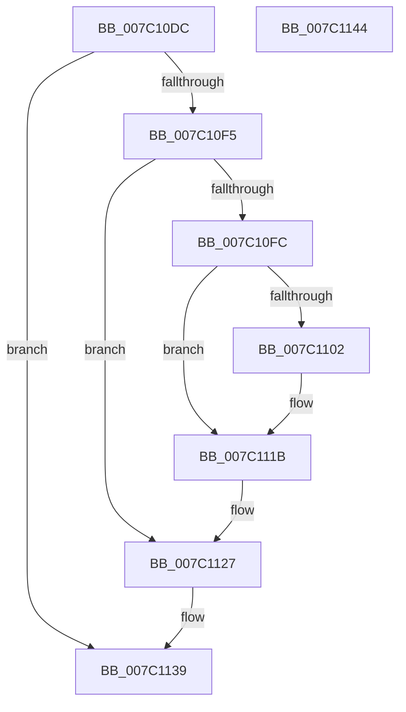

# EtwpDestructIptData

- RVA: `0x007C10DC`–`0x007C1145` (길이 `105` bytes)
- VA: `0x00000001407C10DC`
- 실행 섹션: `PAGE`
- PDB 이름 있음: `예`; PDB Function 태그: `아니요`
- unwind 정보 RVA: `0x0005CAAC`
- 디코드: `27`개 명령, `105/105` bytes 표시
- 미해석 바이트: `0` (있으면 어셈블리에 `.byte`로 보존)

> 이 문서는 커널 이미지의 기계어와 PDB 기호를 분석해 생성했습니다. 4번과 5번은 함수 원형과 자료형을 바이너리 사용 방식에서 추정한 C 해석이며 원본 소스 복구 결과는 아닙니다.

## 1. Dependencies

- 직접 호출 지점: **3**; 고유 호출 대상: **3**
- 직접 호출자로 확인된 함수: **1**
- RIP 상대 이미지 참조: **2**

### Outgoing calls
- `0x007C1116` → [guard_dispatch_icall](../../text/6B/guard_dispatch_icall_function_006BAAD0.md) (function, `0x006BAAD0`)
- `0x007C1122` → [ExReleaseExtensionTable](../../text/45/ExReleaseExtensionTable_function_00456DC0.md) (function, `0x00456DC0`)
- `0x007C112C` → [ExFreePoolWithTag](../../poolcode/B8/ExFreePoolWithTag_function_00B82870.md) (function, `0x00B82870`)

### Direct callers
- [EtwpFreeLoggerContext](../9C/EtwpFreeLoggerContext_function_009C1688.md) at `0x009C1A16`

### Static image references
- `0x007C1102` → RVA `0x00F475C0` (`.data`; read/write)
- `0x007C111B` → RVA `0x00EFF108` (`.data`; read)

## 2. Other-region calls and transfers

- 다른 실행 섹션으로 향하는 call: **3**
  - `0x007C1116` → [guard_dispatch_icall](../../text/6B/guard_dispatch_icall_function_006BAAD0.md) (`PAGE` → `.text`)
  - `0x007C1122` → [ExReleaseExtensionTable](../../text/45/ExReleaseExtensionTable_function_00456DC0.md) (`PAGE` → `.text`)
  - `0x007C112C` → [ExFreePoolWithTag](../../poolcode/B8/ExFreePoolWithTag_function_00B82870.md) (`PAGE` → `POOLCODE`)
- 별도 외부 분기/꼬리 이동을 확인하지 못했습니다.

## 3. Assembly (complete function range)

```asm
007C10DC  48 89 5C 24 08                  mov qword ptr [rsp + 8], rbx
007C10E1  57                              push rdi
007C10E2  48 83 EC 20                     sub rsp, 0x20
007C10E6  48 8B 99 38 04 00 00            mov rbx, qword ptr [rcx + 0x438]
007C10ED  48 8B F9                        mov rdi, rcx
007C10F0  48 85 DB                        test rbx, rbx
007C10F3  74 44                           je 0x1407c1139
007C10F5  48 83 7B 10 00                  cmp qword ptr [rbx + 0x10], 0
007C10FA  74 2B                           je 0x1407c1127
007C10FC  48 83 3B 00                     cmp qword ptr [rbx], 0
007C1100  74 19                           je 0x1407c111b
007C1102  F0 0F BA 35 B5 64 78 00 02      lock btr dword ptr [rip + 0x7864b5], 2
007C110B  48 8B 43 10                     mov rax, qword ptr [rbx + 0x10]
007C110F  48 8B 0B                        mov rcx, qword ptr [rbx]
007C1112  48 8B 40 08                     mov rax, qword ptr [rax + 8]
007C1116  E8 B5 99 EF FF                  call 0x1406baad0
007C111B  48 8B 0D E6 DF 73 00            mov rcx, qword ptr [rip + 0x73dfe6]
007C1122  E8 99 5C C9 FF                  call 0x140456dc0
007C1127  33 D2                           xor edx, edx
007C1129  48 8B CB                        mov rcx, rbx
007C112C  E8 3F 17 3C 00                  call 0x140b82870
007C1131  48 83 A7 38 04 00 00 00         and qword ptr [rdi + 0x438], 0
007C1139  48 8B 5C 24 30                  mov rbx, qword ptr [rsp + 0x30]
007C113E  48 83 C4 20                     add rsp, 0x20
007C1142  5F                              pop rdi
007C1143  C3                              ret
007C1144  CC                              int3
```

## 4. C-style interpretation (structured pseudocode)

```c
__int64 __fastcall EtwpDestructIptData(__int64 a1, int a2)
{
    __int64 result;
    __int64 v_rsp;
    unsigned __int64 v_stack_p8;

    v_stack_p8 = v_rbx;
    v_rsp = (v_rsp) - (32);
    if (*(unsigned __int64 *)(a1 + 1080) == 0) goto loc_007C1139;
    if ((*(unsigned __int64 *)(*(unsigned __int64 *)(a1 + 1080) + 16)) == 0) goto loc_007C1127;
    if ((*(unsigned __int64 *)(*(unsigned __int64 *)(a1 + 1080))) != 0) {
        result = *(unsigned __int64 *)(*(unsigned __int64 *)(a1 + 1080) + 16);
        a1 = *(unsigned __int64 *)(*(unsigned __int64 *)(a1 + 1080));
        result = *(unsigned __int64 *)(result + 8);
        result = guard_dispatch_icall(a1, a2, a3, a4);
    }
    result = ExReleaseExtensionTable(*(unsigned __int64 *)(v_rip + 7593958), a2, a3, a4);
loc_007C1127:
    a2 = 0;
    result = ExFreePoolWithTag(*(unsigned __int64 *)(a1 + 1080), a2, a3, a4);
loc_007C1139:
    v_rsp = (v_rsp) + (32);
    return result;
}
```

## 5. (Beta) C Style

```c
int64_t EtwpDestructIptData(void *Arg1, int32_t Arg2)
{
    uint8_t *arg1 = (uint8_t *)Arg1;

    int64_t result;
    int64_t local_rsp;
    uint64_t v_stack_p8;

    v_stack_p8 = local_rbx;
    local_rsp = (local_rsp) - (32);
    if (*(uint64_t *)(arg1 + 0x438) == 0) goto loc_007C1139;
    if ((*(uint64_t *)(*(uint64_t *)(arg1 + 0x438) + 0x10)) == 0) goto loc_007C1127;
    if ((*(uint64_t *)(*(uint64_t *)(arg1 + 0x438))) != 0) {
        result = *(uint64_t *)(*(uint64_t *)(arg1 + 0x438) + 0x10);
        Arg1 = *(uint64_t *)(*(uint64_t *)(arg1 + 0x438));
        result = *(uint64_t *)(result + 0x8);
        result = guard_dispatch_icall(Arg1, Arg2, a3, a4);
    }
    result = ExReleaseExtensionTable(*(uint64_t *)(v_rip + 0x73DFE6), Arg2, a3, a4);
loc_007C1127:
    Arg2 = 0;
    result = ExFreePoolWithTag(*(uint64_t *)(arg1 + 0x438), Arg2, a3, a4);
loc_007C1139:
    local_rsp = (local_rsp) + (32);
    return result;
}
```

### 관측된 메모리 오프셋

구조체 형식이 확인되지 않은 접근은 인자 기준의 오프셋으로만 기록했습니다.

| 기준 인자 | 오프셋 표현 | 폭 (bit) | 접근 |
|---|---:|---:|---|
| `Arg1` | `+ 0x438` | `64` | `R` |
| `Arg1` | `+ 0x438` | `64` | `R/W` |

## 6. Execution-region graph

[열기: 2D/3D 그래프와 함수 탐색 컨트롤 패널](../../../control-panel.html?section=page&rva=0x007C10DC&view=graph)

- 2D 그래프는 위에서 아래로 흐르고, 3D 그래프는 빈 공간을 드래그해 회전합니다. Shift+드래그는 이동, 휠은 확대·축소, 함수 노드 선택은 대상 보고서 이동입니다.

### Static fallback


