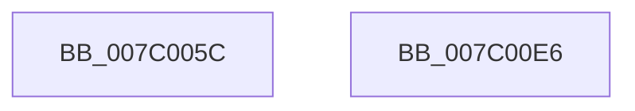

# EtwpExecutiveResourceConfigRunDown

- RVA: `0x007C005C`–`0x007C00E7` (길이 `139` bytes)
- VA: `0x00000001407C005C`
- 실행 섹션: `PAGE`
- PDB 이름 있음: `예`; PDB Function 태그: `아니요`
- unwind 정보 RVA: `0x0006F9F8`
- 디코드: `30`개 명령, `139/139` bytes 표시
- 미해석 바이트: `0` (있으면 어셈블리에 `.byte`로 보존)

> 이 문서는 커널 이미지의 기계어와 PDB 기호를 분석해 생성했습니다. 4번과 5번은 함수 원형과 자료형을 바이너리 사용 방식에서 추정한 C 해석이며 원본 소스 복구 결과는 아닙니다.

## 1. Dependencies

- 직접 호출 지점: **2**; 고유 호출 대상: **2**
- 직접 호출자로 확인된 함수: **1**
- RIP 상대 이미지 참조: **4**

### Outgoing calls
- `0x007C00CF` → [EtwpLogKernelEvent](../../text/25/EtwpLogKernelEvent_function_0025CC00.md) (function, `0x0025CC00`)
- `0x007C00DC` → [_security_check_cookie](../../text/6A/_security_check_cookie_function_006AC640.md) (function, `0x006AC640`)

### Direct callers
- [EtwpKernelTraceRundown](../9E/EtwpKernelTraceRundown_function_009E4080.md) at `0x009E41F6`

### Static image references
- `0x007C0060` → RVA `0x00E0A740` (`.data`; read)
- `0x007C006F` → RVA `0x00E0EB10` (`.data`; read)
- `0x007C0095` → RVA `0x00E0EB18` (`.data`; read)
- `0x007C009F` → RVA `0x00E0EB14` (`.data`; read)

## 2. Other-region calls and transfers

- 다른 실행 섹션으로 향하는 call: **2**
  - `0x007C00CF` → [EtwpLogKernelEvent](../../text/25/EtwpLogKernelEvent_function_0025CC00.md) (`PAGE` → `.text`)
  - `0x007C00DC` → [_security_check_cookie](../../text/6A/_security_check_cookie_function_006AC640.md) (`PAGE` → `.text`)
- 별도 외부 분기/꼬리 이동을 확인하지 못했습니다.

## 3. Assembly (complete function range)

```asm
007C005C  48 83 EC 68                     sub rsp, 0x68
007C0060  48 8B 05 D9 A6 64 00            mov rax, qword ptr [rip + 0x64a6d9]
007C0067  48 33 C4                        xor rax, rsp
007C006A  48 89 44 24 50                  mov qword ptr [rsp + 0x50], rax
007C006F  8B 05 9B EA 64 00               mov eax, dword ptr [rip + 0x64ea9b]
007C0075  41 B9 01 00 00 00               mov r9d, 1
007C007B  83 64 24 4C 00                  and dword ptr [rsp + 0x4c], 0
007C0080  44 8B 01                        mov r8d, dword ptr [rcx]
007C0083  F6 DA                           neg dl
007C0085  48 8B 91 50 05 00 00            mov rdx, qword ptr [rcx + 0x550]
007C008C  48 8D 4C 24 40                  lea rcx, [rsp + 0x40]
007C0091  89 44 24 30                     mov dword ptr [rsp + 0x30], eax
007C0095  8B 05 7D EA 64 00               mov eax, dword ptr [rip + 0x64ea7d]
007C009B  89 44 24 34                     mov dword ptr [rsp + 0x34], eax
007C009F  8B 05 6F EA 64 00               mov eax, dword ptr [rip + 0x64ea6f]
007C00A5  89 44 24 38                     mov dword ptr [rsp + 0x38], eax
007C00A9  48 8D 44 24 30                  lea rax, [rsp + 0x30]
007C00AE  48 89 44 24 40                  mov qword ptr [rsp + 0x40], rax
007C00B3  66 1B C0                        sbb ax, ax
007C00B6  66 05 4E 0F                     add ax, 0xf4e
007C00BA  C7 44 24 28 02 19 50 00         mov dword ptr [rsp + 0x28], 0x501902
007C00C2  66 89 44 24 20                  mov word ptr [rsp + 0x20], ax
007C00C7  C7 44 24 48 0C 00 00 00         mov dword ptr [rsp + 0x48], 0xc
007C00CF  E8 2C CB A9 FF                  call 0x14025cc00
007C00D4  48 8B 4C 24 50                  mov rcx, qword ptr [rsp + 0x50]
007C00D9  48 33 CC                        xor rcx, rsp
007C00DC  E8 5F C5 EE FF                  call 0x1406ac640
007C00E1  48 83 C4 68                     add rsp, 0x68
007C00E5  C3                              ret
007C00E6  CC                              int3
```

## 4. C-style interpretation (structured pseudocode)

```c
__int64 __fastcall EtwpExecutiveResourceConfigRunDown(__int64 a1, unsigned __int8 a2)
{
    __int64 result;
    __int64 v_rsp;
    unsigned __int64 v_stack_m18;
    unsigned int v_stack_m1C;
    unsigned int v_stack_m20;
    unsigned __int64 v_stack_m28;
    unsigned int v_stack_m30;
    unsigned int v_stack_m34;
    unsigned int v_stack_m38;
    unsigned int v_stack_m40;
    unsigned __int16 v_stack_m48;

    v_rsp = (v_rsp) - (104);
    result = (*(unsigned __int64 *)(v_rip + 6596313)) ^ (v_rsp);
    v_stack_m18 = result;
    a2 = (unsigned __int8)(-(a2));
    v_stack_m38 = (unsigned int)((unsigned int)(*(unsigned int *)(v_rip + 6613659)));
    v_stack_m34 = (unsigned int)((unsigned int)(*(unsigned int *)(v_rip + 6613629)));
    v_stack_m30 = (unsigned int)((unsigned int)(*(unsigned int *)(v_rip + 6613615)));
    v_stack_m28 = v_stack_m38;
    result = (unsigned __int16)((v_stack_m38) + (0xF4EULL));
    v_stack_m40 = 0x501902ULL;
    v_stack_m48 = (unsigned __int16)(result);
    v_stack_m20 = 12;
    result = EtwpLogKernelEvent(v_stack_m28, *(unsigned __int64 *)(a1 + 1360), (unsigned int)(*(unsigned int *)(a1)), 1);
    a1 = (v_stack_m18) ^ (v_rsp);
    result = _security_check_cookie(a1, *(unsigned __int64 *)(a1 + 1360), (unsigned int)(*(unsigned int *)(a1)), 1);
    v_rsp = (v_rsp) + (104);
    return result;
}
```

## 5. (Beta) C Style

```c
int64_t EtwpExecutiveResourceConfigRunDown(void *Arg1, uint8_t Arg2)
{
    uint8_t *arg1 = (uint8_t *)Arg1;

    int64_t result;
    int64_t local_rsp;
    uint64_t v_stack_m18;
    uint32_t v_stack_m1C;
    uint32_t v_stack_m20;
    uint64_t v_stack_m28;
    uint32_t v_stack_m30;
    uint32_t v_stack_m34;
    uint32_t v_stack_m38;
    uint32_t v_stack_m40;
    uint16_t v_stack_m48;

    local_rsp = (local_rsp) - (104);
    result = (*(uint64_t *)(v_rip + 0x64A6D9)) ^ (local_rsp);
    v_stack_m18 = result;
    Arg2 = (uint8_t)(-(Arg2));
    v_stack_m38 = (uint32_t)((uint32_t)(*(uint32_t *)(v_rip + 0x64EA9B)));
    v_stack_m34 = (uint32_t)((uint32_t)(*(uint32_t *)(v_rip + 0x64EA7D)));
    v_stack_m30 = (uint32_t)((uint32_t)(*(uint32_t *)(v_rip + 0x64EA6F)));
    v_stack_m28 = v_stack_m38;
    result = (uint16_t)((v_stack_m38) + (0xF4EULL));
    v_stack_m40 = 0x501902ULL;
    v_stack_m48 = (uint16_t)(result);
    v_stack_m20 = 12;
    result = EtwpLogKernelEvent(v_stack_m28, *(uint64_t *)(arg1 + 0x550), (uint32_t)(*(uint32_t *)(arg1)), 1);
    Arg1 = (v_stack_m18) ^ (local_rsp);
    result = _security_check_cookie(Arg1, *(uint64_t *)(arg1 + 0x550), (uint32_t)(*(uint32_t *)(arg1)), 1);
    local_rsp = (local_rsp) + (104);
    return result;
}
```

### 관측된 메모리 오프셋

구조체 형식이 확인되지 않은 접근은 인자 기준의 오프셋으로만 기록했습니다.

| 기준 인자 | 오프셋 표현 | 폭 (bit) | 접근 |
|---|---:|---:|---|
| `Arg1` | `+ 0x0` | `32` | `R` |
| `Arg1` | `+ 0x550` | `64` | `R` |

## 6. Execution-region graph

[열기: 2D/3D 그래프와 함수 탐색 컨트롤 패널](../../../control-panel.html?section=page&rva=0x007C005C&view=graph)

- 2D 그래프는 위에서 아래로 흐르고, 3D 그래프는 빈 공간을 드래그해 회전합니다. Shift+드래그는 이동, 휠은 확대·축소, 함수 노드 선택은 대상 보고서 이동입니다.

### Static fallback


