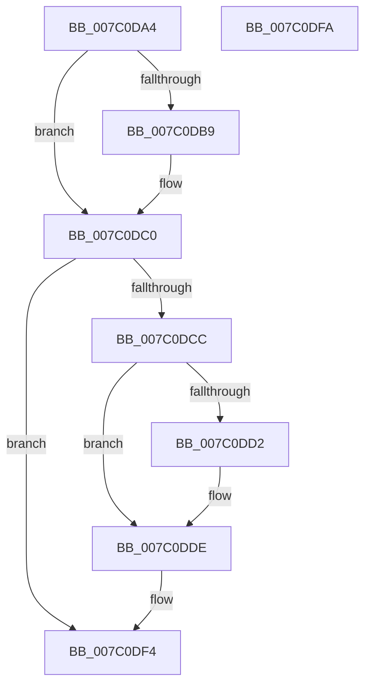

# EtwpFreeLbrData

- RVA: `0x007C0DA4`–`0x007C0DFB` (길이 `87` bytes)
- VA: `0x00000001407C0DA4`
- 실행 섹션: `PAGE`
- PDB 이름 있음: `예`; PDB Function 태그: `아니요`
- unwind 정보 RVA: `0x0005CF00`
- 디코드: `22`개 명령, `87/87` bytes 표시
- 미해석 바이트: `0` (있으면 어셈블리에 `.byte`로 보존)

> 이 문서는 커널 이미지의 기계어와 PDB 기호를 분석해 생성했습니다. 4번과 5번은 함수 원형과 자료형을 바이너리 사용 방식에서 추정한 C 해석이며 원본 소스 복구 결과는 아닙니다.

## 1. Dependencies

- 직접 호출 지점: **2**; 고유 호출 대상: **2**
- 직접 호출자로 확인된 함수: **1**
- RIP 상대 이미지 참조: **2**

### Outgoing calls
- `0x007C0DD9` → [guard_dispatch_icall](../../text/6B/guard_dispatch_icall_function_006BAAD0.md) (function, `0x006BAAD0`)
- `0x007C0DE7` → [ExFreePoolWithTag](../../poolcode/B8/ExFreePoolWithTag_function_00B82870.md) (function, `0x00B82870`)

### Direct callers
- [EtwpFreeLoggerContext](../9C/EtwpFreeLoggerContext_function_009C1688.md) at `0x009C1A09`

### Static image references
- `0x007C0DB9` → RVA `0x00E28FC0` (`.data`; read/write)
- `0x007C0DD2` → RVA `0x00E00C18` (`.data`; read)

## 2. Other-region calls and transfers

- 다른 실행 섹션으로 향하는 call: **2**
  - `0x007C0DD9` → [guard_dispatch_icall](../../text/6B/guard_dispatch_icall_function_006BAAD0.md) (`PAGE` → `.text`)
  - `0x007C0DE7` → [ExFreePoolWithTag](../../poolcode/B8/ExFreePoolWithTag_function_00B82870.md) (`PAGE` → `POOLCODE`)
- 별도 외부 분기/꼬리 이동을 확인하지 못했습니다.

## 3. Assembly (complete function range)

```asm
007C0DA4  40 53                           push rbx
007C0DA6  48 83 EC 20                     sub rsp, 0x20
007C0DAA  F7 81 30 03 00 00 00 80 00 00   test dword ptr [rcx + 0x330], 0x8000
007C0DB4  48 8B D9                        mov rbx, rcx
007C0DB7  74 07                           je 0x1407c0dc0
007C0DB9  F0 FF 0D 00 82 66 00            lock dec dword ptr [rip + 0x668200]
007C0DC0  48 8B 81 30 04 00 00            mov rax, qword ptr [rcx + 0x430]
007C0DC7  48 85 C0                        test rax, rax
007C0DCA  74 28                           je 0x1407c0df4
007C0DCC  8B 08                           mov ecx, dword ptr [rax]
007C0DCE  85 C9                           test ecx, ecx
007C0DD0  74 0C                           je 0x1407c0dde
007C0DD2  48 8B 05 3F FE 63 00            mov rax, qword ptr [rip + 0x63fe3f]
007C0DD9  E8 F2 9C EF FF                  call 0x1406baad0
007C0DDE  48 8B 8B 30 04 00 00            mov rcx, qword ptr [rbx + 0x430]
007C0DE5  33 D2                           xor edx, edx
007C0DE7  E8 84 1A 3C 00                  call 0x140b82870
007C0DEC  48 83 A3 30 04 00 00 00         and qword ptr [rbx + 0x430], 0
007C0DF4  48 83 C4 20                     add rsp, 0x20
007C0DF8  5B                              pop rbx
007C0DF9  C3                              ret
007C0DFA  CC                              int3
```

## 4. C-style interpretation (structured pseudocode)

```c
__int64 __fastcall EtwpFreeLbrData(__int64 a1, int a2)
{
    __int64 result;
    __int64 v_rsp;

    v_rsp = (v_rsp) - (32);
    if (((*(unsigned int *)(a1 + 816)) & (0x8000ULL)) != 0) {
    }
    if (*(unsigned __int64 *)(a1 + 1072) == 0) goto loc_007C0DF4;
    result = *(unsigned __int64 *)(a1 + 1072);
    if ((unsigned int)((unsigned int)(*(unsigned int *)(*(unsigned __int64 *)(a1 + 1072)))) != 0) {
        result = *(unsigned __int64 *)(v_rip + 6553151);
        result = guard_dispatch_icall((unsigned int)(*(unsigned int *)(*(unsigned __int64 *)(a1 + 1072))), a2, a3, a4);
    }
    a2 = 0;
    result = ExFreePoolWithTag(*(unsigned __int64 *)(a1 + 1072), a2, a3, a4);
loc_007C0DF4:
    v_rsp = (v_rsp) + (32);
    return result;
}
```

## 5. (Beta) C Style

```c
int64_t EtwpFreeLbrData(void *Arg1, int32_t Arg2)
{
    uint8_t *arg1 = (uint8_t *)Arg1;

    int64_t result;
    int64_t local_rsp;

    local_rsp = (local_rsp) - (32);
    if (((*(uint32_t *)(arg1 + 0x330)) & (0x8000ULL)) != 0) {
    }
    if (*(uint64_t *)(arg1 + 0x430) == 0) goto loc_007C0DF4;
    result = *(uint64_t *)(arg1 + 0x430);
    if ((uint32_t)((uint32_t)(*(uint32_t *)(*(uint64_t *)(arg1 + 0x430)))) != 0) {
        result = *(uint64_t *)(v_rip + 0x63FE3F);
        result = guard_dispatch_icall((uint32_t)(*(uint32_t *)(*(uint64_t *)(arg1 + 0x430))), Arg2, a3, a4);
    }
    Arg2 = 0;
    result = ExFreePoolWithTag(*(uint64_t *)(arg1 + 0x430), Arg2, a3, a4);
loc_007C0DF4:
    local_rsp = (local_rsp) + (32);
    return result;
}
```

### 관측된 메모리 오프셋

구조체 형식이 확인되지 않은 접근은 인자 기준의 오프셋으로만 기록했습니다.

| 기준 인자 | 오프셋 표현 | 폭 (bit) | 접근 |
|---|---:|---:|---|
| `Arg1` | `+ 0x330` | `32` | `R` |
| `Arg1` | `+ 0x430` | `64` | `R` |
| `Arg1` | `+ 0x430` | `64` | `R/W` |

## 6. Execution-region graph

[열기: 2D/3D 그래프와 함수 탐색 컨트롤 패널](../../../control-panel.html?section=page&rva=0x007C0DA4&view=graph)

- 2D 그래프는 위에서 아래로 흐르고, 3D 그래프는 빈 공간을 드래그해 회전합니다. Shift+드래그는 이동, 휠은 확대·축소, 함수 노드 선택은 대상 보고서 이동입니다.

### Static fallback


