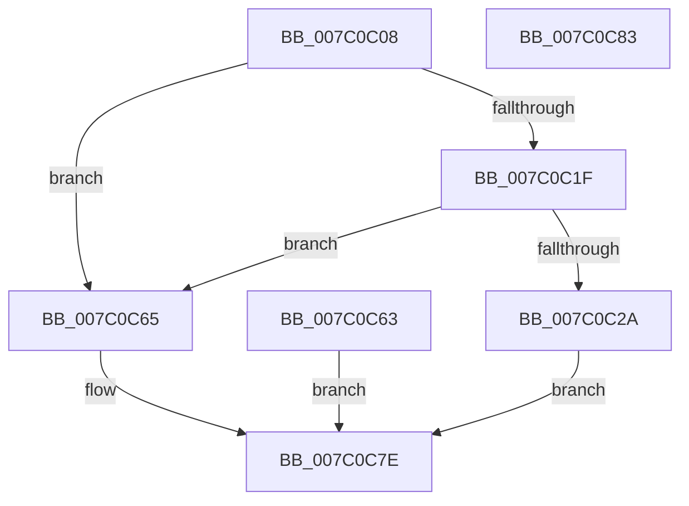

# EtwpFreeUserBufferSpace

- RVA: `0x007C0C08`–`0x007C0C84` (길이 `124` bytes)
- VA: `0x00000001407C0C08`
- 실행 섹션: `PAGE`
- PDB 이름 있음: `예`; PDB Function 태그: `아니요`
- unwind 정보 RVA: `0x000D3E74`
- 디코드: `34`개 명령, `124/124` bytes 표시
- 미해석 바이트: `0` (있으면 어셈블리에 `.byte`로 보존)

> 이 문서는 커널 이미지의 기계어와 PDB 기호를 분석해 생성했습니다. 4번과 5번은 함수 원형과 자료형을 바이너리 사용 방식에서 추정한 C 해석이며 원본 소스 복구 결과는 아닙니다.

## 1. Dependencies

- 직접 호출 지점: **2**; 고유 호출 대상: **2**
- 직접 호출자로 확인된 함수: **1**
- RIP 상대 이미지 참조: **0**

### Outgoing calls
- `0x007C0C5C` → [RtlInterlockedClearBitRun](../../text/46/RtlInterlockedClearBitRun_function_00466D00.md) (function, `0x00466D00`)
- `0x007C0C79` → [ZwFreeVirtualMemory](../../text/6A/ZwFreeVirtualMemory_function_006AD490.md) (function, `0x006AD490`)

### Direct callers
- [EtwpRealtimeInjectEtwBuffer](../9B/EtwpRealtimeInjectEtwBuffer_function_009BF910.md) at `0x009BFA80`

### Static image references
- 디코드된 RIP-relative 메모리 참조가 없습니다.

## 2. Other-region calls and transfers

- 다른 실행 섹션으로 향하는 call: **2**
  - `0x007C0C5C` → [RtlInterlockedClearBitRun](../../text/46/RtlInterlockedClearBitRun_function_00466D00.md) (`PAGE` → `.text`)
  - `0x007C0C79` → [ZwFreeVirtualMemory](../../text/6A/ZwFreeVirtualMemory_function_006AD490.md) (`PAGE` → `.text`)
- 별도 외부 분기/꼬리 이동을 확인하지 못했습니다.

## 3. Assembly (complete function range)

```asm
007C0C08  4C 89 44 24 18                  mov qword ptr [rsp + 0x18], r8
007C0C0D  48 89 54 24 10                  mov qword ptr [rsp + 0x10], rdx
007C0C12  48 83 EC 28                     sub rsp, 0x28
007C0C16  4C 8B 49 70                     mov r9, qword ptr [rcx + 0x70]
007C0C1A  4D 3B C1                        cmp r8, r9
007C0C1D  72 46                           jb 0x1407c0c65
007C0C1F  8B 41 78                        mov eax, dword ptr [rcx + 0x78]
007C0C22  49 03 C1                        add rax, r9
007C0C25  4C 3B C0                        cmp r8, rax
007C0C28  73 3B                           jae 0x1407c0c65
007C0C2A  44 8D 92 FF 0F 00 00            lea r10d, [rdx + 0xfff]
007C0C31  B8 00 F0 FF FF                  mov eax, 0xfffff000
007C0C36  4C 23 D0                        and r10, rax
007C0C39  4C 89 54 24 38                  mov qword ptr [rsp + 0x38], r10
007C0C3E  41 C1 EA 0C                     shr r10d, 0xc
007C0C42  4D 2B C1                        sub r8, r9
007C0C45  49 8B C0                        mov rax, r8
007C0C48  48 99                           cqo
007C0C4A  41 B8 00 10 00 00               mov r8d, 0x1000
007C0C50  49 F7 F8                        idiv r8
007C0C53  48 83 C1 60                     add rcx, 0x60
007C0C57  45 8B C2                        mov r8d, r10d
007C0C5A  8B D0                           mov edx, eax
007C0C5C  E8 9F 60 CA FF                  call 0x140466d00
007C0C61  EB 1B                           jmp 0x1407c0c7e
007C0C63  EB 19                           jmp 0x1407c0c7e
007C0C65  41 B9 00 80 00 00               mov r9d, 0x8000
007C0C6B  4C 8D 44 24 38                  lea r8, [rsp + 0x38]
007C0C70  48 8D 54 24 40                  lea rdx, [rsp + 0x40]
007C0C75  48 8B 49 10                     mov rcx, qword ptr [rcx + 0x10]
007C0C79  E8 12 C8 EE FF                  call 0x1406ad490
007C0C7E  48 83 C4 28                     add rsp, 0x28
007C0C82  C3                              ret
007C0C83  CC                              int3
```

## 4. C-style interpretation (structured pseudocode)

```c
__int64 __fastcall EtwpFreeUserBufferSpace(__int64 a1, __int64 a2, __int64 a3)
{
    __int64 result;
    __int64 v_r10;
    __int64 v_rsp;
    unsigned __int64 v_stack_p10;
    unsigned __int64 v_stack_p18;

    v_stack_p18 = a3;
    v_stack_p10 = a2;
    v_rsp = (v_rsp) - (40);
    if (a3 < (*(unsigned __int64 *)(a1 + 112))) goto loc_007C0C65;
    result = ((unsigned int)(*(unsigned int *)(a1 + 120))) + (*(unsigned __int64 *)(a1 + 112));
    if (a3 >= result) goto loc_007C0C65;
    v_r10 = (a2 + 4095) & ((unsigned int)(0xFFFFF000ULL));
    v_stack_p10 = v_r10;
    v_r10 = (unsigned int)((v_r10) >> (12));
    a3 = (a3) - (*(unsigned __int64 *)(a1 + 112));
    a1 = (a1) + (96);
    result = RtlInterlockedClearBitRun(a1, (unsigned int)((unsigned int)(a3)), (unsigned int)((unsigned int)(v_r10)), *(unsigned __int64 *)(a1 + 112));
    goto loc_007C0C7E;
loc_007C0C65:
    result = ZwFreeVirtualMemory(*(unsigned __int64 *)(a1 + 16), v_stack_p18, v_stack_p10, (unsigned int)(0x8000ULL));
loc_007C0C7E:
    v_rsp = (v_rsp) + (40);
    return result;
}
```

## 5. (Beta) C Style

```c
int64_t EtwpFreeUserBufferSpace(void *Arg1, void *Arg2, int64_t Arg3)
{
    uint8_t *arg1 = (uint8_t *)Arg1;
    uint8_t *arg2 = (uint8_t *)Arg2;

    int64_t result;
    int64_t local_r10;
    int64_t local_rsp;
    uint64_t v_stack_p10;
    uint64_t v_stack_p18;

    v_stack_p18 = Arg3;
    v_stack_p10 = Arg2;
    local_rsp = (local_rsp) - (40);
    if (Arg3 < (*(uint64_t *)(arg1 + 0x70))) goto loc_007C0C65;
    result = ((uint32_t)(*(uint32_t *)(arg1 + 0x78))) + (*(uint64_t *)(arg1 + 0x70));
    if (Arg3 >= result) goto loc_007C0C65;
    local_r10 = (Arg2 + 4095) & ((uint32_t)(0xFFFFF000ULL));
    v_stack_p10 = local_r10;
    local_r10 = (uint32_t)((local_r10) >> (12));
    Arg3 = (Arg3) - (*(uint64_t *)(arg1 + 0x70));
    Arg1 = (Arg1) + (96);
    result = RtlInterlockedClearBitRun(Arg1, (uint32_t)((uint32_t)(Arg3)), (uint32_t)((uint32_t)(local_r10)), *(uint64_t *)(arg1 + 0x70));
    goto loc_007C0C7E;
loc_007C0C65:
    result = ZwFreeVirtualMemory(*(uint64_t *)(arg1 + 0x10), v_stack_p18, v_stack_p10, (uint32_t)(0x8000ULL));
loc_007C0C7E:
    local_rsp = (local_rsp) + (40);
    return result;
}
```

### 관측된 메모리 오프셋

구조체 형식이 확인되지 않은 접근은 인자 기준의 오프셋으로만 기록했습니다.

| 기준 인자 | 오프셋 표현 | 폭 (bit) | 접근 |
|---|---:|---:|---|
| `Arg1` | `+ 0x10` | `64` | `R` |
| `Arg1` | `+ 0x70` | `64` | `R` |
| `Arg1` | `+ 0x78` | `32` | `R` |
| `Arg2` | `+ 0xFFF` | `32` | `R` |

## 6. Execution-region graph

[열기: 2D/3D 그래프와 함수 탐색 컨트롤 패널](../../../control-panel.html?section=page&rva=0x007C0C08&view=graph)

- 2D 그래프는 위에서 아래로 흐르고, 3D 그래프는 빈 공간을 드래그해 회전합니다. Shift+드래그는 이동, 휠은 확대·축소, 함수 노드 선택은 대상 보고서 이동입니다.

### Static fallback


