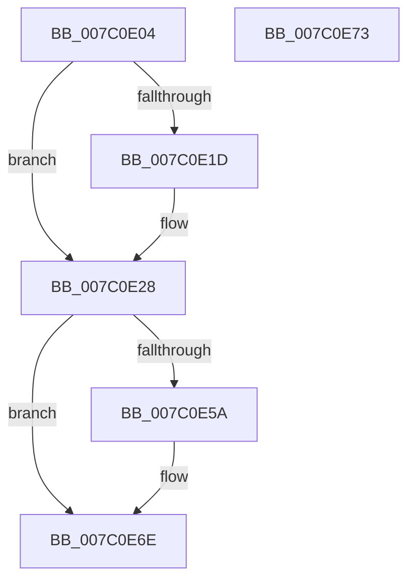

# EtwpInitializeLastBranchTracing

- RVA: `0x007C0E04`–`0x007C0E74` (길이 `112` bytes)
- VA: `0x00000001407C0E04`
- 실행 섹션: `PAGE`
- PDB 이름 있음: `예`; PDB Function 태그: `아니요`
- unwind 정보 RVA: `0x0005C788`
- 디코드: `26`개 명령, `112/112` bytes 표시
- 미해석 바이트: `0` (있으면 어셈블리에 `.byte`로 보존)

> 이 문서는 커널 이미지의 기계어와 PDB 기호를 분석해 생성했습니다. 4번과 5번은 함수 원형과 자료형을 바이너리 사용 방식에서 추정한 C 해석이며 원본 소스 복구 결과는 아닙니다.

## 1. Dependencies

- 직접 호출 지점: **2**; 고유 호출 대상: **2**
- 직접 호출자로 확인된 함수: **1**
- RIP 상대 이미지 참조: **7**

### Outgoing calls
- `0x007C0E22` → [RtlRaiseStatus](../../text/2F/RtlRaiseStatus_function_002F6A50.md) (function, `0x002F6A50`)
- `0x007C0E51` → [guard_dispatch_icall](../../text/6B/guard_dispatch_icall_function_006BAAD0.md) (function, `0x006BAAD0`)

### Direct callers
- [EtwpInitialize](../../init/C4/EtwpInitialize_function_00C4DBCC.md) at `0x00C4DD98`

### Static image references
- `0x007C0E0D` → RVA `0x00E28FB0` (`.data`; read)
- `0x007C0E28` → RVA `0x00E00C00` (`.data`; read)
- `0x007C0E34` → RVA `0x00E28FC0` (`.data`; read/write)
- `0x007C0E40` → RVA `0x00E28FC4` (`.data`; read/write)
- `0x007C0E4A` → RVA `0x00E28FB0` (`.data`; write)
- `0x007C0E5E` → RVA `0x00FC6DA0` (`ALMOSTRO`; write)
- `0x007C0E68` → RVA `0x00FC6D40` (`ALMOSTRO`; write)

## 2. Other-region calls and transfers

- 다른 실행 섹션으로 향하는 call: **2**
  - `0x007C0E22` → [RtlRaiseStatus](../../text/2F/RtlRaiseStatus_function_002F6A50.md) (`PAGE` → `.text`)
  - `0x007C0E51` → [guard_dispatch_icall](../../text/6B/guard_dispatch_icall_function_006BAAD0.md) (`PAGE` → `.text`)
- 별도 외부 분기/꼬리 이동을 확인하지 못했습니다.

## 3. Assembly (complete function range)

```asm
007C0E04  48 83 EC 28                     sub rsp, 0x28
007C0E08  83 64 24 30 00                  and dword ptr [rsp + 0x30], 0
007C0E0D  48 8D 05 9C 81 66 00            lea rax, [rip + 0x66819c]
007C0E14  83 64 24 38 00                  and dword ptr [rsp + 0x38], 0
007C0E19  A8 0F                           test al, 0xf
007C0E1B  74 0B                           je 0x1407c0e28
007C0E1D  B9 02 00 00 80                  mov ecx, 0x80000002
007C0E22  E8 29 5C B3 FF                  call 0x1402f6a50
007C0E27  CC                              int3
007C0E28  48 8B 05 D1 FD 63 00            mov rax, qword ptr [rip + 0x63fdd1]
007C0E2F  48 8D 54 24 38                  lea rdx, [rsp + 0x38]
007C0E34  83 25 85 81 66 00 00            and dword ptr [rip + 0x668185], 0
007C0E3B  48 8D 4C 24 30                  lea rcx, [rsp + 0x30]
007C0E40  83 25 7D 81 66 00 00            and dword ptr [rip + 0x66817d], 0
007C0E47  0F 57 C0                        xorps xmm0, xmm0
007C0E4A  0F 29 05 5F 81 66 00            movaps xmmword ptr [rip + 0x66815f], xmm0
007C0E51  E8 7A 9C EF FF                  call 0x1406baad0
007C0E56  84 C0                           test al, al
007C0E58  74 14                           je 0x1407c0e6e
007C0E5A  8B 44 24 30                     mov eax, dword ptr [rsp + 0x30]
007C0E5E  89 05 3C 5F 80 00               mov dword ptr [rip + 0x805f3c], eax
007C0E64  8B 44 24 38                     mov eax, dword ptr [rsp + 0x38]
007C0E68  89 05 D2 5E 80 00               mov dword ptr [rip + 0x805ed2], eax
007C0E6E  48 83 C4 28                     add rsp, 0x28
007C0E72  C3                              ret
007C0E73  CC                              int3
```

## 4. C-style interpretation (structured pseudocode)

```c
__int64 __fastcall EtwpInitializeLastBranchTracing(void)
{
    __int64 result;
    __int64 v_rsp;
    unsigned int v_stack_p10;
    unsigned int v_stack_p8;

    v_rsp = (v_rsp) - (40);
    result = v_rip + 6717852;
    if ((((unsigned __int8)(v_rip + 6717852)) & (15)) != 0) {
        a1 = 0x80000002ULL;
        result = RtlRaiseStatus(a1, a2, a3, a4);
    }
    *(unsigned __int64 *)(v_rip + 6717791) = v_xmm0;
    result = guard_dispatch_icall(v_stack_p8, v_stack_p10, a3, a4);
    if ((unsigned __int8)(result) != 0) {
        result = v_stack_p8;
        *(unsigned int *)(v_rip + 8412988) = (unsigned int)(result);
        result = v_stack_p10;
        *(unsigned int *)(v_rip + 8412882) = (unsigned int)(result);
    }
    v_rsp = (v_rsp) + (40);
    return result;
}
```

## 5. (Beta) C Style

```c
void EtwpInitializeLastBranchTracing(void)
{
    int64_t result;
    int64_t local_rsp;
    uint32_t v_stack_p10;
    uint32_t v_stack_p8;

    local_rsp = (local_rsp) - (40);
    result = v_rip + 6717852;
    if ((((uint8_t)(v_rip + 6717852)) & (15)) != 0) {
        a1 = 0x80000002ULL;
        result = RtlRaiseStatus(a1, a2, a3, a4);
    }
    *(uint64_t *)(v_rip + 0x66815F) = v_xmm0;
    result = guard_dispatch_icall(v_stack_p8, v_stack_p10, a3, a4);
    if ((uint8_t)(result) != 0) {
        result = v_stack_p8;
        *(uint32_t *)(v_rip + 0x805F3C) = (uint32_t)(result);
        result = v_stack_p10;
        *(uint32_t *)(v_rip + 0x805ED2) = (uint32_t)(result);
    }
    local_rsp = (local_rsp) + (40);
    return result;
}
```

## 6. Execution-region graph

[열기: 2D/3D 그래프와 함수 탐색 컨트롤 패널](../../../control-panel.html?section=page&rva=0x007C0E04&view=graph)

- 2D 그래프는 위에서 아래로 흐르고, 3D 그래프는 빈 공간을 드래그해 회전합니다. Shift+드래그는 이동, 휠은 확대·축소, 함수 노드 선택은 대상 보고서 이동입니다.

### Static fallback


