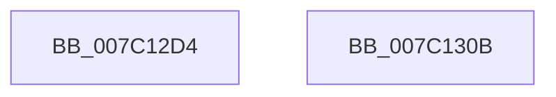

# EtwpInitializeProviderTraits

- RVA: `0x007C12D4`–`0x007C130C` (길이 `56` bytes)
- VA: `0x00000001407C12D4`
- 실행 섹션: `PAGE`
- PDB 이름 있음: `예`; PDB Function 태그: `아니요`
- unwind 정보 RVA: `0x0005C788`
- 디코드: `12`개 명령, `56/56` bytes 표시
- 미해석 바이트: `0` (있으면 어셈블리에 `.byte`로 보존)

> 이 문서는 커널 이미지의 기계어와 PDB 기호를 분석해 생성했습니다. 4번과 5번은 함수 원형과 자료형을 바이너리 사용 방식에서 추정한 C 해석이며 원본 소스 복구 결과는 아닙니다.

## 1. Dependencies

- 직접 호출 지점: **2**; 고유 호출 대상: **1**
- 직접 호출자로 확인된 함수: **1**
- RIP 상대 이미지 참조: **4**

### Outgoing calls
- `0x007C12DF` → [KeInitializeGuardedMutex](../../text/46/KeInitializeGuardedMutex_function_00466E90.md) (function, `0x00466E90`)
- `0x007C12F6` → [KeInitializeGuardedMutex](../../text/46/KeInitializeGuardedMutex_function_00466E90.md) (function, `0x00466E90`)

### Direct callers
- [EtwpInitialize](../../init/C4/EtwpInitialize_function_00C4DBCC.md) at `0x00C4DE10`

### Static image references
- `0x007C12D8` → RVA `0x00EFF460` (`.data`; read)
- `0x007C12E7` → RVA `0x00EFF4C0` (`.data`; read)
- `0x007C12EE` → RVA `0x00EFF4A0` (`.data`; write)
- `0x007C12FE` → RVA `0x00EFF500` (`.data`; write)

## 2. Other-region calls and transfers

- 다른 실행 섹션으로 향하는 call: **2**
  - `0x007C12DF` → [KeInitializeGuardedMutex](../../text/46/KeInitializeGuardedMutex_function_00466E90.md) (`PAGE` → `.text`)
  - `0x007C12F6` → [KeInitializeGuardedMutex](../../text/46/KeInitializeGuardedMutex_function_00466E90.md) (`PAGE` → `.text`)
- 별도 외부 분기/꼬리 이동을 확인하지 못했습니다.

## 3. Assembly (complete function range)

```asm
007C12D4  48 83 EC 28                     sub rsp, 0x28
007C12D8  48 8D 0D 81 E1 73 00            lea rcx, [rip + 0x73e181]
007C12DF  E8 AC 5B CA FF                  call 0x140466e90
007C12E4  0F 57 C0                        xorps xmm0, xmm0
007C12E7  48 8D 0D D2 E1 73 00            lea rcx, [rip + 0x73e1d2]
007C12EE  F3 0F 7F 05 AA E1 73 00         movdqu xmmword ptr [rip + 0x73e1aa], xmm0
007C12F6  E8 95 5B CA FF                  call 0x140466e90
007C12FB  0F 57 C0                        xorps xmm0, xmm0
007C12FE  F3 0F 7F 05 FA E1 73 00         movdqu xmmword ptr [rip + 0x73e1fa], xmm0
007C1306  48 83 C4 28                     add rsp, 0x28
007C130A  C3                              ret
007C130B  CC                              int3
```

## 4. C-style interpretation (structured pseudocode)

```c
__int64 __fastcall EtwpInitializeProviderTraits(void)
{
    __int64 result;
    __int64 v_rsp;

    v_rsp = (v_rsp) - (40);
    result = KeInitializeGuardedMutex(v_rip + 7594369, a2, a3, a4);
    *(unsigned __int64 *)(v_rip + 7594410) = v_xmm0;
    result = KeInitializeGuardedMutex(v_rip + 7594450, a2, a3, a4);
    *(unsigned __int64 *)(v_rip + 7594490) = v_xmm0;
    v_rsp = (v_rsp) + (40);
    return result;
}
```

## 5. (Beta) C Style

```c
void EtwpInitializeProviderTraits(void)
{
    int64_t result;
    int64_t local_rsp;

    local_rsp = (local_rsp) - (40);
    result = KeInitializeGuardedMutex(v_rip + 7594369, a2, a3, a4);
    *(uint64_t *)(v_rip + 0x73E1AA) = v_xmm0;
    result = KeInitializeGuardedMutex(v_rip + 7594450, a2, a3, a4);
    *(uint64_t *)(v_rip + 0x73E1FA) = v_xmm0;
    local_rsp = (local_rsp) + (40);
    return result;
}
```

## 6. Execution-region graph

[열기: 2D/3D 그래프와 함수 탐색 컨트롤 패널](../../../control-panel.html?section=page&rva=0x007C12D4&view=graph)

- 2D 그래프는 위에서 아래로 흐르고, 3D 그래프는 빈 공간을 드래그해 회전합니다. Shift+드래그는 이동, 휠은 확대·축소, 함수 노드 선택은 대상 보고서 이동입니다.

### Static fallback


